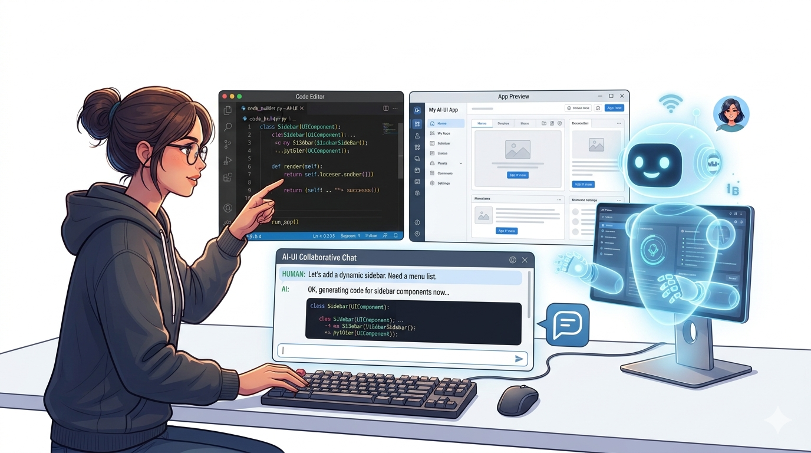
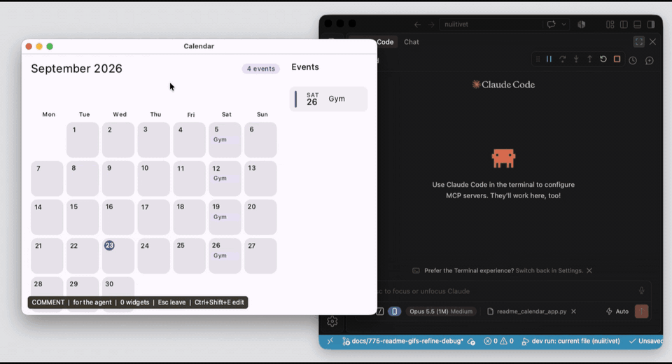
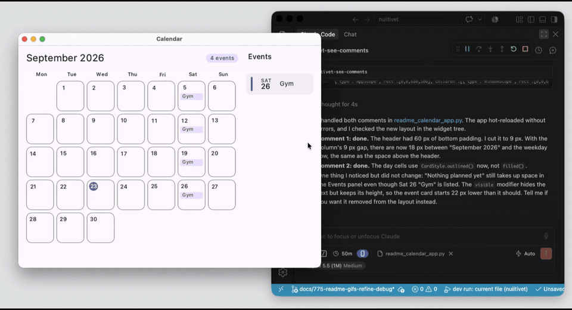
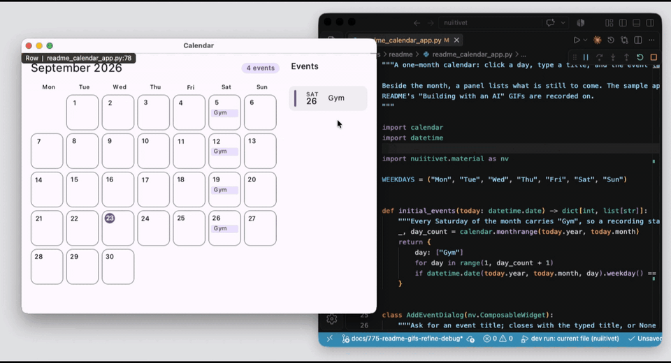
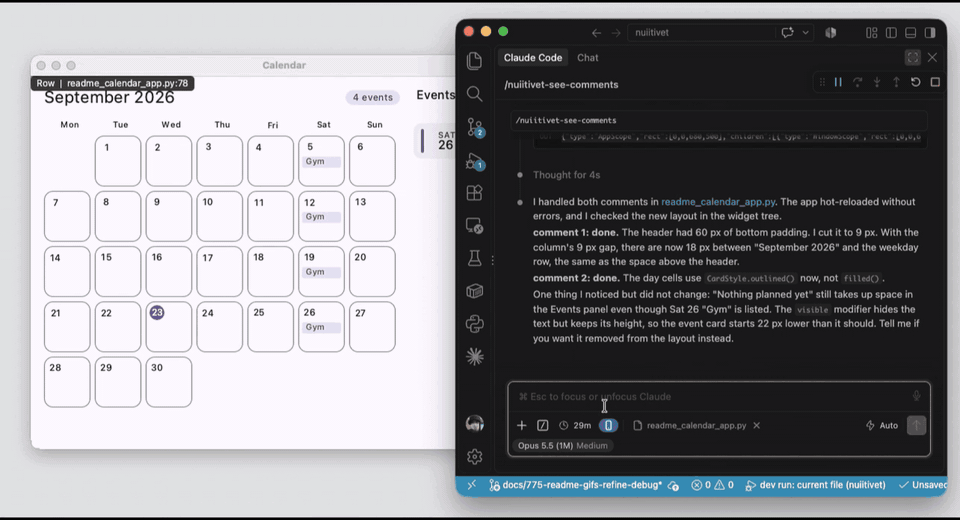
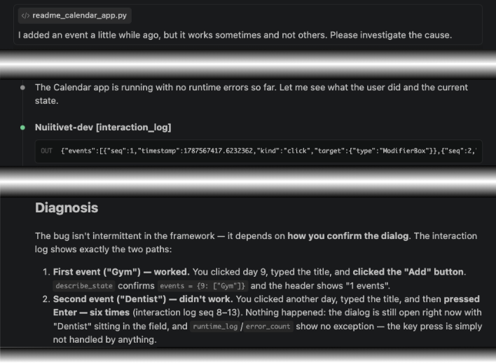
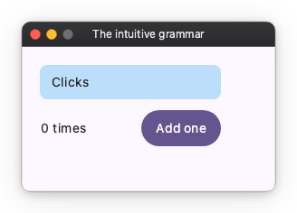

# Nuiitivet



**An intuitive UI framework for Python.**
Intuitive to read and write, and intuitive to build with a coding agent.

[](https://pypi.org/project/nuiitivet/)
[](https://pypi.org/project/nuiitivet/)
[](LICENSE)

---

## 1. Overview

Nuiitivet is a UI framework for Python: a declarative widget tree, reactive
state, Material Design 3. The UI is written in Python alone. There is no new
language.

### 1.1 Targets

- **Desktop (macOS / Windows / Linux)** is the main target. The OS integration
  a desktop app leans on is built in: file dialogs, the menu bar, the tray
  icon.
- **Web** is the secondary target. The app you wrote for the desktop runs in a
  browser from the same source. A browser has no threads, so the work that ran
  on a thread becomes a worker function or a server function; nothing else
  changes ([Web](docs/guide/web/index.md)).
- **Mobile** native apps are not built. For phones, ship a web app with a
  mobile-friendly layout.

### 1.2 Where it sits

Between Tkinter and PyQt / PySide. It is more modern to write than Tkinter,
and it does not aim at the large applications PyQt serves. The target is small
to mid-sized apps, and there is correspondingly less to learn.

The code looks like Flet's. The biggest difference is state management.
`Observable` is modelled on ReactiveProperty, a library widely used with WPF's
MVVM, and Rx operators work directly on it. `Observable` also moves a
worker-thread write back onto the UI thread for you, the step where things
tend to go wrong.

### 1.3 What ships

- **OS integration**: [file dialogs](docs/guide/window/file_dialogs.md),
  [file drop from the OS](docs/guide/modifiers/interaction.md),
  [menu bar](docs/guide/window/menu_bar.md),
  [notifications](docs/guide/window/notifications.md),
  [tray icon](docs/guide/window/tray_icon.md),
  [multiple windows](docs/guide/window/multi_window.md),
  [window chrome](docs/guide/window/chrome.md),
  [screen reader](docs/guide/window/screen_reader.md)
- **Shipping an executable**: recipes for PyInstaller and Nuitka
  ([Packaging](docs/guide/packaging/index.md)). One executable, onto a machine
  with no Python on it
- **Background work**: a write to an `Observable` from a worker thread is
  marshalled onto the UI thread. Progress, cancellation, leaving the screen
  mid-run, a worker that raises: all of them have an answer   ([Background Work](docs/guide/state-management/background_work.md))
- **Hot reload**: a save rebuilds the window in place, and the state your
  `Observable`s hold survives

### 1.4 Limits

By design, a desktop app opens an OS window, so a headless machine with no
display cannot run one. A GPU is recommended; without one, rendering falls
back to CPU raster ([Renderer Selection](docs/guide/window/renderer_selection.md)).

### 1.5 Getting started

Python 3.11 or higher is required.

```bash
pip install 'nuiitivet[dev]'
python -m nuiitivet.dev run app.py
```

Plain `nuiitivet` runs an app and the dev runner, hot reload included. `[dev]`
adds the dev bridge that coding agents use. Installing the skills and registering
the MCP server is covered in [Set up](docs/guide/coding_agent/setup.md). For a first app, the card at the end of
[3. The intuitive grammar](#3-the-intuitive-grammar) runs as it is.

---

## 2. Building with a coding agent

Everything in this chapter turns on when you launch through the dev runner.

```bash
python -m nuiitivet.dev run app.py
```

Ask a coding agent, and the first version of an app is on screen in no time.
It is rarely the version you wanted, so a back-and-forth follows.

- **Refine**: the back-and-forth that brings what works closer to what you want
- **Debug**: the back-and-forth that fixes what behaves wrong

Both can be done through chat, and you have probably felt how hard some of it
is to put into prose. With Nuiitivet, you drag, mark and comment on the running
app itself. The agent looks at the same screen, edits, drives it, and checks.
The centre of your communication with the agent moves from the chat to the
app.

### 2.1 Refine

There are three things you can do on the app's own screen.

#### Write the prompt on the app

In an app with many widgets, **where** is the hard part.

`Ctrl+Shift+C` (`Cmd+Shift+C` on macOS) enters comment mode. Click a widget as
it is, or drag over an area where there is nothing to click, and write your
comment right there, on what you marked. There is no need to work out how to
say where: you point with the mouse.

When you are done, run `/nuiitivet-see-comments` in chat. The agent reads the
comments, changes the app as they say, and drives the app itself to check.
With `/nuiitivet-see-comments watch`, run once per session, the agent answers
every **Send** you make in the app, and no chat message is needed again
([Comment mode](docs/guide/coding_agent/comment_mode.md)).

Below, a calendar app gets these comments:

> 1: too much space, match the top
>
> 2: outlined

The first marks the gap under the month title. The second marks a day cell.
The agent narrows the gap and gives the day cells an outline.



#### Change the layout directly

A size, an alignment, the order inside a `Row`: some changes are not worth an
instruction. They are all layout.

`Ctrl+Shift+E` (`Cmd+Shift+E` on macOS) enters layout edit mode. Drag the
app's own screen to change the layout. The change is written into the source
code. It costs no turn and no tokens.



#### Jump to the source, to check it or edit it

Even when an agent writes the code, human code review does not go to zero.
And a senior engineer is sometimes faster writing the code than instructing an
agent.

`Ctrl+Shift+Click` (`Cmd+Shift+Click` on macOS) opens the source code that
built the widget you clicked, in your editor. The code you want to check, or
to edit, is one click away.



### 2.2 Debug

There are two things the agent can do.

#### The agent sees the app, and drives it

- **See**: the widget tree, the live `Observable` values behind it, a
  screenshot
- **Act**: click, type, scroll, send keys. Targets are named by `key` /
  `label` rather than coordinates, so they survive a layout change
- **Wait**: for async work to settle

So you can ask it to "use this app like a user would". Below, the agent gets
this prompt:

> Test the Events list in the running app. By spec, it lists only events from
> today onward.

The agent adds events and checks the list. It finds a bug at the boundary: an
event for today does not show up.



The agent's last message:

> Cause: the filter at readme_calendar_app.py:132 keeps only
> `day > self.today.day`, so today's events are dropped. It should be `>=`.

#### The agent sees what you did, too

Writing down the steps that reproduce a bug is a chore. The
[dev bridge](#the-dev-bridge) records the actions you took in the app. For
privacy, the text you type is never recorded.

So you walk into the bug once, by hand, and that is enough. Write "this
happened" on the spot in comment mode, or say it in chat. The agent reads the
record, replays the same actions, sees the symptom for itself, and then fixes
it.

The example below is a "works sometimes, fails sometimes" case. Every attempt
is in the record, so the agent compares them and finds the one step that
differed.



### 2.3 What makes this possible

#### The UI is all Python

Python is all you read and all you write. There is no new language to learn,
and it is a language the agent writes well.

A widget is a Python object, and each one corresponds to one expression in
your code. That is why an edit made on a displayed widget can be written
straight back into the code, and why the source jump works.

#### Hot reload

Every save **hot reloads** the app: the window is rebuilt **in place**, no
restart. And the state your `Observable`s hold **survives**: the screen you
reached with twelve clicks is not thrown away because you saved a file.
Reloads also go through with a VS Code **F5** debug session attached, and your
breakpoints stay.

#### The dev bridge

The dev bridge is an MCP server. MCP is the standard that connects agents to
tools, so no per-agent plugin is needed: Claude Code or GitHub Copilot, it
works the same way.

It opens only under the dev runner and listens only on localhost. It is not
part of the app you ship.

#### Skills

Plainly: the agent does not know Nuiitivet. There is not enough of it in the
training data. The bundled skills fill that gap.

- **`nuiitivet-app`**: keeps the code idiomatic. Ships with a linter
- **`nuiitivet-debug`**: teaches the agent hot reload and the dev bridge:
  launch, see, act, check, down to reading the tree before spending a
  screenshot

Installing them is covered in [Set up](docs/guide/coding_agent/setup.md).

---

## 3. The intuitive grammar

A jump to the code is no use if the code it lands on cannot be read: no
review, no touch-up. Nuiitivet takes the good parts of several frameworks,
aiming at a grammar that is intuitive to read and to write. This chapter
builds one small card, a few lines at a time.

### 3.1 Lay out with a widget tree and parameters

```python
import nuiitivet.material as nv

nv.Column(
    [
        nv.Text("Clicks"),
        nv.Button("Add one"),
    ],
    gap=12,
    padding=20,
)
```

A screen is a tree of widgets, as in Flutter. Spacing and sizes are
parameters: `padding`, `gap`, `width`, `height`. Those parameters are all that
decides the layout.

In Flutter, a padding and a width are widgets wrapped around the text, so the
nesting grows with every decoration. Here they are parameters of the widget
itself:

```python
nv.Text("Clicks", padding=12, width=200)
```

A size is a number, `"auto"` (fit the content), or `"wt"` (a share of the
space that is left, what WPF writes as `*`). There is no `margin`. Spacing is
`padding` and `gap` only: the habit CSS authors settle into, made the rule.

### 3.2 Add everything else with modifiers

What is not layout, such as a background, rounded corners, a tooltip, a click,
is attached as a **modifier**. Modifiers chain with `|`, the way they chain in
SwiftUI and Compose:

```python
nv.Text("Clicks", padding=12, width=200).modifier(
    nv.background("#BBDEFB") | nv.corner_radius(8)
)
```

So the code itself tells the two apart: the parameters are the layout, the
modifier chain is everything else.

### 3.3 Show state by binding it

```python
count = nv.Observable(0)

nv.Text(count.map(lambda n: f"{n} times"))  # follows count on its own
```

`Observable` is modelled on ReactiveProperty, from WPF's MVVM. Hand the
`Observable` to the widget and the widget follows it; there is no `setState`
and nothing to refresh by hand.

### 3.4 Handle events with ordinary code

```python
def handle_add(self) -> None:
    self.count.value += 1
    if self.count.value % 10 == 0:
        print("Milestone reached!")
```

```python
nv.Button("Add one", on_click=self.handle_add)
```

What the screen shows is declared: the tree, and the values bound into it.
What happens on a click is a different kind of thing: read a value, change
it, branch on the result. That is a procedure. Forced into a declarative shape
it only gets harder to follow, so a handler is an ordinary method, written top
to bottom, the way you would say it aloud.

### 3.5 The whole card

This is your first app. Save it and run it as it is.

```python
import nuiitivet.material as nv


class CounterCard(nv.ComposableWidget):
    def __init__(self) -> None:
        super().__init__()
        self.count = nv.Observable(0)

    def handle_add(self) -> None:
        self.count.value += 1
        if self.count.value % 10 == 0:
            print("Milestone reached!")

    def build(self) -> nv.Widget:
        return nv.Column(
            [
                nv.Text("Clicks", padding=12, width=200).modifier(nv.background("#BBDEFB") | nv.corner_radius(8)),
                nv.Row(
                    [
                        nv.Text(self.count.map(lambda n: f"{n} times"), width="wt"),
                        nv.Button("Add one", on_click=self.handle_add),
                    ],
                    gap=12,
                    width=200,
                    cross_alignment="center",
                ),
            ],
            gap=12,
            padding=20,
        )


def build_root() -> nv.Widget:
    return CounterCard()


nv.App(nv.Window(content=build_root)).run()
```



What is borrowed, in one list:

- **Flutter**: the widget tree
- **SwiftUI / Compose**: modifiers that chain
- **CSS**: spacing with `padding` and `gap` alone, no `margin`; `Grid` cells
  placed by area name
- **WPF**: `Grid` layout, `*`-style weight sizing (`"wt"` here), and
  ReactiveProperty for state

Where it departs from them, it is to keep the code readable:

- Layout is a **parameter**, not a wrapper, so the nesting does not grow
- Decoration and behavior are attached as **modifiers**, chained with `|`
- Event handlers are written as **procedures**, not declarations

[The intuitive grammar](docs/guide/intuitive_grammar/index.md) continues from
here.

---

## 4. Documentation

For a deep dive into Nuiitivet's design, visit the **[docs site](https://yuksblog.github.io/nuiitivet/)**. Browse runnable
examples in **[samples/](samples/)**. The calendar app shown in this README is
[samples/readme/readme_calendar_app.py](samples/readme/readme_calendar_app.py),
and the card is [samples/intuitive_grammar/counter_card.py](samples/intuitive_grammar/counter_card.py).

| Guide | Summary |
| ----- | ------- |
| [The intuitive grammar](docs/guide/intuitive_grammar/index.md) | What is borrowed from Flutter, SwiftUI / Compose, CSS and WPF, in one small card. |
| [Layout](docs/guide/layout/index.md) | Build UIs with widgets and parameters. |
| [State Management](docs/guide/state-management/index.md) | Reactive `Observable` state that auto-updates the UI. |
| [Modifiers](docs/guide/modifiers/index.md) | Attach decoration and behavior to widgets. |
| [UI Design System](docs/guide/design-system/index.md) | Theming, design tokens, and the Material Design 3 widget catalog. |
| [Overlay](docs/guide/overlay/index.md) | Dialogs, loading, and overlays. |
| [Navigation](docs/guide/navigation/index.md) | Screens, routes, and transitions. |
| [Window & Chrome](docs/guide/window/index.md) | Window sizing, custom chrome, and OS integration. |
| [Concurrency](docs/guide/concurrency.md) | Choosing a concurrency tool, and safe UI updates from background work. |
| [With a coding agent](docs/guide/coding_agent/index.md) | The on-screen modes, hot reload, the dev bridge, and the skills. |
| [Web](docs/guide/web/index.md) | Run the same source in a browser. |
| [Packaging](docs/guide/packaging/index.md) | Ship your app to users. |

---

## 5. License

Nuiitivet is licensed under the Apache License 2.0. See [LICENSE](LICENSE) for
more info.
