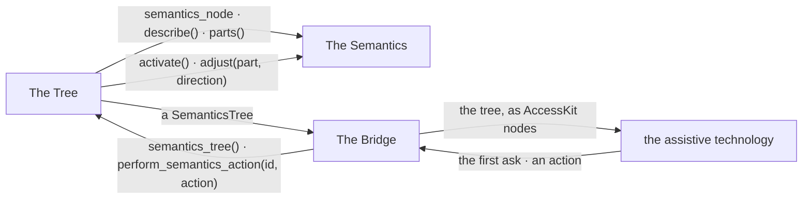
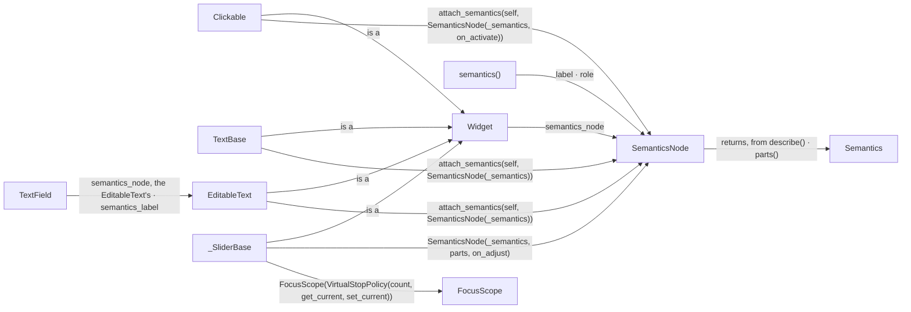
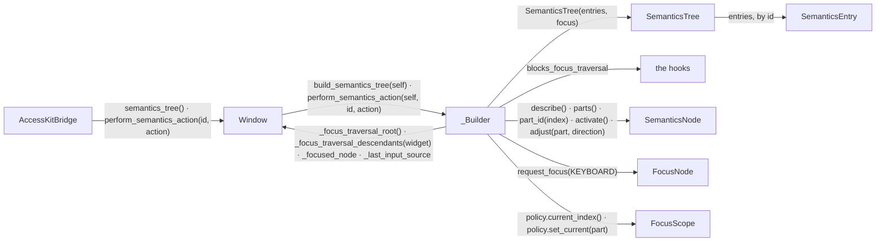
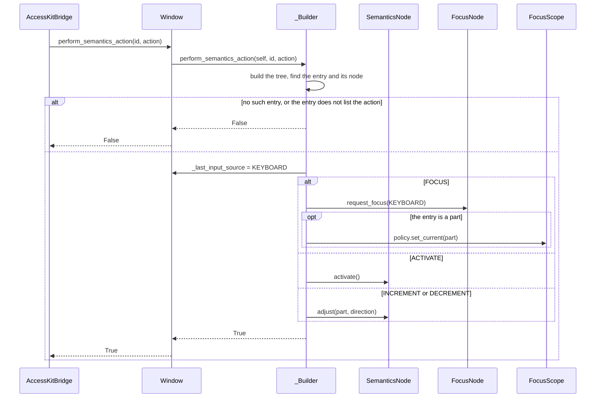
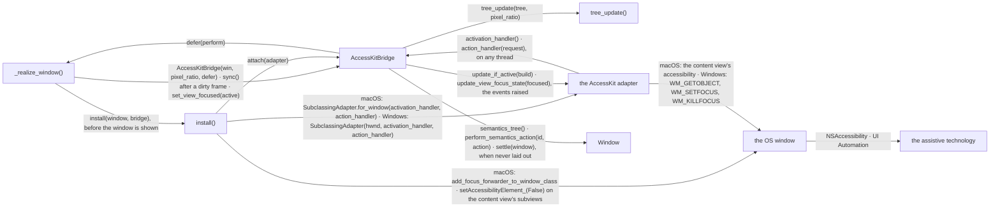
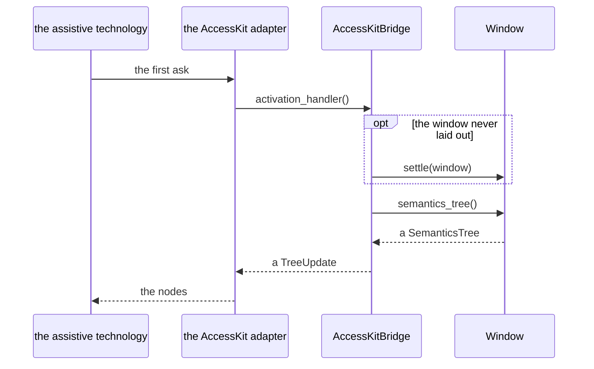
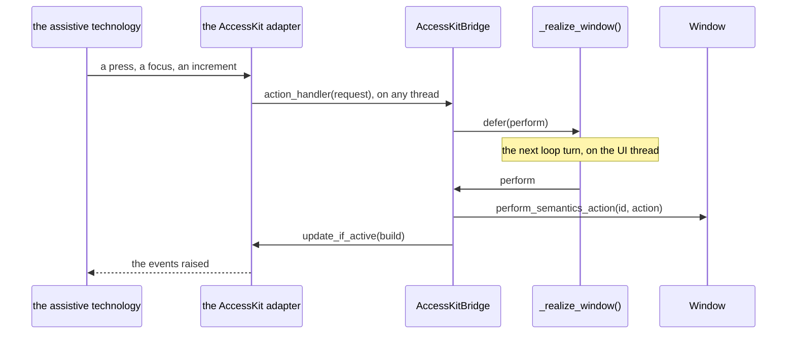

# Accessibility

The window assembles what its widgets say about themselves into a tree of
entries. A bridge hands that tree to the OS, where assistive technology
reads it.

## Overview

Three groups of modules take part, between the widgets and the assistive
technology.

### Structure

| Module | Role |
| --- | --- |
| The Semantics | the node, the value it answers in, the modifier that overrides the answer, the widgets that attach one |
| The Tree | the walk that turns the answers into entries, the focused entry, the actions |
| The Bridge | the tree as AccessKit takes it, the adapter on the OS window, the frame that pushes an update |
| the assistive technology | reads the tree through the OS, sends an action back |

### Promises

- A widget says what it is. Only the window builds the tree. Only the bridge
  talks to the OS.
- A widget's answer is read when the tree is built. Nothing is kept between
  two trees but the ids.
- A tree holds no widget. The bridge names an entry by its id.
- The tree is asked for on the UI thread, after a layout.

## The Semantics

A `SemanticsNode` answers for the widget that carries it, in a `Semantics`
value. A widget that draws several controls itself answers for each as a
part, an entry beneath its own.

### Structure

| Module | Role |
| --- | --- |
| `Widget` | answers with its node, or with none |
| `Clickable` | the host most controls inherit; says it is a button unless a subclass says otherwise |
| `TextBase` | a text; says its string |
| `EditableText` | a text field; says its content |
| `TextField` | answers with its `EditableText`'s node, hands it the label |
| `_SliderBase` | a slider; a range slider is a group with its handles as parts |
| `semantics()` | writes a label, or one per part, and a role on the widget's node, attaching one when there is none |
| `SemanticsNode` | holds the id, the overrides, the callbacks into the widget |
| `Semantics` | what one entry says, an immutable value |
| `FocusScope` | the stops the parts line up with ([INTERACTION_ARCHITECTURE.md](INTERACTION_ARCHITECTURE.md)) |

### Promises

- A widget answers with one node or none. A widget that answers with none
  has no entry. Its children still have theirs.
- A widget may answer with a descendant's node. That node has one entry, at
  the outer widget's rect.
- A label or a role written by `semantics()` replaces the widget's own. A
  list of labels replaces the parts' own, in their order.
- A node's id lasts as long as the node. So does the id of each part.
- Node ids and part ids come from one counter. It never gives 0, the id of
  the window's entry.
- A host that has parts has one per stop of its focus scope, in the stops'
  order.

## The Tree

A `_Builder` walks a window once per request. It returns the entries with
the focused one, or carries one action to a widget.

### Structure

| Module | Role |
| --- | --- |
| `AccessKitBridge` | asks for the tree, sends an action back (The Bridge) |
| `Window` | `semantics_tree()` and `perform_semantics_action()`, the walk's root, the focused node, the last input source |
| `_Builder` | builds the entries from the nodes the walk meets, finds the focused entry, finds the node an action goes to |
| `SemanticsTree` | the entries by id, the window's own at the root, the id of the focused one |
| `SemanticsEntry` | one entry, with its rect, its children and the actions it takes |
| the hooks | what hides or narrows the walk ([INTERACTION_ARCHITECTURE.md](INTERACTION_ARCHITECTURE.md)) |
| `SemanticsNode` | the answers the entries are built from (The Semantics) |
| `FocusNode`, `FocusScope` | where the focus is, which stop is current ([INTERACTION_ARCHITECTURE.md](INTERACTION_ARCHITECTURE.md)) |

### Sequence

#### An action reaches a widget

### Promises

- The walk starts at the Tab sequence's root. It steps through the same
  children.
- A blocked widget that says nothing is left out with its subtree.
- A blocked host that says something keeps its entry. Nothing beneath it has
  one.
- An entry that is not a group, a menu or a radio group takes the text
  beneath it as its label when it has none. That text has no entry of its
  own.
- An entry with a label hides the text beneath it.
- The focused entry is the entry of the focused node's host, else of the
  nearest ancestor that has one, else the window's.
- When the focused host has parts, the focused entry is the part at its
  scope's current index.
- An action is looked up in the tree as it is at that moment.
- An action runs only when its entry lists it.
- A disabled entry lists no action.
- An action counts as keyboard input.

## The Bridge

An `AccessKitBridge` keeps one window's tree in an AccessKit adapter on the
OS window. The pyglet runner installs it on macOS and on Windows, on a
window not yet shown.

### Structure

| Module | Role |
| --- | --- |
| `_realize_window()` | the runner's setup of one OS window; creates it hidden, installs the bridge, shows it, pushes after a frame that changed something, reports the window's activation, runs a deferred action on the next loop turn through a posted event |
| `AccessKitBridge` | answers the adapter's two callbacks, builds the update, pushes it |
| `tree_update()` | turns a `SemanticsTree` into the whole-tree update AccessKit takes, with the root scaled to backing pixels |
| `install()` | `accessibility_macos.py`: subclasses the content view with the adapter, routes the OS window's focused element to the content view, hides the content view's subviews. `accessibility_windows.py`: subclasses the HWND with the adapter; the bridge's report of the activation is a no-op there |
| the AccessKit adapter | AccessKit's macOS adapter, answering for the content view; or its Windows adapter, answering `WM_GETOBJECT` and following `WM_SETFOCUS` / `WM_KILLFOCUS` itself |
| the OS window | the NSWindow and its content view, which answers the focused element; or the HWND |
| `Window` | the tree and the actions (The Tree) |
| the assistive technology | VoiceOver, Narrator, NVDA, or any client of the accessibility API |

### Sequence

#### The assistive technology asks for the tree

#### An action from the assistive technology

### Promises

- The adapter is installed before the OS window is first shown.
- A callback the adapter runs never raises. It returns the tree or queues;
  it never pushes an update.
- An action runs on the next turn of the UI loop, on the UI thread,
  whichever thread it arrived on.
- The tree is pushed after a frame that changed something. It is pushed
  after an action.
- Nothing is built while no assistive technology listens.
- The adapter holds the OS window's activation, from the install on and at
  each change.
- On macOS the OS window answers the focused element through its content
  view. No subview of the content view is an accessibility element.
- The rects go out in backing pixels, through the root's transform.
- An install that fails leaves the app running without a bridge.
