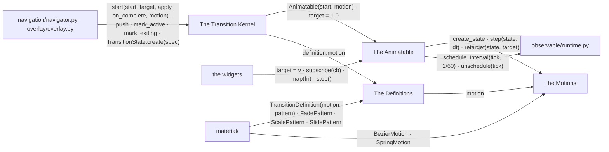
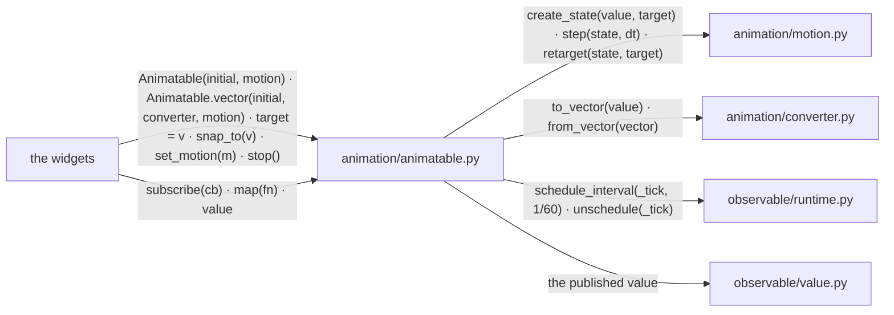
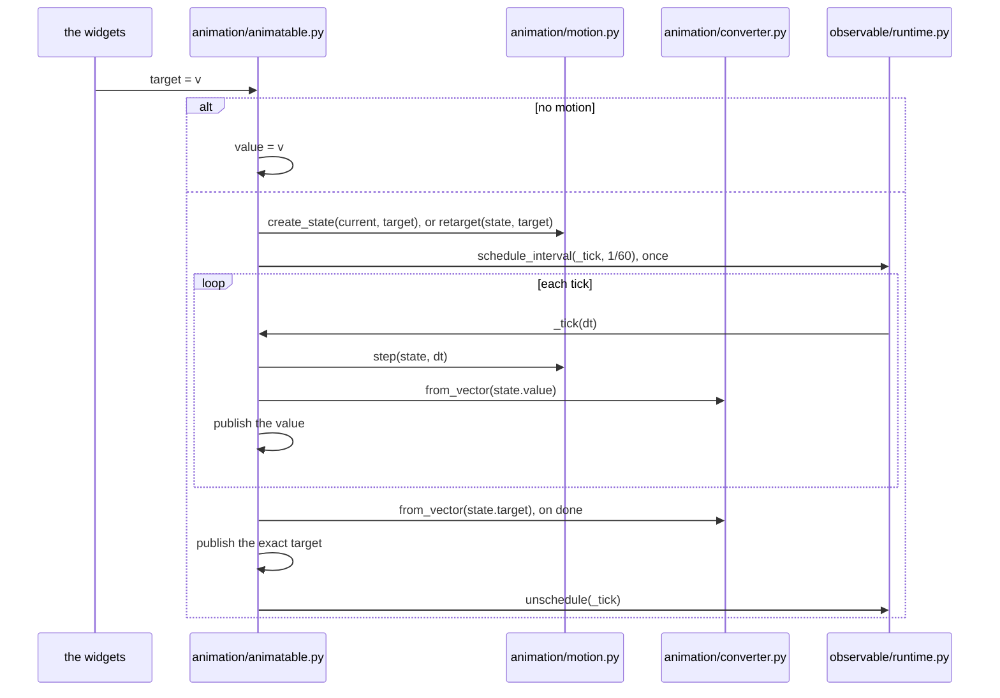
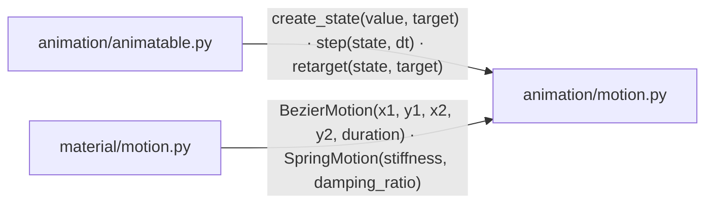
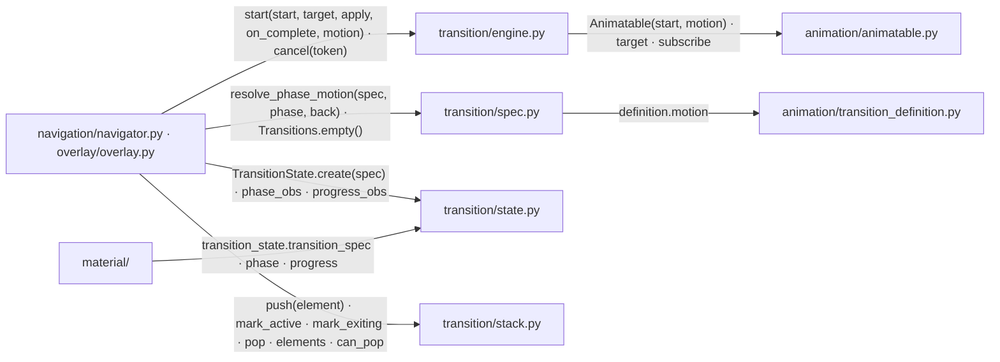
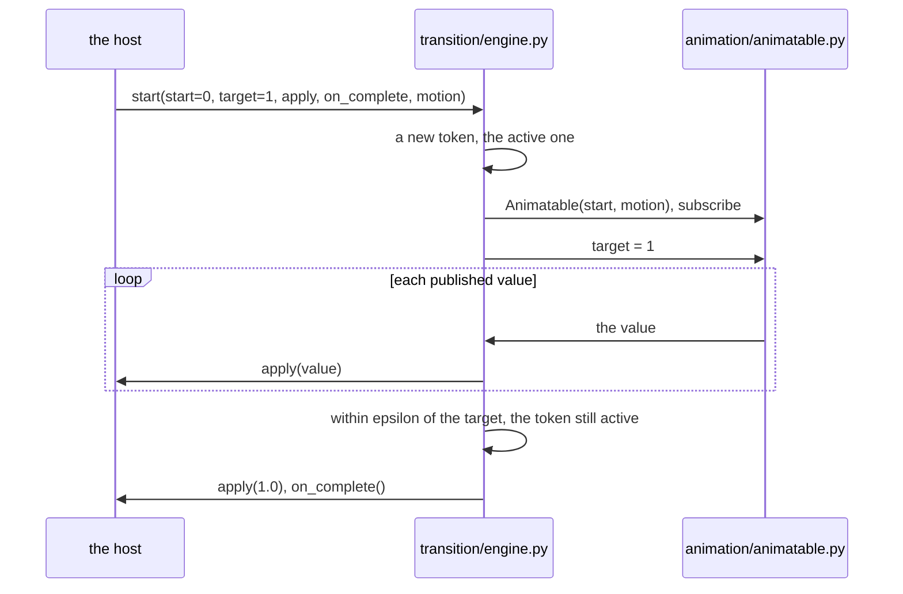
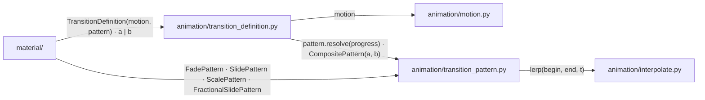

# Animation System

An animation is a value that moves toward a target. A widget assigns the
target and subscribes to the value.

## Overview

Four groups of modules take part.

### Structure

| Module | Role |
| --- | --- |
| The Animatable | the retargetable value |
| The Motions | the arithmetic of one step |
| The Transition Kernel | the enter and exit driver, and a stack's bookkeeping |
| The Definitions | the building block of a design system's transitions |
| `observable/runtime.py` | the clock a tick is scheduled on ([OBSERVABLE.md](OBSERVABLE.md)) |
| the widgets | assign targets and bind values |
| `navigation/navigator.py · overlay/overlay.py` | the two stacks the kernel serves ([NAVIGATION.md](NAVIGATION.md), [OVERLAY.md](OVERLAY.md)) |
| `material/` | the MD3 definitions and the visual resolution ([MATERIAL_INTERACTION.md](MATERIAL_INTERACTION.md)) |

### Promises

- No widget drives a timeline by hand.
- `animation/` and `transition/` import nothing from `widgeting/`.

## The Animatable

`Animatable[T]` owns the current value and the target.

### Structure

| Module | Role |
| --- | --- |
| `animation/animatable.py` | `Animatable`: the value, the target, the motion state, the ticker |
| `animation/motion.py` | advances a state (The Motions) |
| `animation/converter.py` | maps a domain value to a vector of floats and back |
| `observable/runtime.py` | the clock ([OBSERVABLE.md](OBSERVABLE.md)) |
| `observable/value.py` | the `State` the value is published through ([OBSERVABLE.md](OBSERVABLE.md)) |
| the widgets | assign a target, bind the value |

### Sequence

#### A target is assigned

### Promises

- An animatable ticks only while its value differs from its target.
- Without a motion the value jumps to the target.
- The last published value is the exact target.

## The Motions

A `Motion` creates a state, advances it by `dt` and retargets it.

### Structure

| Module | Role |
| --- | --- |
| `animation/motion.py` | `MotionState`, vectors of one dimension; `LinearMotion` and `BezierMotion`, time-based; `SpringMotion`, physics |
| `animation/animatable.py` | the caller (The Animatable) |
| `material/motion.py` | the MD3 curves ([MATERIAL_INTERACTION.md](MATERIAL_INTERACTION.md)) |

### Promises

- A retarget never reverses. It never restarts from the original start.
- A time-based motion continues from the current value with its elapsed
  time reset. A spring keeps its velocity.

## The Transition Kernel

The kernel drives one enter or exit from 0 to 1. It tracks which entries of
a stack are entering, active and exiting.

### Structure

| Module | Role |
| --- | --- |
| `transition/engine.py` | `TransitionEngine`: one animatable from 0 to 1 per transition, a token per start, the exact completion |
| `transition/spec.py` | `TransitionSpec`, an opaque lifecycle token, and `Transitions.empty()`, the token with no motion; the lookup of a phase's motion |
| `transition/state.py` | `TransitionState`: the phase and the progress as `State`s |
| `transition/stack.py` | `StackRuntime`: the entries by identity, each entering, active, exiting or disposed |
| `animation/animatable.py` | the value the engine drives (The Animatable) |
| `animation/transition_definition.py` | where a spec's motion comes from (The Definitions) |
| `navigation/navigator.py · overlay/overlay.py` | the hosts, which render and animate ([NAVIGATION.md](NAVIGATION.md), [OVERLAY.md](OVERLAY.md)) |
| `material/` | resolves the visuals from the state ([MATERIAL_INTERACTION.md](MATERIAL_INTERACTION.md)) |

### Sequence

#### A transition is started and completes

### Promises

- A core `TransitionSpec` carries no visual policy.
- A completion whose token is no longer active is dropped.

## The Definitions

A `TransitionDefinition` pairs a motion with a pattern from progress to
visuals.

### Structure

| Module | Role |
| --- | --- |
| `animation/transition_definition.py` | `TransitionDefinition`, a motion and a pattern; the pipe operator composes two |
| `animation/transition_pattern.py` | the patterns, each resolving a progress into `TransitionVisuals`; the merge of two |
| `animation/interpolate.py` | the interpolation arithmetic |
| `animation/motion.py` | the motion a definition carries (The Motions) |
| `material/` | builds the MD3 definitions ([MATERIAL_INTERACTION.md](MATERIAL_INTERACTION.md)) |

### Promises

- `a | b` keeps the left definition's motion. Both patterns apply.
- A pattern maps progress to visuals and nothing else.
