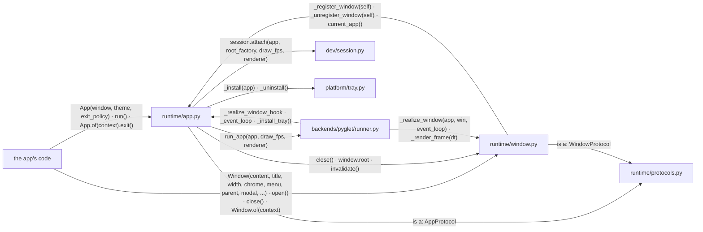
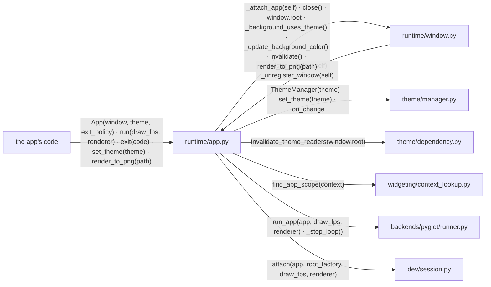
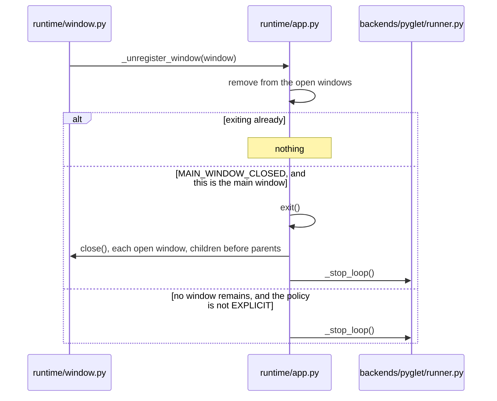
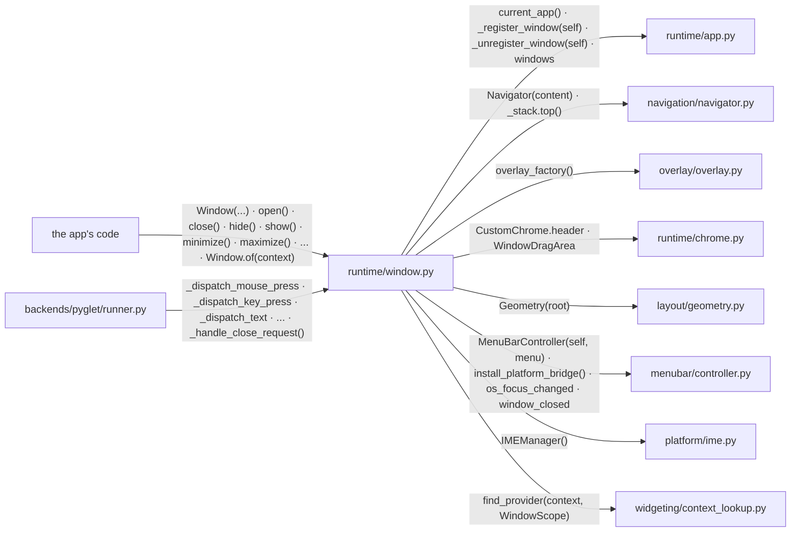
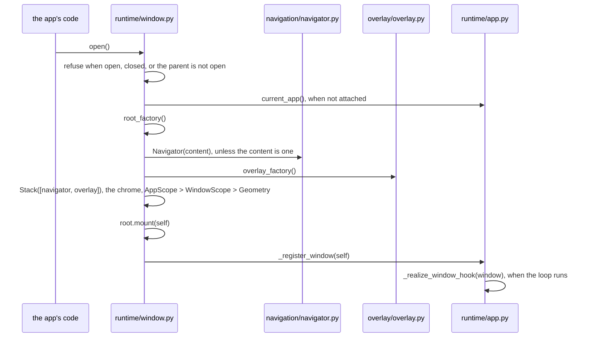
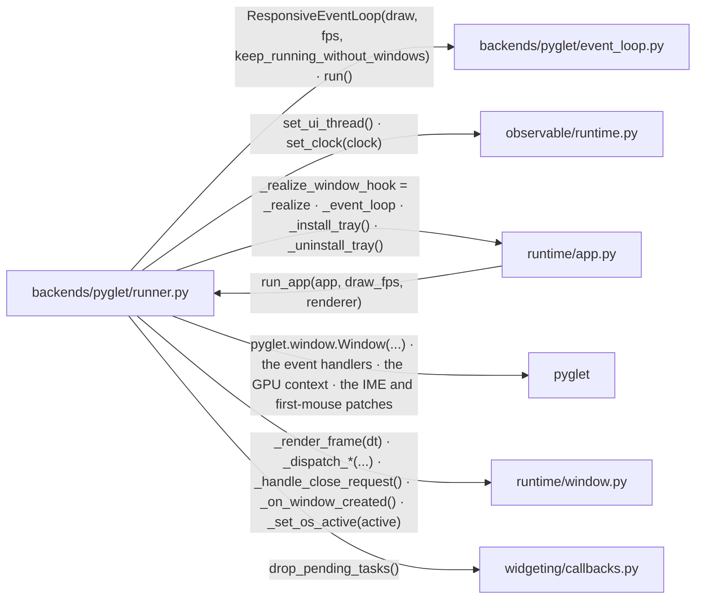
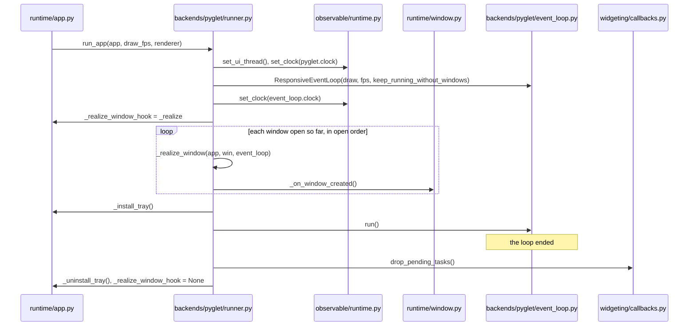

# App and Window

`App` is the process. It owns the event loop, the theme source and the
registry of windows. `Window` is one OS window with its widget tree,
overlay, navigator, focus state and menu bar.

## Overview

Three modules take part, with the protocols, the dev session and the
platform integrations at their edges.

### Structure

| Module | Role |
| --- | --- |
| `runtime/app.py` | `App`: the open windows, the main window, the exit policy, the theme fan-out, `run`; `AppScope`, the outermost widget of every window's tree |
| `runtime/window.py` | `Window`: the lifecycle, the tree with its navigator and overlay, the input dispatch, the frame; `WindowScope`, under the `AppScope` |
| `backends/pyglet/runner.py` | the event loop and the OS window of each `Window` |
| `runtime/protocols.py` | `AppProtocol` and `WindowProtocol`, what a ViewModel is typed against |
| `dev/session.py` | takes the app over from `run()` under the dev runner ([HOT_RELOAD.md](HOT_RELOAD.md)) |
| `platform/tray.py` | installed with the loop ([TRAY_ICON.md](TRAY_ICON.md)) |
| the app's code | constructs the app and its windows, resolves them by `.of()` |

### Promises

- Every window-flavoured keyword lives on `Window`. `App` takes none.
- Nothing below `Window` knows which window hosts it.
- `Window.of(context).close()` closes the context's own window. An operation
  addresses the object it was resolved through.

## The App

`App` holds the open windows in open order. It decides when `run()` returns.

### Structure

| Module | Role |
| --- | --- |
| `runtime/app.py` | `App`: the window list, the main window, `ExitPolicy`, the one `ThemeManager`, the loop handle, the realise hook; `AppScope` |
| `runtime/window.py` | registers on open, unregisters on close (The Window) |
| `backends/pyglet/runner.py` | the loop `run()` blocks on (The Runner) |
| `theme/manager.py` | holds the current theme ([STYLE_THEME.md](STYLE_THEME.md)) |
| `theme/dependency.py` | invalidates the theme readers of one tree ([THEME_CONSUMPTION.md](THEME_CONSUMPTION.md)) |
| `widgeting/context_lookup.py` | the walk to the `AppScope` behind `App.of` |
| `dev/session.py` | the hand-off that makes `run()` return at once ([HOT_RELOAD.md](HOT_RELOAD.md)) |
| the app's code | holds the app, calls `exit` through `AppProtocol` |

### Sequence

#### A window closes and the exit policy fires

### Promises

- `exit()` closes every window under every policy.
- A hidden window counts as open.
- A theme change is fanned out by the app to every open window. No scope
  wires a callback.

## The Window

A `Window` is a model until `open()`. `open()` turns it into a mounted
tree. `close()` finishes the object.

### Structure

| Module | Role |
| --- | --- |
| `runtime/window.py` | `Window`: the lifecycle state, the root factory, the chrome, the modal gates in the dispatch, the close action, the frame; `WindowScope` |
| `runtime/app.py` | the registry and the current app (The App) |
| `backends/pyglet/runner.py` | delivers the OS events (The Runner) |
| `navigation/navigator.py` | the root navigator, one per window ([NAVIGATION.md](NAVIGATION.md)) |
| `overlay/overlay.py` | the overlay, one per window ([OVERLAY.md](OVERLAY.md)) |
| `runtime/chrome.py` | the OS title bar, or a header drawn in the tree |
| `layout/geometry.py` | the root `Geometry` ([GEOMETRY.md](GEOMETRY.md)) |
| `menubar/controller.py` | the menu bar, one per window ([MENU_BAR.md](MENU_BAR.md)) |
| `platform/ime.py` | the IME geometry, one per window ([TEXT_EDITING.md](TEXT_EDITING.md)) |
| `widgeting/context_lookup.py` | the ancestor search behind `Window.of` |
| the app's code | opens, closes and operates windows |

### Sequence

#### A window opens

### Promises

- A closed window stays closed. A reload never resurrects one.
- Every open window's tree is `AppScope > WindowScope > Geometry > the
  content`. The scopes make the app and the window findable and do nothing
  else.
- Closing a parent closes its children first, transitively.
- A window blocked by an open modal child consumes keyboard input. It drops
  pointer input. The gates sit in the dispatch entry points, below every OS
  event path.

## The Runner

The pyglet runner owns the process-wide setup and the loop. It turns each
open `Window` into an OS window.

### Structure

| Module | Role |
| --- | --- |
| `backends/pyglet/runner.py` | `run_app`: the DPI awareness, the clock, the loop, the realise hook, the tray; `_realize_window`: the pyglet window, its event wiring, the per-window GPU state, the patches |
| `backends/pyglet/event_loop.py` | `ResponsiveEventLoop`: draws the open windows on demand, keeps running without windows when told to ([RENDERING_PIPELINE.md](RENDERING_PIPELINE.md)) |
| `runtime/window.py` | the host protocol the OS events are dispatched into (The Window) |
| `runtime/app.py` | the windows to realise, the hook for later ones (The App) |
| `observable/runtime.py` | the UI thread and the clock ([OBSERVABLE.md](OBSERVABLE.md)) |
| `pyglet` | the windows, the GL context, the events |
| `widgeting/callbacks.py` | the async work left pending when the loop ends ([ASYNCIO_INTEGRATION.md](ASYNCIO_INTEGRATION.md)) |

### Sequence

#### The loop starts and ends

### Promises

- The UI thread is the thread that installs the clock.
- Every open window has an OS window while the loop runs.
- A window's OS events enter the `Window`'s dispatch methods. Nothing in the
  runner reads the tree.
