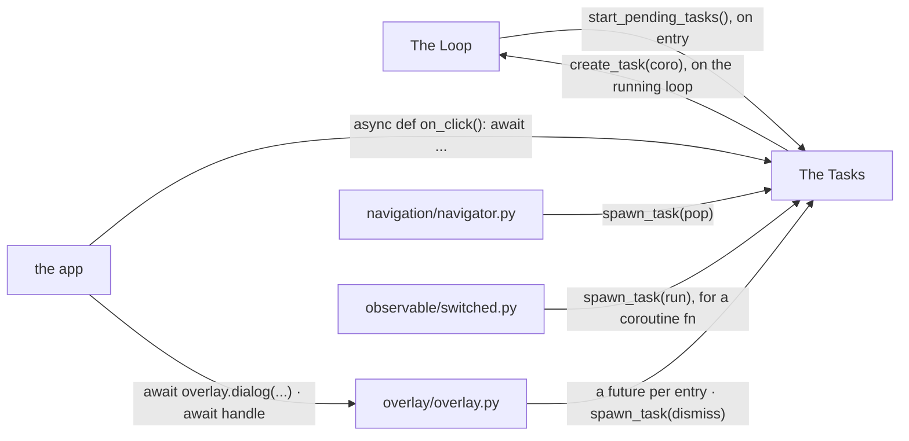
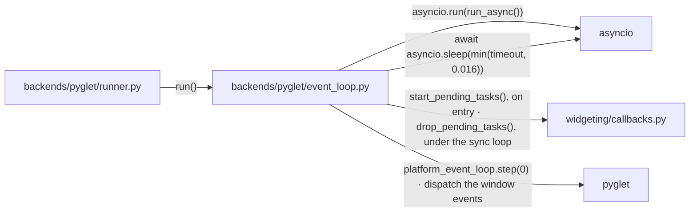
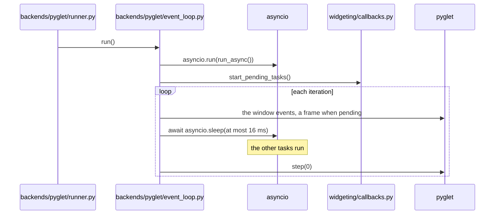
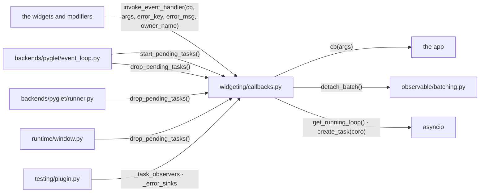
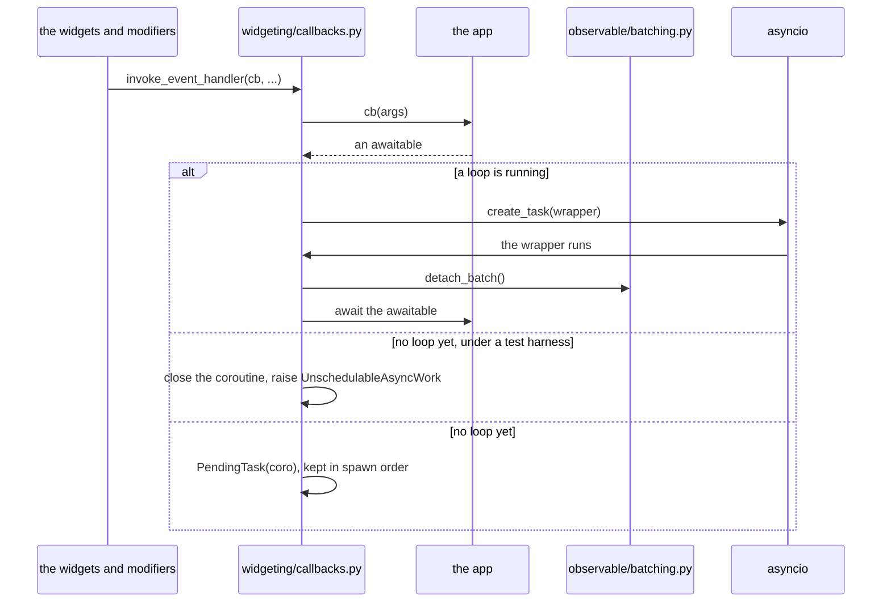

# Asyncio Integration

The framework owns the asyncio runtime. Application code writes `await`
without managing an event loop.

## Overview

Two groups of modules take part, with the awaitables the framework hands out
at their edges.

### Structure

| Module | Role |
| --- | --- |
| The Loop | pumps the platform loop inside an asyncio loop |
| The Tasks | the running tasks, and the work kept until a loop runs |
| `overlay/overlay.py` | an awaitable handle per entry ([OVERLAY.md](OVERLAY.md)) |
| `navigation/navigator.py` | an awaited pop, gated on `will_pop` ([NAVIGATION.md](NAVIGATION.md)) |
| `observable/switched.py` | a coroutine `fn` run as a task ([CONCURRENCY_MODEL.md](CONCURRENCY_MODEL.md)) |
| the app | writes `async` handlers and awaits the framework's futures |

### Promises

- An `async` handler runs on the UI thread.
- Every task the framework creates is born in `spawn_task`.

## The Loop

On the desktop `ResponsiveEventLoop.run_async` pumps pyglet inside an
asyncio loop. In a browser the page's own loop drives asyncio.

### Structure

| Module | Role |
| --- | --- |
| `backends/pyglet/event_loop.py` | pumps pyglet inside an asyncio loop, or runs synchronously as a fallback |
| `widgeting/callbacks.py` | the work kept until a loop runs (The Tasks) |
| `pyglet` | the platform events and the windows |
| `asyncio` | the loop the pump runs inside |
| `backends/pyglet/runner.py` | starts the loop ([APP_WINDOW.md](APP_WINDOW.md)) |

### Sequence

#### The pump yields between frames

### Promises

- Under the synchronous loop an `await` on a framework future never
  completes.

## The Tasks

`widgeting/callbacks.py` turns an awaitable a handler returned into a task,
or keeps it until a loop runs.

### Structure

| Module | Role |
| --- | --- |
| `widgeting/callbacks.py` | turns a handler's awaitable into a task, or keeps it as a `PendingTask` until a loop runs; the hooks a harness observes through |
| `observable/batching.py` | the batch the task detaches from ([OBSERVABLE.md](OBSERVABLE.md)) |
| `asyncio` | the running loop |
| `backends/pyglet/event_loop.py` | starts the kept work on entry (The Loop) |
| `backends/pyglet/runner.py` | drops the kept work after the loop ([APP_WINDOW.md](APP_WINDOW.md)) |
| `runtime/window.py` | drops the kept work after a headless render ([APP_WINDOW.md](APP_WINDOW.md)) |
| `testing/plugin.py` | observes every task and every contained error ([CONCURRENCY_MODEL.md](CONCURRENCY_MODEL.md)) |
| the widgets and modifiers | invoke the app's handlers |
| the app | the handler, sync or async |

### Sequence

#### An async handler is invoked

### Promises

- A task detaches from the batch of the dispatch that started it.
- An exception in a task is contained.
- Kept work is dropped where no loop will come.
- Under a test harness, an exception in a task is re-raised.
