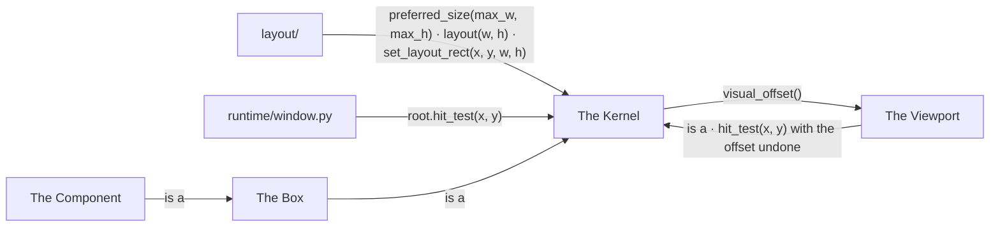
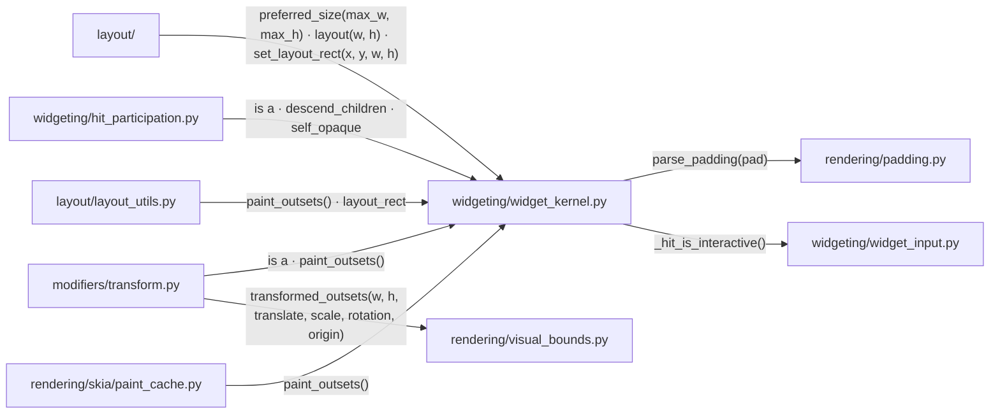
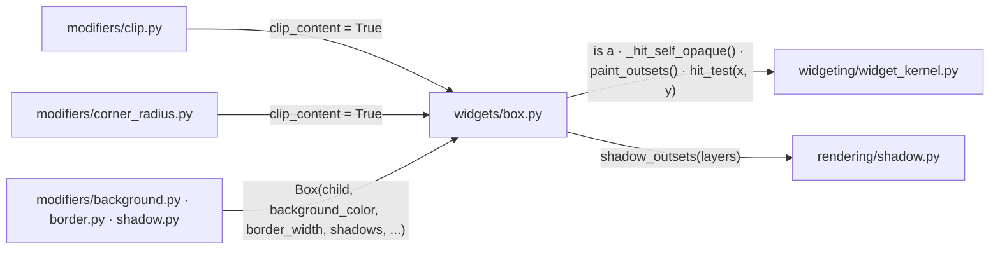
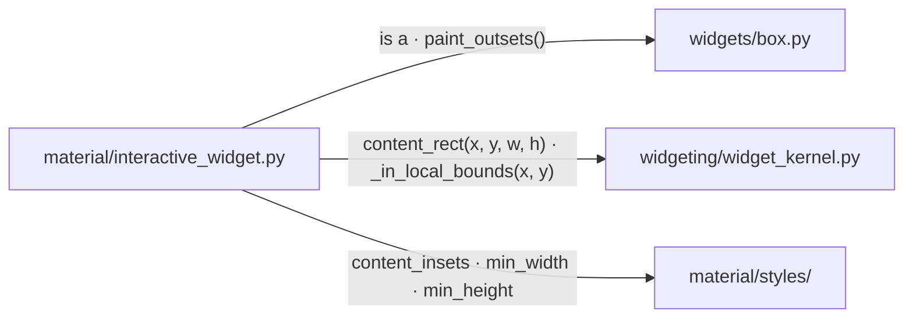
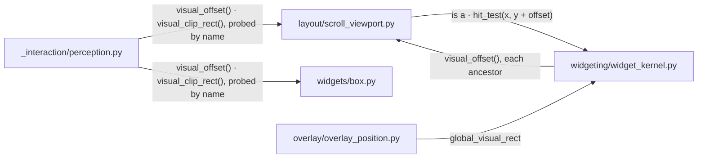
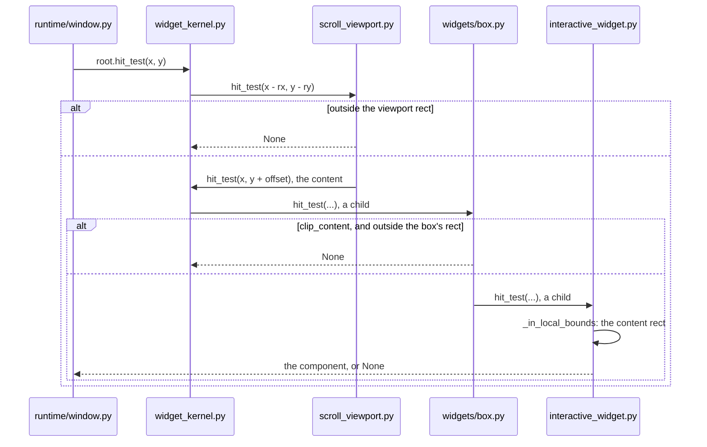

# Box Model

A parent hands a widget an allocated rect. The widget's padding insets it to
the content rect. A widget may paint past the allocated rect and reports how
far.

## Overview

Four modules give the rects their meaning: the kernel every widget is built
on, the box that paints a surface, the MD3 component, and the scroll
viewport that displaces its content.

### Structure



| Module | Role |
| --- | --- |
| The Kernel | the rects, the padding, the hit resolution, the overflow contract |
| The Box | a painted surface, a clip, a shadow |
| The Component | an MD3 container drawn inside the padding |
| The Viewport | content painted displaced and clipped |
| `layout/` | the containers that allocate rects ([LAYOUT.md](LAYOUT.md)) |
| `runtime/window.py` | the pointer dispatch ([INTERACTION_ARCHITECTURE.md](INTERACTION_ARCHITECTURE.md)) |

### Promises

- `Widget.padding` means allocated rect to content rect, on every widget.
- Outsets take part in neither layout nor hit testing.
- Hit testing reads layout state, never paint state.

## The Kernel

`WidgetKernel` holds the rects and resolves a hit.

```text
visual bounds (allocated + outsets)
┌──────────────────────────────────┐
│  allocated rect                  │
│  ┌────────────────────────────┐  │
│  │ padding                    │  │
│  │  ┌──────────────────────┐  │  │
│  │  │ content rect         │  │  │
│  │  └──────────────────────┘  │  │
│  └────────────────────────────┘  │
└──────────────────────────────────┘
```

### Structure



| Module | Role |
| --- | --- |
| `widgeting/widget_kernel.py` | the padding and the two rects; `hit_test`, which descends into the children and then asks the widget's own surface; `global_visual_rect`; the base `paint_outsets`, zero |
| `rendering/padding.py` | the four-tuple from a number, a pair or a tuple |
| `widgeting/widget_input.py` | answers whether the widget handles pointer or scroll input ([INTERACTION_ARCHITECTURE.md](INTERACTION_ARCHITECTURE.md)) |
| `widgeting/hit_participation.py` | the explicit hit postures ([HIT_TESTING.md](HIT_TESTING.md)) |
| `modifiers/transform.py` | reports where the transformed corners land ([MODIFIER.md](MODIFIER.md)) |
| `rendering/visual_bounds.py` | the bounding box of a rect under a transform |
| `layout/layout_utils.py` | skips a child whose rect plus outsets lies outside the clip, with a slack band ([PAINT_CACHE.md](PAINT_CACHE.md)) |
| `rendering/skia/paint_cache.py` | sizes a widget's cache to its rect plus outsets ([PAINT_CACHE.md](PAINT_CACHE.md)) |
| `layout/` | the containers ([LAYOUT.md](LAYOUT.md)) |

### Promises

- Every widget that occupies a rect of its own has `padding`. `preferred_size`
  includes it.
- What a widget draws goes inside the content rect.
- A layout box or a leaf hit-tests on its allocated rect.
- A widget that paints outside its allocated rect reports the overflow in
  `paint_outsets()`. Outsets are reported per widget, not per subtree.
- `global_visual_rect` is the layout rect plus every ancestor's
  `visual_offset()`. Input bounds and overlay anchors read it, never
  `last_rect`.

## The Box

`Box` paints a background, a border and a shadow on its allocated rect.

### Structure



| Module | Role |
| --- | --- |
| `widgets/box.py` | `Box`: the painted surface, `clip_content`, the shadow's reach |
| `widgeting/widget_kernel.py` | the base hit resolution and outsets (The Kernel) |
| `rendering/shadow.py` | how far a shadow's layers blur and offset |
| `modifiers/clip.py` | turns the clip on ([MODIFIER.md](MODIFIER.md)) |
| `modifiers/corner_radius.py` | rounds the corners and turns the clip on |
| `modifiers/background.py · border.py · shadow.py` | wrap a widget in a `Box` |

### Promises

- A `Box` with a background, a border or a shadow catches a hit on its own
  rect. A bare `Box` defers to its children.
- With `clip_content`, a hit outside the box's rect reaches no child.
- The shadow's reach is the box's outset.

## The Component

`InteractiveWidget` draws its container on the content rect. The padding
band stays transparent.

### Structure



| Module | Role |
| --- | --- |
| `material/interactive_widget.py` | `InteractiveWidget`: the container, the state layer, the border and the focus ring on the content rect; the focus ring's reach |
| `widgets/box.py` | the surface it is built on (The Box) |
| `widgeting/widget_kernel.py` | the content rect (The Kernel) |
| `material/styles/` | the MD3 tokens: the container's insets and its minimum size ([STYLE_THEME.md](STYLE_THEME.md)) |

### Promises

- A component hit-tests on its content rect.
- A component's internal spacing lives on a style token, never on
  `Widget.padding`.
- The touch target is inside the content rect.
- The focus ring's reach is the component's outset while it is enabled.

## The Viewport

`ScrollViewport` paints its content displaced by the scroll offset and
clipped to its rect.

### Structure



| Module | Role |
| --- | --- |
| `layout/scroll_viewport.py` | `ScrollViewport`: the displaced paint, the hit test inside its rect, `visual_offset`, `visual_clip_rect` ([LAYOUT.md](LAYOUT.md)) |
| `widgeting/widget_kernel.py` | `global_visual_rect` (The Kernel) |
| `widgets/box.py` | publishes its clip rect the same way (The Box) |
| `_interaction/perception.py` | reads where a widget is on screen ([DEV_BRIDGE.md](DEV_BRIDGE.md)) |
| `overlay/overlay_position.py` | anchors a layer to a widget's on-screen rect ([OVERLAY.md](OVERLAY.md)) |

### Sequence

#### A pointer hits a scrolled component



### Promises

- A descendant receives no pointer event outside the effective visible
  region, the intersection of every ancestor's.
- A visible region constrains the subtree only. Padding, content and outsets
  are unchanged by it.
- A container that paints its children away from their layout position
  publishes `visual_offset()`.
