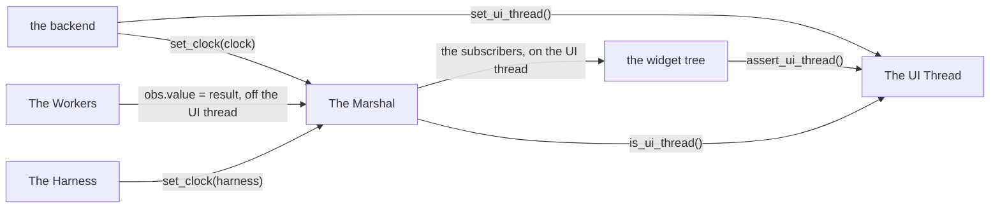
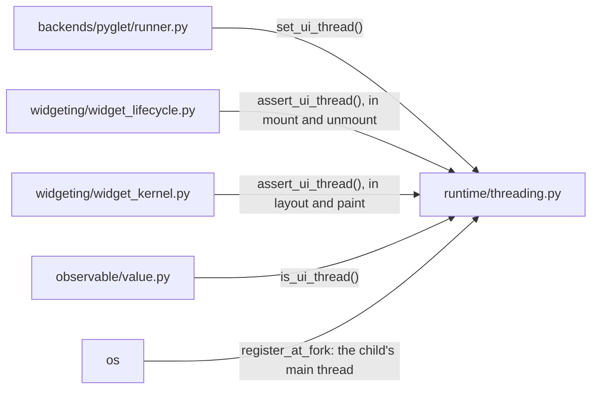
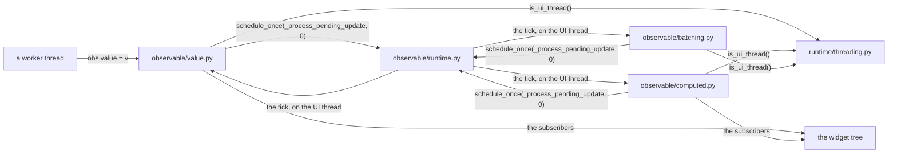
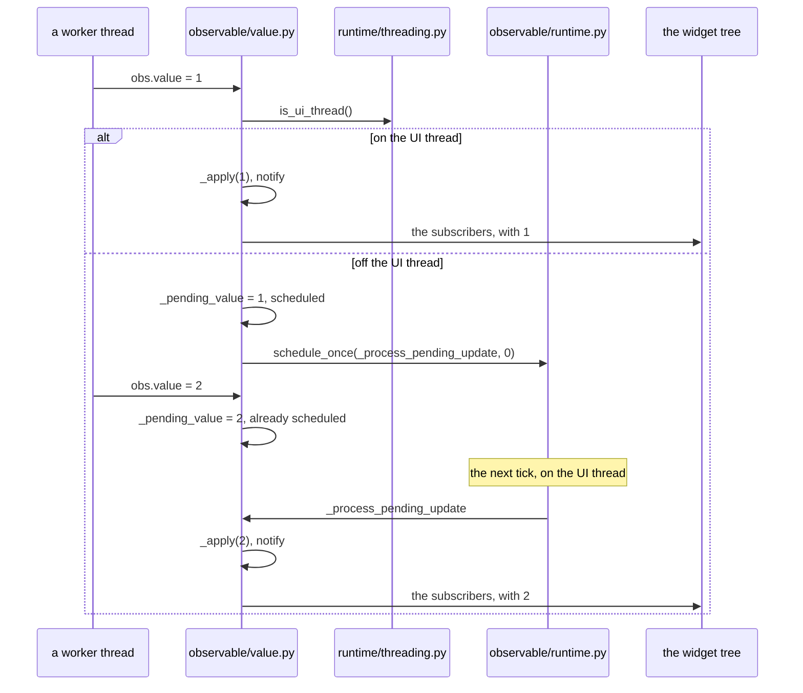
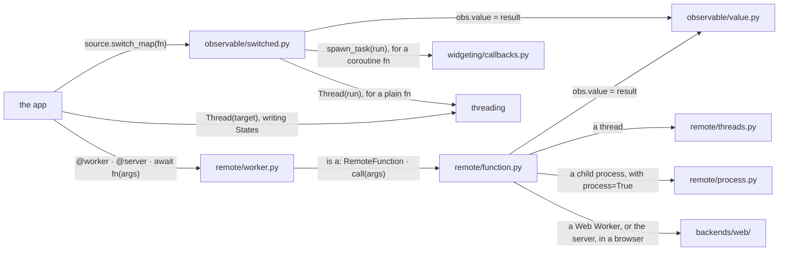
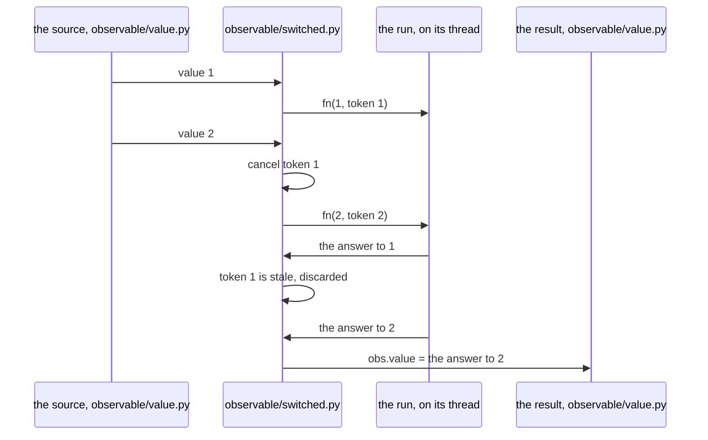
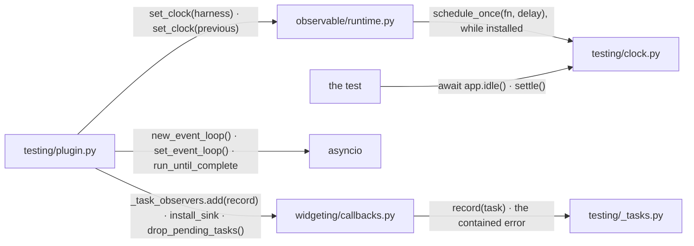

# Concurrency Model

The UI runs on one thread. A value produced on another thread reaches the UI
through a `State`.

## Overview

Four groups of modules take part.

### Structure

| Module | Role |
| --- | --- |
| The UI Thread | one definition of which thread the UI runs on |
| The Marshal | carries a `State` write from any thread onto the UI thread |
| The Workers | the places work runs away from the UI thread |
| The Harness | runs a test on the UI thread with its own clock |
| the widget tree | the subscribers ([WIDGET_ARCHITECTURE.md](WIDGET_ARCHITECTURE.md)) |
| the backend | names the UI thread and installs the clock ([APP_WINDOW.md](APP_WINDOW.md)) |

### Promises

- A worker thread never touches a widget.
- Every value that crosses from a worker to the UI crosses through a
  `State`.

## The UI Thread

`runtime/threading.py` holds the one answer to "is this the UI thread".

### Structure

| Module | Role |
| --- | --- |
| `runtime/threading.py` | the cached thread ident; `set_ui_thread`, `is_ui_thread`, `assert_ui_thread` |
| `backends/pyglet/runner.py` | names the thread that runs the frame loop ([APP_WINDOW.md](APP_WINDOW.md)) |
| `widgeting/widget_lifecycle.py` | asserts at mount and unmount ([WIDGET_ARCHITECTURE.md](WIDGET_ARCHITECTURE.md)) |
| `widgeting/widget_kernel.py` | asserts at layout and paint ([RENDERING_PIPELINE.md](RENDERING_PIPELINE.md)) |
| `observable/value.py` | asks on every write (The Marshal) |
| `os` | re-seats the ident after a fork |

### Promises

- The UI thread is the main thread until a backend names another.
- The thread that installs the clock is the thread the marshal targets.

## The Marshal

A `State` written off the UI thread notifies on the UI thread.

### Structure

| Module | Role |
| --- | --- |
| `observable/value.py` | `State`: holds a pending value and the scheduled flag; applies and notifies |
| `observable/computed.py` | `ComputedState`: the same for a derived value |
| `observable/batching.py` | `BatchContext`: flushes the queued recomputes |
| `observable/runtime.py` | the installed clock ([OBSERVABLE.md](OBSERVABLE.md)) |
| `runtime/threading.py` | the thread test (The UI Thread) |
| a worker thread | writes a value |
| the widget tree | the subscribers |

### Sequence

#### A State is written

### Promises

- A write off the UI thread is applied on the next tick. Writes before the
  tick coalesce to the latest value.
- A write on the UI thread applies inline.
- A batch whose `State`s want the UI thread flushes its recomputes there.

## The Workers

Work leaves the UI thread through `switch_map`, a `@worker` or `@server`
function, or a thread the app starts.

### Structure

| Module | Role |
| --- | --- |
| `observable/switched.py` | `switch_map`: a mapped value whose `fn` takes time to answer ([OBSERVABLE.md](OBSERVABLE.md)) |
| `remote/worker.py` | `@worker`, a function the app awaits that runs away from the UI |
| `remote/function.py` | `RemoteFunction`, `@server`: the declared types and the call |
| `remote/threads.py` | the desktop's threads |
| `remote/process.py` | the desktop's child processes |
| `backends/web/` | the Web Worker and the server call ([WEB_TARGET.md](WEB_TARGET.md)) |
| `widgeting/callbacks.py` | the task a coroutine `fn` runs as ([ASYNCIO_INTEGRATION.md](ASYNCIO_INTEGRATION.md)) |
| `threading` | the standard library's threads |
| `observable/value.py` | the values the work reports through (The Marshal) |
| the app | starts the work |

### Sequence

#### A source changes before its run has answered

### Promises

- A superseded `switch_map` run publishes nothing.
- A `@worker` or `@server` function shares nothing with its caller. Arguments
  and the result are copied.

## The Harness

The pytest plugin runs a test on the UI thread. The harness is the clock.

### Structure

| Module | Role |
| --- | --- |
| `testing/plugin.py` | installs the harness clock, owns the loop, registers the task observer and the error sink |
| `testing/clock.py` | the clock a test pumps by hand |
| `testing/_tasks.py` | `TaskRegistry`: the tasks a harness caused and the failures it contained |
| `widgeting/callbacks.py` | the hooks the harness observes through ([ASYNCIO_INTEGRATION.md](ASYNCIO_INTEGRATION.md)) |
| `observable/runtime.py` | the clock slot ([OBSERVABLE.md](OBSERVABLE.md)) |
| `asyncio` | the loop the harness owns |
| the test | drives the app |

### Promises

- A test body runs on the UI thread.
- A write from a worker lands on the harness clock. Nothing runs it until the
  test pumps the clock.
- An exception a handler raised reaches the test.
