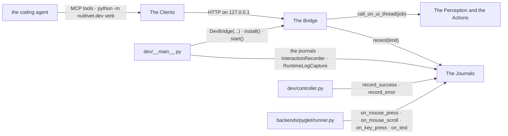
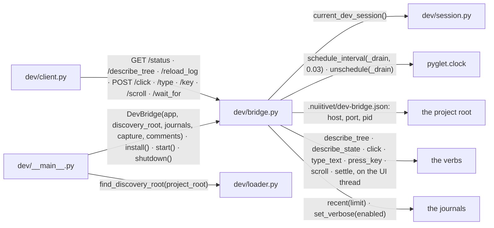
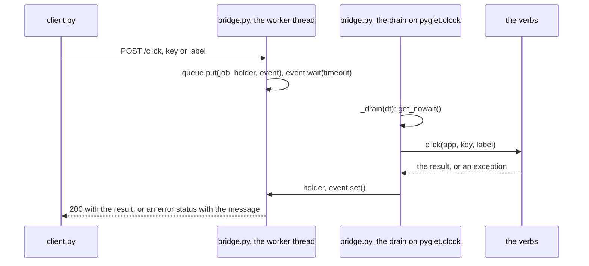
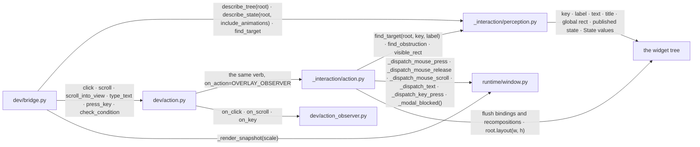
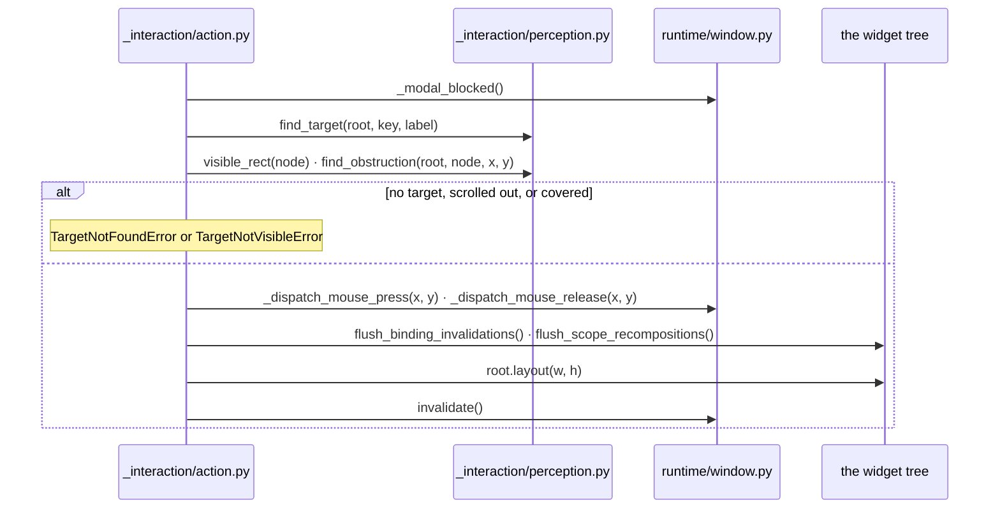
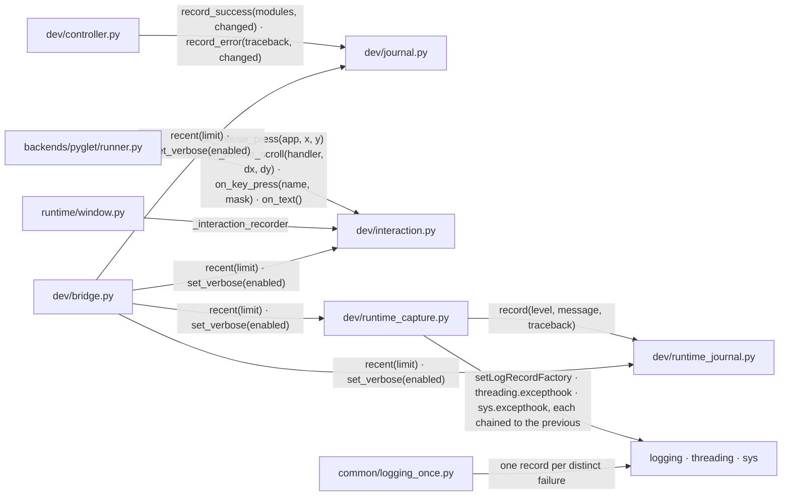
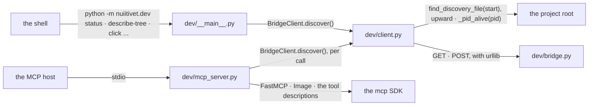

# Dev Bridge

The dev bridge lets a tool see and drive a running app. Hot reload lets its
author edit it ([HOT_RELOAD.md](HOT_RELOAD.md)). The human's side of the
same session is [DEV_MODES.md](DEV_MODES.md).

## Overview

Four groups of modules take part, with the dev runner, the hot reload
controller and the backend's input handlers at their edges.

### Structure

| Module | Role |
| --- | --- |
| The Clients | the MCP server and the CLI |
| The Bridge | the HTTP server the clients talk to |
| The Perception and the Actions | what a tool reads, and the input it synthesises |
| The Journals | what happened while the agent was not looking |
| `dev/__main__.py` | the dev runner ([HOT_RELOAD.md](HOT_RELOAD.md)) |
| `dev/controller.py` | the reloader ([HOT_RELOAD.md](HOT_RELOAD.md)) |
| `backends/pyglet/runner.py` | the real input path ([APP_WINDOW.md](APP_WINDOW.md)) |
| the coding agent | reads and acts in turns |

### Promises

- The bridge opens inside a dev session only.
- Everything the bridge does to the tree runs on the UI thread.
- The agent pulls. Nothing is pushed to it.

## The Bridge

A localhost HTTP server on a port the OS picks, started by the dev runner
beside hot reload.

### Structure

| Module | Role |
| --- | --- |
| `dev/bridge.py` | `DevBridge`: the HTTP server on a daemon thread, the handler per route, the discovery file; `_UIThreadMarshaller`: a queue drained on the clock, each worker blocking on its job's event |
| `dev/session.py` | answers whether a dev session is active |
| `dev/loader.py` | the anchor of the discovery file, the user-facing project root |
| `pyglet.clock` | the UI thread's tick the drain runs on |
| `dev/__main__.py` | wires the bridge around the app. Tears it down after the loop |
| `dev/client.py` | the HTTP client (The Clients) |
| the verbs | the work the bridge runs on the UI thread (The Perception and the Actions) |
| the journals | read by the bridge (The Journals) |
| the project root | holds the discovery file |

### Sequence

#### A request touches the tree

### Promises

- The discovery file is removed on shutdown.
- A worker thread never touches the tree.
- A job's exception reaches the client as an error response.

## The Perception and the Actions

A tool reads the tree, the state behind it or a screenshot. A tool
synthesises the input the real backend delivers.

### Structure

| Module | Role |
| --- | --- |
| `_interaction/perception.py` | `describe_tree`, each mounted node's type, identity, root rect and published state; `describe_state`, the `State` values reachable from the tree in the same shape; the target lookup and the obstruction test. Re-exported by `dev/perception.py` |
| `_interaction/action.py` | the verbs |
| `dev/action.py` | the verbs with the on-screen marker bound |
| `dev/action_observer.py` | draws the marker of a bridge-driven action ([DEV_MODES.md](DEV_MODES.md)) |
| `dev/bridge.py` | runs them on the UI thread (The Bridge) |
| `runtime/window.py` | the dispatch entry points; the offscreen render ([APP_WINDOW.md](APP_WINDOW.md)) |
| the widget tree | what is described and driven |

### Sequence

#### A click lands and the tree settles

### Promises

- A synthesised action enters at the window's dispatch, below the backend's
  input handlers.
- Every verb settles the app before it returns.
- The screenshot is rendered on an offscreen raster surface, never read
  back from the framebuffer.
- Perception never paints.

## The Journals

Three ring buffers tell the agent what happened between its turns.

### Structure

| Module | Role |
| --- | --- |
| `dev/journal.py` | `ReloadJournal`, each reload's outcome |
| `dev/interaction.py` | `InteractionJournal`, the human's coarse actions and the window opens and closes; `InteractionRecorder`, the hook on the real input path that writes them |
| `dev/runtime_journal.py` | `RuntimeJournal`: log records at WARNING and above, uncaught exceptions |
| `dev/runtime_capture.py` | `RuntimeLogCapture`: the taps on the log record factory and the two exception hooks; the verbose switch |
| `dev/controller.py` | the reloader ([HOT_RELOAD.md](HOT_RELOAD.md)) |
| `backends/pyglet/runner.py` | calls the window's recorder from its input handlers ([APP_WINDOW.md](APP_WINDOW.md)) |
| `runtime/window.py` | the slot the dev runner puts a recorder in, `None` in production |
| `logging · threading · sys` | the standard library's record factory and exception hooks |
| `common/logging_once.py` | logs each distinct failure once at its emit site ([ERROR_HANDLING.md](ERROR_HANDLING.md)) |
| `dev/bridge.py` | serves the journals (The Bridge) |

### Promises

- Every entry carries a monotonic `seq`.
- A reload entry's `changed` names the modules whose source bytes changed.
  A save with identical bytes leaves it empty.
- The interaction journal records the human only. A synthesised action
  bypasses the recorder.
- The interaction journal's vocabulary is the action vocabulary. A semantic
  event is not recorded.
- Typed content never enters a journal. A printable key is dropped. A burst
  of text is one marker.
- A scroll entry is recorded only for an event a region consumed. A gesture
  on one region in one direction is one entry.
- Console output is unchanged by the capture. No handler is added to the
  root logger.
- The journal de-duplicates nothing. The verbose switch makes the emit sites
  record every occurrence.

## The Clients

The MCP server and the CLI issue the same HTTP requests.

### Structure

| Module | Role |
| --- | --- |
| `dev/mcp_server.py` | `python -m nuiitivet.dev mcp`: one tool per bridge route, each forwarding to a freshly discovered client; the descriptions that steer the model |
| `dev/__main__.py` | the one-shot subcommands |
| `dev/client.py` | `BridgeClient`: finds the discovery file, drops a stale one whose process is gone, speaks HTTP |
| `dev/bridge.py` | the server (The Bridge) |
| the project root | holds the discovery file (The Bridge) |
| the mcp SDK | an optional dependency, 1.x or 2.x |
| the MCP host | the agent's runtime |
| the shell | a session without an MCP host |

### Promises

- The MCP server holds no app logic.
- The MCP server starts with no app running.
- The CLI depends on the standard library only.
