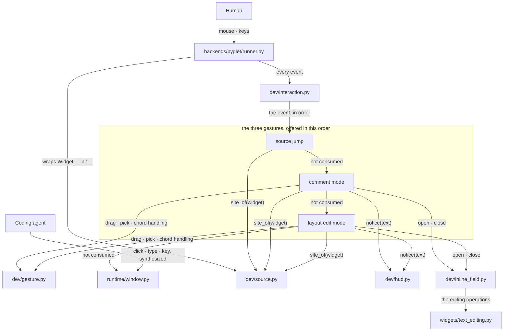
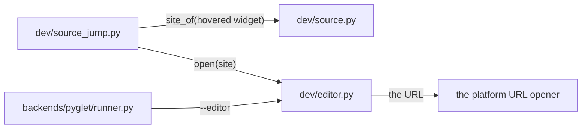
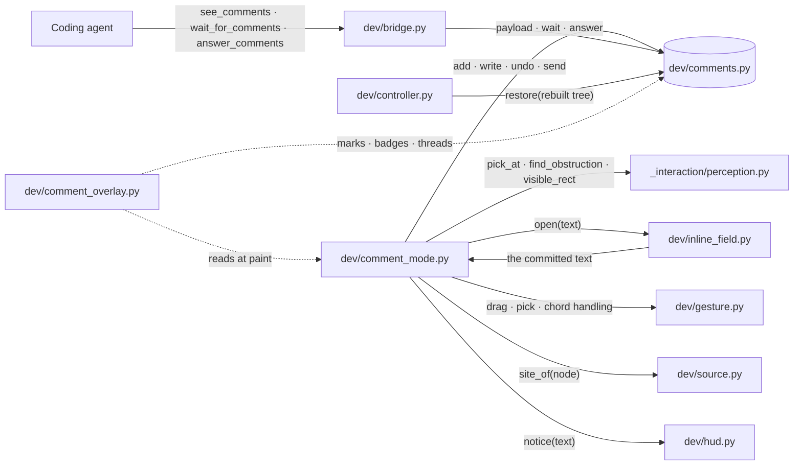
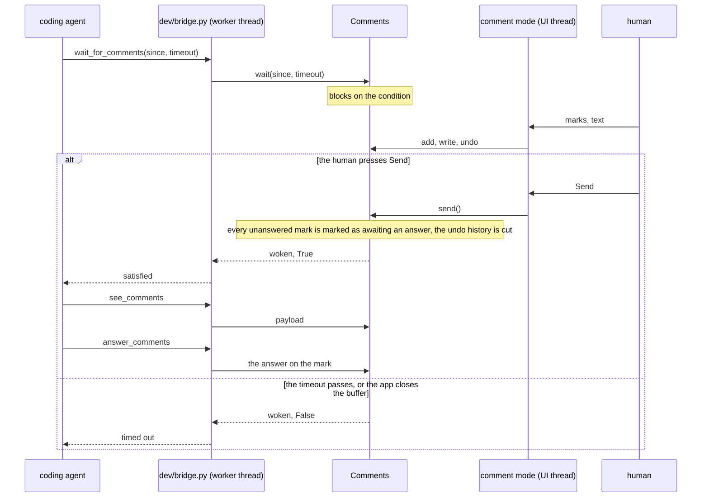
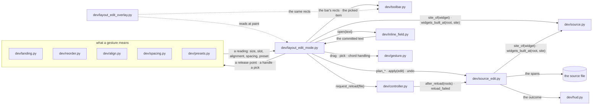
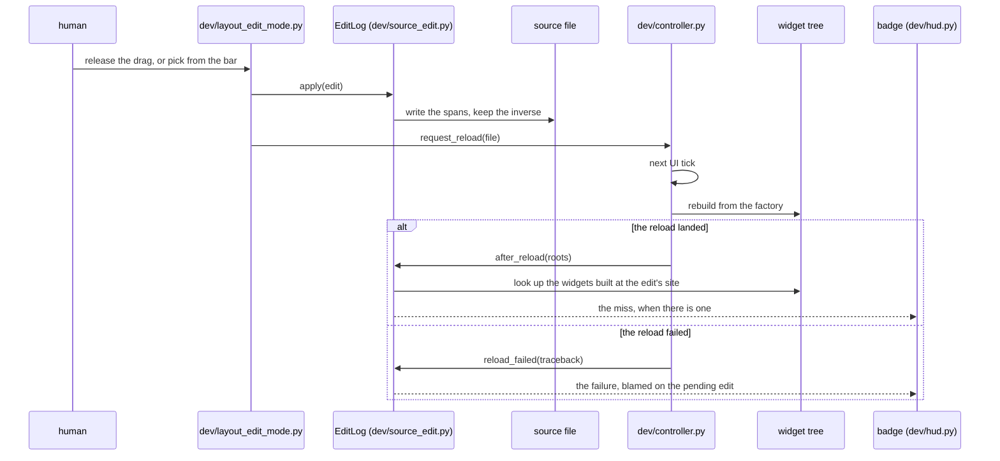

# Dev Modes

The dev modes run human to app. The human points at a widget in the running
app. The dev runner acts on that widget's source: source jump opens the line
that built it, comment mode marks it for the agent, layout edit mode rewrites
the line. Source jump does not latch; the two modes do. Every bridge surface
([DEV_BRIDGE.md](DEV_BRIDGE.md)) runs the other way, agent to app.

## What the Gestures Share

The three gestures share the input layers the runner installs, the record of
which line built each widget, and the glass every mode paints on. The
Structure is the whole page: the shared modules and the three gestures as
groups.

### Structure

| Module | Role |
| --- | --- |
| `backends/pyglet/runner.py` | installs the dev input layers in their order and claims the prefix chord |
| `dev/interaction.py` | records every real input event before the layers see it |
| source jump | opens the construction site of the hovered widget in the editor |
| comment mode | marks widgets and regions for the agent, with the human's text |
| layout edit mode | turns a drag or a pick into an edit of the widget's source |
| `dev/gesture.py` | the drag, pick and chord handling the two modes share |
| `runtime/window.py` | dispatches what no layer consumed into the widget tree |
| `dev/source.py` | records the construction site of every widget |
| `dev/hud.py` | the badge both modes report through |
| `dev/inline_field.py` | the one-line field both modes open over the glass |
| `widgets/text_editing.py` | the editing operations the field shares with `EditableText` |

### Promises

- Every chord the dev runner claims starts with `Ctrl+Shift`.
- No action of the agent reaches a mode.
- A layer that consumes an event ends the walk.
- At most one mode is latched at a time. A latched mode lets the other's
  chord pass.
- The dev runner wraps `Widget.__init__`. The wrap records, for every
  widget, the chain of frames outside the package and outside any install
  directory. The record is rebuilt with the tree on reload.
- Each frame records the span of the executing call. The frame a jump opens
  and an edit targets is the innermost user frame outside any `__init__`.
- A frame records whether it built the widget directly. A pointer on a
  widget no user call built resolves to the nearest ancestor a user call did
  build.
- Every mode paints on the glass, never into the tree. The glass is painted
  over the tree last painted, in the frame the mode asks for.
- Each gesture paints in a colour family of its own.

## Source Jump

Source jump opens the hovered widget's construction site in the editor.

### Structure

| Module | Role |
| --- | --- |
| `dev/source_jump.py` | tracks the hover and the click |
| `dev/editor.py` | fills the `--editor` URL template, checks the editor is installed, launches |
| `backends/pyglet/runner.py` | passes the `--editor` option (What the Gestures Share) |
| `dev/source.py` | answers which line built the hovered widget (What the Gestures Share) |
| the platform URL opener | opens the editor URL |

### Promises

- The editor is reached by a URL through the platform's URL opener. The URL
  is the `--editor` template with the site's file and line filled in.
- `--editor` is validated when the app starts.

## Comment Mode

Comment mode records what the human pointed at, as nodes and as regions,
with what they wrote on each mark. The agent reads the marks through the
bridge and answers on them.

### Structure

| Module | Role |
| --- | --- |
| `dev/comment_mode.py` | tracks the candidate under the pointer, the marks, the open field |
| `dev/comments.py` | the comment buffer: identity, text, thread, history, the wait on a send |
| `dev/comment_overlay.py` | paints the brackets, badges and threads on the glass |
| `_interaction/perception.py` | picks the node under a point and its visible rect ([DEV_BRIDGE.md](DEV_BRIDGE.md)) |
| `dev/bridge.py` | serves `see_comments`, `answer_comments`, `wait_for_comments` ([DEV_BRIDGE.md](DEV_BRIDGE.md)) |
| `dev/controller.py` | restores the marks after a rebuild ([HOT_RELOAD.md](HOT_RELOAD.md)) |
| `dev/inline_field.py`, `dev/gesture.py`, `dev/source.py`, `dev/hud.py` | the shared field, mechanics, sites and badge (What the Gestures Share) |

### Sequence

#### A send wakes the agent's wait

### Promises

- The picker is geometry-only. An idle `Overlay` reports itself out of the
  way. `Box` exposes its `clip_content` clip to the occlusion check.
- A mark carries the visible rect, the node's rect intersected with every
  ancestor clip. The brackets on the glass and the rect handed to the agent
  are the same rect. An action aims at the visual rect.
- A region stores only its rect.
- One `Comments` per app is shared by the mode on the UI thread, the reload
  controller after a rebuild and the bridge on its worker threads. Nodes and
  regions share one ordered list.
- Members are keyed on object identity. A member a rebuild dropped is
  matched back by the key-preferring structural path of
  [HOT_RELOAD.md](HOT_RELOAD.md).
- Every change to the buffer is an undo step. The undo history ends at the
  last send. An answer is outside it.
- Only a send, the timeout or the app going down ends a wait. Leaving the
  mode does not.
- The interaction journal records none of what a comment carries: rects,
  on-screen text, the human's words.

## Layout Edit Mode

Layout edit mode turns a drag on a widget, or a pick from the bar over it,
into an edit of the widget's source. No agent and no turn is involved.

### Structure

| Module | Role |
| --- | --- |
| `dev/layout_edit_mode.py` | holds the selection, the drag in flight and the open list; turns each gesture into a reading and each reading into an edit |
| `dev/landing.py` | a size from a release point |
| `dev/reorder.py` | a slot or a cell from a release point |
| `dev/align.py` | an alignment from a release point |
| `dev/spacing.py` | a padding side or a gap from a handle |
| `dev/presets.py` | the choices a widget declares, their parameters, the default |
| `dev/toolbar.py` | the bar's geometry |
| `dev/source_edit.py` | plans and applies span edits, keeps the edit log with each edit's inverse, checks the pending edit after the reload |
| the source file | what the spans are written into |
| `dev/layout_edit_overlay.py` | paints the mode's state on the glass |
| `dev/controller.py` | reloads the file and reports back ([HOT_RELOAD.md](HOT_RELOAD.md)) |
| `dev/inline_field.py`, `dev/gesture.py`, `dev/source.py`, `dev/hud.py` | the shared field, mechanics, sites and badge (What the Gestures Share) |

### Sequence

#### An edit lands through the reload

### Promises

- During a gesture only the overlay moves.
- A site with no user frame is refused.
- A write is a set of spans in one file, or two for a move across
  containers. Nothing around a span is reformatted.
- An edit is undone by its inverse spans. The undo is refused when the text
  they expect has moved. A refusal reaches the badge and never the
  `Comments`.
- What is written is a value, never a delta. A landing value is measured
  from the live tree.
- A layout index must name a source span. An order the runner cannot see in
  one list literal is refused.
- Alignment is written on the container. A `CrossAligned` the human wrote is
  rewritten in place.
- The handle is the only grab zone for spacing.
- Spacing is written in the shape its handles stand for. The file's brackets
  are kept. The sides the drag did not touch are taken from the live widget.
- A widget declares in `editable_parameters()` which class each preset
  keyword is picked from. The choices are that class's classmethods whose
  parameters are all optional `Literal`s, or its uppercase attributes.
  `default()` names the default. `nuiitivet.dev` imports no design system.
- What is written is spelled as the destination's module spells it, a preset
  as a call of its companion class, a `GridItem` by the name the module
  imports. No import is added.
- Whatever expression a keyword holds is replaced whole.
- A miss, a site that builds nothing, or a failed reload reaches the badge.
