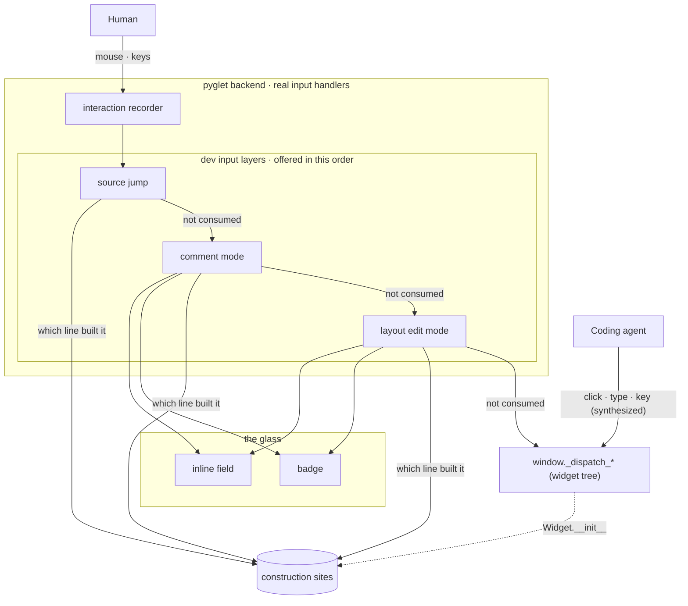
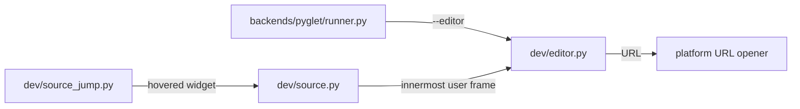
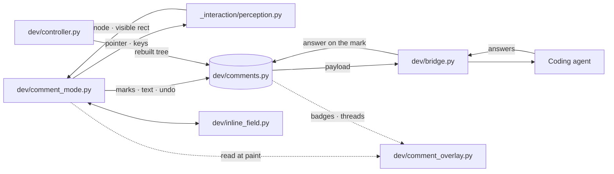
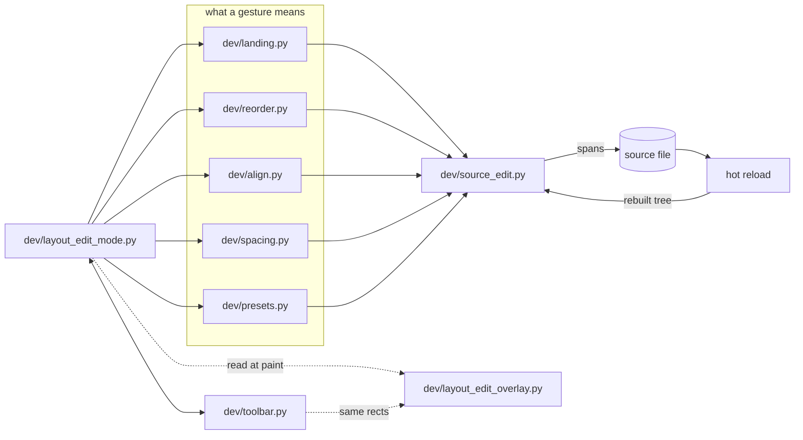

# Dev Modes

The dev modes run human to app. The human points at a widget in the running
app. The dev runner acts on that widget's source: source jump opens the line
that built it, comment mode marks it for the agent, layout edit mode rewrites
the line. Source jump does not latch; the two modes do. Every bridge surface
([DEV_BRIDGE.md](DEV_BRIDGE.md)) runs the other way, agent to app.

## What the Gestures Share

The three gestures share the input layers the runner installs, the record of
which line built each widget, and the glass every mode paints on.

### Structure

| Role | Module |
| --- | --- |
| the dev input layers: their order, the prefix chord | `backends/pyglet/runner.py` |
| the interaction recorder the layers sit on | `dev/interaction.py` |
| the mechanics the layers share | `dev/gesture.py` |
| the construction site of every widget | `dev/source.py` |
| the badge both modes report through | `dev/hud.py` |
| the inline field both modes open over the glass | `dev/inline_field.py` |
| the editing operations the field shares with `EditableText` | `widgets/text_editing.py` |

### Promises

- Every chord the dev runner claims starts with `Ctrl+Shift`.
- No action of the agent reaches a mode.
- A layer that consumes an event ends the walk.
- Each mode lets the other's chord pass. The entering mode closes the other.
- The dev runner, not the framework, wraps `Widget.__init__`. The wrap
  records, for every widget, the chain of frames outside the package and
  outside any install directory.
- A site is captured at construction. It is rebuilt with the tree on reload.
- Each frame records the span of the executing call. The frame a jump opens
  and an edit targets is the innermost user frame outside any `__init__`.
- A frame records whether it built the widget directly. A pointer on a
  widget no user call built resolves to the nearest ancestor a user call did
  build.
- Every mode paints on the glass, never into the tree. The constraint is the
  action overlay's: paint-only, live frames only. Neither `describe_tree` nor
  `screenshot` sees a mode. The frame a mode asks for redraws the glass over
  the tree last painted.
- Each gesture, and the action overlay, paints in a colour family of its own.

## Source Jump

Source jump opens the hovered widget's construction site in the editor.

### Structure

| Role | Module |
| --- | --- |
| the hover and the click | `dev/source_jump.py` |
| the construction site of the hovered widget | `dev/source.py` |
| the URL template, the install check, the launch | `dev/editor.py` |

### Promises

- The editor is reached by a URL through the platform's URL opener. The URL
  is the `--editor` template with the site's file and line filled in.
- `--editor` is validated when the app starts, not on the first click.

## Comment Mode

Comment mode records what the human pointed at, as nodes and as regions,
with what they wrote on each mark. The bridge carries the marks to the agent
and the agent's answers back onto the marks.

### Structure

| Role | Module |
| --- | --- |
| the candidate under the pointer, the marks, the open field | `dev/comment_mode.py` |
| the geometry picker and the visible rect | `_interaction/perception.py` (`pick_at`, `find_obstruction`, `visible_rect`) |
| the comment buffer: identity, text, thread, history, the wait on a send | `dev/comments.py` |
| `see_comments`, `answer_comments`, `wait_for_comments` | `dev/bridge.py` |
| the restore of the marks after a rebuild | `dev/controller.py` |
| the brackets, badges and threads on the glass | `dev/comment_overlay.py` |

### Promises

- The picker is geometry-only. It descends through the children the keyboard
  traverses before it checks occlusion. An idle `Overlay` reports itself out
  of the way. `Box` exposes its `clip_content` clip to the occlusion check.
- A mark carries the visible rect, the node's rect intersected with every
  ancestor clip. The brackets on the glass and the rect handed to the agent
  are the same rect. An action aims at the visual rect.
- A region stores only its rect.
- One `Comments` per app is shared by the mode on the UI thread, the reload
  controller after a rebuild and the bridge on its worker threads. Nodes and
  regions share one ordered list.
- Members are keyed on object identity. A rebuild drops them. The controller
  matches them back by the key-preferring structural path of
  [HOT_RELOAD.md](HOT_RELOAD.md).
- Every change to the buffer is an undo step. The undo history ends at the
  last send. An answer is outside it.
- A send wakes every wait on the buffer. The bridge's wait blocks on the
  worker thread until the next send or a timeout. Leaving the mode does not
  wake it. The app going down releases it.
- The interaction journal records none of what a comment carries: rects,
  on-screen text, the human's words.

## Layout Edit Mode

Layout edit mode turns a drag on a widget, or a pick from the bar over it,
into an edit of the widget's source. No agent and no turn is involved.

### Structure

| Role | Module |
| --- | --- |
| the selection, the drag in flight, the open list; each gesture turned into a reading, each reading into an edit | `dev/layout_edit_mode.py` |
| a size from a release point | `dev/landing.py` |
| a slot or a cell from a release point | `dev/reorder.py` |
| an alignment from a release point | `dev/align.py` |
| a padding side or a gap from a handle | `dev/spacing.py` |
| the choices a widget declares, their parameters, the default | `dev/presets.py` |
| the bar's geometry | `dev/toolbar.py` |
| span surgery, the edit log with each edit's inverse, the check after the reload | `dev/source_edit.py` |
| the mode's state on the glass | `dev/layout_edit_overlay.py` |

### Promises

- The tree is never mutated. During a gesture only the overlay moves.
- The widget edited is the owner a user call built. A site with no user
  frame is refused.
- A write is a set of spans in one file, or two for a move across
  containers. The spans are located by re-parsing the file and matching the
  call at the recorded site. Nothing around a span is reformatted.
- An edit is undone by its inverse spans. The undo is refused when the text
  they expect has moved. A refusal reaches the badge and never the
  `Comments`.
- What is written is a value, never a delta. A landing value is measured
  from the live tree.
- A layout index must name a source span. An order the runner cannot see in
  one list literal is refused.
- Alignment is written on the container. A `CrossAligned` the human wrote is
  rewritten in place.
- The handle is the only grab zone for spacing.
- Spacing is written in the shape its handles stand for. The file's brackets
  are kept. The sides the drag did not touch are taken from the live widget.
- A widget declares in `editable_parameters()` which class each preset
  keyword is picked from. The choices are that class's classmethods whose
  parameters are all optional `Literal`s, or its uppercase attributes.
  `default()` names the default. `nuiitivet.dev` imports no design system.
- What is written is spelled as the destination's module spells it, a preset
  as a call of its companion class, a `GridItem` by the name the module
  imports. No import is added.
- Whatever expression a keyword holds is replaced whole.
- After the reload, the pending edit is checked against the instances
  rebuilt at its site. A miss, a site that builds nothing, or a failed
  reload reaches the badge.
