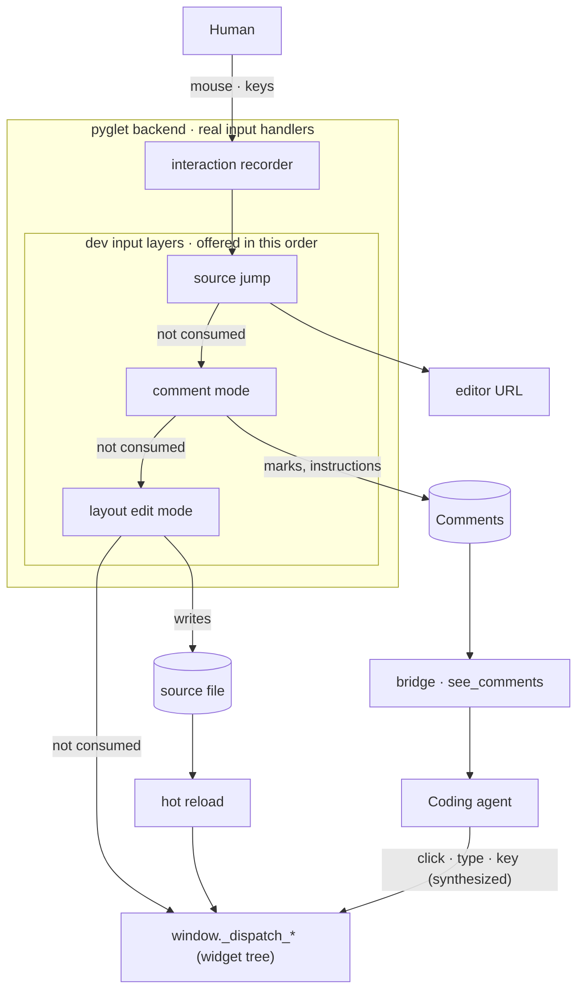

# Dev Modes

Every bridge surface ([DEV_BRIDGE.md](DEV_BRIDGE.md)) runs agent to app. The
dev modes run the other way: they let the human point at a widget and have
something happen to it, a mark the agent can read, an editor opened on the
line that built it, or its source rewritten by a drag. Prose is an expensive
channel for a location, and for two cases it barely works: an anonymous inner
node no phrase identifies, and a gap with no widget to name.

Three gestures share one input layer and one prefix:

| Gesture | Chord | Kind | Effect |
| --- | --- | --- | --- |
| Comment mode | `Ctrl+Shift+C` | latched mode | marks widgets and regions for the agent, with an instruction typed on the mark |
| Layout edit mode | `Ctrl+Shift+E` | latched mode | a drag rewrites size, order or alignment in the source |
| Source jump | `Ctrl+Shift+Click` | modeless | opens the widget's construction site in the editor |

`Ctrl+Shift` is the dev runner's prefix: every chord it claims starts with
it, so an app never has to guess which are taken. The letters name what the
human does, `C` comments and `E` edits, and sit under the left hand while the
right is on the mouse.

What the gestures share comes first, the input layers, the construction
sites and the overlays; each gesture then has its own section.

## Input Layers

The layers sit on the backend's real input handlers, where the interaction
recorder hangs, and the agent's synthesised actions enter below them at the
window's dispatch. That is what makes a comment unforgeable: nothing the
agent does can reach a mode. What each mode produces leaves by a different
door, the comments through the bridge, the jump through the platform's URL
opener, a layout edit through the file and the reload that follows.

The jump is offered on every event ahead of the modes, because it works in
any state; then comment mode, then layout edit mode, and a layer that
consumes an event ends the walk. Each mode lets the other's chord pass, and
the entering mode closes the other, comment mode keeping its marks and
layout edit mode dropping its drag. The jump is not a mode because nothing
persists between one jump and the next.

## Construction Sites

Every mark is followed by the same question: which line built this? The dev
runner wraps `Widget.__init__`, the one chokepoint every widget passes
through, and walks the frames out of the package to the first user frames; a
frame under an install directory is skipped like the package's own, since
nobody can edit that line. The wrap is installed by the runner and never by
the framework, so a production launch pays nothing, not even a flag check on
the construction path.

Sites are captured at construction and rebuilt with everything else on
reload, so there is no invalidation step to get wrong. They are interned,
since one helper builds fourteen cards. A site is a short chain, not one
location: "change every tile" wants the helper and "change this one" wants
the call site, and only the caller knows which; the innermost frame is
flagged as the one place an editor can open. Each frame records the span of
the exact call that was executing, not the line, since a line can hold
several calls and chained calls share a start; the frame an edit targets is
the innermost user frame outside any `__init__`, because inside a
constructor the executing call is `super().__init__(...)` rather than the
call a human recognises. A frame also records whether it built the widget
directly: a label a button builds for itself has no user call of its own, so
a pointer on it means the nearest ancestor a user call did build, the
button, and that owner is what layout edit mode edits.

## Overlays

Each mode paints on the glass, never into the tree, the same paint-only,
live-frames-only constraint as the action overlay, so `describe_tree` never
sees a bracket and `screenshot` never contains one. The frame a mode asks
for leaves the tree clean: the renderer redraws the glass over the tree it
last painted, so a hover crossing a grid of small widgets costs the overlay
and not a tree walk per cell. Four colour families, because one visual
language for opposite directions would mislead:

| Colour | Means |
| --- | --- |
| indigo (action overlay) | the agent did this |
| amber (comment mode) | the human means this |
| teal (layout edit mode) | a change about to be made to a file |
| rose (source jump) | a jump, not a mark; under a held chord inside comment mode, amber brackets would read as a mark about to be made |

A mode teaches its keys in one place, the sheet `H` holds open. Held rather
than toggled, so there is nothing to close and no second key to remember.
The entering and leaving lines sit at the window's centre, since the eye has
to find a line before it can read it, and a corner is not where the eye is.
Nothing else lists keys: a key list on screen while the human works covers
the app they are working on, and the mode's brackets say it is on. The
`Stack` layer keys are the one exception, beside the layer list, where the
eye is mid-drag. Notices share one box at the bottom-left that steps out of
the pointer's way.

## Comment Mode

Comment mode records what the human pointed at, as nodes and as regions, and
what they wrote on each mark; the bridge serves the result to the agent, and
the agent's answer comes back through the bridge onto the mark. A comment is
a mark with a thread, and a bare number is a whole comment.

The whole exchange happens inside the mode: the human marks, sends, reads the
answer on the mark, replies and sends again. The send is the hand-over, and
leaving is not, since the answer arrives on the marks and leaving would put
them out of sight at the moment they matter. The human leaves to use the
app, so no mark is drawn while the mode is off.

### Marks

`hit_test` cannot serve the picker: it returns the deepest hit-participating
widget, and the node a human means is often one that participates in none, a
plain `Text` or a spacing `Container`. The picker is geometry-only, and three
rules make geometry agree with the eye. It descends through the same children
the keyboard traverses, so it stops where the eye does, and only then checks
occlusion; a `None` hit is not an obstruction, so a non-interactive target
stays reachable. An idle `Overlay`, mounted at full size in every window,
says it is not in the way. `Box` honours `clip_content` when hit testing and
exposes the clip to the occlusion check, since a decorative shape laid out
far larger than its parent and clipped to a corner is an ordinary idiom.

A mark, once made, never moves, so no mark is the current one and all of
them are drawn alike, as their badges. The keyboard walk that chooses the
candidate holds until the pointer travels the few pixels that part a click
from a drag, since a hand resting on the mouse drifts between the key and
the click.

Reporting uses the visible rect, not the visual rect: a mark answers "what
of it is on screen", so the rect intersects every ancestor clip, and the
payload and the on-screen brackets both use it, so the box on the glass and
the rect handed to the agent are the same claim. An action still aims at the
visual rect, the node's actual origin.

A region is the half node picking cannot express. Only the rect is stored;
its `container`, the innermost enclosing node plus that node's immediate
children, and its `contents` are derived on every read, which carries a
region across a reload with no restore step. A rectangle carries two
readings the geometry cannot separate: "the gap between these things" wants
the enclosing owner, "these things" wants what the box crosses. So each
reading gets one field, and the caller, which knows what the human said,
chooses. `contents` intersects rather than requiring containment, because
humans drag rough boxes, and is scoped to the container's subtree, which is
what makes intersection workable: the ancestor chain trivially overlaps and
drops out without a special case.

### The Field

A new mark opens its field at once, since the instruction is what the mark
was made for, and the mark is the handle after that. A click never removes a
mark, since the brackets on a marked widget promise the same click as on any
other. Reading a mark is a hover on its badge, not a click, so rereading
several marks opens no field; nothing but the number stays beside a mark,
since a line of text on every mark covers the app it comments on. The field
is the one layout edit mode opens over a text literal, so neither mode grows
a second editor. The thread stays while the field is open on its mark, since
a reply is written against what was said. Thread and field stack under the
mark's badge as one block, over every badge, since the badge is where the
thread was asked for and a tall mark would put its bottom edge a screen
away; the thread is kept to its newest rows when the block would not fit,
since the reply is written to the newest exchange and the field has to stay
on screen.

### The Thread

A mark is a thread, and the agent answers on it. The human already decided
where by marking; an answer in chat hands them a number to find on screen
again, and "not quite, a bit more" would have to be typed in chat or written
over the first instruction. The outcome joins the number on the badge as a
glyph on a disc of its own colour, since an outcome in the badge's own amber
reads as part of the number and is the one thing on the mark the human must
not miss.

The answered line is not reopened for editing, since rewriting it would
detach the answer from what it answered; a reply is a new line. A mark stays,
whatever the answer, until the human removes it, since the judgement on an
answer is theirs. An answer bumps no `seq` and sits outside undo, since the
agent wrote it; the undo snapshots carry it too, so no step of the human's
takes it back.

### The Send

The send has a button and a key. The key is `Ctrl+Enter`, the send key of
every chat box; the button sits sunk below the window's edge with a sliver
showing, since a control standing on the app all the time covers it, and
stands up for the entering line's moment, so the mode shows it once on the
way in. The sliver and not the button's place is what raises it, since a
widget at the window's bottom-right has to stay markable. A sent mark with no
answer yet carries a grey disc with an hourglass where the answer's disc will
land, so the human sees which marks the round has not reached.

A send ends the undo history and wakes every wait on the buffer. The bridge
offers the wait as a call that blocks on the worker thread until the next
send or a timeout, with a `since` so a send that came in before the call
still satisfies it; leaving the mode does not wake it, and the app going
down releases it, so a waiting worker never holds the process. A blocking
call is what lets a watch with no model in the loop turn a send into a
notification, which is how the agent waits without the human switching to
chat.

### The Buffer

One `Comments` buffer per app is shared by the mode on the UI thread, the
reload controller after a rebuild, and the bridge on its worker threads.
Nodes and regions live in one ordered list because they share one on-screen
numbering.

Every change is a step back, so clearing is safe to reach for. The history
survives leaving the mode, since leaving is a look at the app and not a
verdict on the marks, and stops at the last send, since what the agent was
sent is not the human's to take back.

Members are keyed on object identity, because two anonymous siblings resolve
to the same identity dict, and keying on that would make picking the second
remove the first. A rebuild evaporates them, and that is the normal case:
"point at it, then have the agent fix it" puts a reload in the middle of
nearly every use. They are matched back by the same key-preferring
structural path the state restore of [HOT_RELOAD.md](HOT_RELOAD.md) uses,
and misses are counted rather than silently shortening the list.

### Privacy

A comment may carry rects, on-screen text and the human's own words, unlike
the interaction journal, which records none of them. The journal records
ambiently, without item-by-item consent; a comment is an explicit act of
disclosure, the same ground on which a screenshot may.

## Source Jump

`Ctrl+Shift+Click` opens the hovered widget's construction site. It does not
latch, which is only safe because the overlay repaints on every state
change: returning from the editor shows the badge that says the mode is
still on.

The editor is handed a URL (`vscode://file/path/to/app.py:171:1`) through
the platform's standard opener, not a CLI: the line rides inside the URL, so
nothing on the way can drop it. The route is chosen by an install check, not
by probing the scheme, since probing waits on the opener, on the UI thread,
for an answer that never changes; `--editor vscode` asserts what the check
cannot see. `--editor` is a URL template, not a command, because what goes
stale is the built-in list, by way of VS Code forks whose URLs differ only in
scheme, so one line catches up. A malformed template is refused at launch
rather than arriving as silence on the first click, and a successful jump
names the file, the only evidence the click was received, since an opener
succeeds whether or not a handler is registered.

The editor boots from a cleaned environment: an editor's extension host sets
`ELECTRON_RUN_AS_NODE`, and on Windows the scheme handler is a relaunch of
the editor binary, so every app a coding agent started would boot that
handler as Node, which exits while the jump reports success.

## Layout Edit Mode

The sibling of comment mode with the opposite division of labour: the human
drags a widget and the dev runner edits the source itself, with no agent and
no turn. The tree is never mutated: what is on screen always came from the
code, and during the gesture only the overlay moves.

### The Gesture

There is no commit. Every release writes, and `Ctrl+Z` is the confirmation
for every write, which is why a delete asks for none. Undo is the inverse
span, refused when the text it expects has moved. Text is one literal: the
field writes the string into the literal the call was given.

The selection is held by the pointer, over the selected widget's children
too: hover alone would lose the container before its corner can be reached,
and two outlines at once would make the mode read like comment mode's marks.

A drag is not a coordinate. A corner drag resolves to one of the three size
spellings, a body drag to a slot among the siblings or, in a grid, to the
cell under the pointer; what is written is a landing value, a list position
or a cell, never a delta. Landing values are measured, not guessed: the
`auto` band is the widget's own intrinsic size measured at the proposed
width, and the `wt` band is what the parent's allocation would give it, so a
snapped value matches the reload to the pixel; an axis whose landing equals
what is declared is not rewritten. Under the nudge keys the snap bands close
to the exact size, since a key that could not choose the pixel beside them
would adjust nothing.

The container under the pointer decides the reading: the deepest container
under the pointer, looking past the dragged subtree. The widget's own
container gives the in-place reading, any other makes the drag a move into
it, and none keeps the in-place reading so a drag past the end of a list
still lands at its end; "deepest" rather than "the one the pointer left" is
what lets a widget move into a sibling container nested inside its own. In a
`Stack` the layer decides, not the point, since a point over a stack names
every layer under it.

### What Is Written

The edit re-parses the file, matches the `Call` node the site recorded, then
replaces the literal's span or inserts the keyword after the last argument;
nothing around it is reformatted, and a site under an install directory is
refused. A refusal is a badge, not a mark: the file is left alone and the
reason named, and nothing is handed to the agent, since layout edit mode
never touches the `Comments`.

Staying put is alignment, and the alignment is the container's. Writing the
container's value rather than a per-child wrapper keeps one rule for every
container, and aligning a whole column is what a drag most often means; a
per-child override is asked for in words.

A reorder moves a span. The runner locates, through the container's site,
the list literal that owns the children's order, `children` itself or the
list a comprehension or a `ForEach` iterates, inline or bound once to a name
never mentioned again, and moves the element with one of its separators so
the formatting survives. The gate is that a layout index must name a source
span: an order the runner cannot see in one literal is refused, and tree
indices are never trusted past that gate. A move between containers is two
lists in one edit, possibly two files, written together and undone together
with the second refusing when either has moved. A box with a child is passed
over by the destination walk, since replacing it would be a choice, not a
move; only the source can tell, since the tree sees the same children either
way, so it is read once when the drag starts and once per container the
pointer enters.

A grid drop is a cell, and the wrapper is the destination's. A `Grid` places
by `GridItem`, never by order, so inside a grid the in-place reading is a
cell change, and a move across a grid's edge adds or removes the wrapper. An
occupied cell is allowed, since overlap is the grid's business.

Write, reload, check: the ghost is a prediction, and after the reload the
edit log finds the instances rebuilt at the site and compares their rect, or
for a move the class at the slot or in the cell, with it; a miss, a site that
now builds nothing, or a failed reload becomes the badge.

## Implementation Map

| Design area | Module |
| --- | --- |
| dev input layers: order, prefix chord | `backends/pyglet/runner.py` |
| mechanics shared by the layers | `dev/gesture.py` |
| comment mode, the comment buffer, overlay | `dev/comment_mode.py`, `dev/comments.py`, `dev/comment_overlay.py` |
| geometry picker, visible rect | `_interaction/perception.py` (`pick_at`, `find_obstruction`) |
| construction sites | `dev/source.py` |
| source jump, editor launch | `dev/source_jump.py`, `dev/editor.py` |
| layout edit mode: mode, landing values, alignment, slots and gates, span surgery, overlay | `dev/layout_edit_mode.py`, `dev/landing.py`, `dev/align.py`, `dev/reorder.py`, `dev/source_edit.py`, `dev/layout_edit_overlay.py` |
| the badge both modes share | `dev/hud.py` |
| the inline field both modes open over the glass | `dev/inline_field.py` |
| the editing operations shared with `EditableText` | `widgets/text_editing.py` |
| edit log and reload request | `dev/source_edit.py` (`EditLog`), `dev/controller.py` |
