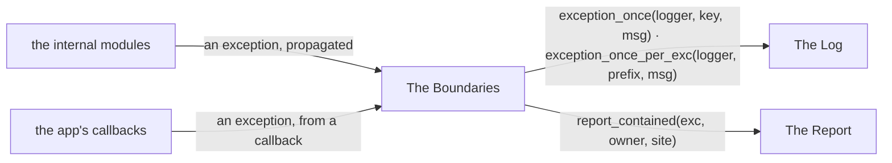
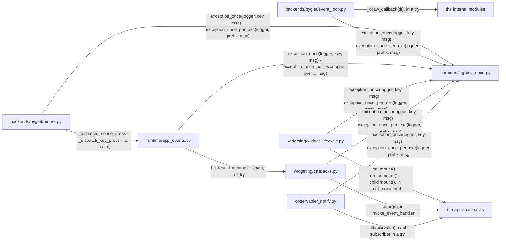
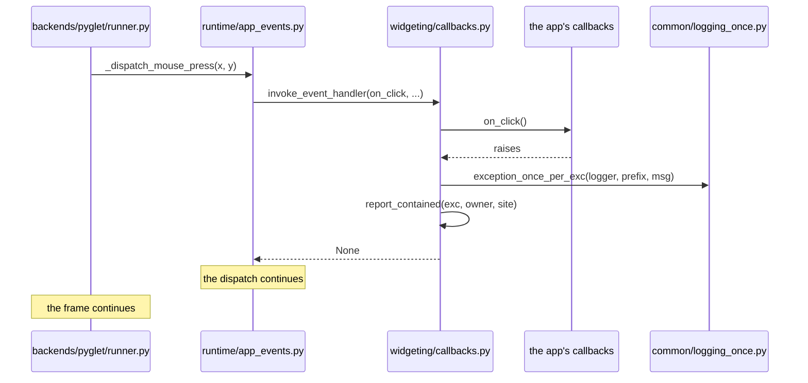
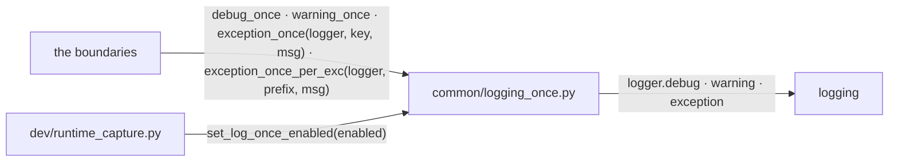
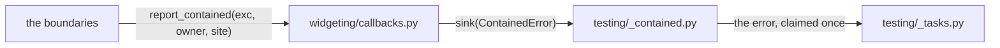

# Error Handling

An exception is caught once, at a boundary. Inside the boundary it
propagates.

## Overview

Three groups of modules take part, with the internal modules and the app's
callbacks at their edges.

### Structure

| Module | Role |
| --- | --- |
| The Boundaries | the entry points from the OS, the backend and the app's callbacks, where an exception is finalised |
| The Log | emits a record once per key |
| The Report | hands a contained exception to whoever is listening |
| the internal modules | `widgeting`, `layout`, `rendering`, `observable` and the rest, which propagate |
| the app's callbacks | user code the framework calls |

### Promises

- A boundary logs and continues, or it raises. An internal catch adds
  context and re-raises.
- `logger.exception` is called at a boundary only.
- `RendererError` passes every boundary.

## The Boundaries

Each entry point catches what the code below it propagated.

### Structure

| Module | Role |
| --- | --- |
| `backends/pyglet/runner.py` | the window's event handlers, each dispatch in its own try ([APP_WINDOW.md](APP_WINDOW.md)) |
| `backends/pyglet/event_loop.py` | the draw callback in a try ([RENDERING_PIPELINE.md](RENDERING_PIPELINE.md)) |
| `runtime/app_events.py` | pointer delivery, each step in a try ([INTERACTION_ARCHITECTURE.md](INTERACTION_ARCHITECTURE.md)) |
| `widgeting/widget_lifecycle.py` | the lifecycle hooks and the children's mounts, contained ([WIDGET_ARCHITECTURE.md](WIDGET_ARCHITECTURE.md)) |
| `widgeting/callbacks.py` | `invoke_event_handler`, containing a handler ([ASYNCIO_INTEGRATION.md](ASYNCIO_INTEGRATION.md)) |
| `observable/_notify.py` | notifies each subscriber, surviving one that raises ([OBSERVABLE.md](OBSERVABLE.md)) |
| `common/logging_once.py` | the record (The Log) |
| the internal modules | propagate |
| the app's callbacks | may raise |

### Sequence

#### A click handler raises

### Promises

- A callback's exception never unwinds the dispatch it was called from.
- `CancelledError` passes through a task boundary.
- A failure in `run_app` before the loop starts raises.

## The Log

`exception_once` and its siblings de-duplicate by a key the call site
chooses.

### Structure

| Module | Role |
| --- | --- |
| `common/logging_once.py` | the keys seen, the per-exception signature and the kill switch |
| `logging` | the standard library's logger, `nuiitivet` and its children |
| `dev/runtime_capture.py` | switches the de-duplication off for a verbose runtime log ([DEV_BRIDGE.md](DEV_BRIDGE.md)) |
| the boundaries | the call sites (The Boundaries) |

### Promises

- The key is a category and a site, chosen by the call site. It is never the
  message.
- A different failure at the same site is logged again.
- The framework adds no logging handler. It calls no `basicConfig`.
- Logging never raises.

## The Report

`report_contained` tells a listening harness that user code raised.

### Structure

| Module | Role |
| --- | --- |
| `widgeting/callbacks.py` | `report_contained` and the sink set |
| `testing/_contained.py` | the harness's sink; claims an error and reports it at teardown ([CONCURRENCY_MODEL.md](CONCURRENCY_MODEL.md)) |
| `testing/_tasks.py` | holds the failure until the test reads it |
| the boundaries | the containment sites (The Boundaries) |

### Promises

- A containment site reports.
- A sink never raises.
- A contained exception keeps its type when it reaches a test.
- One containment is one record.
