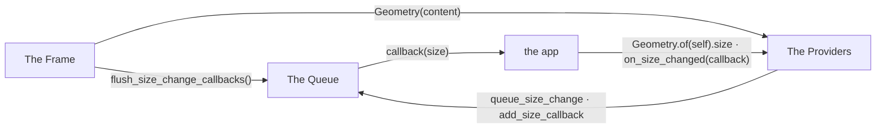
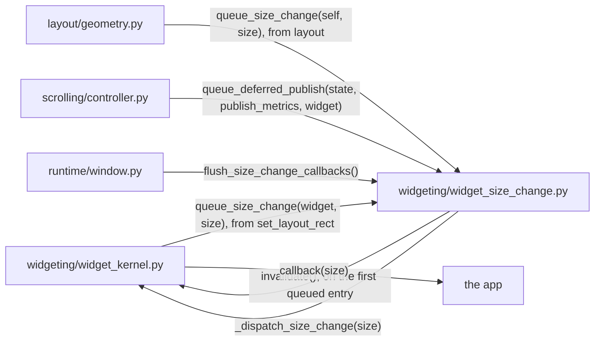
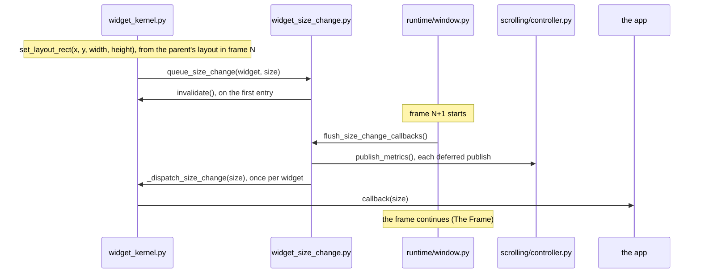
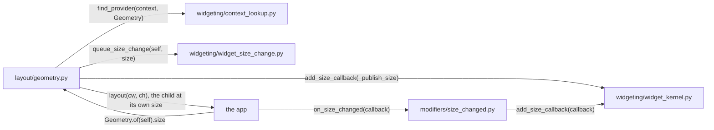
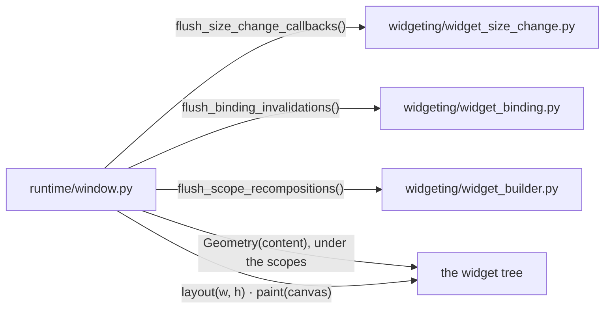
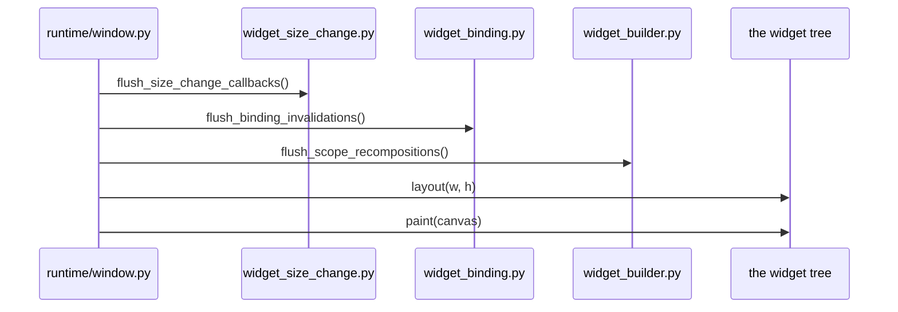
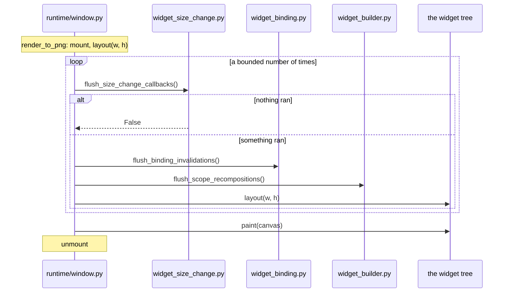

# Geometry

The parent decides a widget's size in layout. The measurement is recorded
as a layout result. This page is how it reaches the code that reads it.

## Overview

Three groups of modules carry a measurement from the layout that made it to
the code that reads it.

### Structure

| Module | Role |
| --- | --- |
| The Queue | holds a measurement between the layout that made it and the frame that reports it |
| The Providers | `Geometry` for a subtree, `on_size_changed` for one widget |
| The Frame | drains the queue at the start of each frame |
| the app | the widgets that read a `Geometry` or carry a size callback |

### Promises

- No `State` is written during layout. No size callback runs during
  layout.

## The Queue

A measurement waits here from the layout that made it to the start of the
next frame.

### Structure

| Module | Role |
| --- | --- |
| `widgeting/widget_kernel.py` | stores the layout result on the widget, holds its size callbacks, runs them |
| `widgeting/widget_size_change.py` | the queue and its flush |
| `runtime/window.py` | the flush's caller (The Frame) |
| `layout/geometry.py` | queues its own size (The Providers) |
| `scrolling/controller.py` | queues the publish of the scroll metrics |
| the app | the size callbacks |

### Sequence

#### A measurement reaches its consumers

### Promises

- A size callback runs once per changed size.
- A widget dropped or unmounted before the flush is skipped.

## The Providers

`Geometry` publishes its own measured size to its subtree as a
`State[Size]`. `on_size_changed` reports a widget's size to the widget
that carries it.

### Structure

| Module | Role |
| --- | --- |
| `layout/geometry.py` | `Geometry`, a widget around one child, publishing `size` |
| `modifiers/size_changed.py` | `on_size_changed`, the callback registered on the widget it is applied to |
| `widgeting/context_lookup.py` | resolves a `.of()` lookup along the parent chain |
| `widgeting/widget_kernel.py` | the size callbacks a widget holds (The Queue) |
| `widgeting/widget_size_change.py` | the queue (The Queue) |
| the app | the child a `Geometry` lays out, the descendants that read it, the widgets that carry a modifier |

### Promises

- Constraints are not published.
- `size` is one `State`, never a width and a height apart.
- The nearest `Geometry` wins.
- `on_size_changed` adds no node to the tree. It creates no scope.

## The Frame

The window runs the frame the queue was drained for. `render_to_png` drains
the queue again until nothing runs, before it paints.

### Structure

| Module | Role |
| --- | --- |
| `runtime/window.py` | runs the frame |
| `widgeting/widget_size_change.py` | the queue (The Queue) |
| `widgeting/widget_binding.py` | the binding invalidations ([OBSERVABLE.md](OBSERVABLE.md)) |
| `widgeting/widget_builder.py` | the scope recompositions ([WIDGET_ARCHITECTURE.md](WIDGET_ARCHITECTURE.md)) |
| the widget tree | the scopes, the root `Geometry` (The Providers), the content |

### Sequence

#### A frame starts

#### A snapshot drains the queue before it paints

### Promises

- The live frame runs no size callback between layout and paint.
- A snapshot paints after a bounded number of drains.
- The window wraps the content in a `Geometry`.
