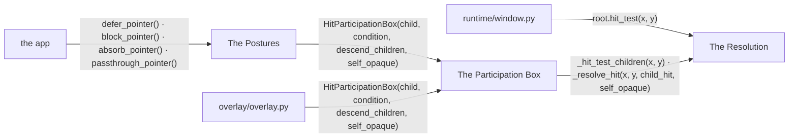
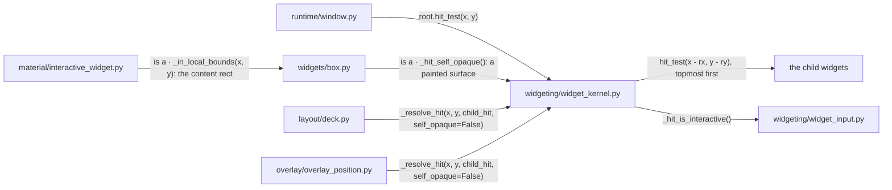
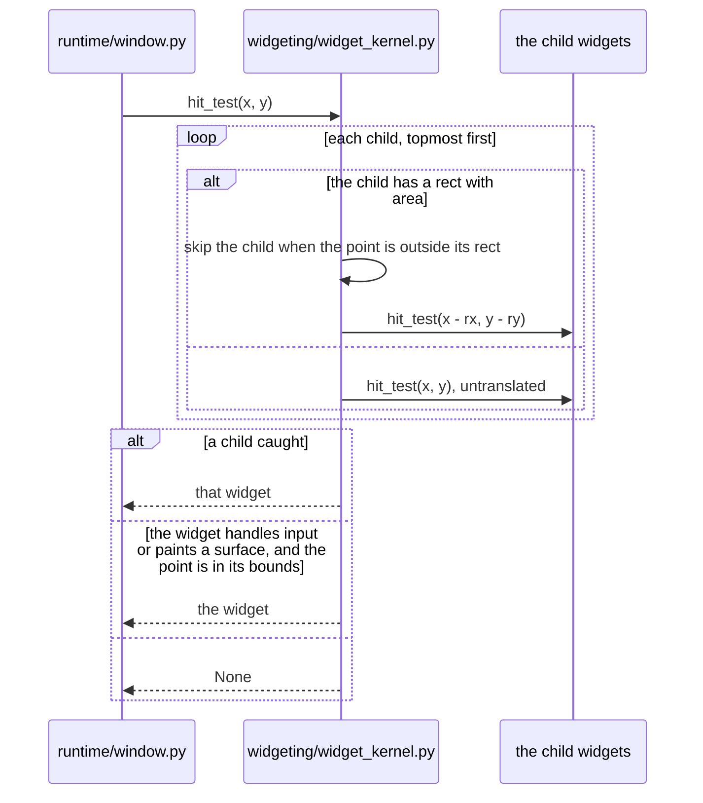
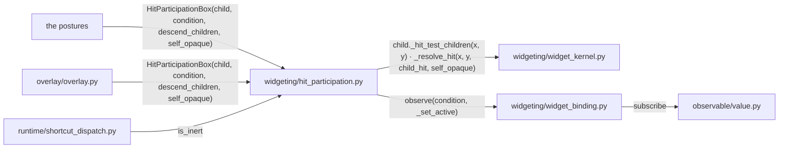
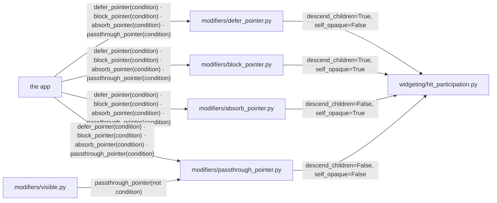
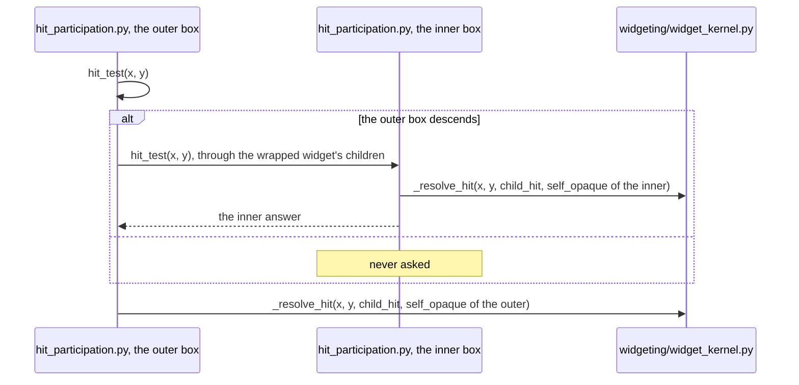

# Hit Testing

Hit testing names the widget under a point. Two axes decide it for every
widget. One is whether the widget's own rectangle catches. The other is
whether the test descends into its children.

## Overview

Three groups of modules take part, with the pointer dispatch and the overlay
at their edges.

### Structure

| Module | Role |
| --- | --- |
| The Resolution | the descent into the children and the widget's own surface |
| The Participation Box | one wrapper that fixes both axes while a condition holds |
| The Postures | the four modifiers, each a setting of the box |
| `runtime/window.py` | asks for the target of a pointer event ([INTERACTION_ARCHITECTURE.md](INTERACTION_ARCHITECTURE.md)) |
| `overlay/overlay.py` | builds its blocking and click-through layers from the box ([OVERLAY.md](OVERLAY.md)) |
| the app | picks a posture |

### Promises

- The hit region is the rectangle, never the painted shape.
- The two axes are not public. A posture is named, never spelled as flags.
- Every widget's hit resolves through `_resolve_hit`.

## The Resolution

`WidgetKernel.hit_test` combines the children's answer with the widget's own
surface.

### Structure

| Module | Role |
| --- | --- |
| `widgeting/widget_kernel.py` | the descent, the own-surface policy and the bounds test |
| `widgeting/widget_input.py` | answers whether the widget handles pointer or scroll input ([INTERACTION_ARCHITECTURE.md](INTERACTION_ARCHITECTURE.md)) |
| `widgets/box.py` | catches on its own surface when it paints a background, a border or a shadow ([BOX_MODEL.md](BOX_MODEL.md)) |
| `material/interactive_widget.py` | bounds the hit to its content rect ([BOX_MODEL.md](BOX_MODEL.md)) |
| `layout/deck.py` | a pure pass-through wrapper ([LAYOUT.md](LAYOUT.md)) |
| `overlay/overlay_position.py` | a pure pass-through wrapper ([OVERLAY.md](OVERLAY.md)) |
| `runtime/window.py` | asks for the target (Overview) |
| the child widgets | each a kernel of its own |

### Sequence

#### A point is resolved

### Promises

- A widget that handles pointer or scroll input catches its rect. A widget
  that paints a surface catches its rect. Any other widget defers to its
  children.
- A size-less provider such as `ForEach` is no bounds gate for the subtree
  it lifts into its parent.
- A pure pass-through wrapper passes `self_opaque=False`. No wrapper keeps an
  `is self` check of its own.

## The Participation Box

`HitParticipationBox` overrides a subtree's two axes while its condition
holds.

### Structure

| Module | Role |
| --- | --- |
| `widgeting/hit_participation.py` | overrides a subtree's two axes while its condition holds; reports whether the subtree is inert |
| `widgeting/widget_kernel.py` | the resolution the box drives (The Resolution) |
| `widgeting/widget_binding.py` | the subscription to a `State` condition ([WIDGET_ARCHITECTURE.md](WIDGET_ARCHITECTURE.md)) |
| `observable/value.py` | a `State[bool]` condition ([OBSERVABLE.md](OBSERVABLE.md)) |
| `runtime/shortcut_dispatch.py` | reads whether a subtree is inert ([KEYBOARD_SHORTCUTS.md](KEYBOARD_SHORTCUTS.md)) |
| the postures | the four modifiers that configure the box (The Postures) |
| `overlay/overlay.py` | the backdrop and the blocker ([OVERLAY.md](OVERLAY.md)) |

### Promises

- An inactive box resolves as the wrapped widget would alone.
- The condition is read at construction, never at the first hit.
- The box descends into the wrapped widget's children, not into the widget.
  The wrapped widget's own surface is governed by the box.
- `widgeting/hit_participation.py` imports no modifier.

## The Postures

Four modifiers name one setting of the box each.

### Structure

| Module | Role |
| --- | --- |
| `modifiers/defer_pointer.py` | self never catches, the children do |
| `modifiers/block_pointer.py` | self catches its whole rect, the children still work |
| `modifiers/absorb_pointer.py` | self catches its whole rect, nothing below it is asked |
| `modifiers/passthrough_pointer.py` | the whole subtree is click-through |
| `modifiers/visible.py` | composes the click-through posture into a hidden widget ([MODIFIER.md](MODIFIER.md)) |
| `widgeting/hit_participation.py` | the wrapper each posture configures (The Participation Box) |
| the app | picks a posture, with a `bool` or a `State[bool]` |

### Sequence

#### Two stacked postures resolve a point

### Promises

- Stacked postures are nested boxes, the later in `a | b` outermost. The
  outermost box decides whether descent happens. Where two disagree on the
  widget's own surface, the outermost wins.
