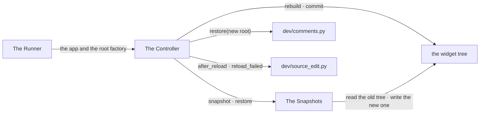
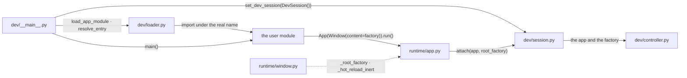
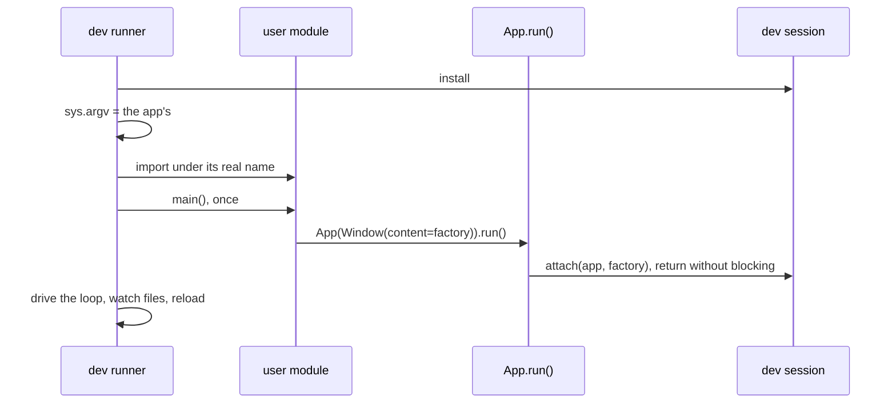
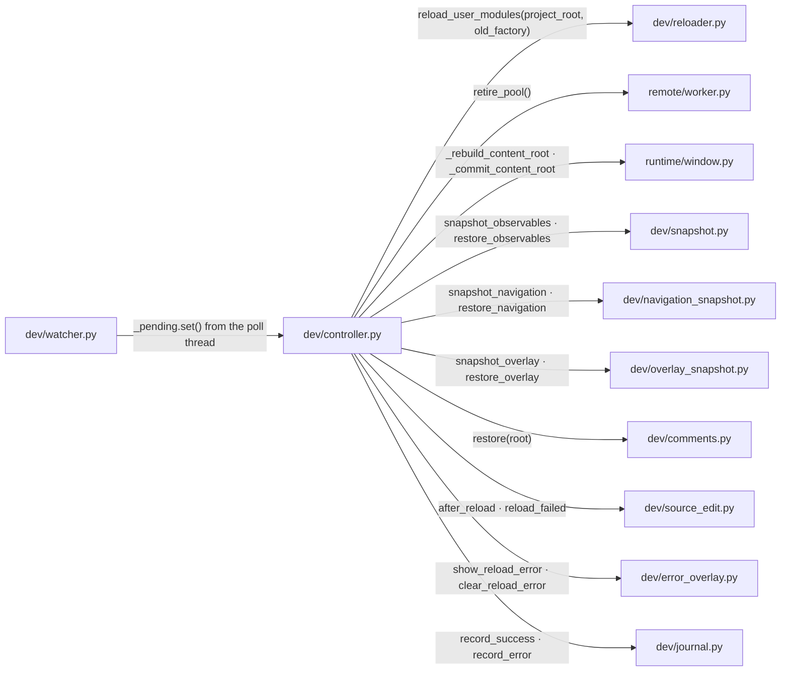
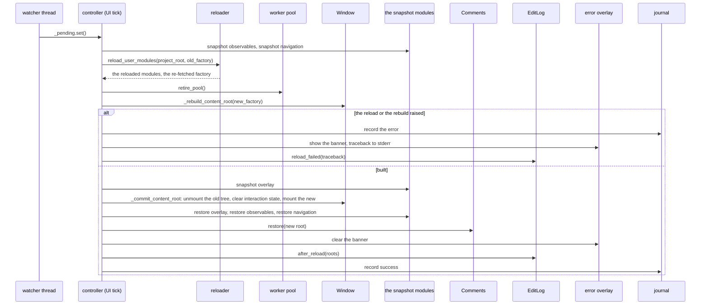
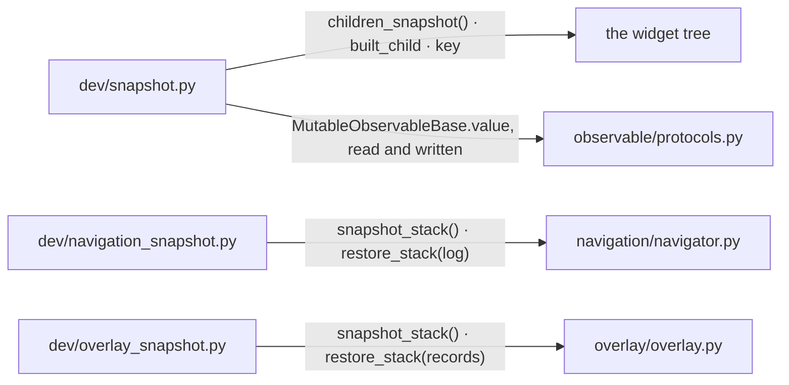
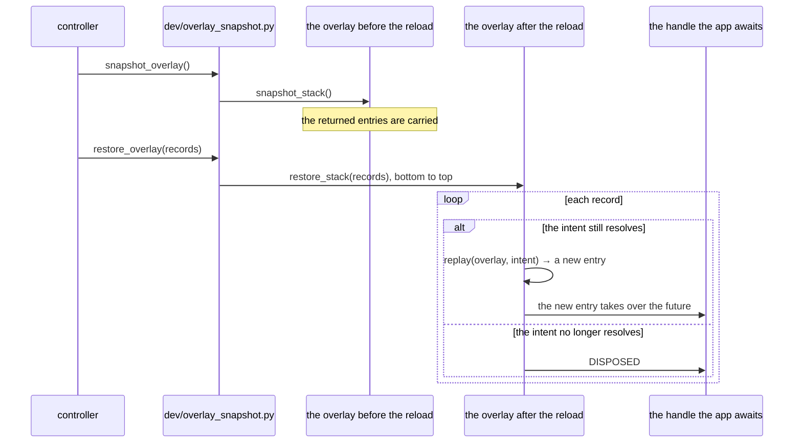

# Hot Reload

A save rebuilds the content tree from the root factory while the process, the
window, the GL context and the app's `Observable` values survive. The dev
bridge that drives the reloaded app is in [DEV_BRIDGE.md](DEV_BRIDGE.md); the
layout edit that lands through a reload is in [DEV_MODES.md](DEV_MODES.md).

## Overview

Three groups of modules take part: the runner that starts the app, the
controller that turns a save into a reload, and the snapshots that carry
state into the new tree.

### Structure

| Module | Role |
| --- | --- |
| The Runner | starts the app under the dev session and keeps the root factory |
| The Controller | turns a save into one reload: modules, rebuild, commit, the report |
| The Snapshots | copy what the old tree held into the new one |
| the widget tree | what is rebuilt and restored |
| `dev/comments.py` | the comment marks, matched back after a rebuild ([DEV_MODES.md](DEV_MODES.md)) |
| `dev/source_edit.py` | the pending layout edit, checked after a reload ([DEV_MODES.md](DEV_MODES.md)) |

### Promises

- User code carries no dev/prod branch.
- The tree is rebuilt only by re-invoking the root factory.
- The framework's own modules are never reloaded.

## The Runner

The dev runner imports the user's module, calls `main()`, and takes the app
and its root factory from `App.run()`.

### Structure

| Module | Role |
| --- | --- |
| `dev/__main__.py` | parses the command, sets the app's `sys.argv`, drives the loop |
| `dev/loader.py` | turns the launch target into a real module name, puts the package root on `sys.path`, finds the entry |
| `dev/session.py` | the process-global `DevSession` the app attaches to |
| the user module | the app's own code, with its `main()` |
| `runtime/app.py` | `App.run()` hands the app to the session when one is installed |
| `runtime/window.py` | holds the root factory, or marks the window inert (The Controller) |
| `dev/controller.py` | receives the app and the factory (The Controller) |

### Sequence

#### The app starts under the runner

### Promises

- `main()` runs once per process.
- The user's module is imported under its real name, never `__main__`.
- The app sees its own `sys.argv`. The runner's is never restored.
- A window whose content or overlay is a widget instance is inert to reload.

## The Controller

One save becomes one reload on the UI thread.

### Structure

| Module | Role |
| --- | --- |
| `dev/watcher.py` | polls the user files' mtimes on a background thread; acknowledges a file the runner wrote |
| `dev/controller.py` | holds the pending event, runs the reload on the UI tick in order |
| `dev/reloader.py` | decides which modules are the user's, orders them, reloads them, re-fetches the factory |
| `remote/worker.py` | the worker pool the reload retires |
| `runtime/window.py` | rebuilds the content root from the factory and commits it in place of the old one |
| `dev/error_overlay.py` | the banner over the still-running UI |
| `dev/journal.py` | records every reload, success or failure |
| `dev/snapshot.py`, `dev/navigation_snapshot.py`, `dev/overlay_snapshot.py` | the three snapshots and their restores (The Snapshots) |
| `dev/comments.py` | the comment marks matched back onto the new tree |
| `dev/source_edit.py` | the pending layout edit checked after the reload |

### Sequence

#### A save becomes a reload

### Promises

- A user module lies under the project root, outside the install
  directories, under none of the blacklisted root packages.
- Every user module is reloaded on every save.
- The factory is re-fetched by name from its reloaded module.
- Only the content tree is rebuilt.
- A reload or a rebuild that raises leaves the previous tree on screen.
- No reference into the old tree survives the commit.
- The watcher only signals.

## The Snapshots

The new tree starts with fresh observables, a fresh navigator and a fresh
overlay. Each snapshot writes into the new tree what the old one held,
matched by an identity that survives the rebuild. The replay of the route
stack is in [NAVIGATION.md](NAVIGATION.md).

### Structure

| Module | Role |
| --- | --- |
| `dev/snapshot.py` | walks the tree by structural path, copies every mutable observable's value, writes it back at the same path |
| `dev/navigation_snapshot.py` | reads the route log before the swap, replays it after the commit |
| `dev/overlay_snapshot.py` | reads the entry records before the commit, shows them again after it |
| the widget tree | what the walk reads: `children_snapshot()`, `built_child`, `key` (`widgeting/`) |
| `observable/protocols.py` | `MutableObservableBase`, the value the snapshot copies |
| `navigation/navigator.py` | keeps the route log and replays it ([NAVIGATION.md](NAVIGATION.md)) |
| `overlay/overlay.py` | keeps the entry records, replays them, hands the old handle to the new entry ([OVERLAY.md](OVERLAY.md)) |

### Sequence

#### An awaited entry survives a reload

### Promises

- An observable's value is copied. The object holding it is not.
- A widget's `key` is its identity for the restore. A keyless widget is
  identified by its position and type.
- A path with no match in the new tree leaves that observable at its initial
  value.
- Only observables held by a widget in the tree are restored.
- An intent is resolved by its qualified name.
- An awaited handle completes once: by its own entry, by the entry that took
  it over, or with `DISPOSED`.
- An entry shown from a widget is not recorded. It closes with the old tree.
- The record lives in the core `Overlay`.
- An entry whose intent no longer resolves does not stop the entries above
  it from being restored.
