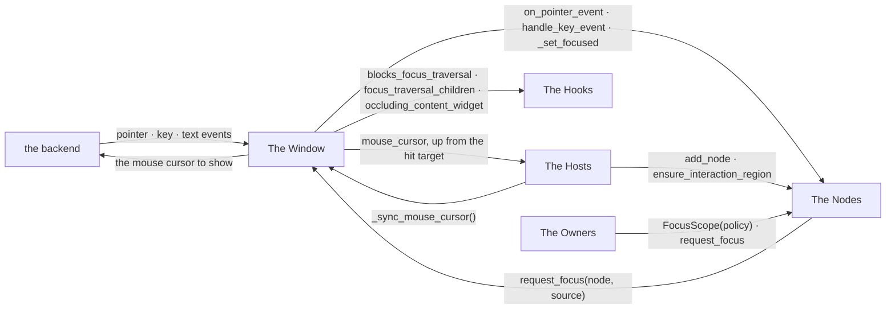
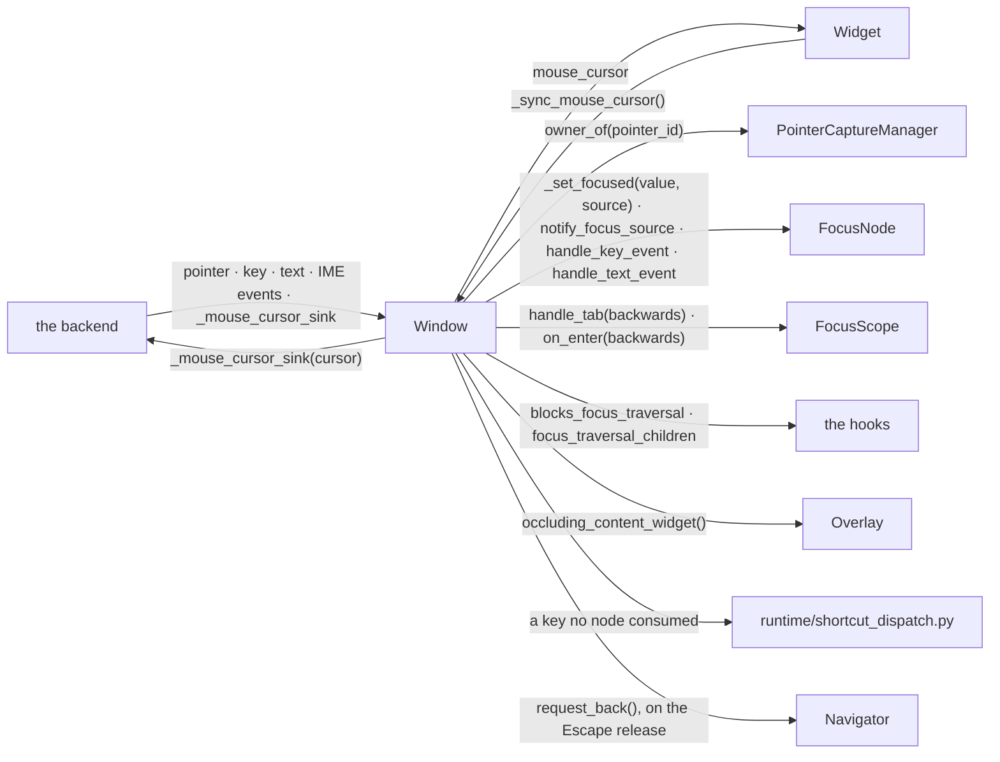
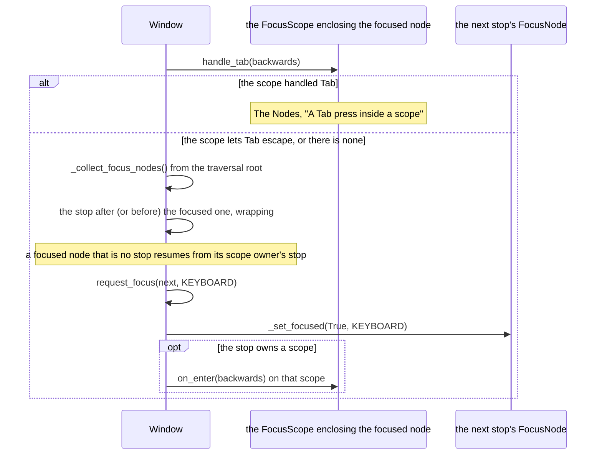
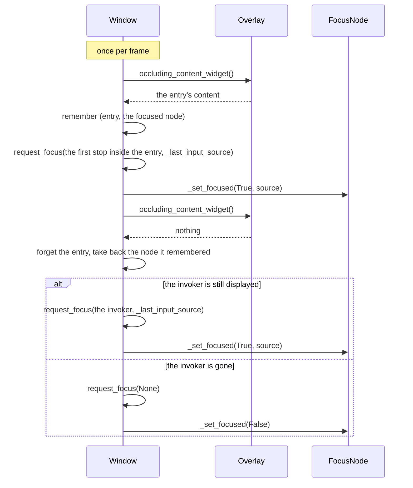
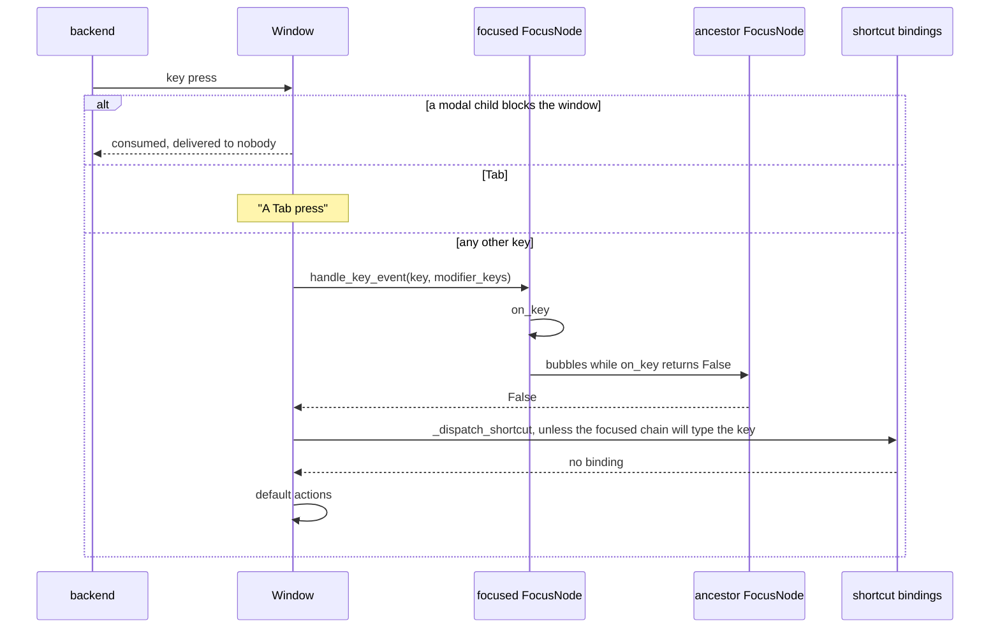
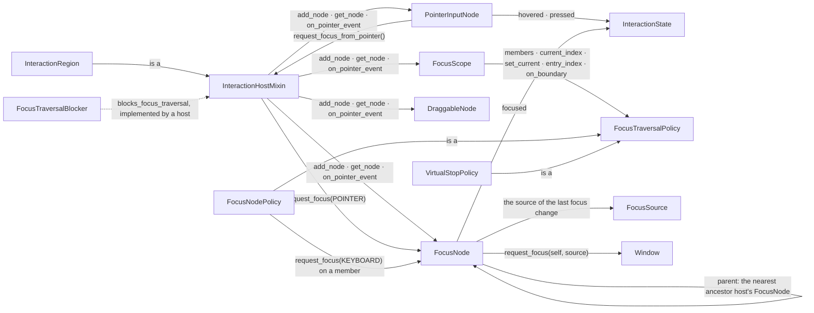
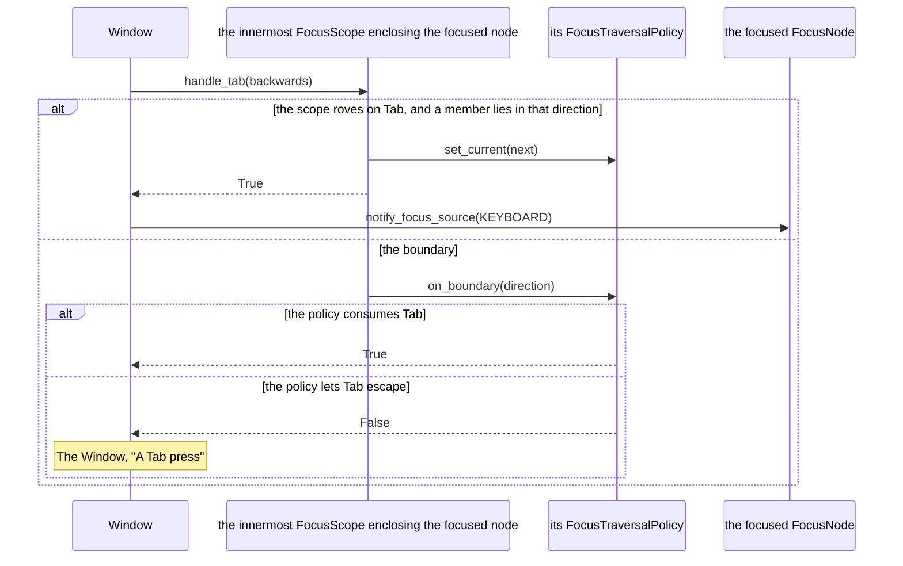
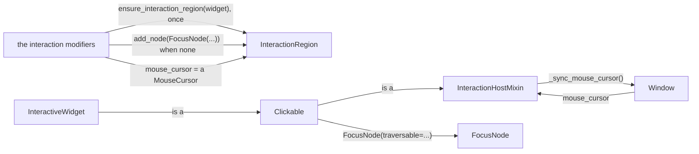
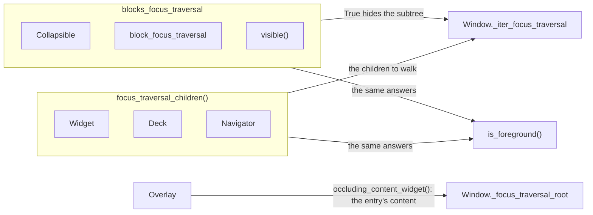
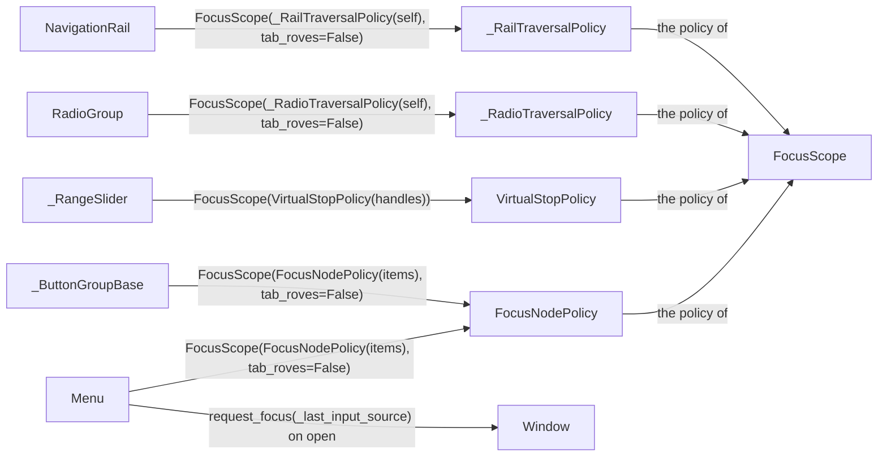

# Interaction Architecture

Pointer events, focus and keyboard input are handled by nodes hosted on a
widget.

## Overview

Five groups of modules take part: the window, the nodes, the hosts that
carry nodes, the hooks the Tab walk asks, and the widgets that own a focus
scope.

### Structure

| Module | Role |
| --- | --- |
| the backend | delivers pointer, key and text events to the window, shows the mouse cursor it is handed |
| The Window | dispatches the events, holds the focused node, walks the Tab sequence, traps focus in a modal, resolves the mouse cursor |
| The Nodes | the nodes a host carries, the state they share, the scope and its policies |
| The Hosts | the ways a widget becomes a host: a modifier wrapping it, or inheriting through `Clickable` |
| The Hooks | what hides or narrows the Tab walk, and the shortcut layer that asks the same hooks |
| The Owners | the widgets that traverse their own parts through a scope |

### Promises

- Input reaches a widget only through the nodes on its host.
- A widget requests focus. Only the window sets it.
- A widget answers the mouse cursor over itself. Only the window decides
  which one the backend shows.

## The Window

The window turns backend events into calls on nodes, holds the one focused
node, and walks the tree for the Tab sequence.

### Structure

| Module | Role |
| --- | --- |
| the backend | delivers pointer, key, text and IME events, and the sink that shows a mouse cursor on the OS window |
| `Window` | dispatches the events, holds the focused node and the last input source, walks the tree from the traversal root for the stops, drops focus the walk no longer reaches, traps focus inside an open modal, resolves the mouse cursor |
| `Widget` | answers the mouse cursor over itself, or answers nothing |
| `PointerCaptureManager` | the widget that holds the pointer during a drag |
| `FocusNode`, `FocusScope` | the nodes the window calls (The Nodes) |
| the hooks | what the walk asks on the way down (The Hooks) |
| `Overlay` | the occluding entry the walk starts from (The Hooks) |
| `runtime/shortcut_dispatch.py` | the shortcut bindings a key falls to ([KEYBOARD_SHORTCUTS.md](KEYBOARD_SHORTCUTS.md)) |
| `Navigator` | back navigation on Escape ([NAVIGATION.md](NAVIGATION.md)) |

### Sequence

#### A Tab press

#### A modal opens and closes

#### A key press reaches its handler

### Promises

- One walk yields the reachable widgets. The stops and the reachability of
  the focused node rest on it.
- Reachable means not hidden by a blocker, a narrowing container or an
  input-blocking overlay entry.
- While an input-blocking overlay entry is open, the sequence starts at that
  entry's content.
- Focus is never outside the open entry. Focus is never left in a closed
  entry.
- Focus held in content that is no longer reachable is dropped.
- Scopes resolve innermost first.
- Every key press and every pointer press sets the window's last input
  source.
- A key consumed by one handler reaches no other.
- A key the focused chain will turn into text never reaches the shortcut
  bindings.
- `on_text`, `on_text_motion` and `on_ime_composition` go to the focused
  node only.
- Escape is consumed on press. Its release runs back navigation.
- Key input to a window blocked by a modal child is consumed and delivered to
  nobody.
- The mouse cursor is the hit target's answer, else the nearest ancestor's,
  else the arrow. During a drag the capture owner stands in for the hit
  target.

## The Nodes

A node is attached to a host and shares the host's `InteractionState`. The
focus node holds focus and keys; the scope groups the nodes beneath it.

### Structure

| Module | Role |
| --- | --- |
| `InteractionHostMixin` | carries the nodes, routes a pointer event to them, asks focus for the host on a primary press |
| `InteractionRegion` | the wrapper host a modifier puts around a widget, built once per widget by `ensure_interaction_region()` |
| `InteractionState` | the one state the nodes write and the widget paints from |
| `PointerInputNode` | hover, press, release, click; captures the pointer on a press |
| `FocusNode` | holds focus, says whether it is a Tab stop, bubbles keys and text to the ancestor node |
| `DraggableNode` | drag start, deltas and end, with long-press initiation |
| `FocusScope` | marks a subtree as one group Tab enters and leaves |
| `FocusTraversalPolicy`, `FocusNodePolicy`, `VirtualStopPolicy` | enumerates a scope's members and moves between them; over real child nodes, or over stops the owner keeps |
| `FocusTraversalBlocker` | the protocol a host implements to hide its subtree from the Tab walk |
| `FocusSource` | whether a focus change came from the keyboard or the pointer |
| `Window` | the one that sets focus (The Window) |

### Sequence

#### A Tab press inside a scope

### Promises

- The widget paints hovered, pressed, focused and disabled from the host's
  one `InteractionState`.
- A node with `traversable=False` holds focus, receives keys and bubbles
  them. The Tab sequence never stops on it.
- A key the focused node's `on_key` returns `False` for bubbles to the
  nearest ancestor `FocusNode`.
- A request for the node already focused re-announces the source. The source
  changes without focus moving.
- A scope is the unit Tab enters and leaves. Tab enters at the first member
  and Shift+Tab at the last, unless the policy's `entry_index` says
  otherwise.
- The members of a `FocusNodePolicy` are `traversable=False`. Only the
  policy moves focus between them.
- Whether Tab roves between the members, or is always a boundary, is the
  scope's setting. What happens at the boundary, escape or consume, is the
  policy's answer.

## The Hosts

A widget becomes a host in one of two ways: a modifier wraps it in an
`InteractionRegion`, or it inherits `InteractionHostMixin` through
`Clickable`.

### Structure

| Module | Role |
| --- | --- |
| the interaction modifiers | `focusable()`, `clickable()`, `hoverable()`, `cursor()`: wrap any widget in one shared region, then add the node or write the `mouse_cursor` it needs |
| `Clickable` | the host every control inherits; carries `traversable`, and blocks the Tab walk while disabled |
| `InteractiveWidget` | the Material host: the state layer, the focus ring, activation on Space and Enter |
| `InteractionRegion`, `InteractionHostMixin`, `FocusNode` | what the hosts are built from (The Nodes) |
| `Window` | resolves the cursor from the answers (The Window) |

### Promises

- A modifier wraps the widget in one `InteractionRegion`. A second pointer
  modifier on the same widget reuses it.
- A standard control adds its nodes in `__init__`. No wrapper enters the tree.
- A primary-button press on a host with a `FocusNode` requests focus for it,
  with the pointer as the source.
- A new capability is a new node on the same host.
- A `mouse_cursor` written on a host, by `cursor()` or by code, replaces the
  host's own answer.
- A write to `mouse_cursor` on a mounted host reaches the window at once.

## The Hooks

The Tab walk asks the hooks on the way down.

### Structure

| Module | Role |
| --- | --- |
| `Collapsible` | blocks the walk while closed |
| `block_focus_traversal()` | blocks the walk while its condition holds |
| `visible()` | hides a subtree; composed of `block_focus_traversal()` and the pointer pass-through |
| `Widget` | `focus_traversal_children()`: the children to walk, `children_snapshot()` unless a container narrows it |
| `Deck` | narrows the walk to the selected page |
| `Navigator` | narrows the walk to the top route |
| `Overlay` | `occluding_content_widget()`: the content of the topmost input-blocking entry, or none |
| `is_foreground()` | the shortcut layer's test of whether a binding's subtree is displayed |
| `Window._iter_focus_traversal`, `Window._focus_traversal_root` | the walk and its root (The Window) |

### Promises

- A blocking `FocusTraversalBlocker` hides its whole subtree.
- `focus_traversal_children()` narrows the walk to some of the children. It
  is resolved on every call.
- The shortcut layer's foreground test asks the same hooks as the walk.

## The Owners

A widget that traverses its own parts owns a `FocusScope` and gives it a
policy over its members.

### Structure

| Module | Role |
| --- | --- |
| `Menu` | items as real focus nodes; the arrows rove, Tab is a boundary |
| `_ButtonGroupBase` | items as real focus nodes; Left and Right rove, stopping at the ends |
| `_RangeSlider` | the two handles as virtual stops; Tab roves between them |
| `RadioGroup`, `_RadioTraversalPolicy` | entered at the selected radio; the arrows rove, wrap, and move the selection |
| `NavigationRail`, `_RailTraversalPolicy` | entered at the selected item; Up and Down rove and wrap, moving focus only |
| `FocusScope`, `FocusNodePolicy`, `VirtualStopPolicy` | what the owners build on (The Nodes) |
| `Window` | hands a self-focusing widget its last input source (The Window) |

### Promises

- A group has one external Tab stop, its owner's. A popup menu has none.
- A disabled member has no `FocusNode`.
- Whether roving wraps, and whether it moves the selection, are the policy's
  decisions.
- A widget that takes focus on its own inherits the window's last input
  source.
