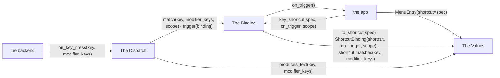
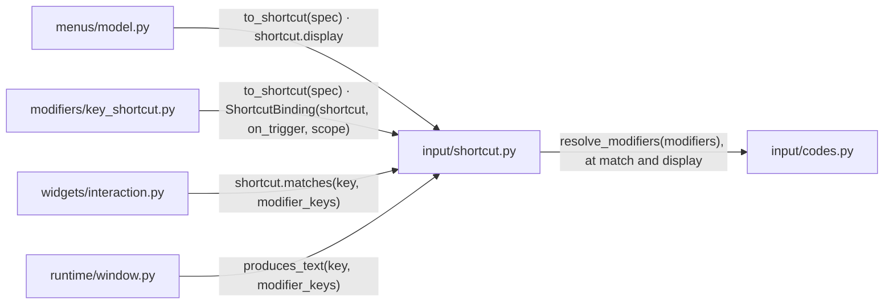
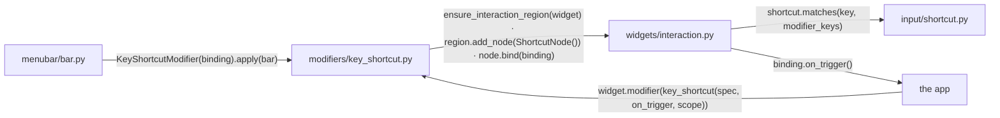
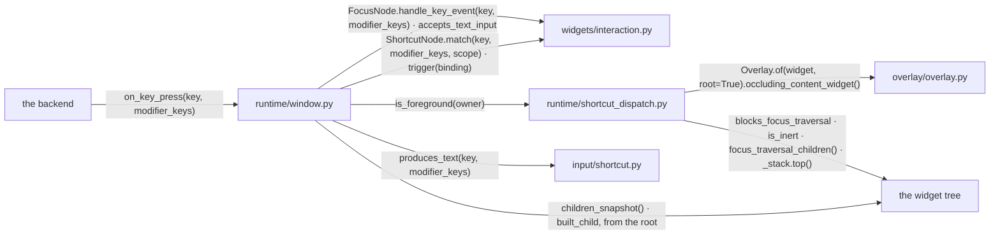
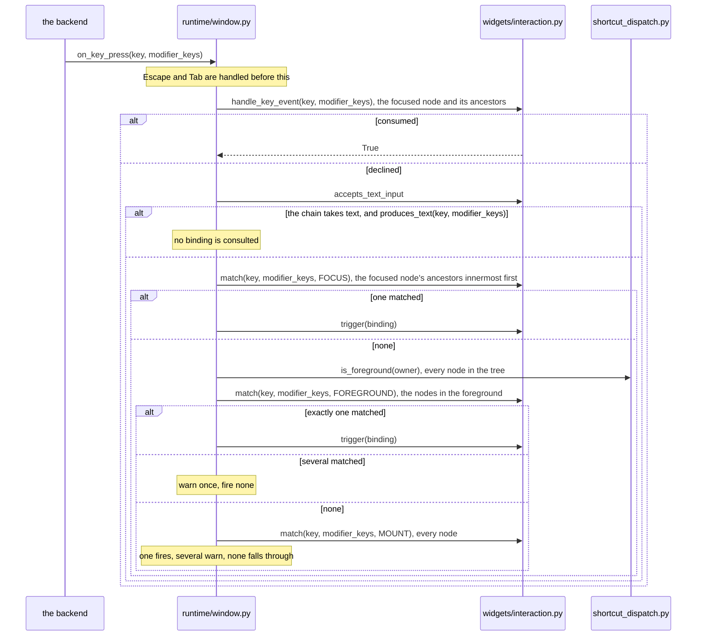

# Keyboard Shortcuts

A shortcut is a key gesture bound to a command. It fires whether or not
anything holds focus.

## Overview

Three groups of modules take part.

### Structure

| Module | Role |
| --- | --- |
| The Values | the frozen value types |
| The Binding | the modifier and the menu bar, ending in a widget's `ShortcutNode` |
| The Dispatch | the key-press tiers in the window |
| the backend | the source of key presses ([APP_WINDOW.md](APP_WINDOW.md)) |
| the app | declares the bindings, owns the commands |

### Promises

- A binding lives on a widget. The widget's place in the tree decides
  whether the binding is live.

## The Values

A gesture, a binding and a scope are frozen values, shared between a menu
item and a modifier.

### Structure

| Module | Role |
| --- | --- |
| `input/shortcut.py` | `Shortcut`, a key name with its modifier mask; `ShortcutBinding`, the gesture with its callback and its scope, `FOCUS`, `FOREGROUND` or `MOUNT`; `produces_text`, whether a key press may become text |
| `input/codes.py` | the `MOD_*` masks; turns `MOD_ACCEL` into the platform's primary modifier |
| `menus/model.py` | `MenuEntry` holds a `Shortcut` and shows its display form ([MENU_BAR.md](MENU_BAR.md)) |
| `modifiers/key_shortcut.py` | builds the binding (The Binding) |
| `widgets/interaction.py` | matches a key press against the bindings it holds (The Binding) |
| `runtime/window.py` | asks whether a key is text (The Dispatch) |

### Promises

- `MOD_ACCEL` is resolved when a gesture is matched or displayed, never when
  it is constructed.
- Both sides of a match pass through `normalize_key_name`.

## The Binding

A binding reaches a widget through `key_shortcut` or through a menu bar. Both
end in the widget's `ShortcutNode`.

### Structure

| Module | Role |
| --- | --- |
| `modifiers/key_shortcut.py` | `key_shortcut`, the modifier that puts a binding on a widget |
| `widgets/interaction.py` | `ShortcutNode`, one widget's bindings keyed by gesture, on its `InteractionRegion` ([INTERACTION_ARCHITECTURE.md](INTERACTION_ARCHITECTURE.md)) |
| `menubar/bar.py` | binds each menu item's shortcut on the bar widget ([MENU_BAR.md](MENU_BAR.md)) |
| `input/shortcut.py` | the gesture (The Values) |
| the app | the widget the binding is applied to, the callback it names |

### Promises

- A `ShortcutNode` holds one binding per gesture.
- A menu item's shortcut is a `MOUNT` binding on the menu bar.
- A menu item and a `key_shortcut` binding reference the command's callback.
  Neither owns it.

## The Dispatch

The window offers a key press to the focused node first, then to the
bindings, narrowest scope first.

### Structure

| Module | Role |
| --- | --- |
| `runtime/window.py` | resolves a key press in tiers; collects the `ShortcutNode`s of the tree |
| `widgets/interaction.py` | the focused `FocusNode` and the chain it bubbles along ([INTERACTION_ARCHITECTURE.md](INTERACTION_ARCHITECTURE.md)); the `ShortcutNode`s (The Binding) |
| `runtime/shortcut_dispatch.py` | answers whether a widget is on the topmost interactable layer |
| `overlay/overlay.py` | names the content of the topmost blocking entry ([OVERLAY.md](OVERLAY.md)) |
| `input/shortcut.py` | `produces_text` (The Values) |
| the backend | the source of key presses ([APP_WINDOW.md](APP_WINDOW.md)) |
| the widget tree | the ancestors asked whether they hide the widget ([INTERACTION_ARCHITECTURE.md](INTERACTION_ARCHITECTURE.md)) |

### Sequence

#### A key press reaches a binding

### Promises

- A key the focused chain consumes reaches no binding.
- A key the focused chain can type reaches no binding. When text and a
  shortcut can both claim a key, the key is text.
- Among `FOCUS` bindings the innermost enclosing the focused node wins.
- Several `FOREGROUND` or `MOUNT` matches fire nothing.
- A widget is in the foreground by the same test that puts it in the Tab
  sequence.
- A blocking overlay entry puts everything outside its content out of the
  foreground. A passthrough entry blocks nothing.
