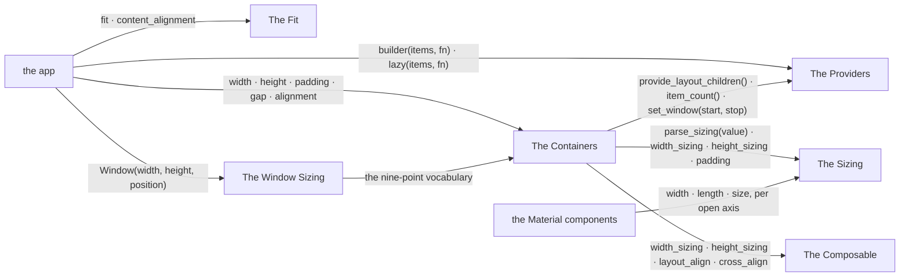
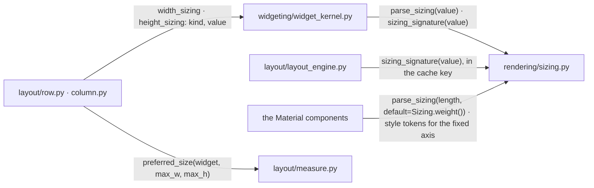
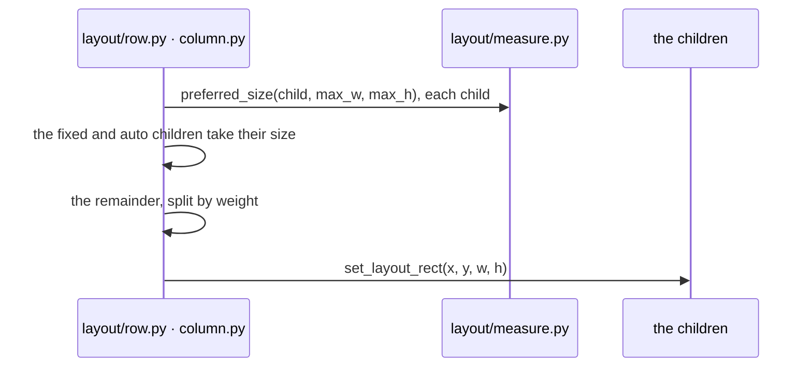
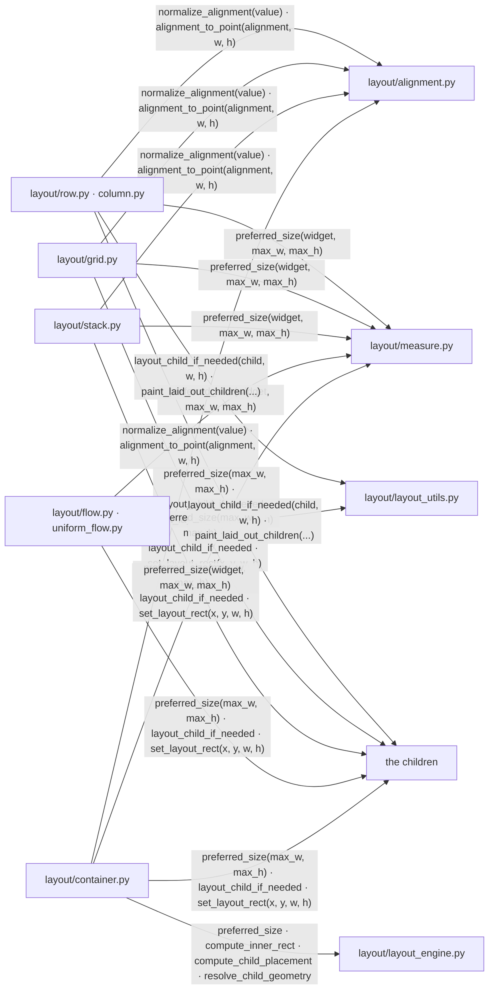
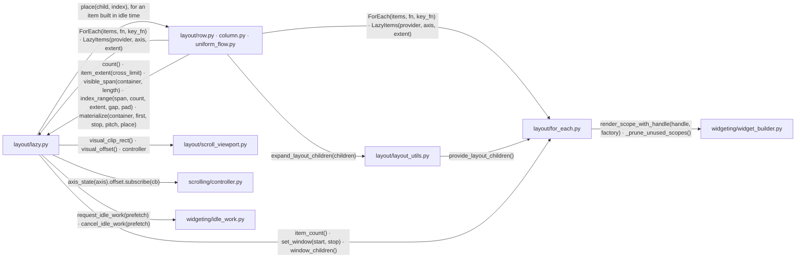
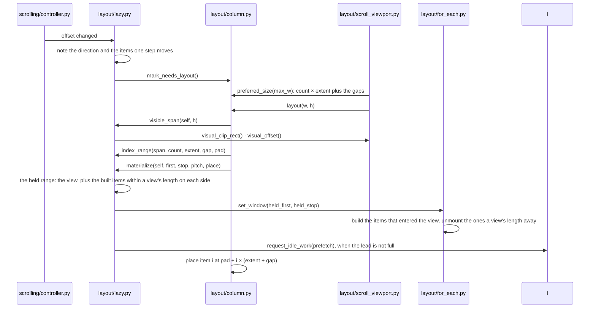
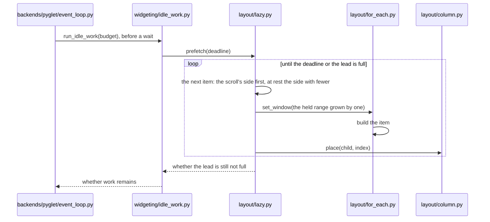
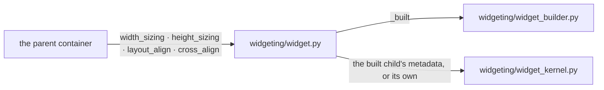
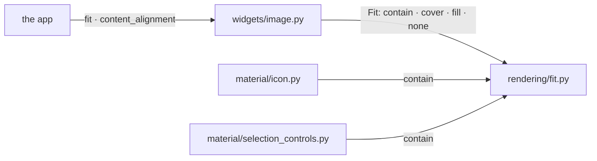
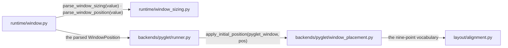

# Layout

A widget's size and spacing are its own properties. Its parent places it.

## Overview

Five groups of modules take part, with the Material components and the app at
their edges.

### Structure

| Module | Role |
| --- | --- |
| The Sizing | how a widget asks for space on one axis |
| The Containers | place their children and share the room out |
| The Providers | build a container's children from data, all of them or the ones in view |
| The Composable | reports the layout metadata of the widget it built |
| The Fit | places a widget's content inside the rect it was given |
| The Window Sizing | the window's size and position, resolved before layout |
| the Material components | the MD3 widgets ([MATERIAL_INTERACTION.md](MATERIAL_INTERACTION.md)) |
| the app | sizes, spaces and aligns widgets |

### Promises

- `padding` and `gap` are the two spacing properties.
- A modifier never changes layout ([MODIFIER.md](MODIFIER.md)).
- Alignment belongs to the parent.

## The Sizing

A `Sizing` is how a widget asks for space on one axis.

### Structure

| Module | Role |
| --- | --- |
| `rendering/sizing.py` | `Sizing`, one of `fixed`, `auto` and `weight`, and its parser |
| `widgeting/widget_kernel.py` | holds a widget's two sizings ([BOX_MODEL.md](BOX_MODEL.md)) |
| `layout/row.py · column.py` | share an axis out by the children's sizings (The Containers) |
| `layout/layout_engine.py` | keys its caches on the sizings (The Containers) |
| `layout/measure.py` | the measurement cache (The Containers) |
| the Material components | the fixed axes' style tokens |

### Sequence

#### A row shares its width out

### Promises

- Only the space left after the `fixed` and `auto` children is shared by
  weight.
- A `weight` child measures as its content.
- An axis MD3 leaves open is a constructor parameter, named `width`, `length`
  or `size` by its degree of freedom. An axis MD3 fixes is a style token.

## The Containers

A container measures its children and allocates each a rect.

### Structure

| Module | Role |
| --- | --- |
| `layout/row.py · column.py` | one axis shared out by sizing, `main_alignment` and `cross_alignment` across it, a `gap` between the children |
| `layout/grid.py` | rows, columns and areas; allocates each cell's rect |
| `layout/stack.py` | children over one another, each the sole claimant of both axes |
| `layout/container.py` | one child, placed by `alignment` |
| `layout/flow.py · uniform_flow.py` | children wrapped into lines |
| `layout/alignment.py` | the nine-point vocabulary and its point in a rect |
| `layout/layout_engine.py` | the padding, border and placement arithmetic, cached ([RENDERING_PIPELINE.md](RENDERING_PIPELINE.md)) |
| `layout/measure.py` | the measurement cache ([RENDERING_PIPELINE.md](RENDERING_PIPELINE.md)) |
| `layout/layout_utils.py` | lays a child out and paints the children ([RENDERING_PIPELINE.md](RENDERING_PIPELINE.md)) |
| the children | measured and placed |

### Promises

- Alignment positions a child. It never stretches one.
- Whether a child fills its `Grid` cell is the child's own sizing.
- Nothing clips a child larger than its rect.

## The Providers

A provider builds a container's children from a data collection. A lazy
container's provider builds the items in view, and the ones around them
while the loop is idle.

### Structure

| Module | Role |
| --- | --- |
| `layout/for_each.py` | `ForEach`: one scoped fragment per item, found by its key; with a window, per item in the window |
| `layout/lazy.py` | `LazyItems`: the item extent, the span the viewport shows, the index range it covers, the held range around it and the lead; follows the viewport's offset while mounted, builds ahead of it in idle time and keeps the items a view's length behind it |
| `layout/row.py · column.py · uniform_flow.py` | `builder()` and `lazy()`; place the provided children, a lazy one at its index times the pitch (The Containers) |
| `layout/layout_utils.py` | replaces a provider with its children (The Containers) |
| `layout/scroll_viewport.py` | the clip rect, the displacement and the controller it scrolls by ([BOX_MODEL.md](BOX_MODEL.md)) |
| `scrolling/controller.py` | the offset `Observable` |
| `widgeting/widget_builder.py` | the recompose scopes ([WIDGET_ARCHITECTURE.md](WIDGET_ARCHITECTURE.md)) |
| `widgeting/idle_work.py` | the tasks the frame loop runs before it waits ([RENDERING_PIPELINE.md](RENDERING_PIPELINE.md)) |

### Sequence

#### A scroll moves the window

#### Idle time builds ahead of the view

### Promises

- A provider is never laid out or painted. Its children take its place in the
  container.
- A lazy container holds a widget for each item in view, for the built items
  within a view's length on each side of it, and for none beyond.
- An item that left the view keeps its widget until it lies a view's length
  away. The item comes back into view without a build.
- The layout pass builds the items that entered the view and no other.
- The lead is filled in idle time, one item at a time, the scroll's side
  first.
- At rest the lead is the same on both sides. While scrolling it grows with
  the items one scroll step moves.
- Every item of a lazy container has one main-axis extent: the given one,
  else the measured extent of the first item in view.
- A lazy container's window is the span its nearest enclosing scroll viewport
  shows. With no viewport, the window is its own rect.
- A lazy container's extent on its axis is the sum of its items and gaps,
  known without building them.
- A lazy container takes the cross-axis extent it is offered.

## The Composable

A `ComposableWidget` reports the layout metadata of its built child.

### Structure

| Module | Role |
| --- | --- |
| `widgeting/widget.py` | the declared flags and the getters |
| `widgeting/widget_builder.py` | the built child ([WIDGET_ARCHITECTURE.md](WIDGET_ARCHITECTURE.md)) |
| `widgeting/widget_kernel.py` | the stored values (The Sizing) |
| the parent container | reads the metadata |

### Promises

- A declared value wins. An undeclared one is derived from the built child.

## The Fit

A leaf with content of its own places that content inside its rect by a fit
mode.

### Structure

| Module | Role |
| --- | --- |
| `rendering/fit.py` | the four modes |
| `widgets/image.py` | exposes `fit` and `content_alignment` |
| `material/icon.py` | contains its glyph |
| `material/selection_controls.py` | `Checkbox` and `RadioButton` contain their graphic |
| the app | picks a mode for an image |

### Promises

- `cover` and `fill` exist for `Image` alone.

## The Window Sizing

A window's size and position are resolved before layout.

### Structure

| Module | Role |
| --- | --- |
| `runtime/window_sizing.py` | `WindowSizing`, fixed or auto; `WindowPosition`, an alignment on a screen plus an offset |
| `runtime/window.py` | resolves its size from the content's preferred size when auto ([APP_WINDOW.md](APP_WINDOW.md)) |
| `backends/pyglet/window_placement.py` | places the outer frame in the screen's work area |
| `backends/pyglet/runner.py` | applies the position when the OS window is created ([APP_WINDOW.md](APP_WINDOW.md)) |
| `layout/alignment.py` | the nine points (The Containers) |

### Promises

- A window position is resolved against the screen's work area, never its
  bounds. It places the outer frame, never the client area.
