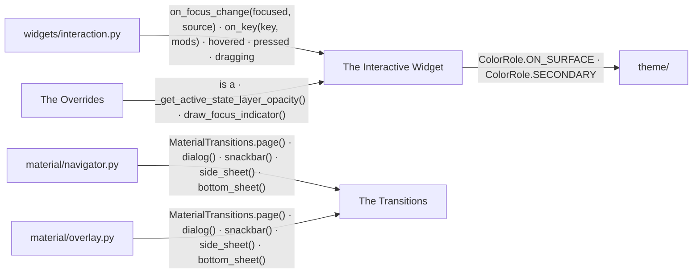
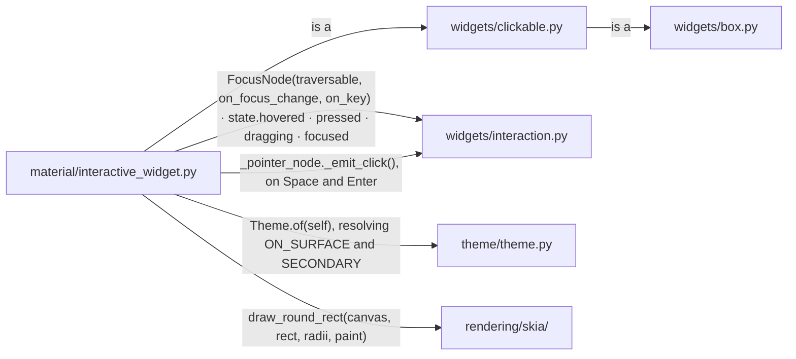
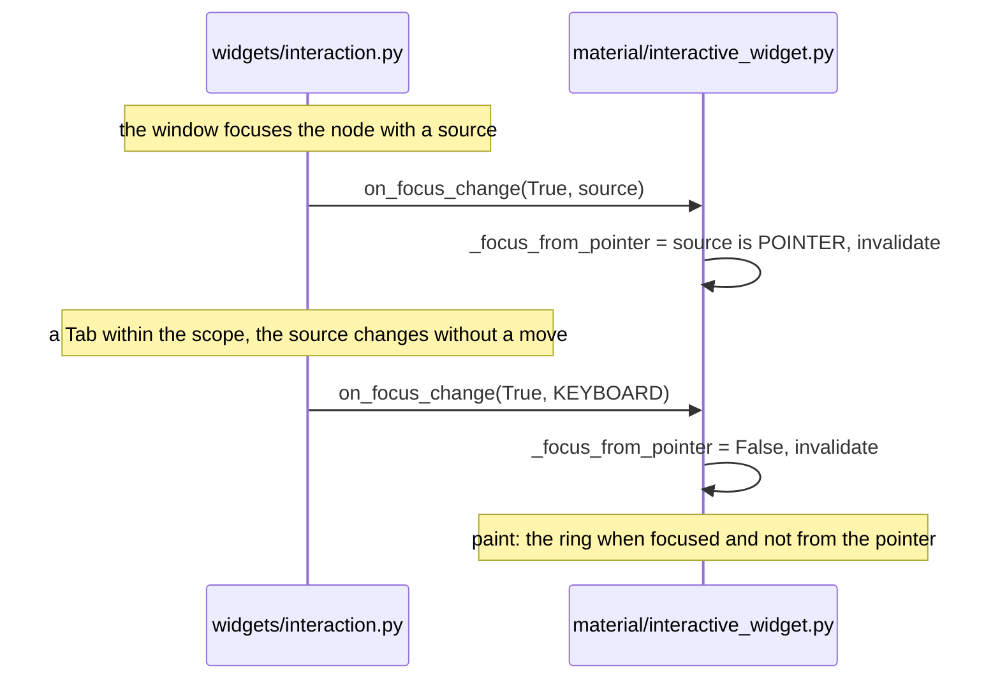
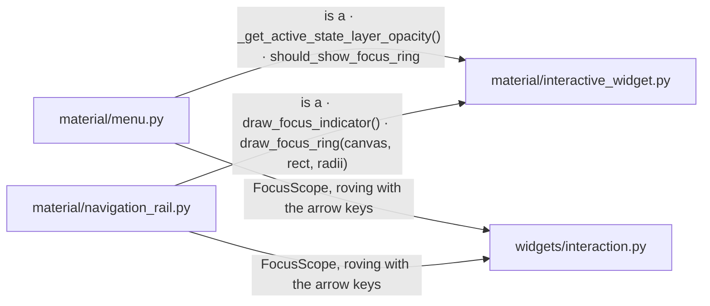
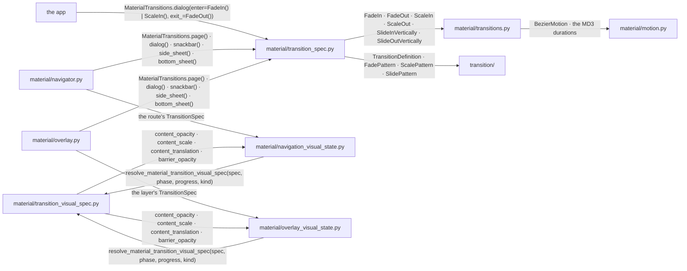

# Material Interaction

Every interactive Material widget is an `InteractiveWidget`.

## Overview

Three groups of modules take part.

### Structure

| Module | Role |
| --- | --- |
| The Interactive Widget | the base every interactive Material widget is built on |
| The Overrides | the components that draw the focus layer or the ring differently |
| The Transitions | the MD3 transition presets and the visual spec they resolve to |
| `widgets/interaction.py` | the focus node and the interaction state ([INTERACTION_ARCHITECTURE.md](INTERACTION_ARCHITECTURE.md)) |
| `theme/` | the colour roles ([STYLE_THEME.md](STYLE_THEME.md)) |
| `material/navigator.py` | the page transitions ([NAVIGATION.md](NAVIGATION.md)) |
| `material/overlay.py` | the dialog, snackbar and sheet transitions ([OVERLAY.md](OVERLAY.md)) |

### Promises

- Whether a widget is focused and whether it shows a ring are two separate
  answers.
- `navigation/` and `overlay/` import nothing from `material/`. The Material
  motion reaches them as a `TransitionSpec`.

## The Interactive Widget

`InteractiveWidget` is a `Clickable` with the MD3 state layer, the focus ring
and the Space and Enter binding.

### Structure

| Module | Role |
| --- | --- |
| `material/interactive_widget.py` | `InteractiveWidget`: the state layer's opacity by state, the ring outside the content rect, the pointer flag the ring reads |
| `widgets/clickable.py` | `Clickable`: the click, the disabled state, the focus node ([INTERACTION_ARCHITECTURE.md](INTERACTION_ARCHITECTURE.md)) |
| `widgets/interaction.py` | tells the widget it is focused, and how ([INTERACTION_ARCHITECTURE.md](INTERACTION_ARCHITECTURE.md)) |
| `widgets/box.py` | the container it paints on the content rect ([BOX_MODEL.md](BOX_MODEL.md)) |
| `theme/theme.py` | the colour roles ([THEME_CONSUMPTION.md](THEME_CONSUMPTION.md)) |
| `rendering/skia/` | the paint |

### Sequence

#### Focus arrives and the ring follows the source

### Promises

- Keyboard focus draws no state layer by default.
- The ring is drawn for keyboard and programmatic focus, never for pointer
  focus. It follows the latest `FocusSource`, whether or not focus moved.
- The ring's reach is the widget's outset ([BOX_MODEL.md](BOX_MODEL.md)).

## The Overrides

Two components draw the focus differently from the base.

### Structure

| Module | Role |
| --- | --- |
| `material/menu.py` | `MenuItem`, roved with the arrow keys |
| `material/navigation_rail.py` | the rail item, roved with the arrow keys, its active indicator its focus shape |
| `material/interactive_widget.py` | the base (The Interactive Widget) |
| `widgets/interaction.py` | the scope the items rove in ([INTERACTION_ARCHITECTURE.md](INTERACTION_ARCHITECTURE.md)) |

### Promises

- A roved menu item layers focus.
- A rail item keeps the ring alone, inset on the active indicator.

## The Transitions

The Material layer ships the MD3 transitions as presets over the transition
kernel.

### Structure

| Module | Role |
| --- | --- |
| `material/transition_spec.py` | `MaterialTransitionSpec`, an enter and an exit definition with a barrier mode and the backward variants; `MaterialTransitions`, the presets per component |
| `material/transitions.py` | the fade, scale and slide factories with the MD3 durations |
| `material/transition_visual_spec.py` | resolves a spec, a phase and a progress into opacity, scale, translation and barrier opacity |
| `material/motion.py` | the MD3 motion curves |
| `transition/` | the kernel's definitions and patterns ([ANIMATION_SYSTEM.md](ANIMATION_SYSTEM.md)) |
| `material/navigator.py` | the Material navigator, with the page preset as its default ([NAVIGATION.md](NAVIGATION.md)) |
| `material/overlay.py` | the Material overlay, each preset supplying its surface's transition ([OVERLAY.md](OVERLAY.md)) |
| `material/navigation_visual_state.py` | paints a route frame from the resolved spec |
| `material/overlay_visual_state.py` | paints a layer frame from the resolved spec, the scrim included |
| the app | customises a preset's enter and exit |

### Promises

- A spec with no backward variant plays its forward definition on a pop.
- The barrier fades with the progress where the spec says `fade`.
- A painter reads the resolved visual spec and composes nothing else.
