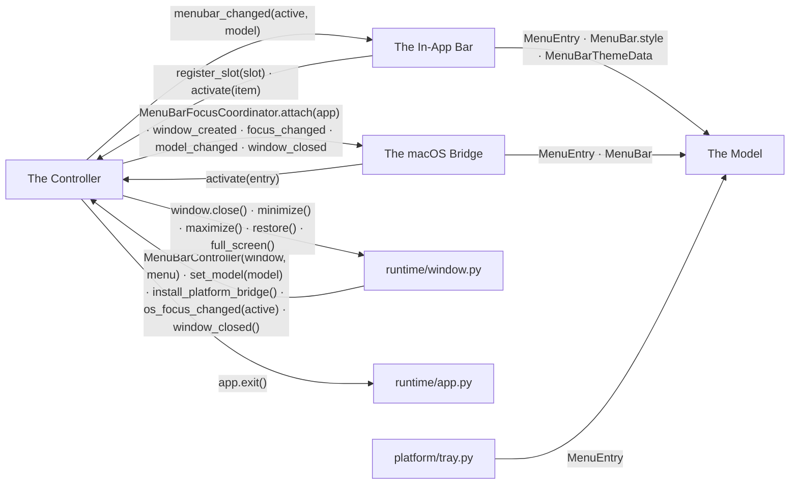
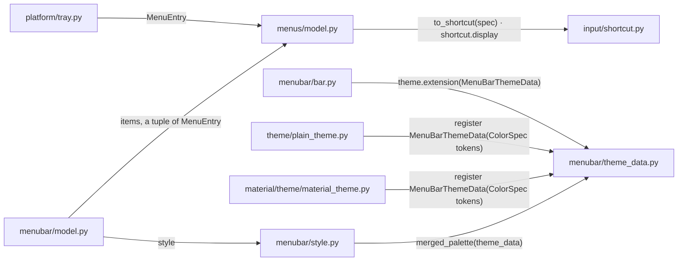
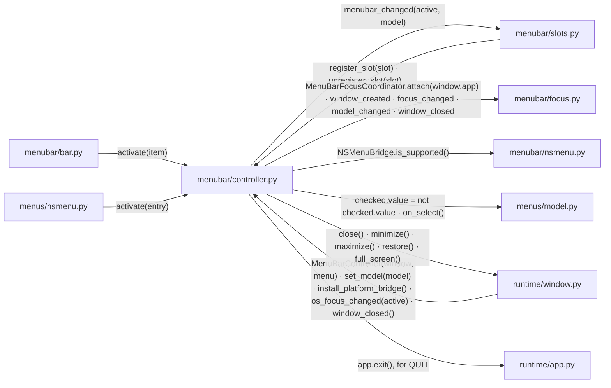
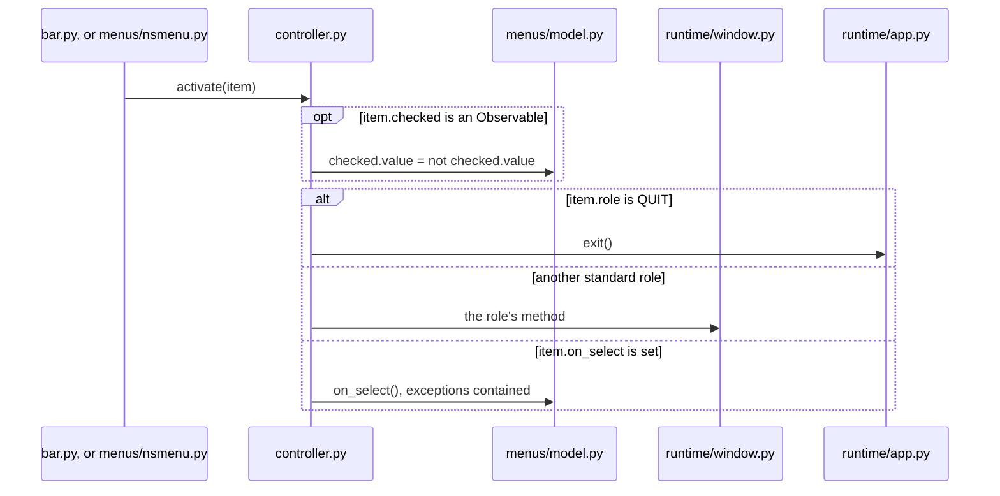
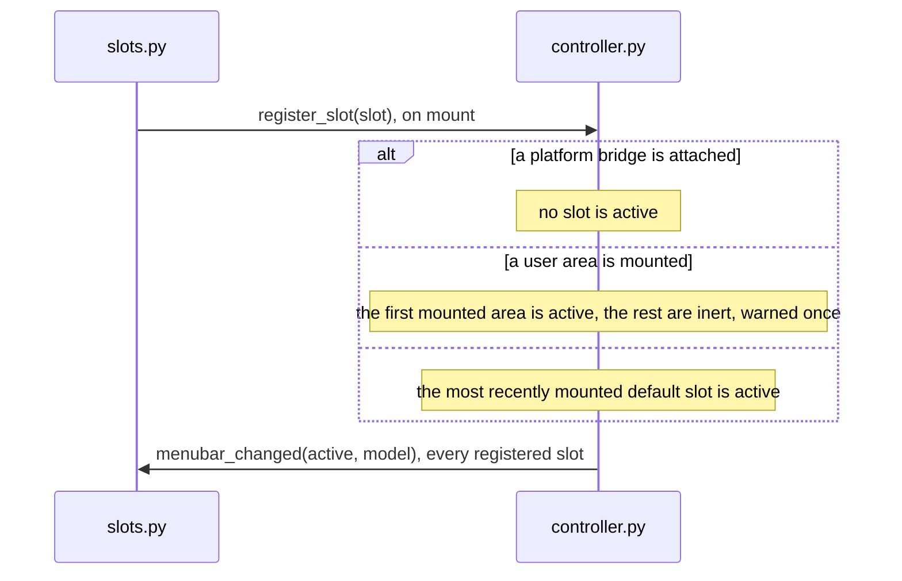
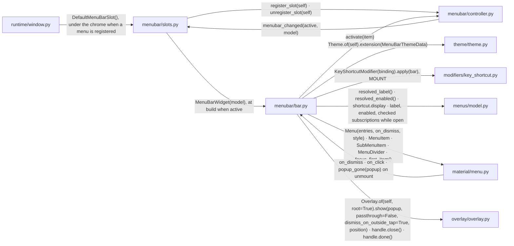
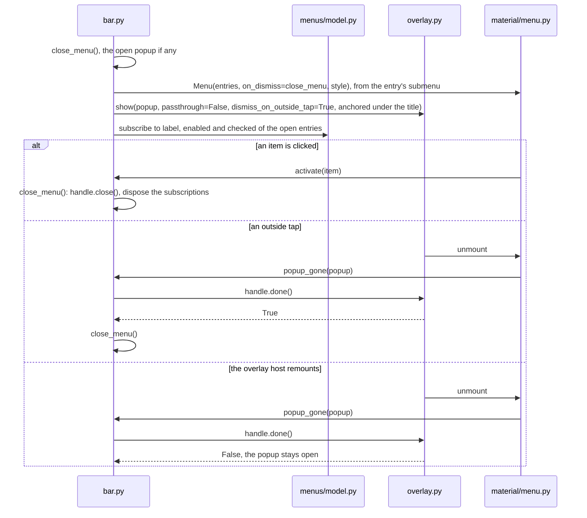
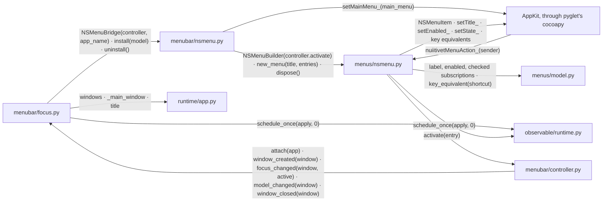
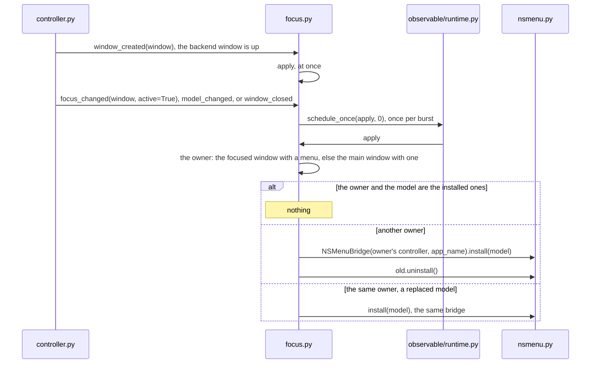
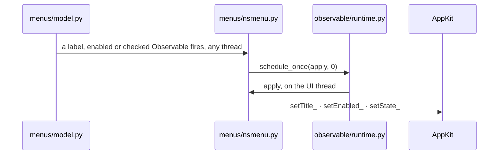

# Menu Bar

The menu is a model registered on the window, `Window(menu=...)`. One model
feeds the in-app bar on Windows and Linux and the global bar on macOS.

## Overview

Four groups of modules take part, with the window, the app and the tray at
their edges.

### Structure

| Module | Role |
| --- | --- |
| The Model | the entries, the bar root, the style and the palette, as data |
| The Controller | per window: the registered model, the slot that renders it, the one activation path |
| The In-App Bar | the slots and the bar widget drawn on Windows and Linux |
| The macOS Bridge | the global bar, following the focused window |
| `runtime/window.py` | holds the controller, exposes `menu`, reports the OS focus and the close ([APP_WINDOW.md](APP_WINDOW.md)) |
| `runtime/app.py` | holds the one focus coordinator, `exit()` ([APP_WINDOW.md](APP_WINDOW.md)) |
| `platform/tray.py` | the tray menu, built from the same entries ([TRAY_ICON.md](TRAY_ICON.md)) |

### Promises

- Every surface activates an entry through the controller.
- Structure is replaced wholesale through `window.menu`. `label`, `enabled`
  and `checked` move live on every surface.
- On each platform exactly one mechanism fires a menu shortcut: the in-app
  bar's bindings, or the native key equivalents.

## The Model

The entries, the bar root, the style and the palette are plain data,
rendered by whichever surface the platform has.

### Structure

| Module | Role |
| --- | --- |
| `menus/model.py` | `MenuEntry`, one entry: an action, a submenu, a separator or a standard item with a `MenuRole`; `label`, `enabled` and `checked` plain or `Observable` |
| `menubar/model.py` | `MenuBar`, the root holding the top-level entries and a style |
| `menubar/style.py` | `MenuBarStyle`, per-instance geometry and nullable colour overrides |
| `menubar/theme_data.py` | `MenuBarThemeData`, the palette of the bar and of its popups, neutral literals by default |
| `input/shortcut.py` | the gesture and its display form ([KEYBOARD_SHORTCUTS.md](KEYBOARD_SHORTCUTS.md)) |
| `material/theme/material_theme.py` | registers the Material palette, MD3 role tokens ([STYLE_THEME.md](STYLE_THEME.md)) |
| `theme/plain_theme.py` | registers the plain palette ([STYLE_THEME.md](STYLE_THEME.md)) |
| `platform/tray.py` | consumes the entries ([TRAY_ICON.md](TRAY_ICON.md)) |
| `menubar/bar.py` | reads the palette (The In-App Bar) |

### Promises

- `menus/` imports no surface. `menubar/` imports `menus/`.
- The palette holds `ColorSpec` tokens, resolved at paint.
- `MenuBarThemeData` and `MenuBarStyle` live outside `material/`. The bar
  reads its palette from `Theme.extension(MenuBarThemeData)`, never from a
  Material colour role.

## The Controller

One controller per window holds the model. Every activation runs through
it. It chooses the slot that renders.

### Structure

| Module | Role |
| --- | --- |
| `menubar/controller.py` | `MenuBarController`: the registered model, the registry of mounted slots, the activation of an entry, the role dispatch |
| `runtime/window.py` | creates the controller with the window, forwards `menu`, the backend window's creation, the OS focus and the close |
| `runtime/app.py` | `exit()` |
| `menubar/slots.py` | the slots that register on mount (The In-App Bar) |
| `menubar/bar.py` | activates from a popup or a shortcut (The In-App Bar) |
| `menubar/focus.py` | the coordinator the controller attaches to on macOS (The macOS Bridge) |
| `menubar/nsmenu.py` | answers whether the bridge is supported here (The macOS Bridge) |
| `menus/nsmenu.py` | activates from an `NSMenuItem`, through the `activate` the bridge handed it (The macOS Bridge) |
| `menus/model.py` | the entry activated (The Model) |

### Sequence

#### An entry is activated

#### The slot that renders is chosen

### Promises

- A window-scoped role calls the owning window. `QUIT` calls that window's
  app.
- A disabled entry is never activated by a shortcut.
- The model stays on the window wherever it renders.
- A mounted user area takes over from the default slot.

## The In-App Bar

On Windows and Linux a slot builds the bar widget. A top-level entry opens a
popup through the overlay.

### Structure

| Module | Role |
| --- | --- |
| `menubar/slots.py` | `DefaultMenuBarSlot` and `MenuBarArea`: a widget marking where the bar renders; a zero-size spacer when inactive |
| `menubar/bar.py` | `MenuBarWidget`: the row of titles, the open popup, the subscriptions of the open entries, the model's shortcut bindings |
| `menubar/controller.py` | the active slot and the activation (The Controller) |
| `runtime/window.py` | inserts the default slot into the wrapped root ([APP_WINDOW.md](APP_WINDOW.md)) |
| `material/menu.py` | the popup surface, its keyboard traversal and its submenus ([MATERIAL_INTERACTION.md](MATERIAL_INTERACTION.md)) |
| `overlay/overlay.py` | anchors the popup under its title ([OVERLAY.md](OVERLAY.md)) |
| `modifiers/key_shortcut.py` | the binding of each entry's shortcut ([KEYBOARD_SHORTCUTS.md](KEYBOARD_SHORTCUTS.md)) |
| `theme/theme.py` | the theme extension the palette comes from ([THEME_CONSUMPTION.md](THEME_CONSUMPTION.md)) |
| `menus/model.py` | the entries drawn (The Model) |

### Sequence

#### A top-level menu opens and closes

### Promises

- The popups are the MD3 `Menu` widgets. Their `MenuStyle` is derived from
  the bar's palette, never from the Material defaults.
- A popup's unmount is a dismissal only when its overlay entry is settled.
- `menubar/bar.py` imports `nuiitivet.material`. The slot imports it at its
  first build. No other module under `menubar/` imports `material`.

## The macOS Bridge

On macOS the model is installed as the application's main menu.

### Structure

| Module | Role |
| --- | --- |
| `menubar/focus.py` | `MenuBarFocusCoordinator`: picks the window whose model belongs on the bar, owns the bridge, coalesces reinstalls onto the next tick |
| `menubar/nsmenu.py` | `plan_menus`, the arrangement with the application menu first; `NSMenuBridge`, installs the planned menus as the main menu |
| `menus/nsmenu.py` | `NSMenuBuilder`: entries to `NSMenu` trees, the action target, the retained objects, the property subscriptions; `key_equivalent` ([TRAY_ICON.md](TRAY_ICON.md) shares it) |
| `menubar/controller.py` | attaches the window, receives the activations (The Controller) |
| `runtime/app.py` | the open windows, the main window, the coordinator slot ([APP_WINDOW.md](APP_WINDOW.md)) |
| `observable/runtime.py` | the installed clock ([OBSERVABLE.md](OBSERVABLE.md)) |
| AppKit | the main menu and its items |
| `menus/model.py` | the entries installed (The Model) |

### Sequence

#### The bar follows the windows

#### A property changes

### Promises

- One coordinator and one bridge per app.
- The bar shows the focused window's model. The main window's model stands
  in for a window with `menu=None`.
- The Cocoa imports happen lazily, on macOS only. `plan_menus` and
  `key_equivalent` import on every platform.
- AppKit is touched on the UI thread only.
