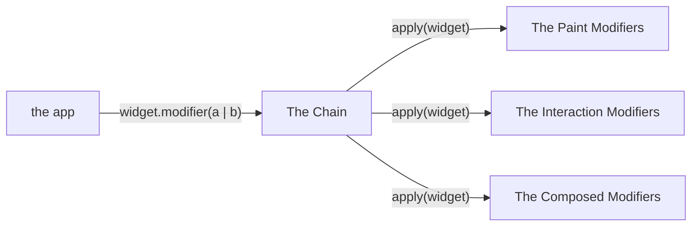
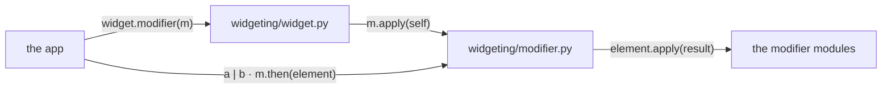
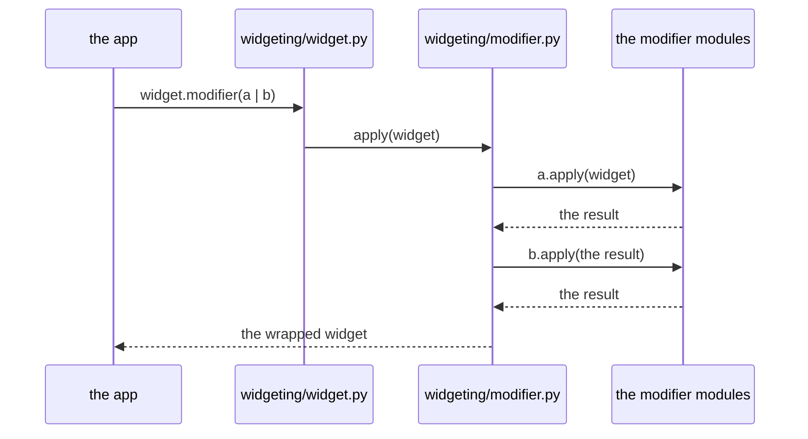
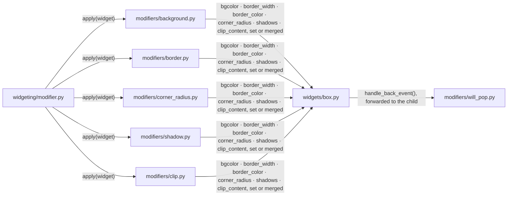
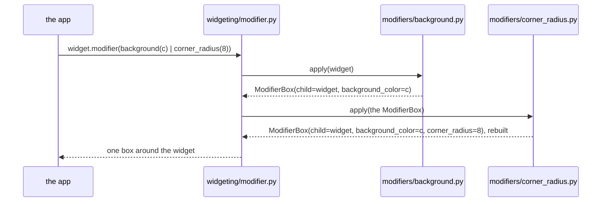
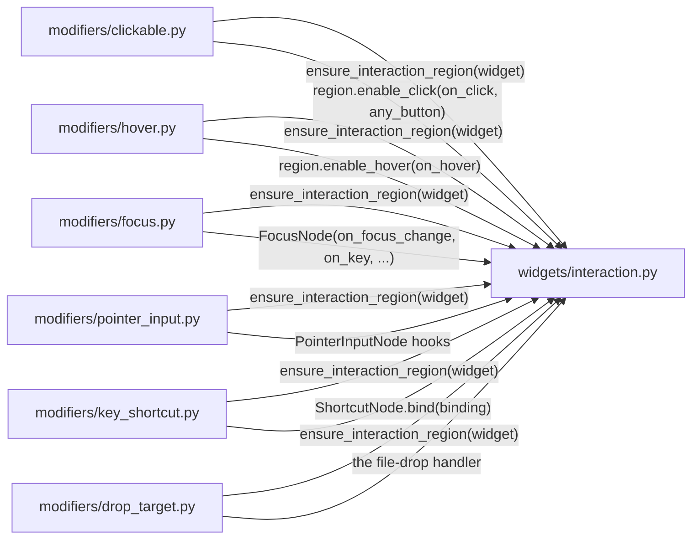
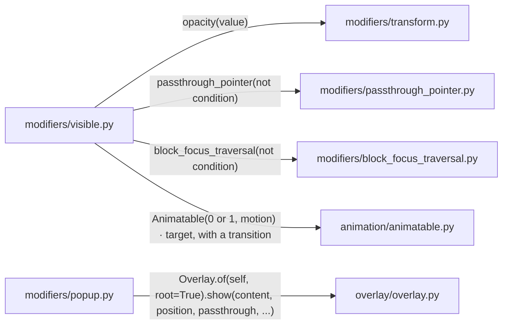
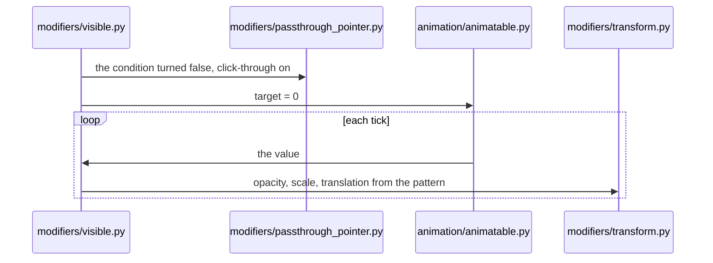

# Modifier

A modifier wraps a widget to add a capability or a visual effect.

## Overview

Four groups of modules take part, with the app at their edge.

### Structure

| Module | Role |
| --- | --- |
| The Chain | a modifier as a function from a widget to a widget, and the chaining of several |
| The Paint Modifiers | the decorations |
| The Interaction Modifiers | the input handlers |
| The Composed Modifiers | the modifiers built from the others, or wrapping a widget of their own |
| the app | writes `.modifier(...)` |

### Promises

- A modifier never changes layout.
- A chain of paint modifiers is one node in the tree. A chain of interaction
  modifiers is one node in the tree.

## The Chain

A `ModifierElement` turns a widget into a widget. A `Modifier` is a list of
them.

### Structure

| Module | Role |
| --- | --- |
| `widgeting/modifier.py` | the element protocol and the chain |
| `widgeting/widget.py` | `Widget.modifier`, which hands the widget to the chain ([WIDGET_ARCHITECTURE.md](WIDGET_ARCHITECTURE.md)) |
| the modifier modules | the elements (The Paint Modifiers, The Interaction Modifiers, The Composed Modifiers) |
| the app | chains and applies |

### Sequence

#### A chain is applied

### Promises

- An element decides for itself whether to wrap the widget or to merge into
  it.

## The Paint Modifiers

A paint modifier sets a property of the box around the widget.

### Structure

| Module | Role |
| --- | --- |
| `modifiers/background.py` | the background colour |
| `modifiers/border.py` | the border width and colour |
| `modifiers/corner_radius.py` | the corner radii, with the clip on |
| `modifiers/shadow.py` | the shadow layers |
| `modifiers/clip.py` | the clip alone |
| `widgets/box.py` | `Box`, the painted surface; `ModifierBox`, the box the framework created and may rebuild ([BOX_MODEL.md](BOX_MODEL.md)) |
| `widgeting/modifier.py` | the chain (The Chain) |
| `modifiers/will_pop.py` | a scope under a decorated widget ([NAVIGATION.md](NAVIGATION.md)) |

### Sequence

#### Two paint modifiers become one box

### Promises

- A paint modifier applied to a `Box` sets the property on that box. Applied
  to a `ModifierBox`, it rebuilds the box with the property merged. Applied
  to any other widget, it wraps the widget in a new `ModifierBox`.
- A `ModifierBox` forwards a back event to its child.

## The Interaction Modifiers

An interaction modifier adds a node to the one region around the widget.

### Structure

| Module | Role |
| --- | --- |
| `modifiers/clickable.py` | a click |
| `modifiers/hover.py` | hover enter and leave |
| `modifiers/focus.py` | a focus node with its key handler |
| `modifiers/pointer_input.py` | the raw pointer hooks |
| `modifiers/key_shortcut.py` | a shortcut binding ([KEYBOARD_SHORTCUTS.md](KEYBOARD_SHORTCUTS.md)) |
| `modifiers/drop_target.py` | a file drop |
| `widgets/interaction.py` | `InteractionRegion`, the one host of the nodes and their shared state ([INTERACTION_ARCHITECTURE.md](INTERACTION_ARCHITECTURE.md)) |

### Promises

- A widget has at most one `InteractionRegion`. Every interaction modifier
  adds to it.

## The Composed Modifiers

The remaining modifiers are built from the others, or carry a wrapper widget
of their own.

### Structure

| Module | Role |
| --- | --- |
| `modifiers/visible.py` | hides a widget, with an optional transition |
| `modifiers/transform.py` | opacity, scale, translation and rotation at paint, reporting their outsets ([BOX_MODEL.md](BOX_MODEL.md)) |
| `modifiers/passthrough_pointer.py` | the click-through posture ([HIT_TESTING.md](HIT_TESTING.md)) |
| `modifiers/block_focus_traversal.py` | takes the subtree out of the Tab sequence ([INTERACTION_ARCHITECTURE.md](INTERACTION_ARCHITECTURE.md)) |
| `animation/animatable.py` | drives the transition ([ANIMATION_SYSTEM.md](ANIMATION_SYSTEM.md)) |
| `modifiers/popup.py` | shows a layer anchored to the widget; `tooltip` and `context_menu` are built the same way ([OVERLAY.md](OVERLAY.md)) |
| `overlay/overlay.py` | the layer stack ([OVERLAY.md](OVERLAY.md)) |

### Sequence

#### A widget is hidden with a transition

### Promises

- `visible(False)` keeps the widget mounted.
- Input is blocked for the whole exit transition.
- `visible` is `opacity`, `passthrough_pointer` and `block_focus_traversal`
  composed.
