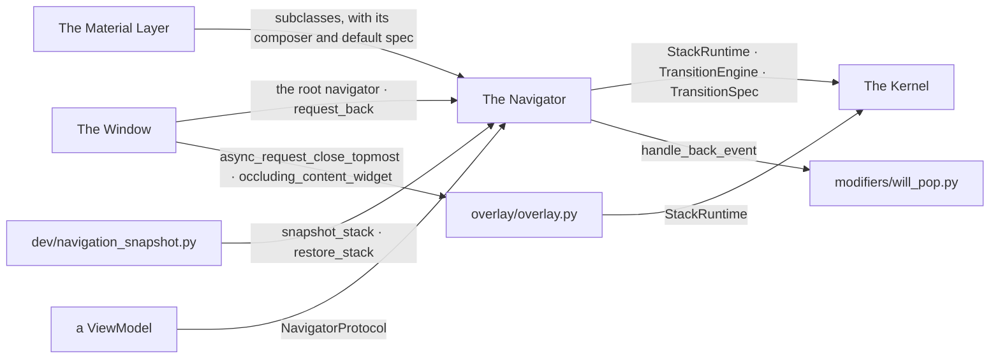
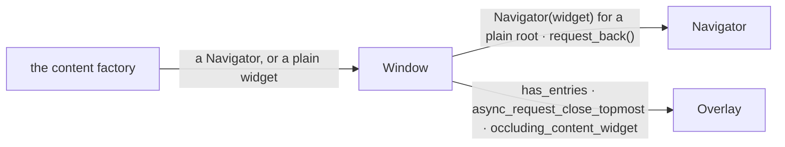
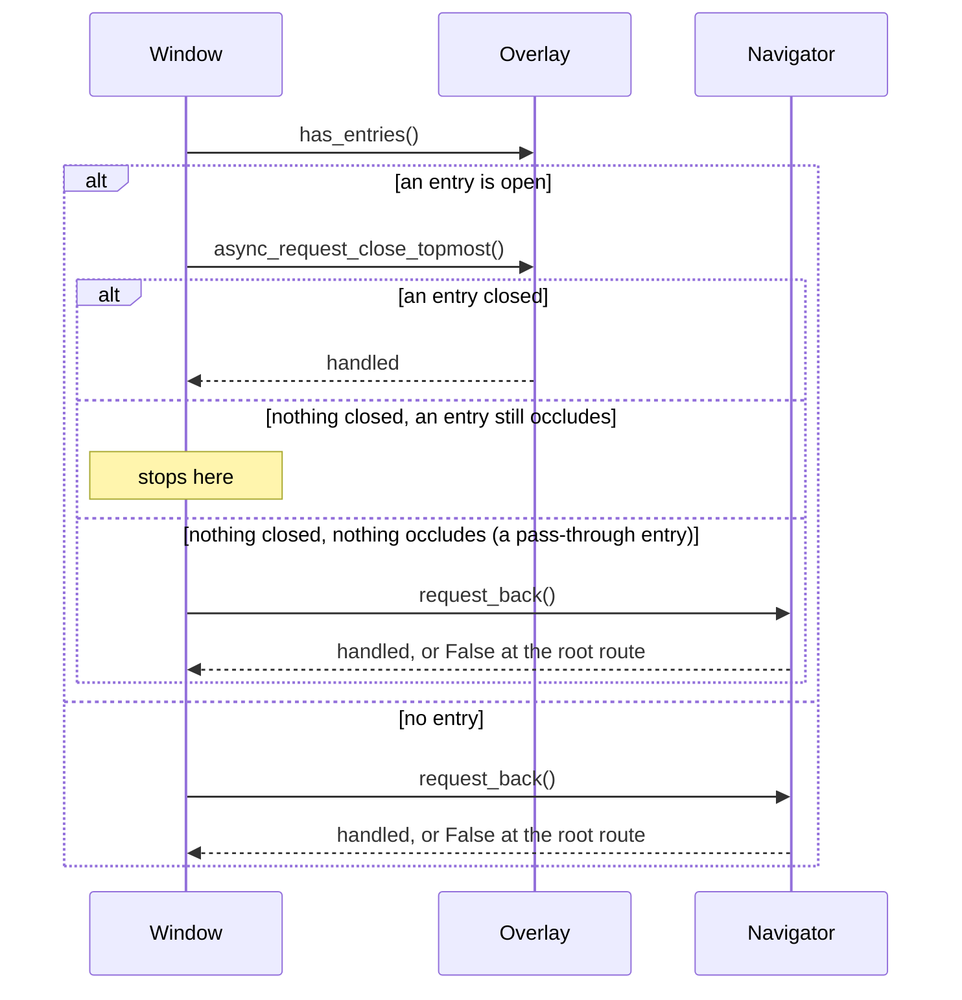
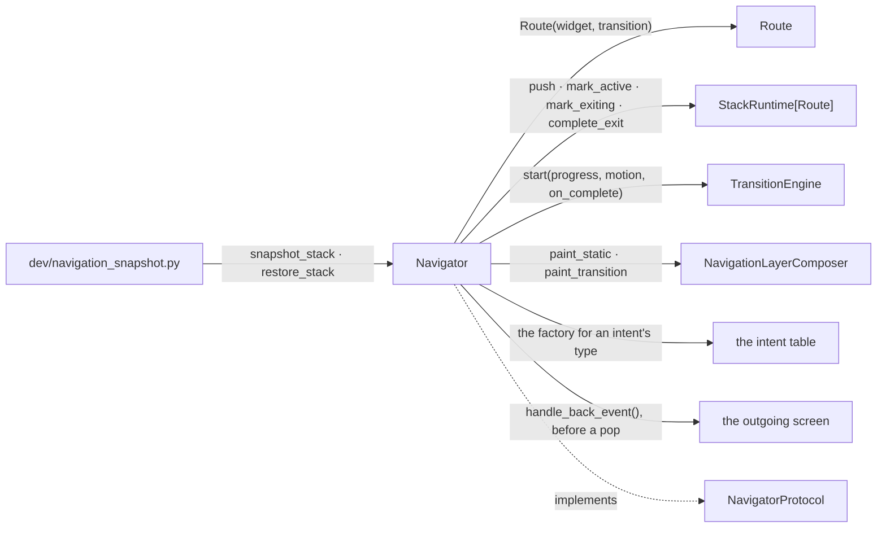
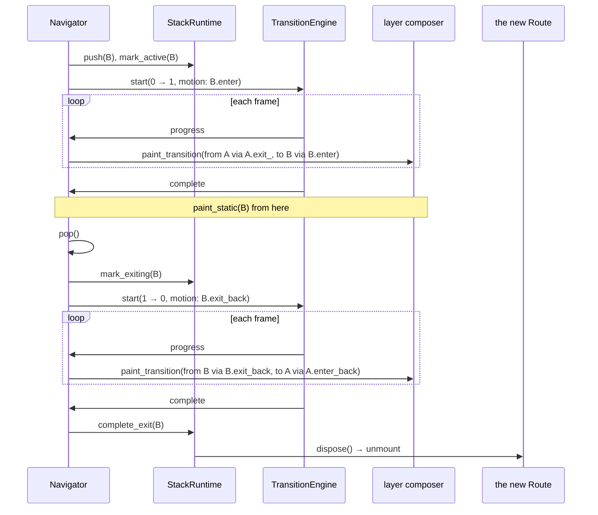
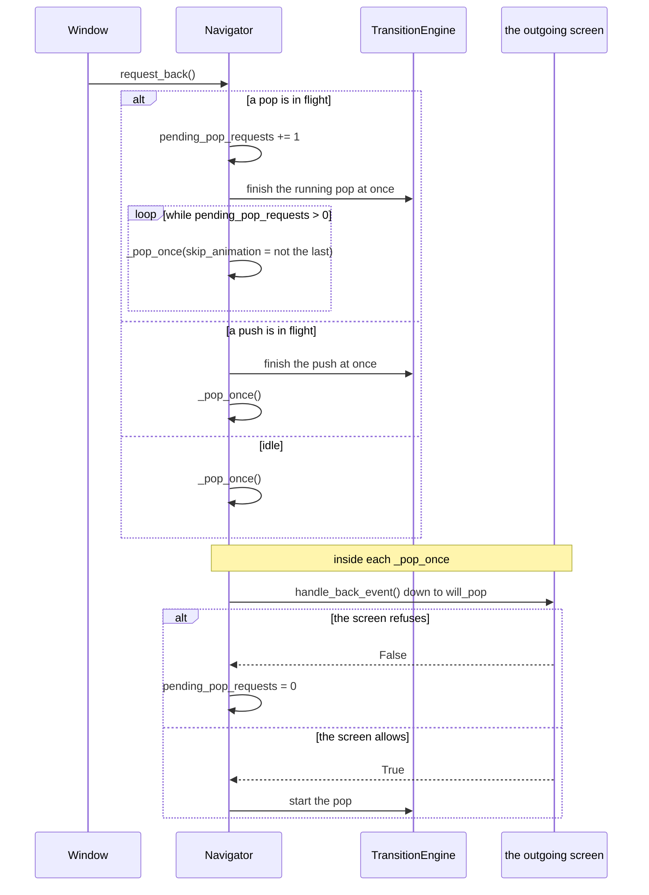
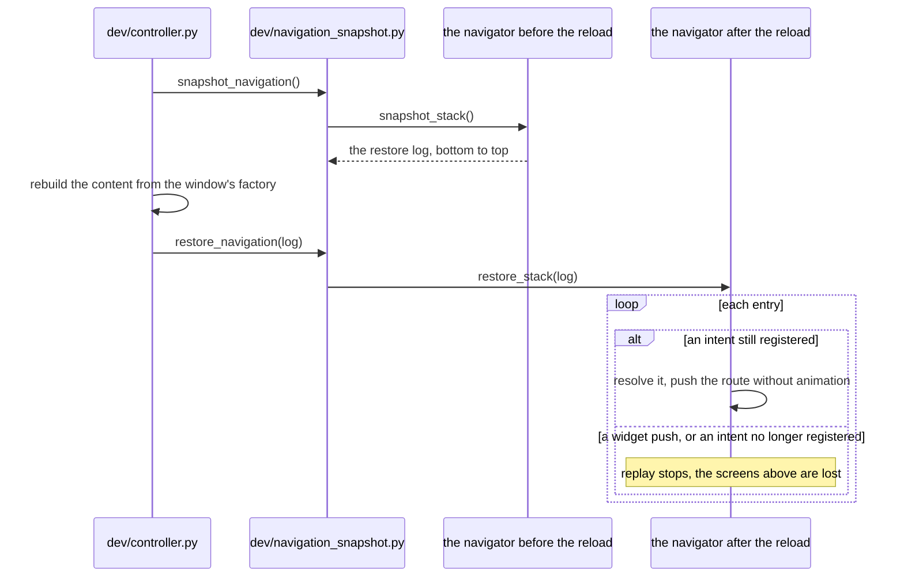
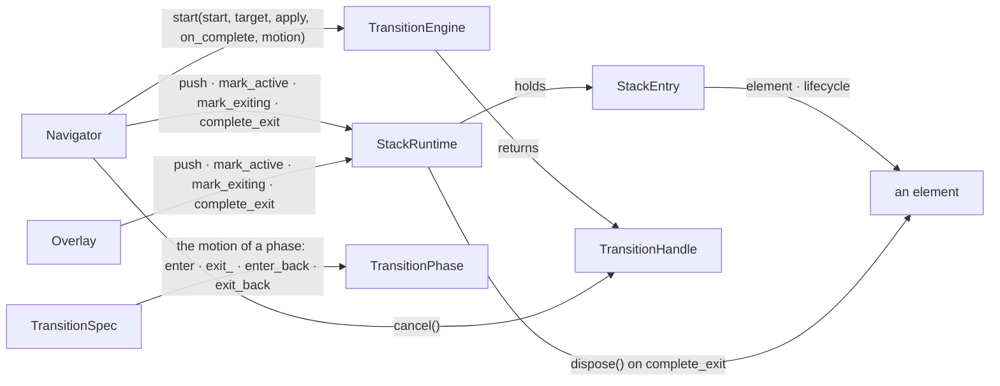
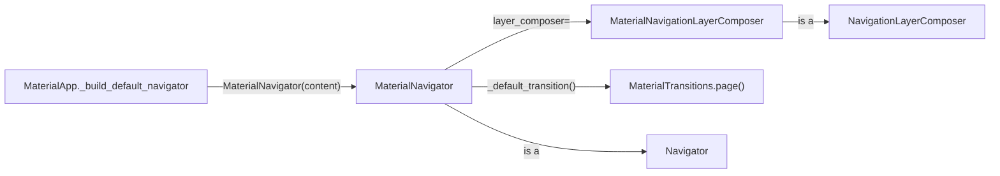

# Navigation

A `Navigator` holds a stack of screens and paints the top one. `Overlay` is
built on the same kernel ([OVERLAY.md](OVERLAY.md)).

## Overview

Four groups of modules take part: the window that owns the root navigator,
the navigator package, the transition kernel both stacks stand on, and the
Material layer that subclasses the navigator. The overlay, the reload
snapshot, the `will_pop` modifier and a ViewModel stand at their edges.

### Structure

| Module | Role |
| --- | --- |
| The Window | holds the root navigator and routes a back action |
| The Navigator | keeps the stack of routes, resolves a push, paints the top, absorbs back requests |
| The Kernel | tracks when an element enters, stays and exits a stack; drives the progress of a transition |
| The Material Layer | subclasses the navigator with the Material default and composer |
| `overlay/overlay.py` | the layers above the screen, offered a back action first ([OVERLAY.md](OVERLAY.md)) |
| `dev/navigation_snapshot.py` | saves the route log before a reload and replays it after ([HOT_RELOAD.md](HOT_RELOAD.md)) |
| `modifiers/will_pop.py` | lets a screen refuse to be popped ([MODIFIER.md](MODIFIER.md)) |
| a ViewModel | app code that pushes and pops through `NavigatorProtocol` |

### Promises

- `navigation` and `overlay` import neither the other. Both import
  `transition`.
- A screen enters the tree only as the widget of a route.

## The Window

The window holds the root navigator and routes a back action.

### Structure

| Module | Role |
| --- | --- |
| the content factory | the window's `content`, returning the root |
| `Window` | holds the root navigator, wraps a plain root in the implicit one (`MaterialApp` overrides the wrap), offers a back action to the overlay and then the navigator |
| `Navigator` | the stack of screens (The Navigator) |
| `Overlay` | the layers above the screen ([OVERLAY.md](OVERLAY.md)) |

### Sequence

#### A back action

### Promises

- A window owns one root navigator. A plain widget given as the content is
  wrapped in one.
- A back action never reaches past an occluding overlay entry, an entry
  animating out included. A pass-through entry blocks nothing.
- The window handles one request per input.

## The Navigator

The navigator keeps routes on a stack from the kernel, resolves a push to a
route, paints through a layer composer, and absorbs back requests.

### Structure

| Module | Role |
| --- | --- |
| `Navigator` | `push` turns a widget or an intent into a route and starts the enter transition; `pop` and `request_back` take one route off, absorbing requests during a transition; `of` finds the navigator a widget drives; `paint` draws the top route or a transition frame; `_restore_log` keeps a descriptor per push |
| `Route` | a screen and the transition it moves with; disposing it unmounts the screen |
| `StackRuntime[Route]` | the stack from the kernel (The Kernel) |
| `TransitionEngine` | drives the progress of a transition (The Kernel) |
| `NavigationLayerComposer` | the paint of a static screen and of a transition frame |
| `NavigatorProtocol` | the three methods a ViewModel is typed against |
| the intent table | `Navigator.routes`: an intent type to the factory that builds its screen, or its screen and transition |
| the outgoing screen | asked before a pop; the question is forwarded down its built tree to a `will_pop` modifier |
| `dev/navigation_snapshot.py` | the reload's read and replay of the log ([HOT_RELOAD.md](HOT_RELOAD.md)) |

### Sequence

#### A screen is pushed and popped

#### A back request reaches the navigator

#### The stack is restored after a reload

### Promises

- A screen's transition is held by its route until the route is disposed.
- A screen pushed with no transition moves with the navigator's default.
- Outside a transition only the top route is painted. The routes beneath
  stay mounted.
- Each screen of a transition is painted through its own spec.
- The restore log replays intent pushes only.
- Queued pops run without animation, except the last.
- No pop starts against the outgoing screen's refusal. A refusal discards
  the queue.
- A refused pop still counts as handled.

## The Kernel

The kernel tracks when an element enters, stays and exits a stack, and
drives the progress of a transition. It knows nothing of screens or layers.

### Structure

| Module | Role |
| --- | --- |
| `Navigator`, `Overlay` | the two stacks built on the kernel (The Navigator, [OVERLAY.md](OVERLAY.md)) |
| `StackRuntime` | the ordered elements and their lifecycle: entering, active, exiting, disposed |
| `StackEntry` | one element with its lifecycle state |
| `TransitionEngine` | animates one progress from start to target and reports completion |
| `TransitionHandle` | cancels a running transition |
| `TransitionSpec`, `EmptyTransitionSpec` | the four motions of a screen; the spec that moves nothing |
| `TransitionPhase` | which of the four motions a frame is in |
| an element | a `Route`, or an overlay layer; anything with `dispose()` |

### Promises

- The stack holds any element with a `dispose()`. It disposes an element
  when its exit completes.
- The engine drives one progress per transition and reports completion once.

## The Material Layer

The Material navigator subclasses `Navigator` with its own composer and its
own default.

### Structure

| Module | Role |
| --- | --- |
| `MaterialApp._build_default_navigator` | wraps a plain root in a `MaterialNavigator` |
| `MaterialNavigator` | the navigator with the Material default and composer |
| `MaterialNavigationLayerComposer` | paints the Material motion of a transition |
| `MaterialTransitions.page()` | the page transition every Material screen moves with by default |
| `Navigator`, `NavigationLayerComposer` | what the Material classes subclass (The Navigator) |

### Promises

- `MaterialNavigator` adds no navigation API.
- The default transition is a subclass hook. `Navigator` defaults to the
  empty spec; `MaterialNavigator` to the page transition.
