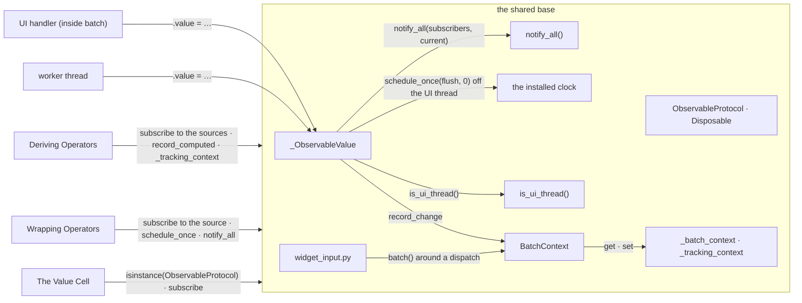
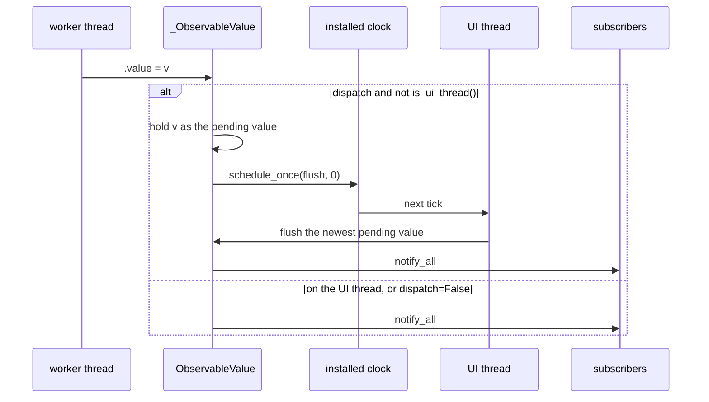
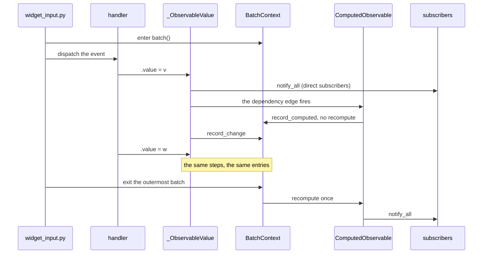
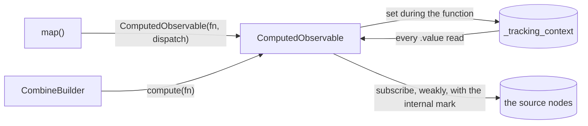
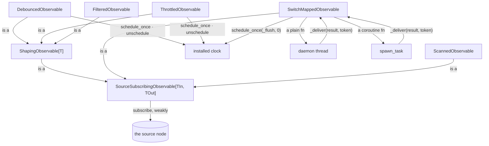
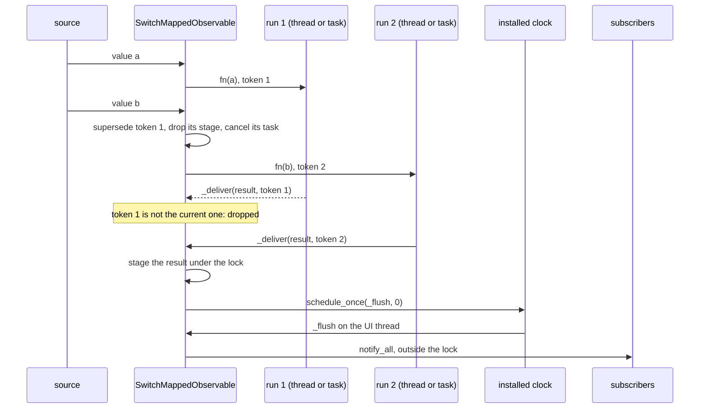
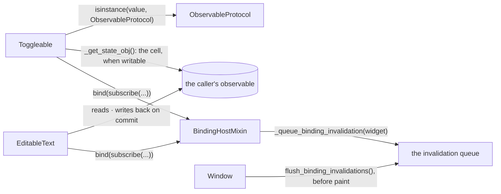
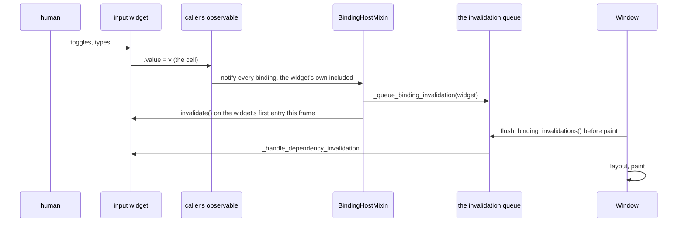

# Observable

An `Observable` is a value that notifies when it changes. A domain model, a
service or a widget holds one. Every node of the graph is built on one shared
base. Two kinds of node stand on it: a derivation of other nodes, and a
wrapper that reshapes what its source emits. A widget joins the graph through
its value cell. The thread the graph runs on is defined in
[CONCURRENCY_MODEL.md](CONCURRENCY_MODEL.md).

## What Every Observable Shares

The shared base carries the held value, the notify loop, the batch, the
marshalling of a worker's write onto the UI thread, and the containment of a
callback that raises. The Structure is the whole page: the shared modules,
and the three subjects below as groups.

### Structure

| Module | Role |
| --- | --- |
| `_ObservableValue` | the mutable value node: compares, decides whether a write is marshalled, notifies (`observable/value.py`) |
| `ObservableProtocol`, `Disposable` | the read-only and writable protocols, the subscription handle, the mark for the graph's own edges (`observable/protocols.py`) |
| `notify_all()` | the one loop that delivers a value to every subscriber, surviving one that raises (`observable/_notify.py`) |
| `BatchContext` | records the dirty values and the queued derivations, flushes at the outermost exit (`observable/batching.py`) |
| `_batch_context`, `_tracking_context` | the two `contextvars`: the current batch, the tracking derivation (`observable/contexts.py`) |
| the installed clock | carries every timer and every marshalled notification to the UI thread (`observable/runtime.py`) |
| `is_ui_thread()` | the one definition of the UI thread (`runtime/threading.py`) |
| `widget_input.py` | dispatches pointer, key and focus events, each inside a batch (`widgeting/`) |
| Deriving Operators | compute a value from other nodes and hold no state |
| Wrapping Operators | stay subscribed to a source and reshape what it emits |
| The Value Cell | the cell an input widget keeps its value in, and the bindings that repaint it |

### Sequence

#### A write from a worker thread

#### A handler inside a batch

### Promises

- A value node and a derivation compare the new value with the held one
  before notifying. A wrapper does not.
- A write from a thread other than the UI thread is marshalled onto the UI
  thread. One flush per tick carries the newest value.
- A write on the UI thread applies inline.
- `dispatch=False` keeps a node's notification synchronous on the writing
  thread. Every intermediate value is delivered.
- A derivation, a predicate or a fold runs on the thread that triggered it.
- `batch()` nests. Each derivation a batch reaches recomputes once, at the
  outermost exit. A batch exited off the UI thread marshals that flush when
  any dirty value dispatches.
- Pointer, key and focus dispatch run inside `batch()`.
- `_ObservableValue`, `ComputedObservable` and `SourceSubscribingObservable`
  each define the full operator set.
- A derivation, a predicate or a fold that raises is contained where it runs.
  The node keeps the value it held. Nothing is emitted. The failure is logged
  once.
- A subscriber that raises is contained in the notify loop. The subscribers
  after it are still notified. The value is re-read per subscriber.
- The graph's own edges carry `mark_internal_subscription`. An exception on
  one of them re-raises. The leak check in `testing/_leaks.py` exempts them.

## Deriving Operators

`map`, `combine` and `compute` answer "what is `.value` now" with a function
of their sources. They hold no state of their own.

### Structure

| Module | Role |
| --- | --- |
| `map()` | builds a `ComputedObservable` over one source; defined on every kind of node |
| `CombineBuilder` | collects several sources for one `compute(fn)` |
| `ComputedObservable` | runs the function under the tracking context, re-arms its edges, stores the result |
| `_tracking_context` | the derivation currently running, so a read can register itself |
| the source nodes | whatever the function reads |

### Promises

- The `.value` reads during the function are the dependencies. They are
  collected anew on every run, whether the run raised or not.
- An edge from a source to a derivation holds the derivation weakly.
- `map` carries its source's `dispatch` into the derivation it builds.

## Wrapping Operators

`debounce`, `throttle`, `filter`, `switch_map` and `scan` stay subscribed to
their source until they are disposed. The first three reshape when or whether
a source's value is republished. The last two publish values of their own.

### Structure

| Module | Role |
| --- | --- |
| `SourceSubscribingObservable` | the base of every wrapper: the weak edge to the source, the held value, the teardown |
| `ShapingObservable` | the base of the wrappers whose output type is the input type |
| `DebouncedObservable`, `ThrottledObservable` | republish on the trailing edge, or on the leading edge, of a time window |
| `FilteredObservable` | republishes only the values the predicate passes |
| `SwitchMappedObservable`, `CancelToken` | runs `fn` per change and publishes only the newest run's result |
| `ScannedObservable` | folds every emission into an accumulator |
| the daemon thread | runs a plain `fn` off the UI thread |
| `spawn_task` | runs a coroutine `fn` as a task on the event loop |
| the installed clock | carries a timer or a marshalled result to the UI thread |
| the source node | the node a wrapper subscribes to |

### Sequence

#### A switch_map run superseded by the next change

### Promises

- A wrapper subscribes to its source through a weak reference to itself.
- A wrapper is kept alive by its holder, by the `Disposable` its
  `subscribe()` returned, or by a timer it armed until the timer fires.
- `dispose()` drops the source subscription. It unschedules every callback
  the wrapper may have armed.
- `.value` is the value the wrapper last emitted. Before the first emission
  it is the seed. The value is stored before the subscribers are notified.
- `.value` registers the wrapper with the tracking context, never its source.
  The wrapper's own reads, and the callbacks it runs, are untracked.
- A wrapper has no `dispatch` flag. A wrapper that re-publishes on its
  source's notification emits on that thread. A wrapper that emits from a
  timer or a run emits through the installed clock.
- The clock finds the callback to unschedule by equality.
- `debounce` and `throttle` seed from the source's construction-time value.
  Each holds only the latest pending value.
- `filter` tests the source's construction-time value against the predicate.
- `switch_map` and `scan` seed from `initial`, reading nothing from the
  source. `switch_map` starts no run at construction.
- A plain `switch_map` function runs on a thread of its own. A coroutine
  function runs as a task on the event loop.
- A superseded `switch_map` result never lands. `dispose()` supersedes the
  run in flight.
- `scan` emits once per emission in.

## The Value Cell

An input widget stores its value in a cell. An observable passed to the
constructor becomes that cell.

### Structure

| Module | Role |
| --- | --- |
| the caller's observable | any writable node the app passed in |
| `ObservableProtocol` | the writable protocol, told from the read-only one by `set` |
| `Toggleable` | keeps one live cell, the caller's observable or its own, and reads and writes through it |
| `EditableText` | keeps a richer editing value beside the caller's text and mirrors between them |
| `BindingHostMixin` | holds a widget's subscriptions and disposes them at unmount |
| the invalidation queue | one entry per widget whose bound value changed this frame, drained by `flush_binding_invalidations()` (`widgeting/widget_binding.py`) |
| `Window` | calls the flush before paint |

### Sequence

#### An edit reaches the frame

### Promises

- The text field's mirror is the one widget that holds a value beside the
  caller's. Its rules are in [TEXT_EDITING.md](TEXT_EDITING.md).
- Writability is decided at runtime, by `isinstance(value,
  ObservableProtocol)`.
- An operator that returns a read-only view returns a distinct object.
- `bind()` retains a `Disposable`. Unmount disposes every binding.
- A bound value's update invalidates the widget once per frame.
