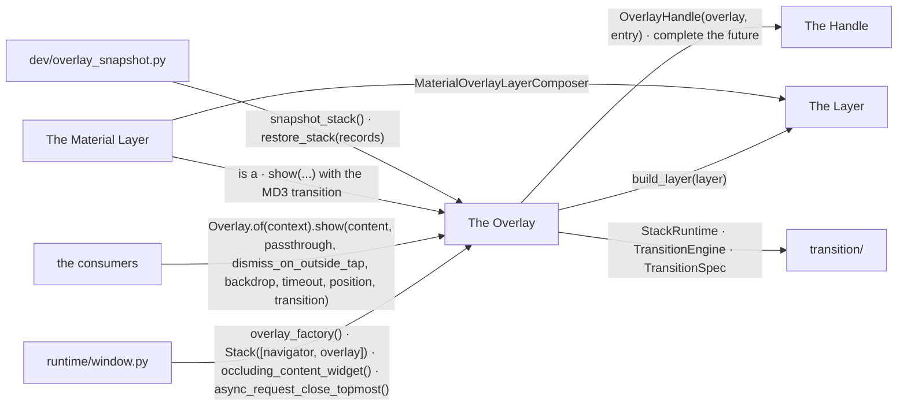
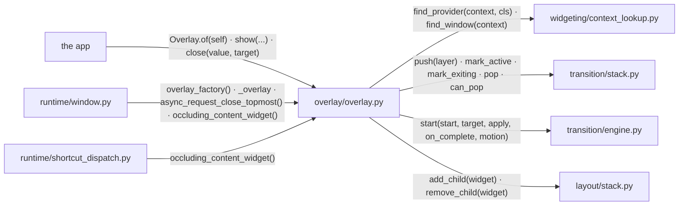
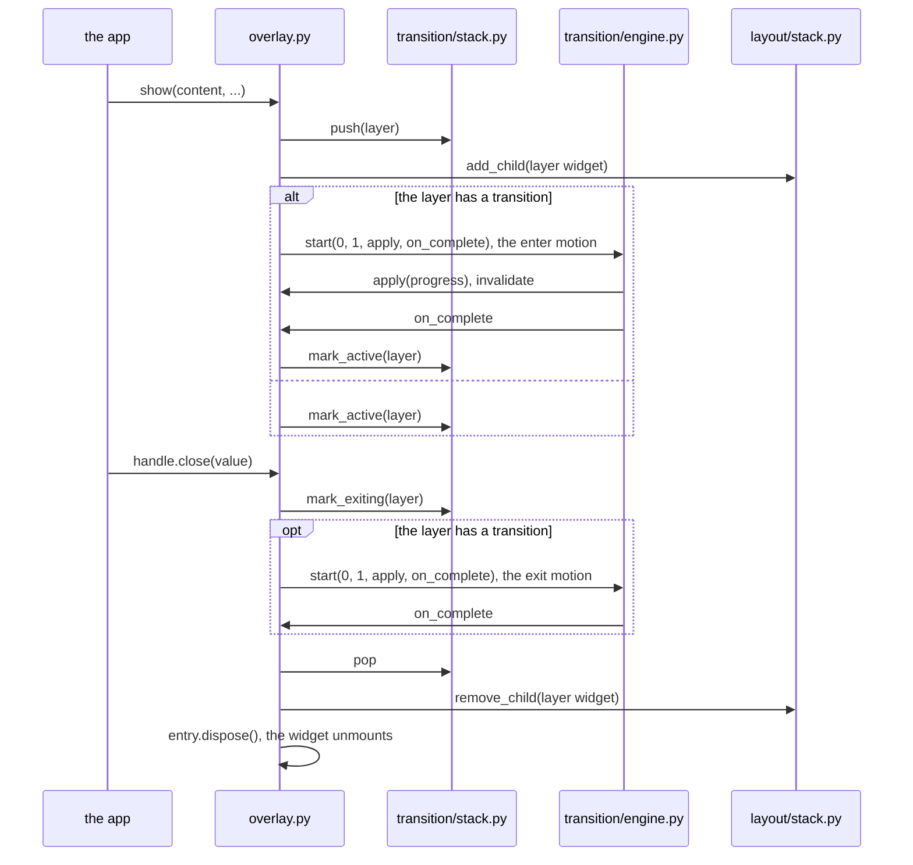
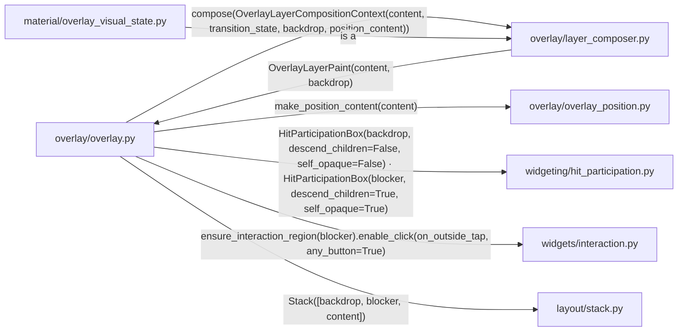
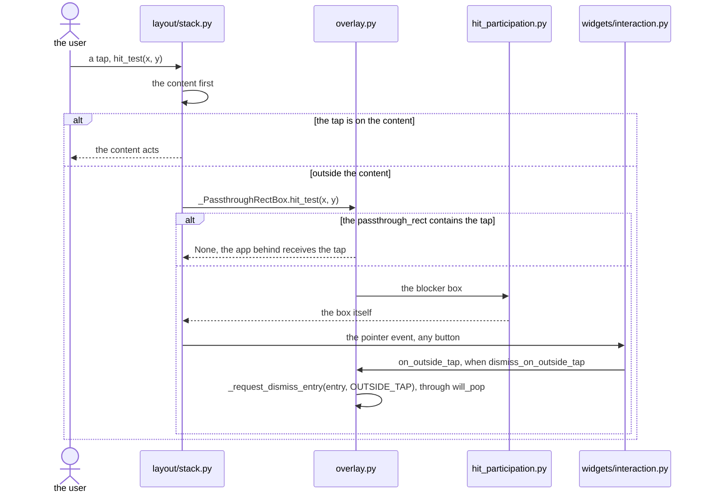
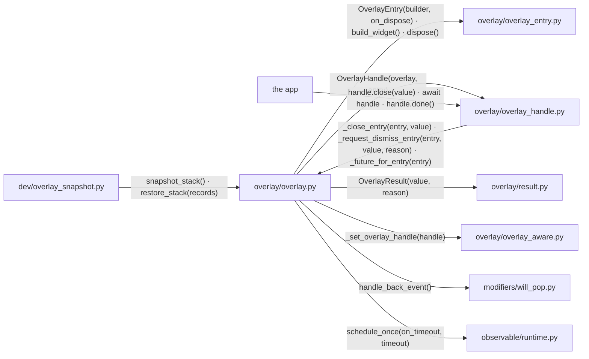
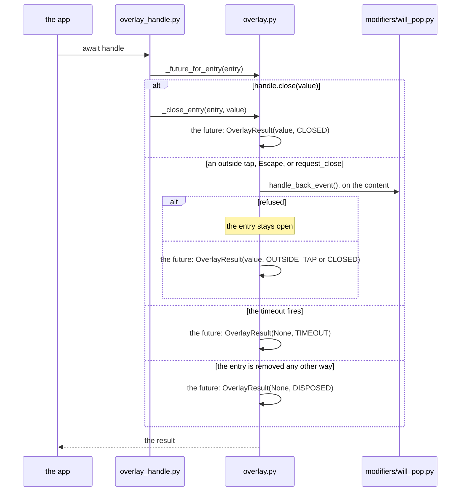
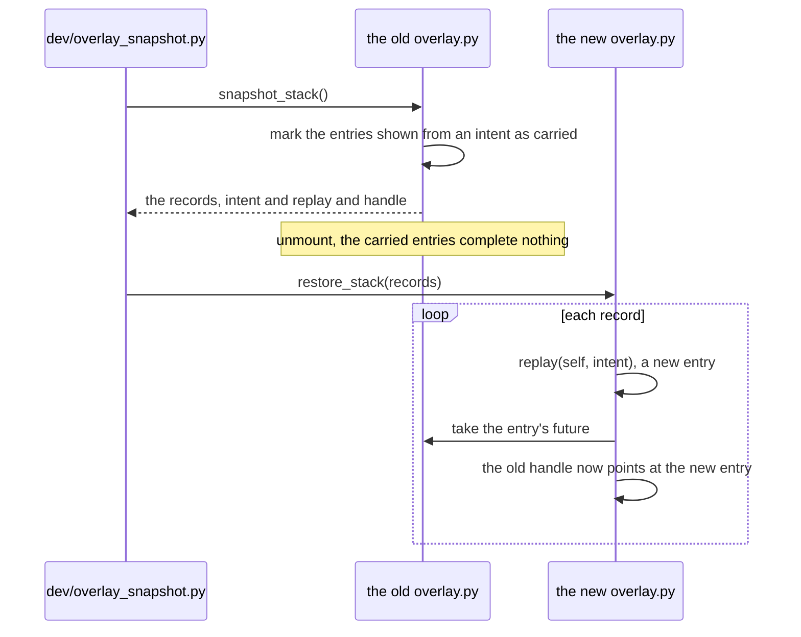
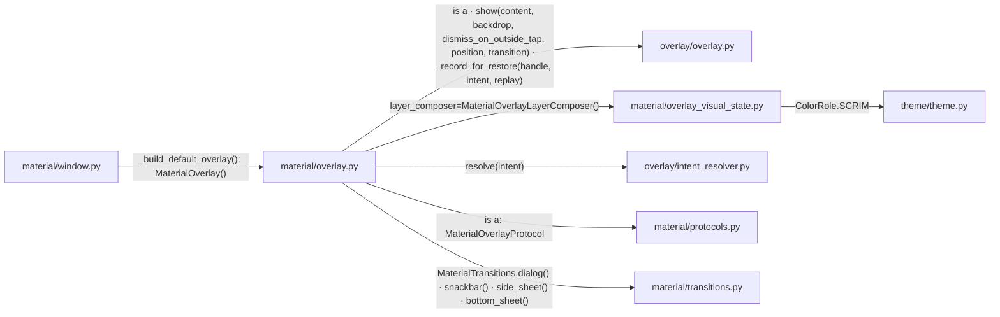

# Overlay

`Overlay.show()` puts a layer on top of the window. It stands on the same
transition kernel as the navigator ([NAVIGATION.md](NAVIGATION.md)).

## Overview

Four groups of modules take part, with the window, the kernel, the reload
snapshot and the consumers at their edges.

### Structure

| Module | Role |
| --- | --- |
| The Overlay | keeps the stack of entries and resolves which overlay a context belongs to |
| The Layer | builds what one entry puts in the tree |
| The Handle | closes an entry and reports how it ended |
| The Material Layer | adds the MD3 presets, the intents and the scrim |
| `runtime/window.py` | builds the overlay from a factory beside the navigator, holds it for the lookup, asks what blocks the keyboard ([APP_WINDOW.md](APP_WINDOW.md)) |
| `transition/` | the stack runtime and the transition engine ([NAVIGATION.md](NAVIGATION.md)) |
| `dev/overlay_snapshot.py` | carries the open intents across a hot reload ([HOT_RELOAD.md](HOT_RELOAD.md)) |
| the consumers | the widgets and modifiers that show a layer, and the shortcut dispatch that asks what blocks |

### Promises

- `overlay` imports nothing from `navigation`. Both import `transition`.
- One overlay per window.

## The Overlay

`Overlay` keeps a private stack of layers, one per entry.

### Structure

| Module | Role |
| --- | --- |
| `overlay/overlay.py` | `Overlay`: the entries, their layers, their futures; `_LayerStack`, the `Stack` of layer widgets; `_OverlayLayer`, one entry with its transition state |
| `transition/stack.py` | tracks which layers enter, stay and exit ([NAVIGATION.md](NAVIGATION.md)) |
| `transition/engine.py` | drives a transition's progress ([ANIMATION_SYSTEM.md](ANIMATION_SYSTEM.md)) |
| `layout/stack.py` | paints the layers in order ([LAYOUT.md](LAYOUT.md)) |
| `runtime/window.py` | holds the overlay as a sibling of the navigator, routes a back action to it, asks what blocks the keyboard ([NAVIGATION.md](NAVIGATION.md)) |
| `widgeting/context_lookup.py` | the ancestor search and the window lookup behind `Overlay.of` |
| `runtime/shortcut_dispatch.py` | asks what blocks the keyboard ([KEYBOARD_SHORTCUTS.md](KEYBOARD_SHORTCUTS.md)) |
| the app | shows and closes entries |

### Sequence

#### An entry is shown and closed

### Promises

- Paint order is insertion order.
- An entry's widget mounts once, when shown. It unmounts once, when its entry
  leaves the stack. The other layers are untouched by a show or a close.
- `Overlay.of` searches the ancestors for the calling class first, then
  falls back to the window's overlay.
- An entry stays open until its exit transition finishes.
- The keyboard side of `passthrough` is read through
  `occluding_content_widget()`, the content of the topmost layer shown with
  `passthrough=False`.
- A window takes its overlay as it takes its content. An instance keeps the
  window hot-reload inert. A factory is re-invoked on a reload.

## The Layer

`build_layer` assembles the widget one entry puts in the tree.

### Structure

| Module | Role |
| --- | --- |
| `overlay/overlay.py` | `build_layer`, assembles the layer; `_PassthroughRectBox`, exempts one window rect from the blocker; `_DefaultOverlayLayerComposer`, a neutral backdrop |
| `overlay/layer_composer.py` | `OverlayLayerComposer`, the protocol a design system implements; the context it receives, the paint it returns |
| `overlay/overlay_position.py` | `OverlayPosition`: `aligned`, `anchored`, `at_point`, `at_pointer`; each wraps the content in a widget that places it |
| `widgeting/hit_participation.py` | a box that decides whether a hit descends to its child and whether the box itself catches ([HIT_TESTING.md](HIT_TESTING.md)) |
| `widgets/interaction.py` | the region that turns a hit on the blocker into the outside tap ([INTERACTION_ARCHITECTURE.md](INTERACTION_ARCHITECTURE.md)) |
| `layout/stack.py` | stacks the three ([LAYOUT.md](LAYOUT.md)) |
| `material/overlay_visual_state.py` | the Material composer (The Material Layer) |

### Sequence

#### A tap lands on a blocking layer

### Promises

- A composer returns the content and the backdrop side by side. The core
  stacks them.
- The backdrop never catches a hit.
- A layer with `passthrough=False` has a blocker that catches every hit the
  content does not.
- The composition context carries visual facts only. No `passthrough`, no
  dismissibility, no barrier colour reaches a composer.

## The Handle

`show()` returns a handle. The handle closes its entry and awaits its
result.

### Structure

| Module | Role |
| --- | --- |
| `overlay/overlay.py` | one future per entry; completes it with a reason; the records of the entries shown from an intent |
| `overlay/overlay_entry.py` | `OverlayEntry`: builds the layer widget on demand, unmounts it on dispose, names its content without building |
| `overlay/overlay_handle.py` | `OverlayHandle`: `close`, `request_close`, `done`, `result`, awaitable |
| `overlay/result.py` | `OverlayResult`, the value and the reason: `CLOSED`, `OUTSIDE_TAP`, `TIMEOUT` or `DISPOSED` |
| `overlay/overlay_aware.py` | `OverlayAware`, a content widget that receives its own handle |
| `modifiers/will_pop.py` | lets the content refuse a dismissal ([MODIFIER.md](MODIFIER.md)) |
| `observable/runtime.py` | the installed clock, for `timeout` ([OBSERVABLE.md](OBSERVABLE.md)) |
| `dev/overlay_snapshot.py` | the reload's snapshot of the overlay ([HOT_RELOAD.md](HOT_RELOAD.md)) |
| the app | holds the handle |

### Sequence

#### A handle is awaited

#### A reload carries an entry

### Promises

- An await never hangs. An entry removed without a close completes with
  `DISPOSED`, unless a snapshot carried it to the rebuilt overlay.
- A result is settled once. A settled result survives the entry's removal
  until the handle reads it.
- `OverlayAware` content holds its handle before its first build.
- An entry shown from an intent survives a reload with its handle. One shown
  from a widget does not.
- A refusal from `will_pop` keeps the entry open.
- Unmounting the overlay removes every entry at once, without exit
  transitions.

## The Material Layer

The Material design system subclasses the overlay.

### Structure

| Module | Role |
| --- | --- |
| `material/overlay.py` | `MaterialOverlay`: the presets, each a `show` with the MD3 transition and position; `WhileLoading`, the context manager |
| `overlay/overlay.py` | the core (The Overlay) |
| `material/overlay_visual_state.py` | `MaterialOverlayLayerComposer`, the scrim at the theme's `SCRIM` colour, faded with the transition |
| `overlay/intent_resolver.py` | `IntentResolver` and `MappingIntentResolver`, an intent type to the widget that shows it |
| `material/protocols.py` | `MaterialOverlayProtocol`, exported as `nv.OverlayProtocol`, what a ViewModel sees |
| `material/window.py` | `MaterialWindow`, whose default overlay is a `MaterialOverlay` |
| `material/transitions.py` | the MD3 transition specs ([MATERIAL_INTERACTION.md](MATERIAL_INTERACTION.md)) |
| `theme/theme.py` | the colour roles ([STYLE_THEME.md](STYLE_THEME.md)) |

### Promises

- An intent cannot change how its entry enters.
- No design-system colour appears in `overlay/`. The default composer's
  backdrop is a private constant.
