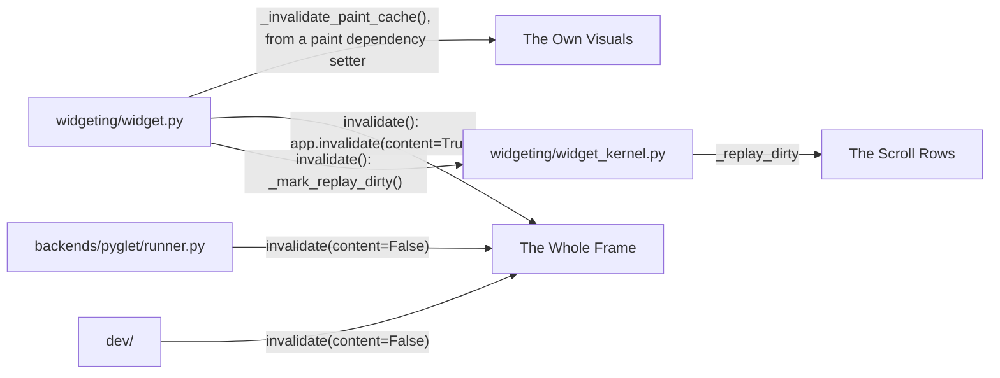
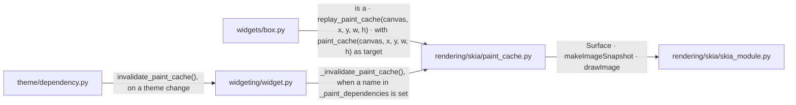
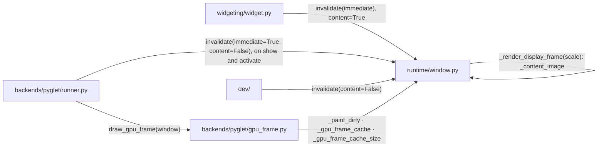
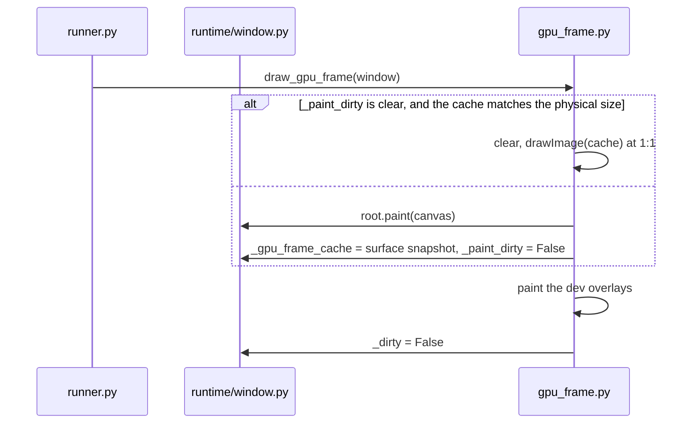
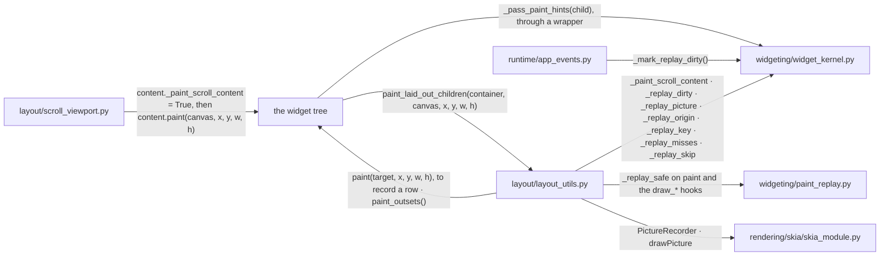
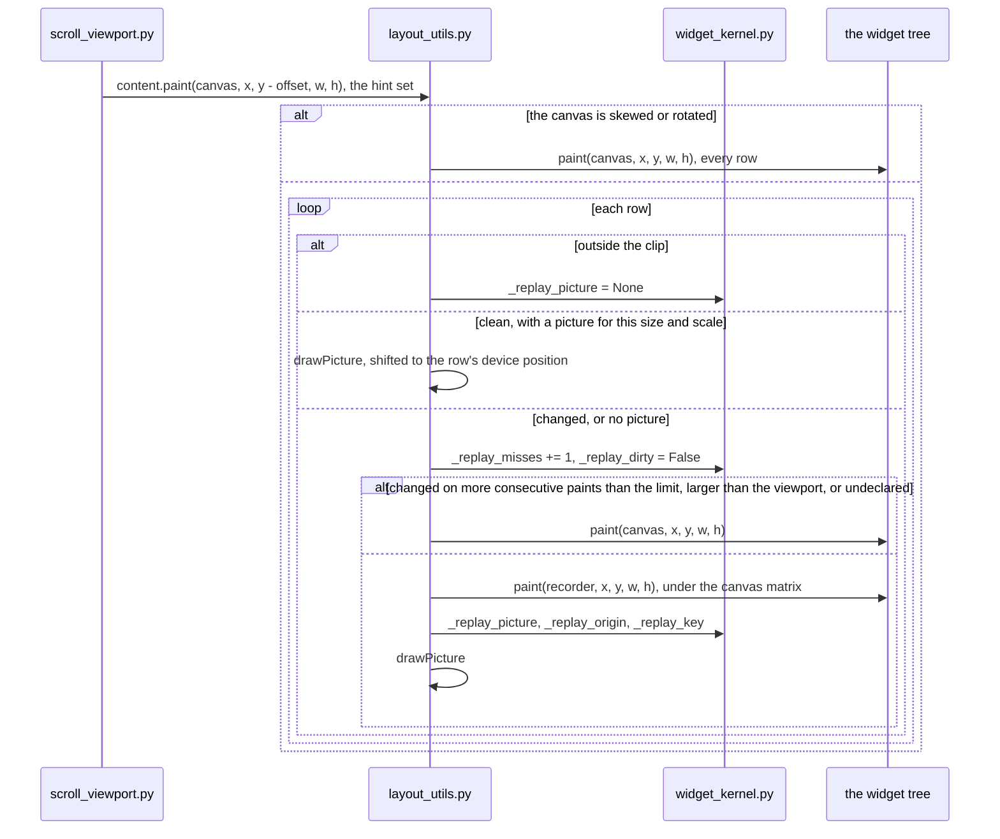

# Paint Cache

A frame's paint cost is the Python walk of the widget tree. Three caches
skip part of that walk: one widget's own visuals, the whole frame, and the
rows of a scroll viewport.

## Overview

Three groups of modules take part, one per cache, with the invalidation
paths at their edges.

### Structure

| Module | Role |
| --- | --- |
| The Own Visuals | one widget's background layers, as a Skia surface |
| The Whole Frame | the last painted tree, as an image |
| The Scroll Rows | one picture per row of a scroll viewport's content |
| `widgeting/widget.py` | `Widget.invalidate` ([WIDGET_ARCHITECTURE.md](WIDGET_ARCHITECTURE.md)) |
| `widgeting/widget_kernel.py` | the paint hints and the replay mark on every widget |
| `backends/pyglet/runner.py` | drives the frames ([RENDERING_PIPELINE.md](RENDERING_PIPELINE.md)) |
| `dev/` | the overlays drawn over the tree ([DEV_MODES.md](DEV_MODES.md)) |

### Promises

- Every paint-affecting change passes through `Widget.invalidate()`.
- The own-visuals cache answers to its widget's own properties only. The
  frame and the rows are marked by every change below them.

## The Own Visuals

A widget with heavy own visuals records its background layers once and blits
them until one of its own properties changes.

### Structure

| Module | Role |
| --- | --- |
| `rendering/skia/paint_cache.py` | `CachedPaintMixin`: the offscreen surface, its snapshot, and the size, outsets and device scale it was recorded at |
| `widgets/box.py` | `Box`, the mixin's user; its background, border and shadow are the recorded layers ([BOX_MODEL.md](BOX_MODEL.md)) |
| `widgeting/widget.py` | clears the cache when a declared paint dependency is set; `invalidate_paint_cache`, the explicit clear ([WIDGET_ARCHITECTURE.md](WIDGET_ARCHITECTURE.md)) |
| `theme/dependency.py` | re-measures and clears the cache of a marked leaf on a theme change ([THEME_CONSUMPTION.md](THEME_CONSUMPTION.md)) |
| `rendering/skia/skia_module.py` | the Skia binding ([RENDERING_PIPELINE.md](RENDERING_PIPELINE.md)) |

### Promises

- A descendant's change leaves the cache in place.
- A cache recorded for another size, outset or device scale is not drawn.
  The widget records again.

## The Whole Frame

A redraw whose content did not change re-blits the last painted tree. The
overlays are painted fresh over it.

### Structure

| Module | Role |
| --- | --- |
| `runtime/window.py` | the two dirty flags, and the raster path's tree image |
| `backends/pyglet/gpu_frame.py` | the GPU path's full-frame cache |
| `backends/pyglet/runner.py` | drives the frame; asks for one with the tree unchanged on show and activate ([RENDERING_PIPELINE.md](RENDERING_PIPELINE.md)) |
| `dev/` | the overlays drawn over the tree ([DEV_MODES.md](DEV_MODES.md)) |
| `widgeting/widget.py` | `Widget.invalidate`, a content change (Overview) |

### Sequence

#### A frame is drawn

### Promises

- `_dirty` says a frame was requested. `_paint_dirty` says the tree must be
  painted again. A content change sets both. A redraw with the tree
  unchanged sets the first only.
- The cached frame holds no dev overlay.
- The raster path and the GPU path keep the same two flags.
- A cached frame fills the whole back buffer.
- A content change repaints the whole tree.

## The Scroll Rows

The container a scroll viewport paints as its content keeps one picture per
child, a row, and replays it while the row is clean.

### Structure

| Module | Role |
| --- | --- |
| `layout/scroll_viewport.py` | paints its content at a position with the scroll offset subtracted, with the scroll-content hint set ([LAYOUT.md](LAYOUT.md)) |
| `layout/layout_utils.py` | the content container's child painter, with the row pictures |
| `widgeting/widget_kernel.py` | the hints a parent sets for the paint that follows; the replay mark, the picture and its key on each widget |
| `widgeting/paint_replay.py` | `replay_safe`, the declaration on a draw method that skipping it on a clean frame is safe |
| `runtime/app_events.py` | delivers pointer events ([INTERACTION_ARCHITECTURE.md](INTERACTION_ARCHITECTURE.md)) |
| the widget tree | the wrappers between the viewport and the container, the container, the rows under it |
| `rendering/skia/skia_module.py` | the Skia binding |

### Sequence

#### A scroll frame paints the content

### Promises

- A row is replayed only when every widget in it declares each of its draw
  methods with `replay_safe`.
- A row is marked changed by every invalidation at or below it.
- A handled pointer event marks the widget that handled it.
- A scroll marks nothing below the viewport.
- A declared widget takes the position its input needs from layout, never
  from its last paint.
- The pictures held are those of the rows on screen.
