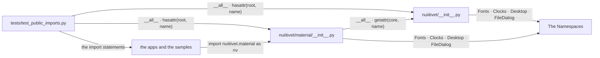
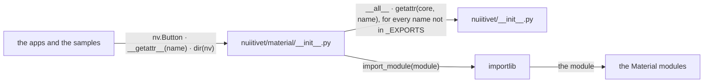
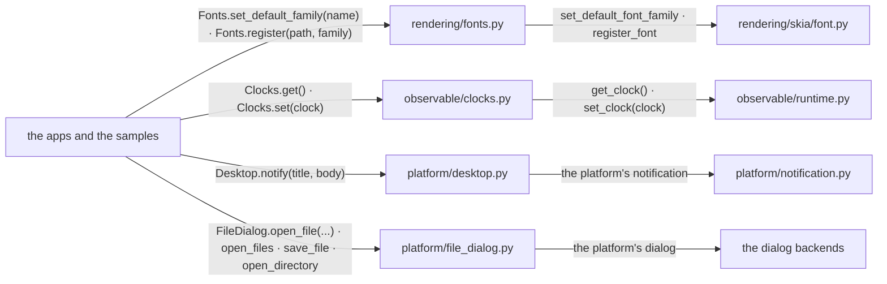

# Public Root

An app imports one root, its design system, and reaches every public symbol
from there.

## Overview

Three groups of modules take part.

### Structure

| Module | Role |
| --- | --- |
| `nuiitivet/__init__.py` | the core symbols, imported eagerly, listed in `__all__` |
| `nuiitivet/material/__init__.py` | the Material symbols, plus the core ones |
| The Namespaces | the static-method classes |
| `tests/test_public_imports.py` | holds every invariant of the surface |
| the apps and the samples | write `nv.` and nothing deeper |

### Promises

- Every core symbol is reachable from the Material root.
- A function sits flat on the root only as DSL vocabulary. Configuration and
  OS services live on a namespace class.

## The Material Root

`nuiitivet.material` binds the core symbols at import. Its own symbols
resolve on first access.

### Structure

| Module | Role |
| --- | --- |
| `nuiitivet/material/__init__.py` | `_EXPORTS`, the Material names and where each lives; `__getattr__`, the lazy resolution; the eager copy of the core names |
| `nuiitivet/__init__.py` | the core names (Overview) |
| the Material modules | the widgets, styles and themes, imported on first access |
| `importlib` | imports a module by name |
| the apps and the samples | read the attributes |

### Promises

- A core name the Material root overrides resolves to the Material class.

## The Namespaces

A namespace class holds static methods.

### Structure

| Module | Role |
| --- | --- |
| `rendering/fonts.py` | `Fonts`, the font configuration ([TYPOGRAPHY.md](TYPOGRAPHY.md)) |
| `observable/clocks.py` | `Clocks`, the clock seam a test swaps ([OBSERVABLE.md](OBSERVABLE.md)) |
| `platform/desktop.py` | `Desktop`, the OS notification |
| `platform/file_dialog.py` | `FileDialog`, the OS file dialogs |
| `rendering/skia/font.py` | the implementation behind `Fonts` |
| `observable/runtime.py` | the implementation behind `Clocks` |
| `platform/notification.py` | the implementation behind `Desktop` |
| the dialog backends | the implementation behind `FileDialog` |
| the apps and the samples | configure at startup, or call from a handler |

### Promises

- A namespace class is never instantiated. The implementation stays in its
  subsystem.
- The class name is a plural or collective noun for the subsystem or the
  service. A method drops the words the class name carries.
