# Rendering Pipeline

A window draws a frame on demand.

## Overview

Four groups of modules take part.

### Structure

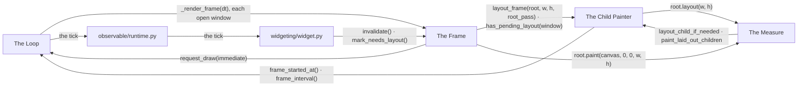

| Module | Role |
| --- | --- |
| The Loop | decides each iteration whether a frame is drawn |
| The Frame | one window's frame, from the queues to the flip |
| The Measure | the caches a layout pass reads |
| The Child Painter | runs a frame's layout until its deadline and finishes it in the frames after; lays a container's children out and paints them |
| `widgeting/widget.py` | `invalidate`, the one request for a frame ([WIDGET_ARCHITECTURE.md](WIDGET_ARCHITECTURE.md)) |
| `observable/runtime.py` | the clock animations tick on ([ANIMATION_SYSTEM.md](ANIMATION_SYSTEM.md)) |

### Promises

- A frame is drawn only when something invalidated.
- A flip follows a full repaint of the back buffer.
- `layout()` issues no draw command. `layout()` writes no `State`. A
  measured result reaches a `State` through the size-change queue.
- `preferred_size()` has no side effect. On a mounted composable it never
  calls `build()`.
- A widget keeps showing what it last showed until its new content is
  ready: a pending child its last layout, a `RasterSurface` its last pixels.
  Only a widget that never had content is painted as nothing.
- Work a frame's layout leaves at its deadline continues in the next frame.
  It never waits for idle time. Idle work between the two frames may do part
  of it.

## The Loop

`ResponsiveEventLoop` wakes for OS events, the clock and a pending frame.

### Structure

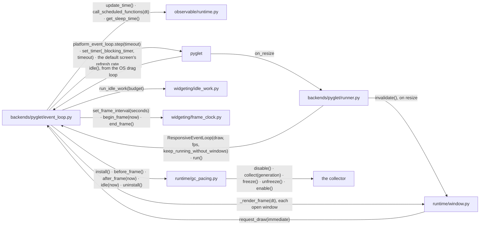

| Module | Role |
| --- | --- |
| `backends/pyglet/event_loop.py` | decides whether a frame is drawn this iteration. Decides how long to sleep |
| `backends/pyglet/runner.py` | builds the loop with the draw callback; the OS event handlers ([APP_WINDOW.md](APP_WINDOW.md)) |
| `runtime/window.py` | requests a frame, draws one (The Frame) |
| `observable/runtime.py` | the clock the loop ticks ([OBSERVABLE.md](OBSERVABLE.md)) |
| `runtime/gc_pacing.py` | `GcPacer`: holds the collector while the loop runs; picks the generation collected at a wait, before a frame past the backstop, and in a quiet stretch |
| `widgeting/idle_work.py` | the tasks the loop runs before it waits, each until the deadline ([LAYOUT.md](LAYOUT.md)) |
| `widgeting/frame_clock.py` | whether a frame is under way, when it began and how long a frame is (The Child Painter) |
| `pyglet` | the platform event loop; the screen's refresh rate |
| the collector | CPython's cyclic garbage collector |

### Sequence

#### A frame is requested and drawn

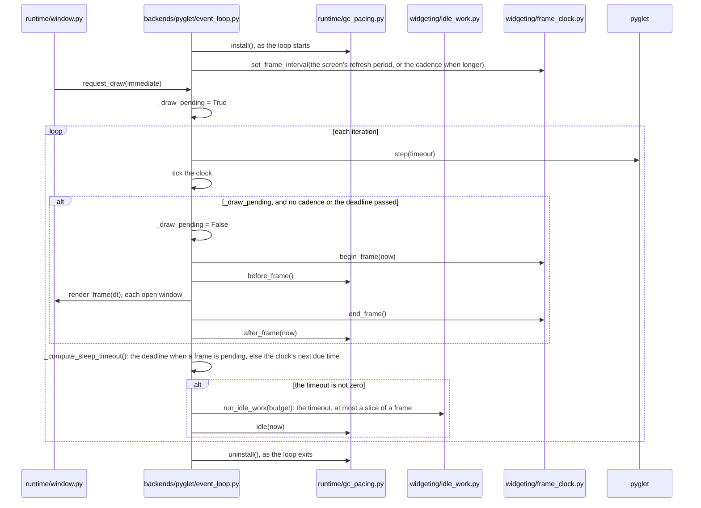

#### The OS owns the loop during a drag

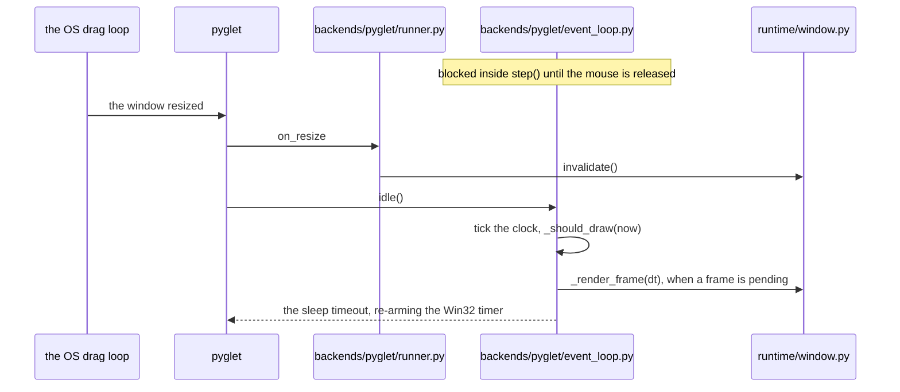

### Promises

- With nothing pending the loop draws nothing. It does not wake for a
  cadence deadline.
- A cadence throttles a pending frame and never produces one.
- A frame served from the OS drag loop passes the same gate as one from the
  main loop.
- Idle work runs before a wait, within its budget. A frame due now runs
  first. Work left over brings the loop back at once.
- The frame clock learns when each frame begins and ends, and how long a
  frame is: the screen's refresh period, or the cadence when that is longer.
- While the loop runs, the collector runs only where the loop calls it.
- No collection runs inside a frame. The loop collects before a wait, or
  before a frame once the allocations after the last collection passed the
  backstop.
- A full collection over the whole heap runs only in a quiet stretch. Past
  the old generation's budget a full collection runs at once, over the
  unfrozen heap.
- The loop hands the collector back as it found it when it exits.

## The Frame

`_render_frame` draws one window.

### Structure

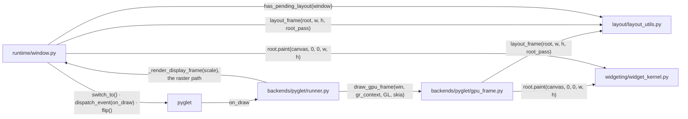

| Module | Role |
| --- | --- |
| `runtime/window.py` | draws a window's frame; renders the raster path's image |
| `backends/pyglet/runner.py` | `on_draw`: the GPU path, falling back to the raster path |
| `backends/pyglet/gpu_frame.py` | paints the tree into the GL framebuffer, or re-blits the cached frame ([PAINT_CACHE.md](PAINT_CACHE.md)) |
| `widgeting/widget_kernel.py` | the root's `paint` |
| `layout/layout_utils.py` | the frame's layout; whether a subtree is pending (The Child Painter) |
| `pyglet` | the window and its back buffer |

### Sequence

#### A window draws a frame

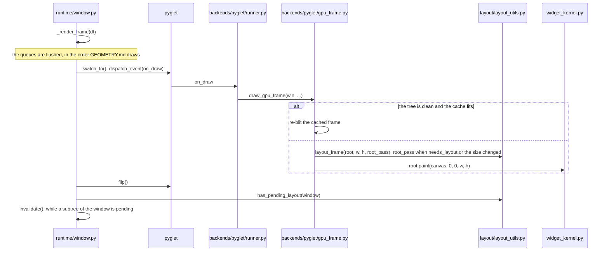

### Promises

- Layout runs to its end before the first draw command. No paint lays a
  widget out. A pass short of time stops at the deadline. The child a pass
  stopped at is painted from its last layout, never from an unfinished one. A
  child with no last layout is painted as nothing (The Child Painter).
- While a subtree of a window is pending, each frame the window draws asks
  for the one after it. That frame lays out and paints the tree. It is never
  the cached frame.
- The GPU path and the raster path lay out and paint the same tree with the
  same calls.

## The Measure

Three caches keep a layout pass proportional to what changed.

### Structure

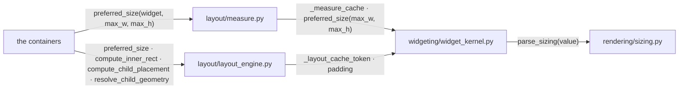

| Module | Role |
| --- | --- |
| `layout/measure.py` | remembers a widget's measurement per constraint pair, a short list per widget |
| `layout/layout_engine.py` | remembers a container's preferred size, inner rect and child placement, keyed on padding, border and the tokens |
| `rendering/sizing.py` | parses a sizing literal once |
| `widgeting/widget_kernel.py` | holds the measure cache slot and the layout cache token; `mark_needs_layout` drops them up the tree |
| the containers | `Row`, `Column`, `Container` and the others that measure their children ([LAYOUT.md](LAYOUT.md)) |

### Promises

- Shrinking a maximum constraint down to the measured result leaves the
  result unchanged. The measure cache answers a shrunk constraint from the
  entry it still fits.
- A change routed through `mark_needs_layout` re-measures the dirtied path
  only.

## The Child Painter

`layout_utils` runs a frame's layout, lays a container's children out and
paints them at their rects. Inside a frame the layout stops descending at its
deadline. The frames after finish it. Until then a child it stopped at is
painted from its last layout, the one that last ran on it. A lazy container
that stopped building at the deadline leaves itself pending too.

### Structure

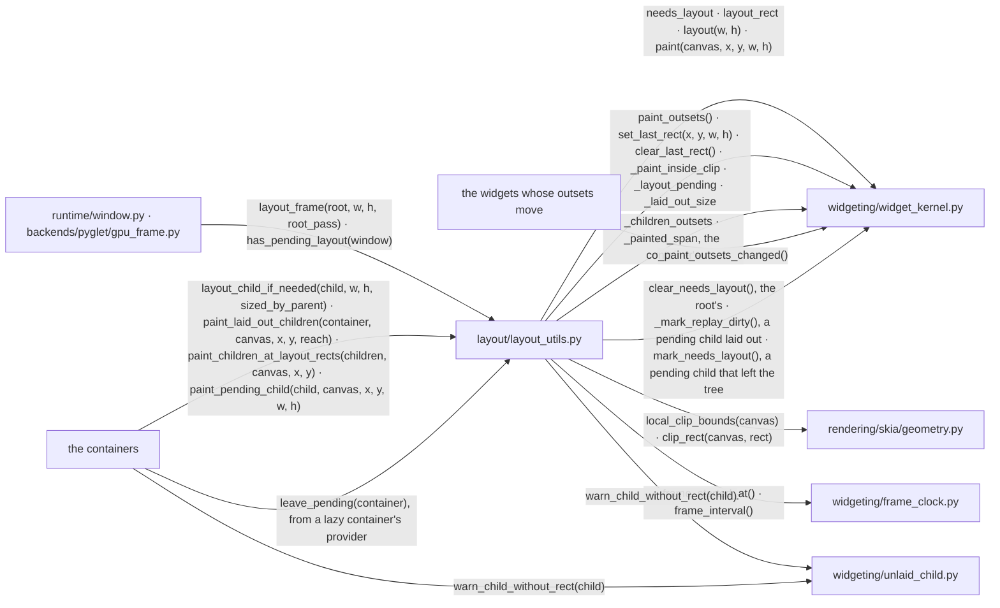

| Module | Role |
| --- | --- |
| `layout/layout_utils.py` | runs a frame's layout: the root's pass, then the pending children, until the deadline; lays a child out unless it is clean at the same size, or the deadline has passed and the child's rect is its parent's; paints the children, a pending one from its last layout, skipping those beyond the clip and its slack band; visits only the children a container's reach gives; tells a child inside the clip so |
| `widgeting/widget_kernel.py` | `layout`, `paint`, `hit_test`, `last_rect`; the pending flag and the size of the last layout; the inside-clip hint a parent sets for the paint that follows; a container's largest child outsets and the span its last paint visited, dropped up the tree by `_paint_outsets_changed` |
| the containers | the multi-child containers, `Container` and `Deck`; a lazy container's provider leaves the container pending while a placeholder in view remains ([LAYOUT.md](LAYOUT.md)); `Column`, `Row`, `Flow` and `UniformFlow` answer which of their children a rect reaches |
| the widgets whose outsets move | `TransformBox`, the animated `visible` box, `Box` with its shadows, `Clickable` with its disabled state |
| `rendering/skia/geometry.py` | reads the canvas clip and narrows it |
| `widgeting/frame_clock.py` | whether a frame is under way and how long a frame is (The Loop) |
| `runtime/window.py · backends/pyglet/gpu_frame.py` | start a frame's layout; ask whether a subtree is pending (The Frame) |
| `widgeting/unlaid_child.py` | warns of a child painted with no rect, naming the parent that never laid it out; called by every paint that skips such a child, the single-child widgets' included |

### Sequence

#### A layout past its deadline leaves a child pending

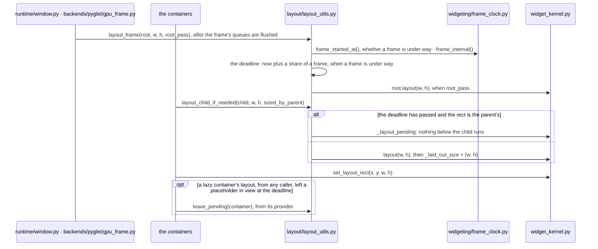

#### A pending child is painted

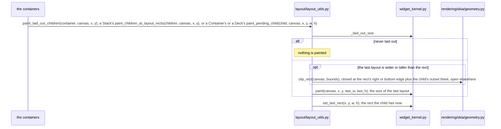

#### The next frame lays the pending children out

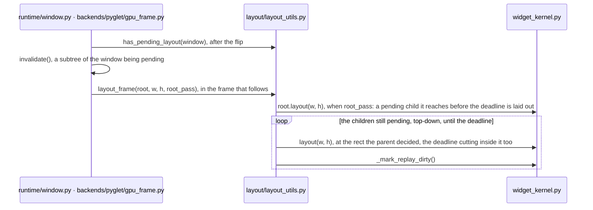

### Promises

- A clean child laid out again at the same size is skipped.
- The deadline of a frame's layout is a share of a frame after the layout
  starts, whatever the frame ran before it.
- Past the deadline a child whose rect its parent decided is left pending: it
  keeps the rect, nothing below it runs. A child sized by its content is laid
  out whatever the time.
- A widget whose own layout stopped at the deadline with work left that
  shows leaves itself pending. It is painted from the layout just made.
- A pending child is painted at the size of its last layout, from the top
  left corner of its rect. A pending child never laid out is painted as
  nothing. In both cases its `last_rect` is its rect.
- Where a pending child's rect is narrower than its last layout, the paint is
  cut at the rect's right edge plus the child's right outset, what it reports
  through `paint_outsets`. Where the rect is shorter, the paint is cut at the
  bottom edge plus the bottom outset. No other side is cut.
- Hit testing descends a pending child through its last layout. Nothing below
  a pending child never laid out is hit.
- No count of frames ends a child's pending state. Only its layout does.
- A child with no rect is not painted. A warning names it and its parent,
  once for each pair of classes, or the child alone when it has no parent. A
  parent whose layout is still to come is not named.
- The layout of the next frame lays the pending children out. The root's pass
  comes first. The pending children share its deadline.
- The pending children are laid out top-down, each at its rect, a subtree
  whole before the siblings after it. A child laid out moves nothing.
- Where no frame is under way a pass leaves nothing pending. A frame's layout
  run there lays out every pending child.
- A child whose rect plus outsets lies outside the clip and its slack band is
  not painted.
- A container that answers which children a rect reaches has its paint visit
  those only. The rect is the clip, widened by the slack band and by the
  largest outset of any child. `Column`, `Row`, `Flow` and the eager
  `UniformFlow` answer. `Grid`, `Stack` and the lazy `UniformFlow` do not.
- A child the paint visits receives its `last_rect`. A child the paint stops
  visiting has none.
- A widget whose `paint_outsets()` changes without a layout calls
  `_paint_outsets_changed()`.
- Without a readable clip every child is painted.
- A `Stack` tests its children against the clip, with the inside-clip hint
  or without it.
- A wrapper passes the inside-clip hint only while it neither narrows the
  clip nor moves its child. A hint covers one paint.
