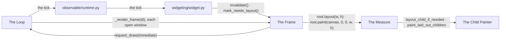
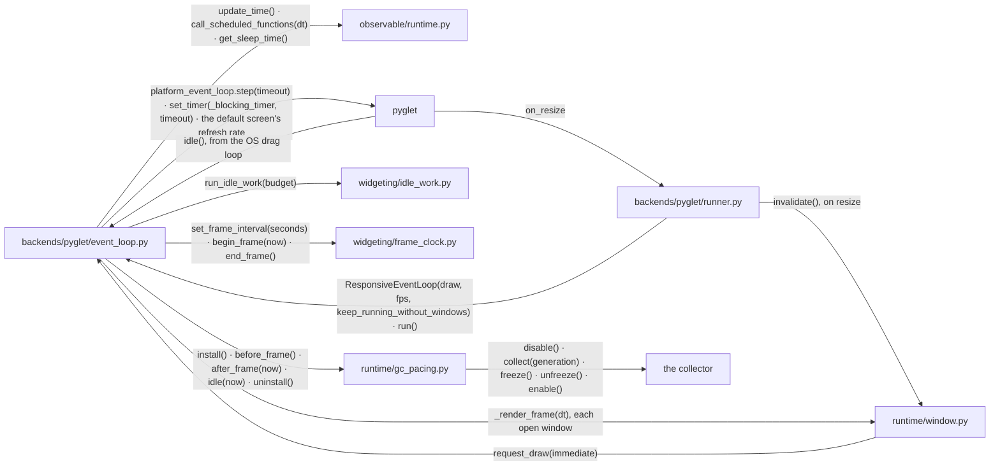
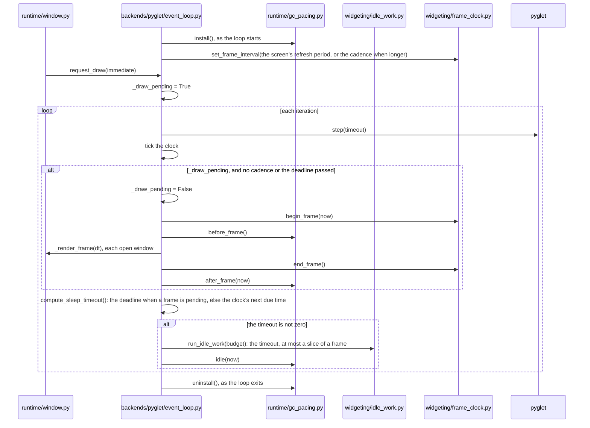
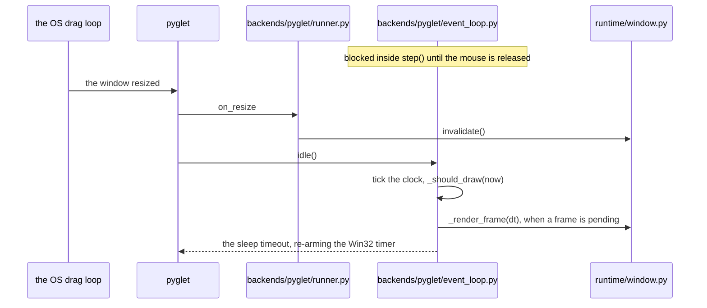
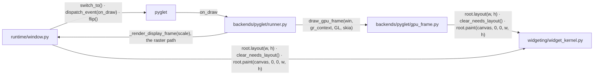
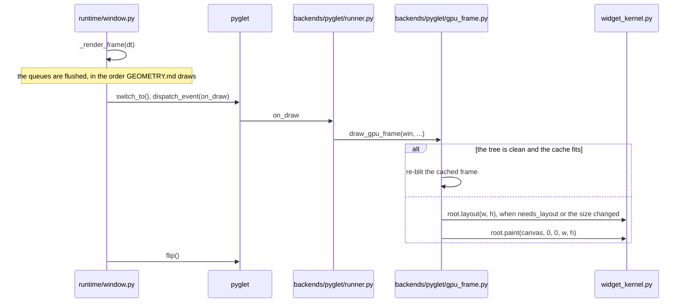
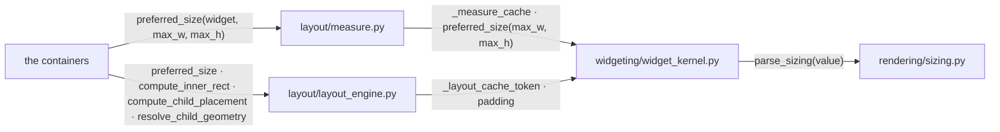
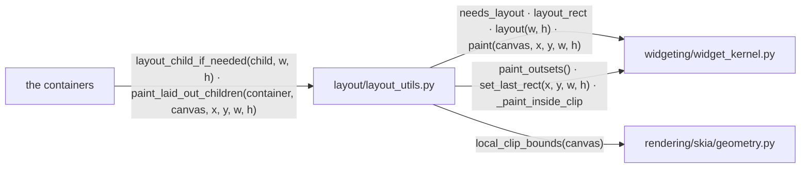

# Rendering Pipeline

A window draws a frame on demand.

## Overview

Four groups of modules take part.

### Structure

| Module | Role |
| --- | --- |
| The Loop | decides each iteration whether a frame is drawn |
| The Frame | one window's frame, from the queues to the flip |
| The Measure | the caches a layout pass reads |
| The Child Painter | lays a container's children out and paints them |
| `widgeting/widget.py` | `invalidate`, the one request for a frame ([WIDGET_ARCHITECTURE.md](WIDGET_ARCHITECTURE.md)) |
| `observable/runtime.py` | the clock animations tick on ([ANIMATION_SYSTEM.md](ANIMATION_SYSTEM.md)) |

### Promises

- A frame is drawn only when something invalidated.
- A flip follows a full repaint of the back buffer.
- `layout()` issues no draw command. `layout()` writes no `Observable`. A
  measured result reaches an `Observable` through the size-change queue.
- `preferred_size()` has no side effect. On a mounted composable it never
  calls `build()`. The one exception: a lazy container given no item extent
  builds its first item, once, to measure it ([LAYOUT.md](LAYOUT.md)).

## The Loop

`ResponsiveEventLoop` wakes for OS events, the clock and a pending frame.

### Structure

| Module | Role |
| --- | --- |
| `backends/pyglet/event_loop.py` | decides whether a frame is drawn this iteration. Decides how long to sleep |
| `backends/pyglet/runner.py` | builds the loop with the draw callback; the OS event handlers ([APP_WINDOW.md](APP_WINDOW.md)) |
| `runtime/window.py` | requests a frame, draws one (The Frame) |
| `observable/runtime.py` | the clock the loop ticks ([OBSERVABLE.md](OBSERVABLE.md)) |
| `runtime/gc_pacing.py` | `GcPacer`: holds the collector while the loop runs; picks the generation collected at a wait, before a frame past the backstop, and in a quiet stretch |
| `widgeting/idle_work.py` | the tasks the loop runs before it waits, each until the deadline ([LAYOUT.md](LAYOUT.md)) |
| `widgeting/frame_clock.py` | whether a frame is under way, when it began and how long a frame is, for work inside a frame that stops at a deadline ([LAYOUT.md](LAYOUT.md)) |
| `pyglet` | the platform event loop; the screen's refresh rate |
| the collector | CPython's cyclic garbage collector |

### Sequence

#### A frame is requested and drawn

#### The OS owns the loop during a drag

### Promises

- With nothing pending the loop draws nothing. It does not wake for a
  cadence deadline.
- A cadence throttles a pending frame and never produces one.
- A frame served from the OS drag loop passes the same gate as one from the
  main loop.
- Idle work runs before a wait, within its budget. A frame due now runs
  first. Work left over brings the loop back at once.
- The frame clock learns when each frame begins and ends, and how long a
  frame is: the screen's refresh period, or the cadence when that is longer.
- While the loop runs, the collector runs only where the loop calls it.
- No collection runs inside a frame. The loop collects before a wait, or
  before a frame once the allocations after the last collection passed the
  backstop.
- A full collection over the whole heap runs only in a quiet stretch. Past
  the old generation's budget a full collection runs at once, over the
  unfrozen heap.
- The loop hands the collector back as it found it when it exits.

## The Frame

`_render_frame` draws one window.

### Structure

| Module | Role |
| --- | --- |
| `runtime/window.py` | draws a window's frame; renders the raster path's image |
| `backends/pyglet/runner.py` | `on_draw`: the GPU path, falling back to the raster path |
| `backends/pyglet/gpu_frame.py` | paints the tree into the GL framebuffer, or re-blits the cached frame ([PAINT_CACHE.md](PAINT_CACHE.md)) |
| `widgeting/widget_kernel.py` | the root's `layout` and `paint` |
| `pyglet` | the window and its back buffer |

### Sequence

#### A window draws a frame

### Promises

- Layout runs to its end before the first draw command. A pass short of time
  leaves placeholders laid out in their items' slots, never an unfinished
  tree ([LAYOUT.md](LAYOUT.md)).
- The GPU path and the raster path lay out and paint the same tree with the
  same calls.

## The Measure

Three caches keep a layout pass proportional to what changed.

### Structure

| Module | Role |
| --- | --- |
| `layout/measure.py` | remembers a widget's measurement per constraint pair, a short list per widget |
| `layout/layout_engine.py` | remembers a container's preferred size, inner rect and child placement, keyed on padding, border and the tokens |
| `rendering/sizing.py` | parses a sizing literal once |
| `widgeting/widget_kernel.py` | holds the measure cache slot and the layout cache token; `mark_needs_layout` drops them up the tree |
| the containers | `Row`, `Column`, `Container` and the others that measure their children ([LAYOUT.md](LAYOUT.md)) |

### Promises

- Shrinking a maximum constraint down to the measured result leaves the
  result unchanged. The measure cache answers a shrunk constraint from the
  entry it still fits.
- A change routed through `mark_needs_layout` re-measures the dirtied path
  only.

## The Child Painter

`layout_utils` lays a container's children out and paints them at their
rects.

### Structure

| Module | Role |
| --- | --- |
| `layout/layout_utils.py` | lays a child out unless it is clean at the same size; paints the children, skipping those beyond the clip and its slack band; tells a child inside the clip so |
| `widgeting/widget_kernel.py` | `layout`, `paint`, `last_rect`; the paint hints a parent sets for the paint that follows |
| the containers | the multi-child containers ([LAYOUT.md](LAYOUT.md)) |
| `rendering/skia/geometry.py` | reads the canvas clip |

### Promises

- A clean child laid out again at the same size is skipped.
- A child whose rect plus outsets lies outside the clip and its slack band is
  not painted. It still receives its `last_rect`.
- Without a readable clip every child is painted.
- A wrapper passes the inside-clip hint only while it neither narrows the
  clip nor moves its child. A hint covers one paint.
