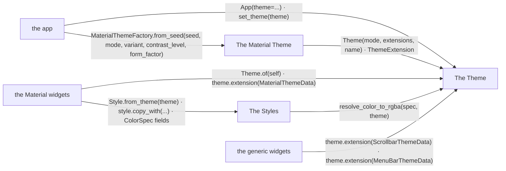
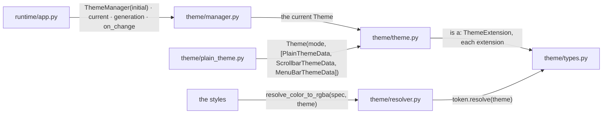
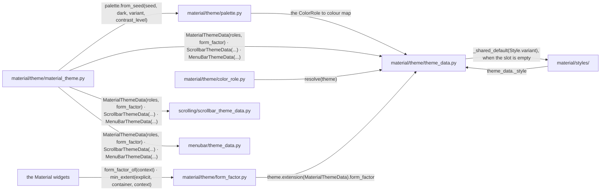
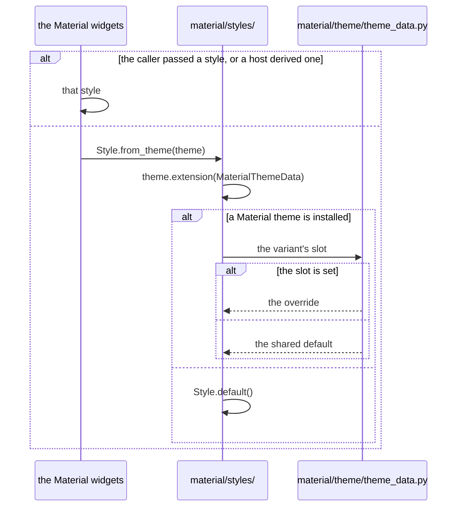
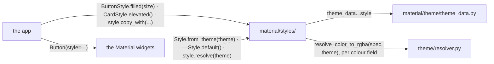

# Style and Theme

A widget's look is a style, one dataclass per widget. A theme supplies the
colours a style names. A design system may put another default style in the
theme. How a widget reads the theme is in
[THEME_CONSUMPTION.md](THEME_CONSUMPTION.md).

## Overview

Three groups of modules take part.

### Structure

| Module | Role |
| --- | --- |
| The Theme | the design-agnostic container, the colour resolver and the manager |
| The Material Theme | the palette from a seed, the form factor and the per-variant style overrides |
| The Styles | one dataclass per widget |
| the Material widgets | read a style ([MATERIAL_INTERACTION.md](MATERIAL_INTERACTION.md)) |
| the generic widgets | the scrollbar and the menu bar, each with a palette extension of its own ([MENU_BAR.md](MENU_BAR.md)) |
| the app | builds a theme and installs it |

### Promises

- Everything design-specific lives in a `ThemeExtension`.
- A generic widget never reads a Material colour role.
- The app-wide palette lives in a `ThemeExtension`. A per-instance override
  lives in the nullable `ColorSpec` fields of the widget's style. The shape
  lives in the style.

## The Theme

`Theme` is the container every design system fills.

### Structure

| Module | Role |
| --- | --- |
| `theme/theme.py` | the container and `Theme.of` |
| `theme/types.py` | the colour spec vocabulary, a token, a literal or either with an alpha, and the extension protocol |
| `theme/resolver.py` | turns a `ColorSpec` into RGBA against a theme |
| `theme/manager.py` | holds the current theme for one owner |
| `theme/plain_theme.py` | `PlainTheme`, the design system with no Material ([THEME_CONSUMPTION.md](THEME_CONSUMPTION.md)) |
| `runtime/app.py` | the `AppScope` that owns the manager ([APP_WINDOW.md](APP_WINDOW.md)) |
| the styles | the colour fields resolved (The Styles) |

### Promises

- A colour token resolves at paint, against the theme current then.
- A theme holds at most one extension per type.
- The manager notifies one owner.

## The Material Theme

`MaterialThemeData` is the Material extension of a theme.

### Structure

| Module | Role |
| --- | --- |
| `material/theme/theme_data.py` | `MaterialThemeData`: the roles, the form factor, one nullable slot per widget variant falling through to a shared default |
| `material/theme/material_theme.py` | `MaterialThemeFactory`: a theme from a seed, with the Material, scrollbar and menu bar extensions |
| `material/theme/palette.py` | derives the roles from a seed, a scheme variant and a contrast level |
| `material/theme/color_role.py` | `ColorRole`, a token resolving through the Material extension |
| `material/theme/form_factor.py` | `FormFactor`, the component sizes of one kind of device |
| `material/styles/` | the defaults the slots fall through to (The Styles) |
| `scrolling/scrollbar_theme_data.py` | the scrollbar's palette |
| `menubar/theme_data.py` | the menu bar's palette ([MENU_BAR.md](MENU_BAR.md)) |
| the Material widgets | measure and paint by the form factor |

### Sequence

#### A widget resolves its style

### Promises

- An empty slot falls through to one shared frozen preset.
- A style keeps the MD3 baseline numbers under every form factor. The widget
  applies the form factor where it measures and paints.
- A style's own `density` wins over the theme's step.

## The Styles

Each widget has its own style class.

### Structure

| Module | Role |
| --- | --- |
| `material/styles/` | one frozen dataclass per widget: the `ColorSpec` fields, the MD3 shape and size tokens, the variant factories, `default()`, `from_theme()` |
| the Material widgets | hold the caller's style, and one a hosting widget such as a toolbar derives for them |
| `material/theme/theme_data.py` | the overrides (The Material Theme) |
| `theme/resolver.py` | the colour resolution (The Theme) |
| the app | passes a style or a variant |

### Promises

- A style is frozen. A variation is a `copy_with`, never a mutation.
- No style class inherits from another.
- Every style class with presets has `default()`.
