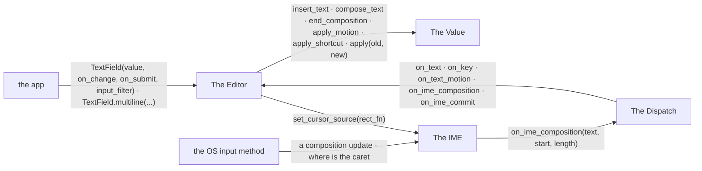
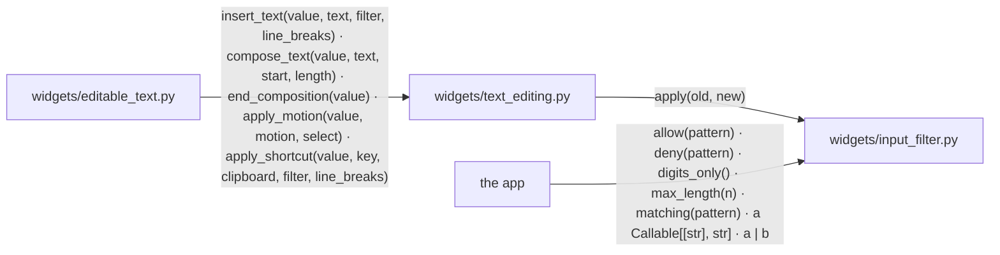
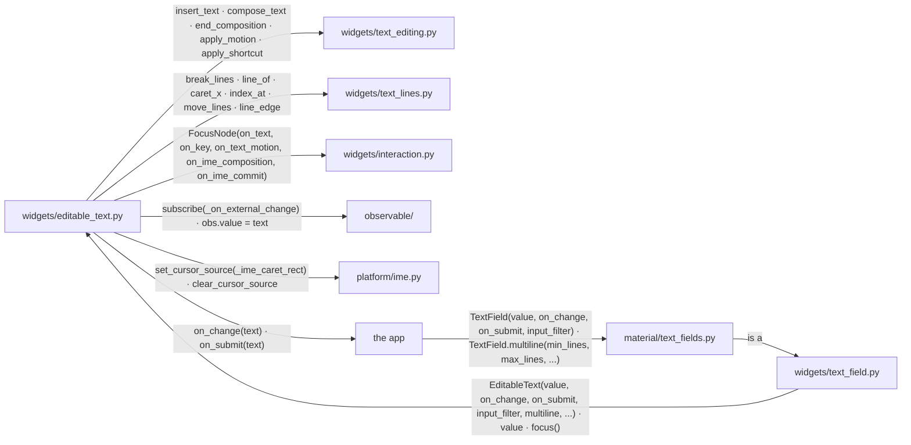
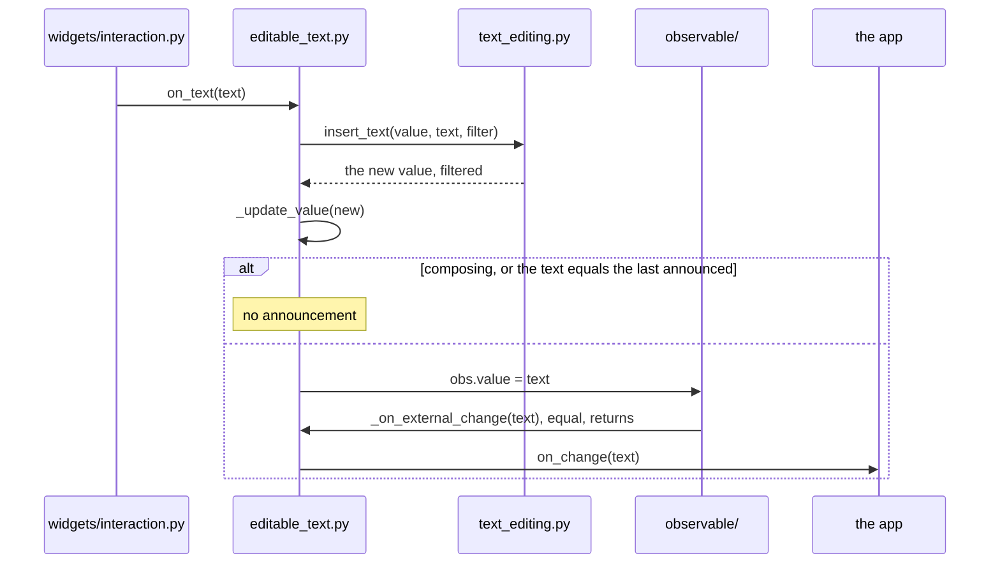
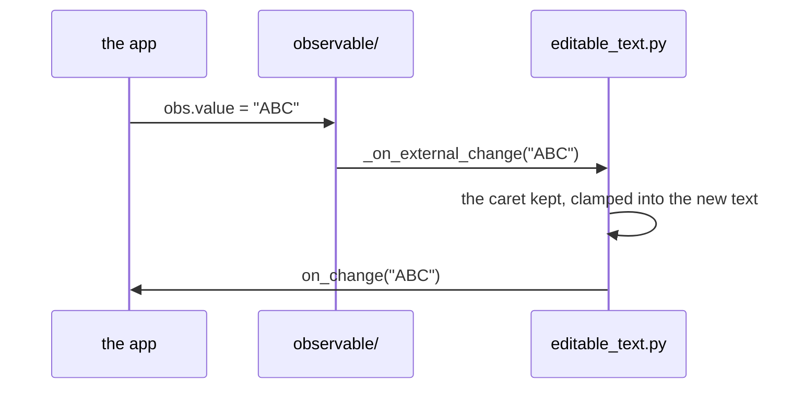
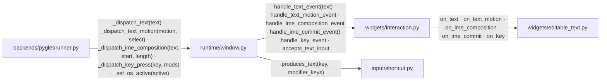
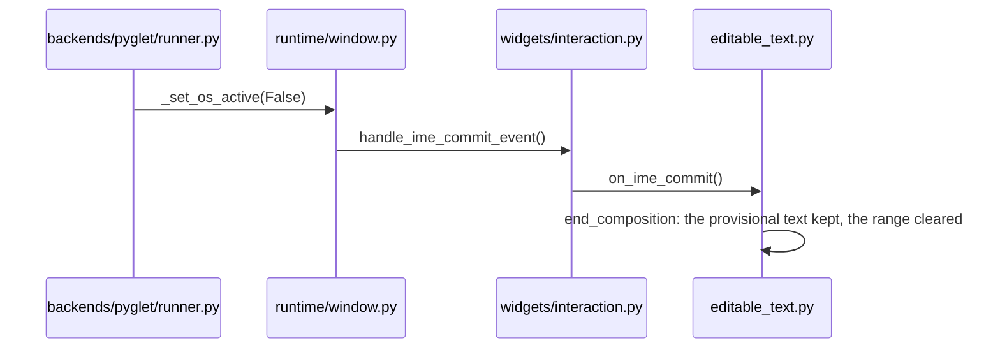
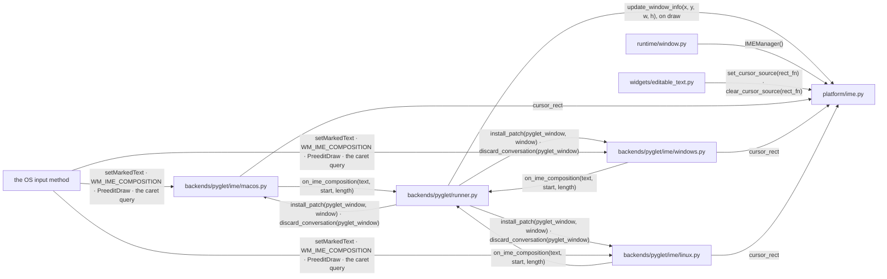
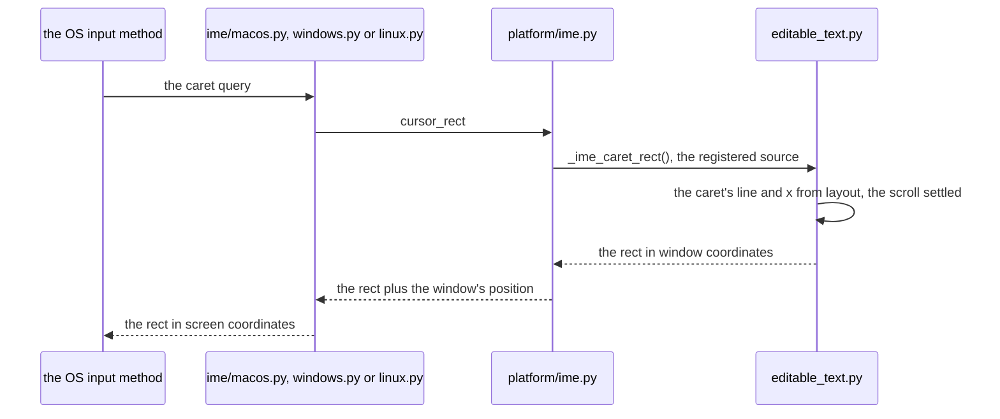

# Text Editing

A text field keeps its state in an immutable value. Typed text, key
shortcuts and the OS input method all turn one value into the next.

## Overview

Four groups of modules take part, with the app and the OS input method at
their edges.

### Structure

| Module | Role |
| --- | --- |
| The Value | the immutable editing value and the pure functions that produce the next one |
| The Editor | the widget that holds the value, mirrors its text to the app and draws it |
| The Dispatch | routes typed text, motions and compositions to the focused field |
| The IME | the patch on each platform window and the caret the OS asks for |
| the app | binds a `str` observable and the callbacks |
| the OS input method | composes text inline and places its candidates at the caret |

### Promises

- Typed text and key presses arrive on two routes. A field inserts
  characters from `on_text`. It claims keys on `on_key`.
- The IME is reached by patching the platform window, never through the
  backend's own text input.

## The Value

`TextEditingValue` is a snapshot of a field: the text, the selection and
the range the IME is still converting.

### Structure

| Module | Role |
| --- | --- |
| `widgets/text_editing.py` | `TextRange`, `TextEditingValue`; the edits as functions from one value to the next |
| `widgets/input_filter.py` | `InputFilter.apply(old, new)`, the built-in filters, the chain |
| `widgets/editable_text.py` | the one caller of the edits (The Editor) |
| the app | composes filters |

### Promises

- The composing range is part of the text until the IME commits.
- A filter runs on typing, a paste and an IME commit. It runs on no deletion
  and on no value the app assigns.

## The Editor

`EditableText` is the field. `TextField` decorates it.

### Structure

| Module | Role |
| --- | --- |
| `widgets/editable_text.py` | `EditableText`: the internal `Observable[TextEditingValue]`, the mirror to the bound `str` observable, the handlers for text, keys, motions and compositions, the caret |
| `widgets/text_field.py` | `TextFieldBase`, the decorated field around one editable |
| `material/text_fields.py` | the MD3 `TextField` and its `multiline` constructor ([MATERIAL_INTERACTION.md](MATERIAL_INTERACTION.md)) |
| `widgets/text_editing.py` | the edits (The Value) |
| `widgets/text_lines.py` | breaks text into lines for a width; the caret's line and x |
| `widgets/interaction.py` | the focus node the handlers hang on ([INTERACTION_ARCHITECTURE.md](INTERACTION_ARCHITECTURE.md)) |
| `observable/` | the bound observable ([OBSERVABLE.md](OBSERVABLE.md)) |
| `platform/ime.py` | the window's caret source (The IME) |
| the app | the bound observable and the callbacks |

### Sequence

#### A keystroke becomes the app's text

#### The app rewrites the text

### Promises

- `on_change` fires for every text change, from the user or from the app.
  The write-back fires for the user's edits only.
- Nothing is announced while a composition is active. Ending the
  composition announces the text, changed or not.
- The write-back loop ends on equality.
- A field without `on_submit` declines Enter.
- An Enter that confirms an IME composition is not a submit.

## The Dispatch

The window routes text, motions and compositions to the focused node. The
node bubbles them up its chain.

### Structure

| Module | Role |
| --- | --- |
| `backends/pyglet/runner.py` | the `on_text`, `on_text_motion`, `on_ime_composition` and activate handlers ([APP_WINDOW.md](APP_WINDOW.md)) |
| `runtime/window.py` | hands each event to the focused node |
| `widgets/interaction.py` | `FocusNode`: the handlers and the bubbling to the parent node |
| `widgets/editable_text.py` | the field at the end of the chain (The Editor) |
| `input/shortcut.py` | the text guard of the shortcut tier ([KEYBOARD_SHORTCUTS.md](KEYBOARD_SHORTCUTS.md)) |

### Sequence

#### The window loses the OS focus mid-composition

### Promises

- A window blocked by a modal child consumes a text event.
- A key the focused chain can type reaches no shortcut.
- A field holds no live composition while its window lacks the OS focus.

## The IME

Each platform window is patched to intercept the input method before the OS
handles it. The window's `IMEManager` answers where the caret is.

### Structure

| Module | Role |
| --- | --- |
| `platform/ime.py` | `IMEManager`: the window's position and the caret source |
| `backends/pyglet/ime/macos.py` | overrides `setMarkedText:selectedRange:replacementRange:` and `firstRectForCharacterRange:actualRange:` on the `NSTextView` through the Objective-C runtime |
| `backends/pyglet/ime/windows.py` | subclasses the window procedure for the composition messages |
| `backends/pyglet/ime/linux.py` | recreates the X input context with preedit callbacks |
| `backends/pyglet/runner.py` | installs the patch when the window is realised; drops the OS conversation on deactivate ([APP_WINDOW.md](APP_WINDOW.md)) |
| `runtime/window.py` | owns the manager ([APP_WINDOW.md](APP_WINDOW.md)) |
| `widgets/editable_text.py` | the focused field, the caret source (The Editor) |
| the OS input method | composes and asks for the caret |

### Sequence

#### The OS asks where the caret is

### Promises

- One `IMEManager` per window.
- The focused field is its window's caret source. It withdraws on unmount.
- The caret rect is computed when the OS asks, from layout state. Nothing
  publishes it on paint.
- A window that loses the OS focus drops its OS-side conversation.
