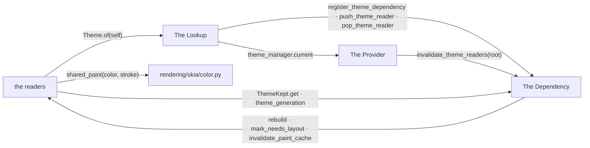
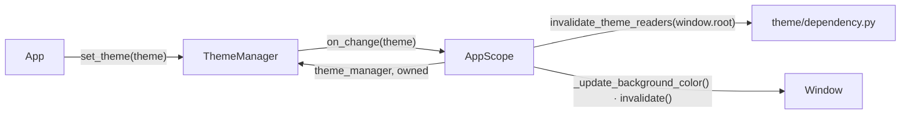
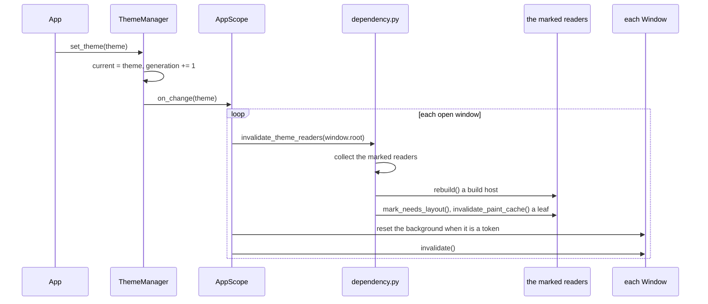
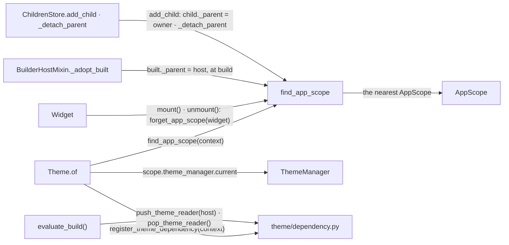
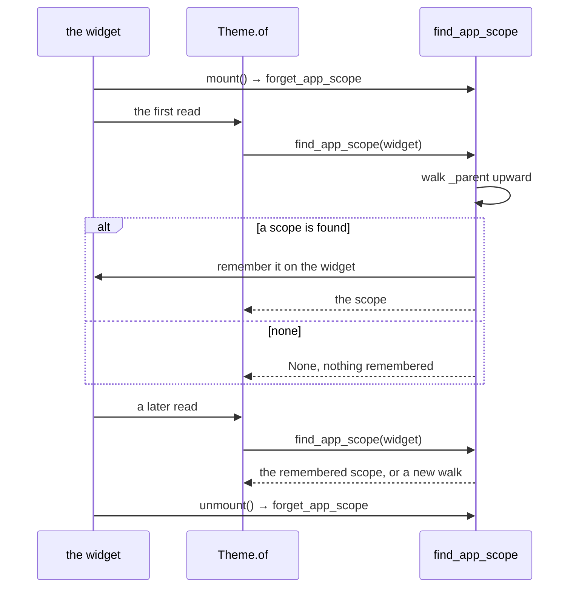
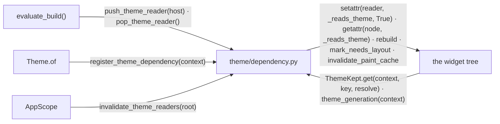
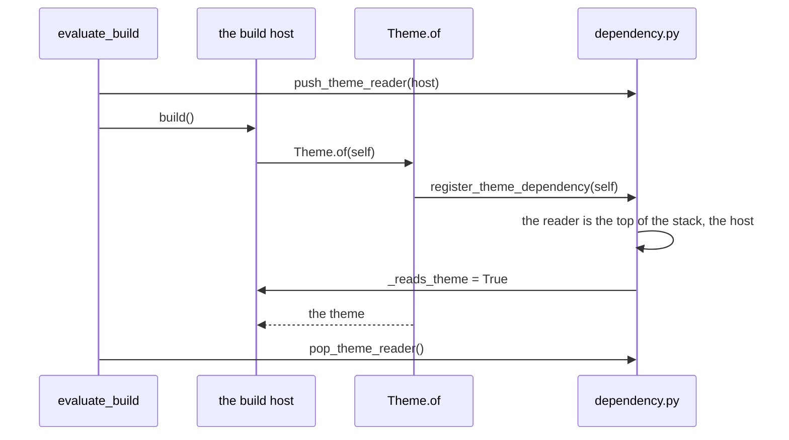

# Theme Consumption

How a widget reads the theme, and how a theme change reaches it. What a
theme holds is in [STYLE_THEME.md](STYLE_THEME.md).

## What Every Reader Shares

A reader is whatever unit the framework can invalidate.

### Structure

| Module | Role |
| --- | --- |
| the readers | the widgets that read the theme: in `build()`, at paint or measure, or through a kept value |
| The Provider | holds the current theme and fans a change out to every window |
| The Lookup | resolves `Theme.of` to the scope above the context, along the parent chain |
| The Dependency | marks a reader, finds the marks on a change, keeps a resolved value for a leaf |
| `rendering/skia/color.py` | hands out one paint per colour and stroke |

### Promises

- A widget obtains the theme only through `Theme.of(context)`.
- A widget with a `build()` reads in `build()`. A leaf reads in `paint()` or
  `preferred_size()`.
- A resolved value on a field is a cache of the read. It is applied again
  when the theme above the widget has moved.
- No widget subscribes to the theme.
- A `ThemeKept` holds colours, never a Skia paint. A paint is obtained from
  `shared_paint` by what it draws.

## The Provider

The `AppScope` owns the `ThemeManager`. A theme change is one call that fans
out to every window.

### Structure

| Module | Role |
| --- | --- |
| `App` | the one entry for a theme change, `set_theme` |
| `ThemeManager` | holds the current theme and the generation counter; notifies its one owner |
| `AppScope` | owns the manager; fans a change out to every open window |
| `theme/dependency.py` | invalidates the readers under a root (The Dependency) |
| `Window` | redraws a background drawn from a token, repaints |

### Sequence

#### A theme change reaches its readers

### Promises

- The manager has one owner hook.
- A theme change re-measures as well as repaints.
- A window background drawn from a token is reset on every theme change.

## The Lookup

`Theme.of` finds the `AppScope` above the context and reads the manager's
current theme. The parent chain it walks is kept intact by the widgeting
layer.

### Structure

| Module | Role |
| --- | --- |
| `Theme.of` | resolves the scope, registers the read, falls back to the light default |
| `find_app_scope`, `forget_app_scope` | walks `_parent` up to the `AppScope`, remembers the answer on the context, forgets it at mount and unmount |
| `Widget` | clears the memory at mount and unmount |
| `evaluate_build()` | pushes the build host as the reader around `build()` |
| `BuilderHostMixin._adopt_built` | links a build result to its host as soon as it is built |
| `ChildrenStore` | links a child to its owner, unlinks it only while the link still points at the owner |
| `AppScope`, `ThemeManager` | the provider the walk ends at (The Provider) |
| `theme/dependency.py` | the mark and the reader stack (The Dependency) |

### Sequence

#### The scope is remembered

### Promises

- A scope the walk found is remembered on the widget until it unmounts. A
  walk that finds nothing remembers nothing.
- Every read that resolves a scope marks its reader.
- A read that resolves no scope returns the light default. It marks nothing.
- A composable parents its build result when it builds.
- A `ChildrenStore` clears a child's `_parent` only while it still points at
  the store's owner.

## The Dependency

The dependency module marks a reader, finds the marks when the theme
changes, and keeps a resolved value for a leaf painted every frame.

### Structure

| Module | Role |
| --- | --- |
| `theme/dependency.py` | the reader stack the build hosts stand on; the mark `_reads_theme` on a reader; the walk over `children` and `built_child` that rebuilds the marked hosts and re-measures the marked leaves; `theme_generation`; `ThemeKept` |
| `evaluate_build()` | pushes and pops the build host around `build()` (The Lookup) |
| `Theme.of` | registers each read (The Lookup) |
| `AppScope` | asks for the invalidation on a change (The Provider) |
| the widget tree | where the marks sit, what the walk invalidates, and the leaves that keep a value |

### Sequence

#### A read inside build() marks the host

### Promises

- The mark lives on the reader, never on the provider.
- A read inside `build()` is attributed to the build host. A read outside
  one is attributed to the context.
- No widget compares the `Theme` object. Staleness is the generation.
