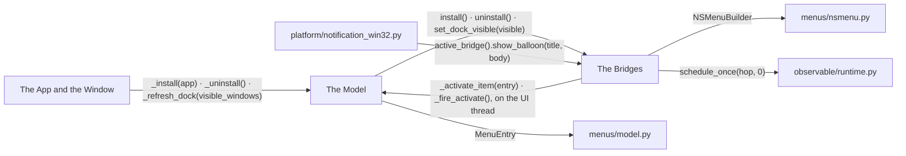
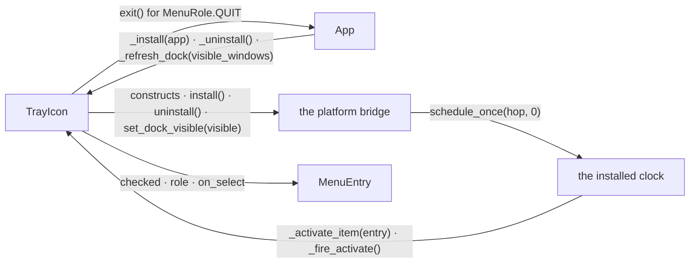
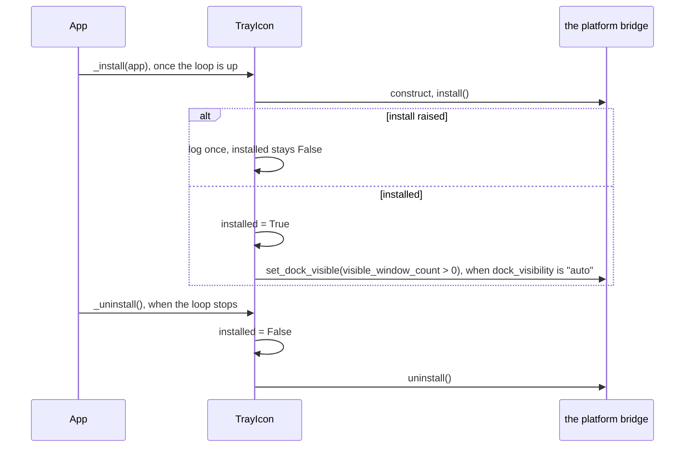
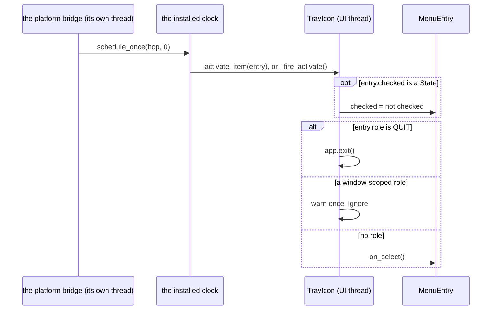
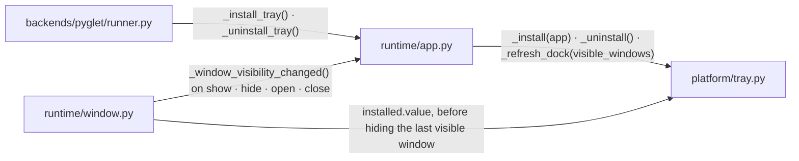
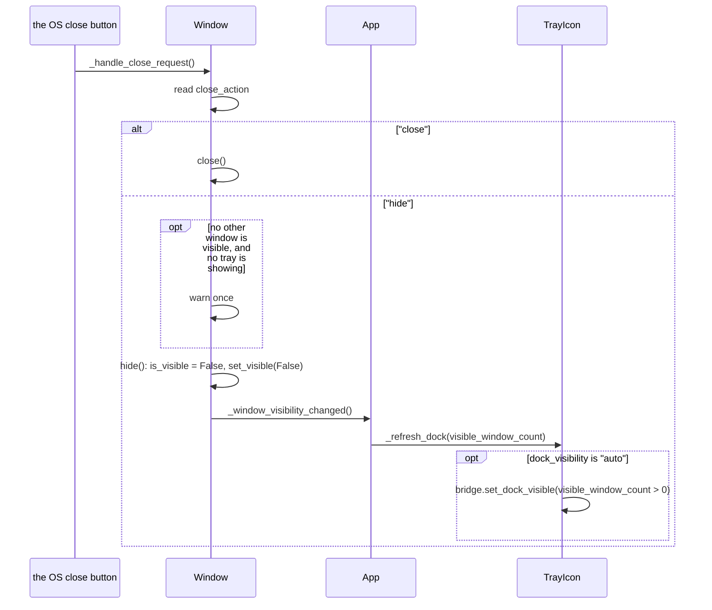
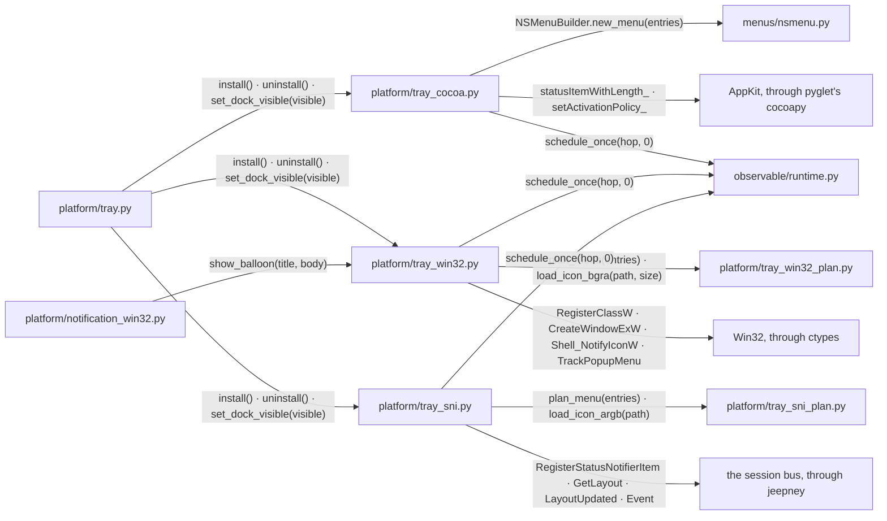
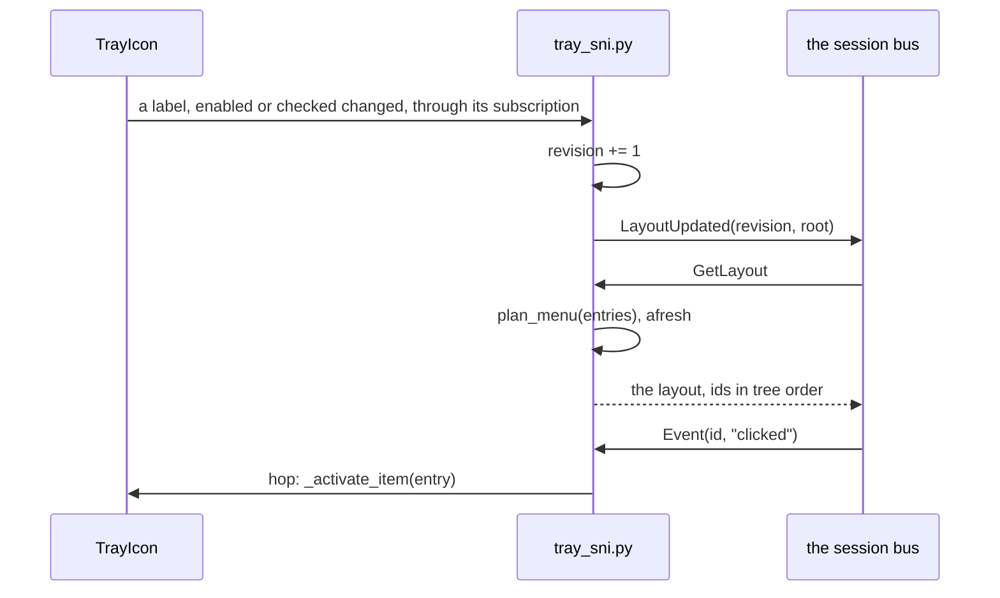

# Tray Icon

`TrayIcon` is a model registered on the `App`, `App(window, tray=...)`. Its
menu is the `MenuEntry` model the menu bar uses ([MENU_BAR.md](MENU_BAR.md)),
with the same live sync of `label`, `enabled` and `checked`.

## Overview

Three groups of modules take part, with the menu model, the notification
backend and the clock at their edges.

### Structure

| Module | Role |
| --- | --- |
| The Model | the icon, the tooltip, the menu, `installed`, the activation of an entry |
| The App and the Window | registers the tray, installs it with the loop, reports window visibility; the window's close button and its hide and show |
| The Bridges | show the icon and the menu through AppKit, Win32 or D-Bus |
| `menus/model.py` | `MenuEntry`, the menu model shared with the menu bar ([MENU_BAR.md](MENU_BAR.md)) |
| `menus/nsmenu.py` | `NSMenuBuilder`, the `NSMenu` construction shared with the menu bar ([MENU_BAR.md](MENU_BAR.md)) |
| `platform/notification_win32.py` | the Windows notification backend |
| `observable/runtime.py` | the installed clock ([OBSERVABLE.md](OBSERVABLE.md)) |

### Promises

- The tray icon lives as long as the app's loop runs.
- `ExitPolicy` is not changed by a tray. It counts the existing windows,
  hidden ones included.
- The tray menu renders natively on every platform.
- A failed install never takes the app down.

## The Model

`TrayIcon` holds what the bridges show and runs what the bridges report.

### Structure

| Module | Role |
| --- | --- |
| `TrayIcon` | holds the icon path, the tooltip, the menu and `dock_visibility`; picks the bridge per platform; publishes `installed`; runs an activated entry |
| `App` | installs and removes the tray with the loop, reports the visible-window count (The App and the Window) |
| the platform bridge | shows the icon and the menu (The Bridges) |
| `MenuEntry` | an item of the menu ([MENU_BAR.md](MENU_BAR.md)) |
| the installed clock | the hop to the UI thread ([OBSERVABLE.md](OBSERVABLE.md)) |

### Sequence

#### The tray is installed and removed

#### An activation reaches the model

### Promises

- `installed` is `True` only while a bridge shows the icon.
- An activation touches the model on the UI thread only.
- A tray menu does not render `shortcut`.

## The App and the Window

The app registers the tray and installs it with the loop. The window's close
button, its hide and its show are what a resident app is built from.

### Structure

| Module | Role |
| --- | --- |
| `backends/pyglet/runner.py` | calls the install once the loop is up and the uninstall when it stops |
| `runtime/app.py` | `App` holds the registered tray, counts the visible windows, applies the exit policy to the open windows |
| `runtime/window.py` | `Window.close_action` decides what the OS close button does; `hide()` and `show()` toggle visibility; `is_visible` reports it |
| `platform/tray.py` | the registered model (The Model) |

### Sequence

#### The close button hides into the tray

### Promises

- `close_action` remaps the OS close button only. `close()` and the menu
  roles always close.
- A hidden window keeps its tree, its state and its geometry. It renders no
  frames.
- A `hide()` before the backend realises the OS window creates it invisible.
- `dock_visibility="auto"` keeps the Dock icon while a window is visible and
  drops it when none is.

## The Bridges

One bridge per platform shows the icon and the menu.

### Structure

| Module | Role |
| --- | --- |
| `platform/tray.py` | the model the bridges show (The Model) |
| `platform/tray_cocoa.py` | an `NSStatusItem` with the menu `NSMenuBuilder` builds; switches the activation policy for the Dock |
| `platform/tray_win32.py` | a dedicated thread owning a hidden top-level window and its message loop; the icon through `Shell_NotifyIcon`; the menu built per right click; the balloon |
| `platform/tray_sni.py` | a `StatusNotifierItem` and its `dbusmenu` on the session bus; a receiver thread serving the desktop's calls; registers again when the watcher's bus name changes owner |
| `menus/nsmenu.py` | `NSMenuBuilder`, shared with the menu bar ([MENU_BAR.md](MENU_BAR.md)) |
| `platform/tray_win32_plan.py` | flattens the menu into Win32 items and command ids; decodes the icon with skia |
| `platform/tray_sni_plan.py` | flattens the menu into a dbusmenu layout and item ids; decodes the icon with skia |
| AppKit | the status bar and the application's activation policy |
| Win32 | the notification area and the popup menu |
| the session bus | the desktop's `StatusNotifierWatcher`, which draws the icon and the menu |
| `platform/notification_win32.py` | the Windows notification backend |
| `observable/runtime.py` | the installed clock ([OBSERVABLE.md](OBSERVABLE.md)) |

### Sequence

#### The desktop asks for the menu again

### Promises

- A bridge keeps no menu state between the desktop's requests. The model is
  the only copy.
- While a tray is installed, a Windows notification balloon hangs on its
  icon. Without one the notification backend adds a transient icon of its
  own.
- Windows and Linux decode the icon with skia. macOS hands the file to
  AppKit.
