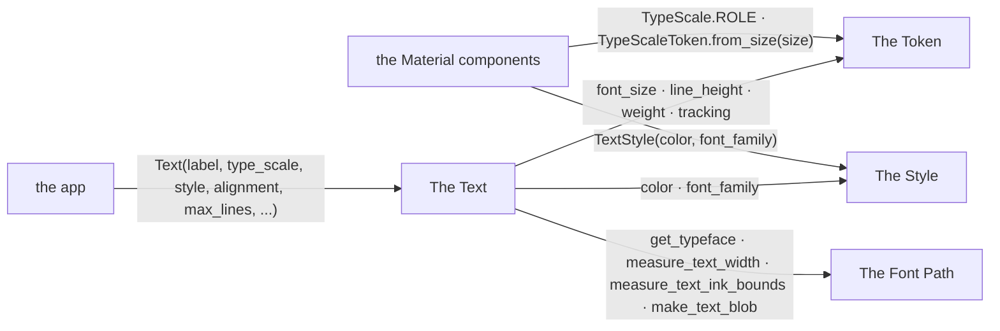
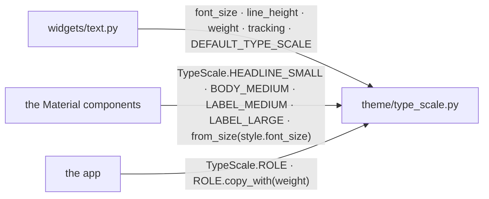
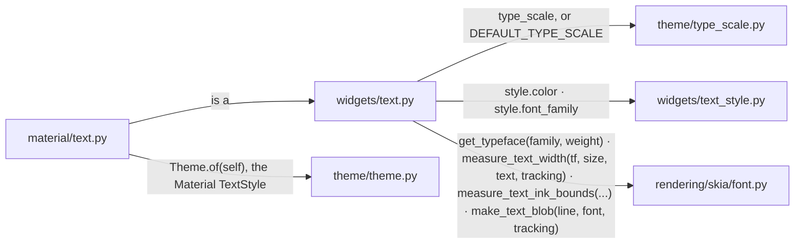
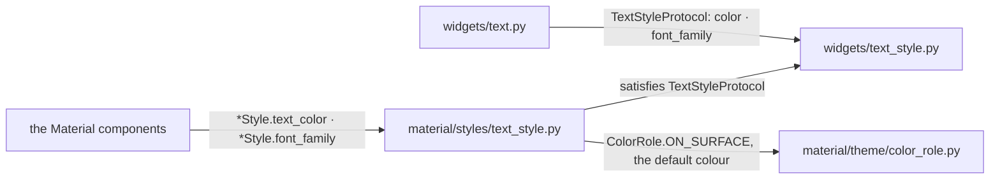
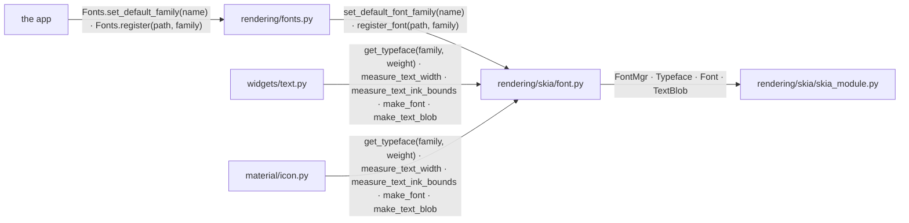

# Typography

A `Text` draws a string. Its metrics come from a `TypeScaleToken`, its layout
from the widget itself, its look from a `TextStyle`.

## Overview

Four groups of modules take part, with the Material components and the app
at their edges.

### Structure

| Module | Role |
| --- | --- |
| The Token | the metrics of one MD3 type-scale role |
| The Text | the widget |
| The Style | the colour and the font family |
| The Font Path | the typeface, the measurements and the shaped text |
| the Material components | own their typography ([MATERIAL_INTERACTION.md](MATERIAL_INTERACTION.md)) |
| the app | constructs a `Text` |

### Promises

- An MD3 type-scale metric is on the token. A property of the layout inside
  the box is on `Text`. A reusable visual property is on `TextStyle`.
- No merged object stands between the token and the style. A token is never
  expanded into a `TextStyle`.

## The Token

A role's metrics travel together as one `TypeScaleToken`.

### Structure

| Module | Role |
| --- | --- |
| `theme/type_scale.py` | `TypeScaleToken`, a frozen struct of font size, line height, weight and tracking; `TypeScale`, the MD3 baseline roles; the default role |
| `widgets/text.py` | reads the metrics (The Text) |
| the Material components | pick the role MD3 fixes, or wrap a style's numeric size |
| the app | picks a role |

### Promises

- A size from a widget's `*Style` becomes a full token through `from_size`.
- Where MD3 fixes a component's role, the component uses that role.

## The Text

`TextBase` lays its string out inside its box.

### Structure

| Module | Role |
| --- | --- |
| `widgets/text.py` | `TextBase`: the alignment, the wrapping, `max_lines`, the overflow, the truncation; the runs and the paint cache |
| `material/text.py` | `Text`, defaulting its style to the current Material theme's |
| `theme/type_scale.py` | the metrics (The Token) |
| `widgets/text_style.py` | the look (The Style) |
| `rendering/skia/font.py` | the typeface, the measurements and the blob (The Font Path) |
| `theme/theme.py` | the Material default style ([THEME_CONSUMPTION.md](THEME_CONSUMPTION.md)) |

### Promises

- Font size, weight and tracking reach the Skia font path. Line height
  places the lines.
- Wrapping and ellipsis are measured with the same tracking the blob is
  shaped with.

## The Style

`TextStyle` is the colour and the font family.

### Structure

| Module | Role |
| --- | --- |
| `widgets/text_style.py` | `TextStyle`; `TextStyleProtocol`, what a `Text` reads |
| `material/styles/text_style.py` | the Material `TextStyle` |
| `widgets/text.py` | reads the protocol (The Text) |
| the Material components | expose the visual overrides on their `*Style` |
| `material/theme/color_role.py` | the colour roles ([STYLE_THEME.md](STYLE_THEME.md)) |

### Promises

- A `TextStyle` carries `color` and `font_family`. Nothing else.

## The Font Path

`rendering/skia/font.py` turns a family and a weight into a typeface. It
measures and shapes a string.

### Structure

| Module | Role |
| --- | --- |
| `rendering/skia/font.py` | resolves a family through the registered fonts, the default family and the platform fallbacks; caches typefaces and measurements; shapes a blob with tracking |
| `rendering/fonts.py` | `Fonts`, the public configuration |
| `widgets/text.py` | measures and paints text (The Text) |
| `material/icon.py` | paints a glyph from an icon font at a numeric `size` |
| `rendering/skia/skia_module.py` | the Skia binding ([RENDERING_PIPELINE.md](RENDERING_PIPELINE.md)) |
| the app | configures fonts at startup |

### Promises

- Measurement and paint apply tracking the same way.
- `Icon` takes a numeric `size`. A type-scale token does not satisfy it.
