# Web Target

One app runs on the desktop and in a browser from the same source. In the
browser, Pyodide runs the app's Python unmodified. A CanvasKit adapter with
the shape of skia-python draws it onto one canvas. The browser's event loop
replaces the pyglet one. The two marks an app makes for the web, `@worker`
and `@server`, run on the desktop too.

## Overview

Four groups of modules take part.

### Structure

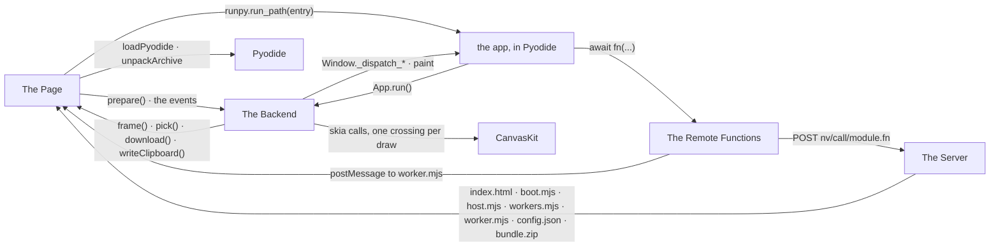

| Module | Role |
| --- | --- |
| The Page | the files the browser loads, the boot that starts Pyodide and the worker, the host that owns the canvas and the input |
| The Backend | the frame loop, the clock, the input translation, the skia adapter and the file dialogs, in Pyodide |
| The Remote Functions | `@worker` and `@server`: a call that leaves the UI thread, on both targets |
| The Server | `run`, `build` and `serve`: the page's files, the stubs for server-only modules, the call route |
| the app | the app's own code, unchanged from the desktop |
| Pyodide | Python in the browser |
| CanvasKit | skia in the browser |

### Promises

- The app does not branch on the target.
- The `@server` functions are the only code that runs on a server.
- A built site is static files.

## The Page

The files the browser loads, and the two it starts: the page's Pyodide and
the worker's.

### Structure

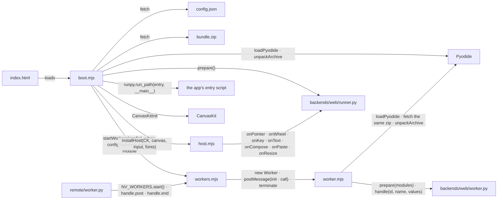

| Module | Role |
| --- | --- |
| `index.html` | the canvas, the unseen input element, the script tag for `boot.mjs` |
| `boot.mjs` | starts the worker, loads the runtimes, the zip and the fonts in parallel, unpacks the zip, installs the host, runs the entry |
| `config.json` | where Pyodide and CanvasKit are, the Pyodide packages the app imports and where their wheels are, the fonts, the entry, the modules that hold a `@worker` function |
| `bundle.zip` | the framework under `lib/` and the app's directory under `app/` |
| `host.mjs` | owns the canvas, the WebGL surface, the input element, the clipboard, the file picker and the download |
| `workers.mjs` | starts Web Workers on request and relays their messages |
| `worker.mjs` | a second Pyodide that imports the worker modules and runs calls |
| the app's entry script | the app's `main()`, run as `__main__` |
| `backends/web/runner.py` | the backend the page hands the events to (The Backend) |
| `backends/web/worker.py` | the worker's side of a call (The Remote Functions) |
| `remote/worker.py` | the pool that asks the page for workers (The Remote Functions) |
| Pyodide | Python in the browser |
| CanvasKit | skia in the browser |

### Sequence

#### The page boots

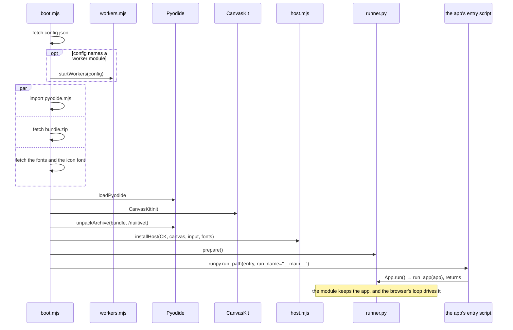

### Promises

- Every URL in the page is relative to the page.
- A development page loads the runtimes from a CDN. A built site carries
  them, with the licences of everything it redistributes.

## The Backend

The backend turns the page's events into the window's dispatch calls, draws
a frame when one is asked for, and keeps time on the browser's loop.

### Structure

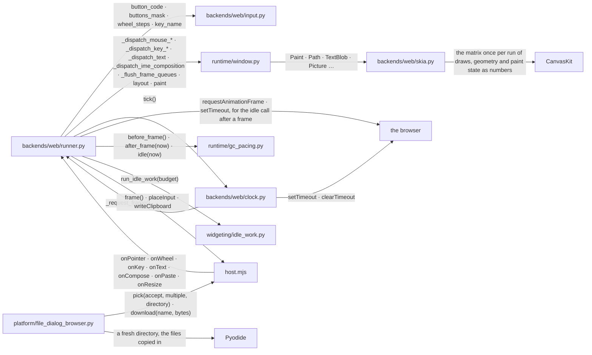

| Module | Role |
| --- | --- |
| `backends/web/runner.py` | `_Loop`: requests a frame on an invalidation, a resize or a due callback; dispatches the events; draws |
| `backends/web/clock.py` | `BrowserClock`: keeps the deadlines; asks for a frame or a `setTimeout`; fires what is due on `tick()` |
| `backends/web/input.py` | translates buttons, wheel deltas and key names once, at the host boundary |
| `backends/web/skia.py` | the `skia` module the rendering code imports in the browser |
| `platform/file_dialog_browser.py` | the file picker, and a download in place of a save dialog |
| `runtime/gc_pacing.py` | `GcPacer`: holds the collector for the page's life; collects on the timer after a frame ([RENDERING_PIPELINE.md](RENDERING_PIPELINE.md)) |
| `widgeting/idle_work.py` | the tasks the timer after a frame runs ([RENDERING_PIPELINE.md](RENDERING_PIPELINE.md)) |
| `host.mjs` | the canvas, the input element, the clipboard, the picker, the download (The Page) |
| `runtime/window.py` | the dispatch methods and the paint the pyglet backend also calls ([APP_WINDOW.md](APP_WINDOW.md)) |
| the browser | `requestAnimationFrame` and `setTimeout` |
| Pyodide | the page's file system, where a picked or saved file lives |
| CanvasKit | the WebGL surface the adapter draws on |

### Sequence

#### A frame is requested and drawn

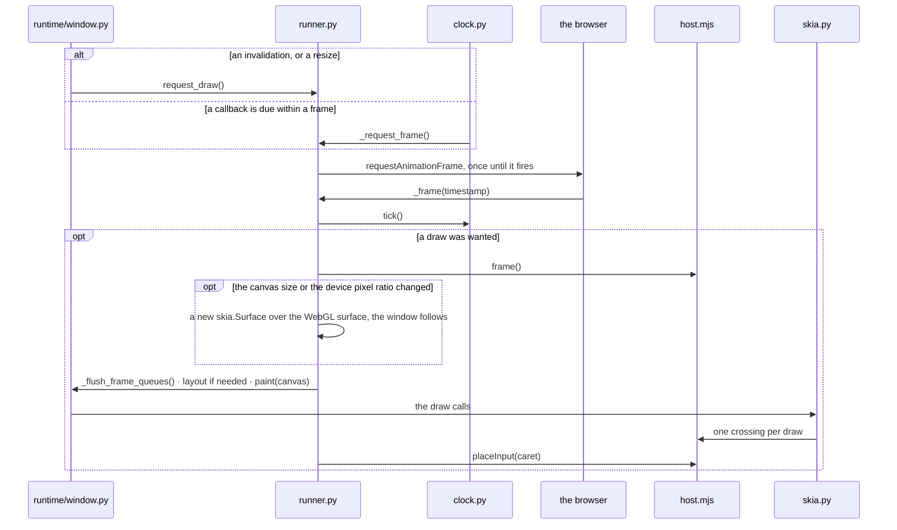

#### A save becomes a download

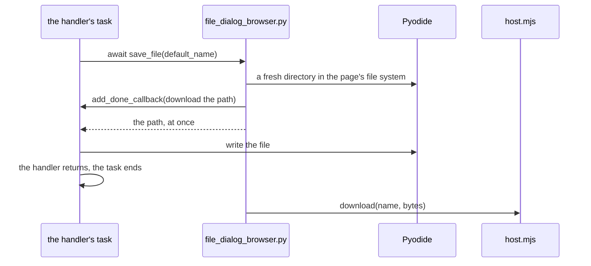

### Promises

- The rendering code is the desktop code.
- The adapter covers the calls the framework makes.
- The canvas matrix lives in Python. It reaches CanvasKit once per run of
  draws.
- Geometry and paint state cross to JS as plain numbers, once per draw.
- Every font family name resolves to the typefaces the page loaded.
- A frame runs only when one was asked for.
- No collection runs inside a frame. The collector runs on a timer the frame
  arms as it ends, after the idle work. Idle work left over re-arms the
  timer at once.
- The WebGL surface is made again when the canvas or the device pixel ratio
  changes. That frame repaints everything.
- A deadline within a frame's time waits for the next frame. A later one is a
  `setTimeout`.
- The main window fills the canvas.
- From the host boundary on, the key handling is the desktop's.
- The clipboard crosses in one direction at a time. A copy writes through
  `navigator.clipboard`. A paste arrives only as a paste event.

## The Remote Functions

`@worker` and `@server` mark the functions whose call leaves the UI thread,
on both targets. Nothing is shared with the caller.

### Structure

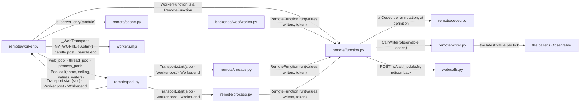

| Module | Role |
| --- | --- |
| `remote/function.py` | `RemoteFunction`: the codecs from the annotations, the call that encodes and decodes, `run()` on the function's side; `ServerFunction`: the server mark's one request; `register`, the two marks |
| `remote/worker.py` | `WorkerFunction`: `parallel`, `process`, `warm`; the three pools; `_WebTransport`, the page's Web Workers as a transport |
| `remote/codec.py` | `Codec`: encode and decode by annotation; the scalars, `datetime`, an `Enum`, a dataclass, the containers |
| `remote/writer.py` | `WriteOnlyObservable`, the progress parameter; `CallWriter`, which lands each write on the caller's observable |
| `remote/pool.py` | `Pool`: the workers of one kind and the calls waiting for them; the ceiling, the machine's limit, `warm`, `retire` |
| `remote/threads.py` | a pooled thread as a transport |
| `remote/process.py` | a child process started with `spawn` and fed through a pipe, as a transport |
| `backends/web/worker.py` | the worker's side in the browser: imports the modules, runs a call, posts the writes and the result |
| `remote/scope.py` | `server_only()`, which marks a module as one the browser never gets |
| `web/calls.py` | the server's side of a `@server` call (The Server) |
| `workers.mjs` | starts and relays the Web Workers (The Page) |
| the caller's Observable | the app's observable a progress parameter writes to |

### Sequence

#### A worker call

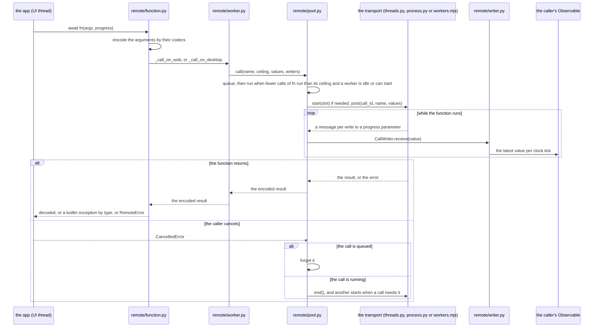

### Promises

- Both marks go on a module-level function. The app calls it the same way on
  both targets, `await fn(...)`.
- On the desktop a call of either mark runs on a thread the runtime owns, or
  in a child process under `process`.
- The arguments, the result and every progress write pass through the codec
  on both targets.
- The codec comes from the type annotations, never from the data. A type the
  codec has no rule for is refused when the function is defined.
- Progress flows through a `WriteOnlyObservable` parameter. The caller's
  observable takes the latest value per clock tick.
- The `CancelToken` is a parameter with a default. On a thread, cancelling
  sets it. In a worker or a child process, cancelling ends the Python running
  the call.
- A builtin exception raised in the function is raised again in the caller by
  type. Any other arrives as `RemoteError`.
- `@worker` marks a function in a module the browser gets.
- The ceiling is per function. The pool is per kind, grown to the largest
  ceiling and never past the machine's cores.
- A worker that ends on its own fails its call with `ConnectionError`. One
  that never becomes ready fails every call until the pool is retired.
- A child process imports the functions' modules by name. It imports the
  entry script the way `multiprocessing` does.
- Hot reload retires the desktop's pools.

## The Server

One process serves the page and answers the server functions.

### Structure

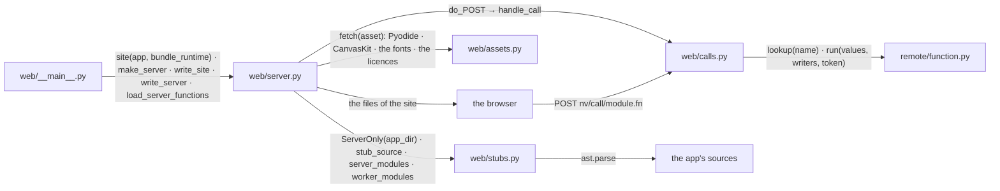

| Module | Role |
| --- | --- |
| `web/__main__.py` | `run` serves the source tree and opens a browser; `build` writes the site and the server directory; `serve` serves a built site and its calls |
| `web/server.py` | builds the zip, lists the page's files, writes the two directories, serves both over HTTP |
| `web/stubs.py` | finds the server-only files and the modules that hold a mark by reading the sources; writes a stub per server-only module |
| `web/assets.py` | downloads and caches Pyodide, CanvasKit, the fonts and their licences |
| `web/calls.py` | runs a `@server` function on a thread per request and streams its writes and result back |
| `remote/function.py` | the function the server runs (The Remote Functions) |
| the app's sources | what is read, zipped, stubbed and served |
| the browser | fetches the page and posts the calls |

### Sequence

#### A server call

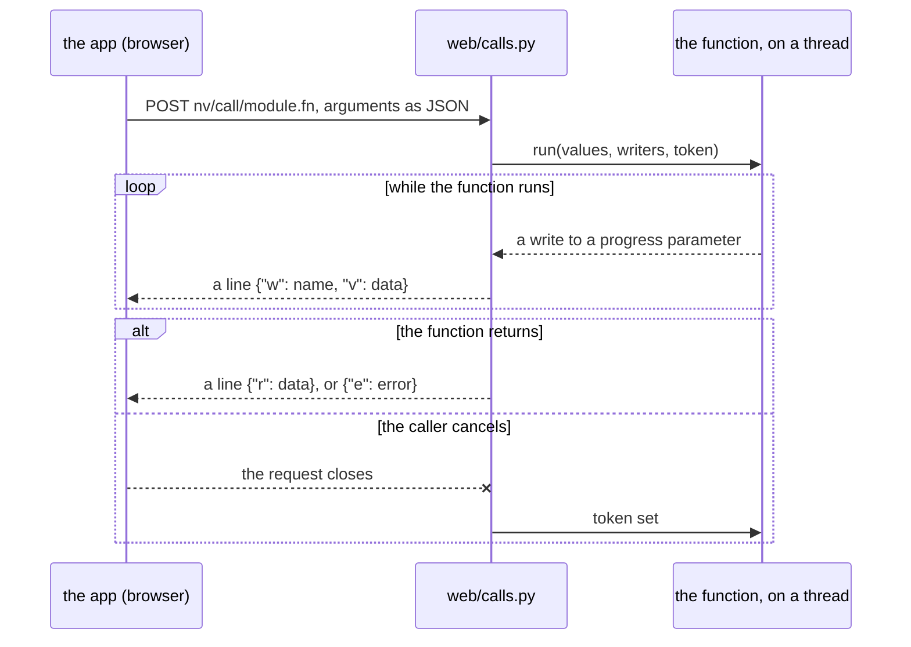

#### The build writes the site

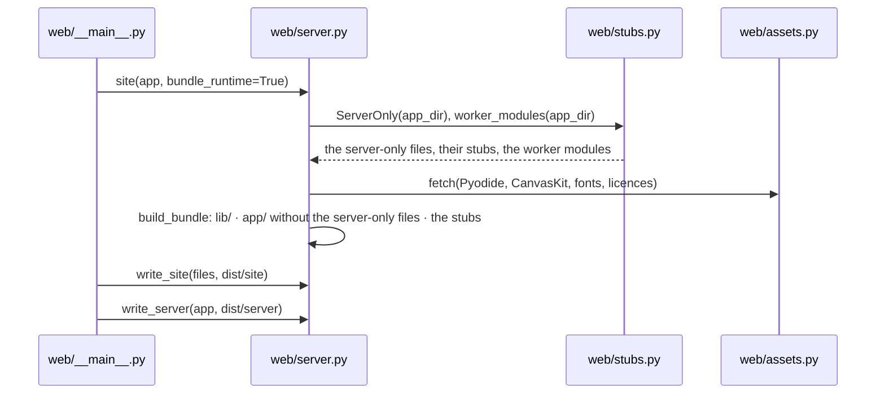

### Promises

- The server keeps no session state.
- A server-only module stays out of the zip. A stub with the same signatures
  takes its place.
- A dataclass in a `@server` signature comes from a module the page gets.
- Each progress write streams back as a line of the response. Cancellation is
  the request closing.
- `run` reads the sources at every request.
- `server/` is the only part that needs Python.
