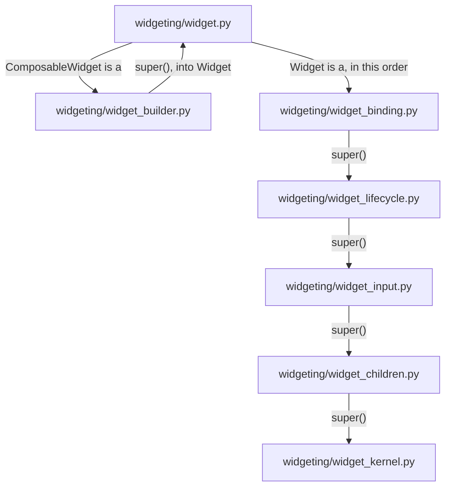
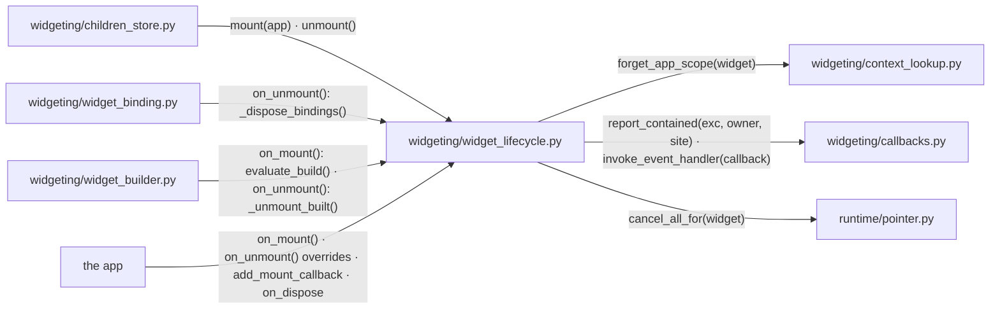
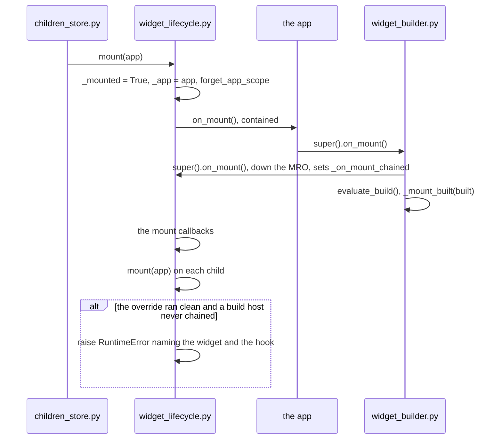
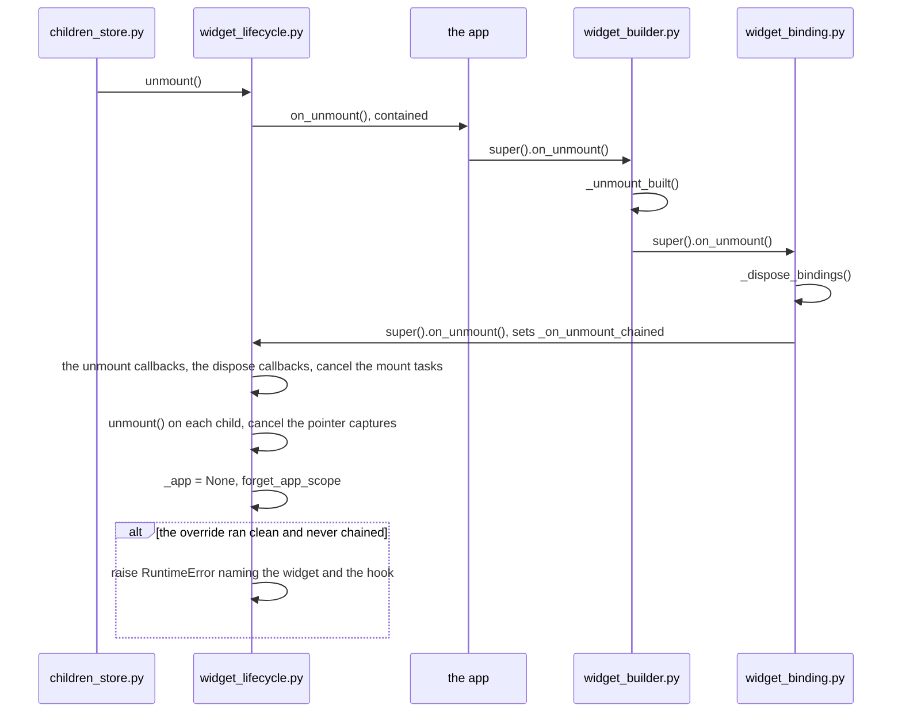
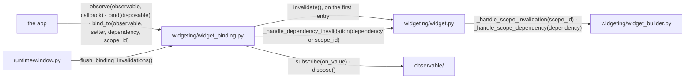
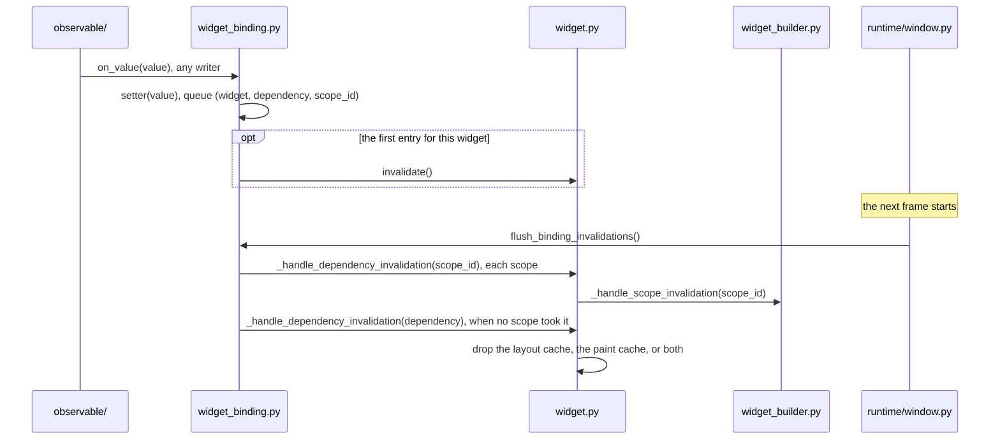
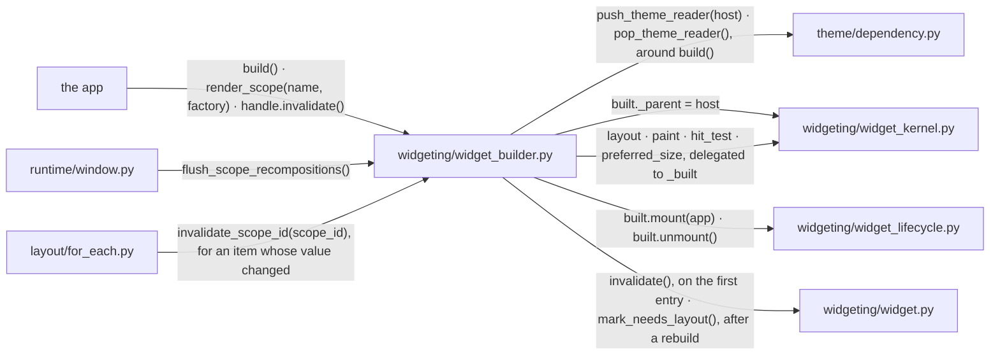
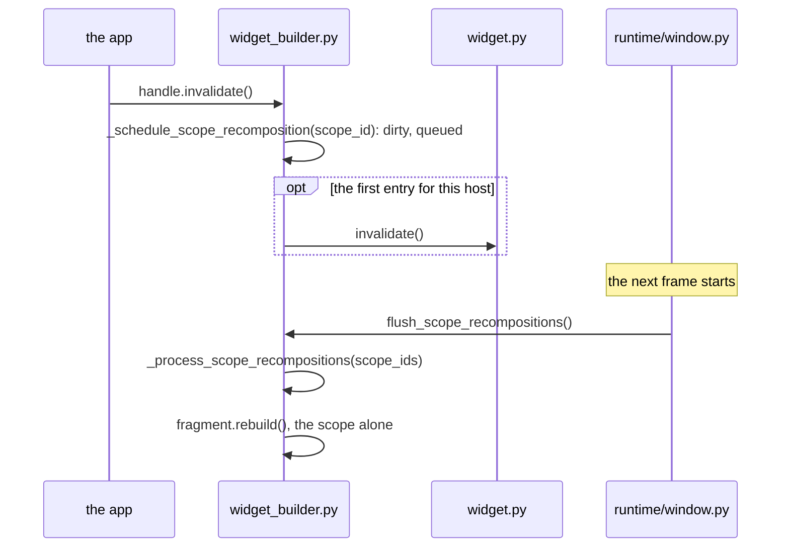
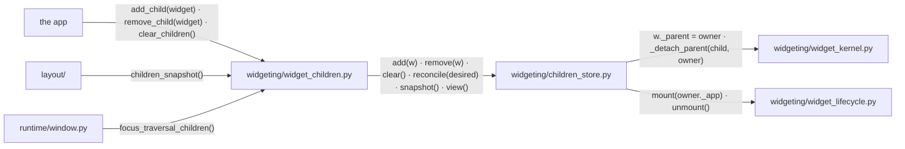

# Widget Architecture

`Widget` is composed from mixins by cooperative multiple inheritance, one
module per responsibility. `ComposableWidget` adds `BuilderHostMixin`.

## Overview

Six mixin modules and the module that composes them make up a widget. A call
chains down the method resolution order.

### Structure

| Module | Role |
| --- | --- |
| `widgeting/widget.py` | `Widget`, the leaf-friendly base; `ComposableWidget`, a widget with a `build()`; the layout and paint dependency declarations |
| `widgeting/widget_builder.py` | `BuilderHostMixin`: `build()`, the built subtree, the recompose scopes |
| `widgeting/widget_binding.py` | `BindingHostMixin`: the subscriptions a widget holds for its mounted life |
| `widgeting/widget_lifecycle.py` | `LifecycleHostMixin`: `mount`, `unmount` and their hooks |
| `widgeting/widget_input.py` | `InputHubMixin`: the pointer, key, focus and scroll entry points ([INTERACTION_ARCHITECTURE.md](INTERACTION_ARCHITECTURE.md)) |
| `widgeting/widget_children.py` | `ChildContainerMixin`: the child list, backed by a `ChildrenStore` |
| `widgeting/widget_kernel.py` | `WidgetKernel`: the sizing, the padding, the rects, `layout`, `paint`, `hit_test` ([LAYOUT.md](LAYOUT.md)) |

### Promises

- `Widget` never assumes a `build()`.
- The rects and the layout flag are written through `set_layout_rect`,
  `set_last_rect`, `mark_needs_layout` and `clear_needs_layout`. The built
  subtree is read as `built_child`.
- `_parent` is written by the children store and the builder only.

## The Lifecycle

`mount` and `unmount` run the hooks, the callbacks and the children. Each
checks that an override chained to its base.

### Structure

| Module | Role |
| --- | --- |
| `widgeting/widget_lifecycle.py` | `LifecycleHostMixin`: the app link, the mounted flags, the mount and unmount callbacks, the dispose callbacks, the chain checks |
| `widgeting/context_lookup.py` | the remembered `AppScope` a mount or unmount forgets ([THEME_CONSUMPTION.md](THEME_CONSUMPTION.md)) |
| `widgeting/callbacks.py` | contains a hook's exception and reports it ([ERROR_HANDLING.md](ERROR_HANDLING.md)) |
| `widgeting/widget_binding.py` | its `on_unmount` (The Bindings) |
| `widgeting/widget_builder.py` | its `on_mount` and `on_unmount` (The Builder) |
| `widgeting/children_store.py` | the caller of `mount` and `unmount` (The Children) |
| `runtime/pointer.py` | the pointer captures released when a widget unmounts ([INTERACTION_ARCHITECTURE.md](INTERACTION_ARCHITECTURE.md)) |
| the app | the widget's overrides and callbacks |

### Sequence

#### A widget mounts

#### A widget unmounts

### Promises

- A second `mount(app)` on a widget mounted to the same app returns at once.
- The base `on_mount` and `on_unmount` end the chains. An override that
  never reaches them is reported after the mount or the unmount, for
  `on_mount` on build hosts only.
- A contained hook exception stops the app only from the root widget.

## The Bindings

A widget subscribes to an `Observable` for its mounted life. The
subscription names what a change invalidates.

### Structure

| Module | Role |
| --- | --- |
| `widgeting/widget_binding.py` | `BindingHostMixin`: the `Disposable`s a widget holds; the queue of pending invalidations and its flush |
| `widgeting/widget.py` | drops the cache a dependency names |
| `widgeting/widget_builder.py` | routes a dependency to the scopes that read it (The Builder) |
| `observable/` | the source and its subscription ([OBSERVABLE.md](OBSERVABLE.md)) |
| `runtime/window.py` | flushes the queue at the start of a frame ([GEOMETRY.md](GEOMETRY.md)) |
| the app | a widget passing an `Observable` into its own state |

### Sequence

#### An observable fires into a widget

### Promises

- Every subscription a widget takes through the mixin is disposed in its
  `on_unmount`.
- A frame sees one invalidation per widget, whatever fired. A widget with no
  app flushes at once.

## The Builder

A `ComposableWidget` assembles a subtree in `build()`. A scope of it
recomposes alone.

### Structure

| Module | Role |
| --- | --- |
| `widgeting/widget_builder.py` | `BuilderHostMixin`: `evaluate_build`, the built subtree, `rebuild`; `RecomposeScope` and `ScopeHandle`; the dirty scopes and the queue of pending recompositions |
| `widgeting/widget.py` | `invalidate`, `mark_needs_layout` (Overview) |
| `widgeting/widget_lifecycle.py` | mounts and unmounts the built subtree (The Lifecycle) |
| `widgeting/widget_kernel.py` | the parent link and the geometry the built subtree is delegated to |
| `theme/dependency.py` | attributes a theme read inside `build()` to the host ([THEME_CONSUMPTION.md](THEME_CONSUMPTION.md)) |
| `runtime/window.py` | flushes the recompositions at the start of a frame ([GEOMETRY.md](GEOMETRY.md)) |
| `layout/for_each.py` | a host that invalidates a scope itself ([LAYOUT.md](LAYOUT.md)) |
| the app | the widget's `build()` and the scopes it renders |

### Sequence

#### A scope recomposes

### Promises

- A build result is parented to its host as soon as it is built.
- A host rebuild rebuilds no scope. The caller that changed a scope's inputs
  invalidates the scope.
- `preferred_size` never calls `build()` on a mounted host.

## The Children

A widget's children live in a `ChildrenStore`. The store links each child to
its owner.

### Structure

| Module | Role |
| --- | --- |
| `widgeting/widget_children.py` | `ChildContainerMixin`: `children`, the snapshot, the children keyboard traversal descends into |
| `widgeting/children_store.py` | `ChildrenStore`: the ordered children, the capacity and overflow policy, the parent link |
| `widgeting/widget_lifecycle.py` | mounts and unmounts a child (The Lifecycle) |
| `widgeting/widget_kernel.py` | holds the parent link |
| `layout/` | the containers that lay the children out ([LAYOUT.md](LAYOUT.md)) |
| `runtime/window.py` | the Tab traversal ([INTERACTION_ARCHITECTURE.md](INTERACTION_ARCHITECTURE.md)) |
| the app | adds and removes children |

### Promises

- A child added to a mounted owner is mounted at once. A child removed is
  unmounted.
- The store clears a child's `_parent` only while it still points at the
  store's owner.
