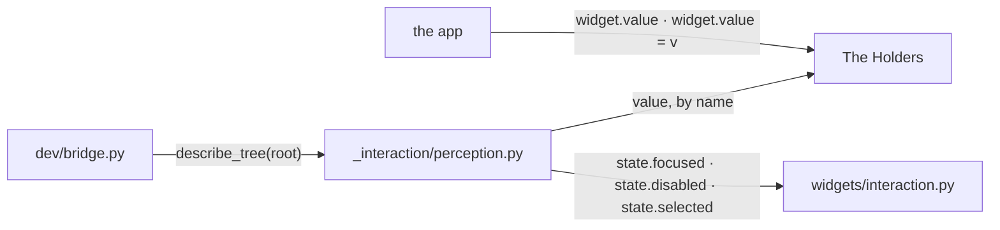
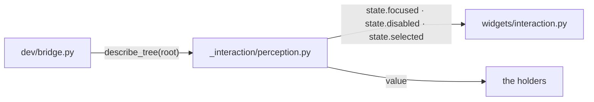
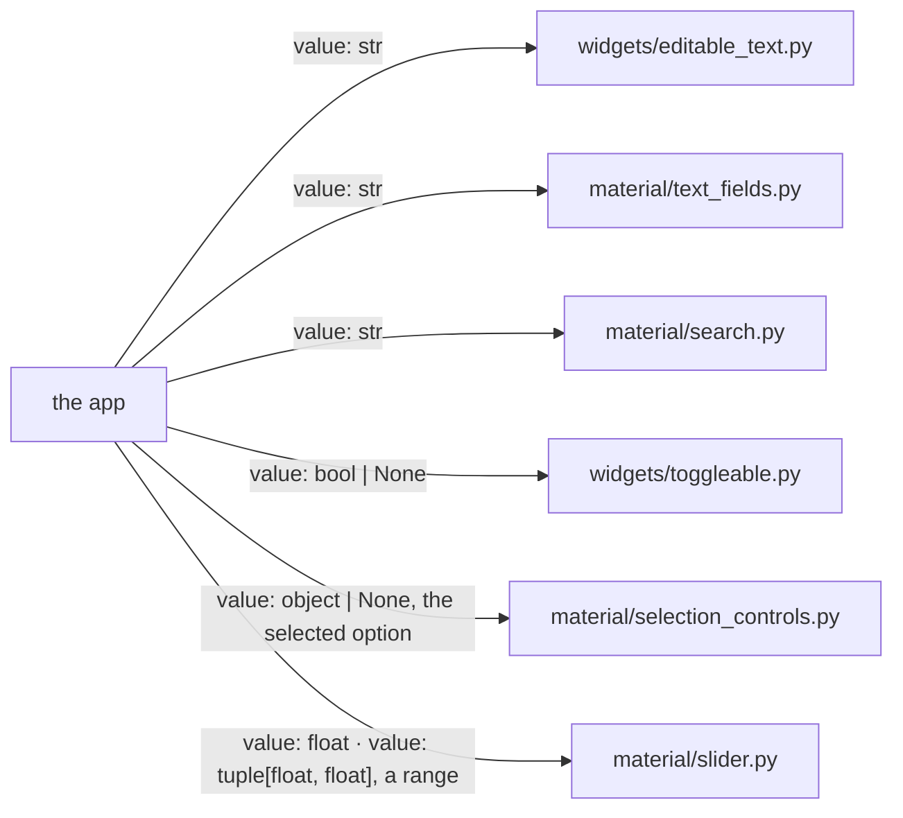

# Widget Value

A widget that holds something the user set publishes it as `value`. One name
serves every widget and the dev tools that read them.

## Overview

The probe and the widgets it reads take part, with the dev bridge and the
app at their edges.

### Structure

| Module | Role |
| --- | --- |
| `_interaction/perception.py` | reads a node's semantic state by name |
| The Holders | the widgets that publish a `value` |
| `widgets/interaction.py` | the flags a node's interaction state holds ([INTERACTION_ARCHITECTURE.md](INTERACTION_ARCHITECTURE.md)) |
| `dev/bridge.py` | serves the tree to a coding agent ([DEV_BRIDGE.md](DEV_BRIDGE.md)) |
| the app | reads and assigns through the same name |

### Promises

- A widget with nothing the user set has no `value`.
- `value` is the one thing the user set, never the widget's whole state.

## The Probe

`describe_tree` reads each node by name.

### Structure

| Module | Role |
| --- | --- |
| `_interaction/perception.py` | probes each node for the flags and for `value`, tolerating a getter that raises |
| `widgets/interaction.py` | the flags a node's interaction state holds ([INTERACTION_ARCHITECTURE.md](INTERACTION_ARCHITECTURE.md)) |
| the holders | publish `value` (The Holders) |
| `dev/bridge.py` | the caller ([DEV_BRIDGE.md](DEV_BRIDGE.md)) |

### Promises

- The probe reads public properties only.
- `value` is reported whenever the node has one.
- A toggle's `value` is its checked state.

## The Holders

The widgets below publish `value`.

### Structure

| Module | Role |
| --- | --- |
| `widgets/editable_text.py` | the text being edited ([TEXT_EDITING.md](TEXT_EDITING.md)) |
| `material/text_fields.py` | the field's text |
| `widgets/toggleable.py` | the checked state, `None` for indeterminate |
| `material/selection_controls.py` | `RadioGroup`, the selected option |
| `material/search.py` | the query |
| `material/slider.py` | `Slider` and `RangeSlider` |
| the app | reads and assigns |

### Promises

- The type of `value` is the type of the widget's primary input.
- A value made of several parts is one `value`. Its shape is the one the
  widget already declares elsewhere, such as the `on_change` signature.
- A composite `value` setter orders its parts itself.
