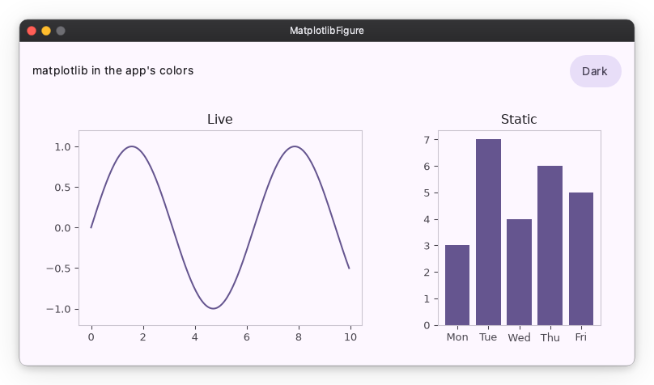
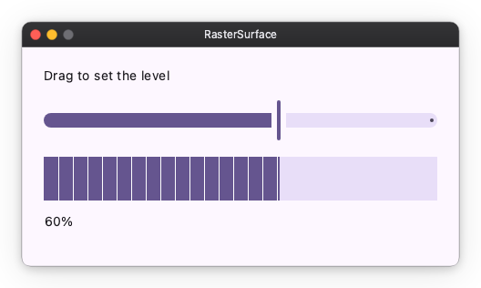

# Charts

A chart is pixels. matplotlib makes them, and so does any library that hands
you an RGBA buffer or a PNG. Three widgets show them; pick by what you have.

| You have | Use |
| --- | --- |
| A matplotlib `Figure` | `nv.MatplotlibFigure`: drawn at the widget's size, fed from an Observable, in the app's colors |
| RGBA pixels from any library: Pillow, OpenCV, a loop of your own | `nv.RasterSurface` |
| A PNG or JPEG from anything else, plotly's `write_image` or a file on disk | `nv.Image` |

The complete apps of this page are `samples/charts/matplotlib_figure.py` and
`samples/charts/raster_surface.py`.

## A matplotlib figure

`MatplotlibFigure` needs the extra:

```sh
pip install nuiitivet[matplotlib]
```

### 1. Show a figure

```python
from matplotlib.figure import Figure

import nuiitivet.material as nv

bars = Figure()
bars_ax = bars.subplots()
bars_ax.bar(["Mon", "Tue", "Wed", "Thu", "Fri"], [3, 7, 4, 6, 5])
bars_ax.set_title("Static")

nv.MatplotlibFigure(bars, width=260, height="wt")
```

The widget sets `figsize` and `dpi` to its own size on every layout; what you
set on the figure is overwritten. A 10pt label is 10pt on screen, as in the
rest of the app, on any display.

The figure shown this way is a picture: it takes no mouse.

### 2. Feed it from an Observable

```python
import math

XS = [i / 20 for i in range(200)]
samples = nv.Observable([math.sin(x) for x in XS])

live = Figure()
live_ax = live.subplots()
(line,) = live_ax.plot(XS, samples.value)
live_ax.set_ylim(-1.2, 1.2)


def plot(figure: Figure, ys: list[float]) -> None:
    line.set_ydata(ys)  # same artists, new data


nv.MatplotlibFigure.plot(live, samples, plot, width="wt", height="wt")

samples.value = [math.sin(x + 0.5) for x in XS]  # redraws the chart
```

`MatplotlibFigure.plot` takes the figure, the Observable and a function; it
is the constructor for a chart that changes. The function receives the figure
and the new value, and runs on every change of `samples`, the first draw
included; the figure is drawn after it. A resize draws the figure again
without calling it.

`set_ydata` moves the data and keeps the line. When the number of series
changes from one value to the next, `figure.clear()` and plot again.

Every change draws the whole figure again, about 30 ms for a chart like this
one. Values that arrive within one frame are drawn once, with the latest.

### 3. Match the theme



The figure follows the app's theme and switches with it. The figure and axes
backgrounds are transparent, so the chart sits on whatever is behind it. Text
and ticks take the on-surface colors, spines the outline color. A series
drawn in one of matplotlib's stock cycle colors takes the theme's accent
colors in this order: primary, tertiary, secondary, error. A color you set
yourself stays. `themed=False`, on either constructor, leaves every color as
matplotlib drew it.

## Pixels from any library

```python
_FILL = bytes((101, 85, 143, 255))  # RGBA, alpha not premultiplied
_REST = bytes((232, 222, 248, 255))
_TICK = bytes((255, 255, 255, 255))


def draw_meter(level: float, width_px: int, height_px: int) -> bytes:
    filled = int(round(width_px * max(0.0, min(1.0, level))))
    row = bytearray(_FILL * filled + _REST * (width_px - filled))
    # A one-pixel tick every 16 device pixels of the filled part.
    for x in range(16, filled, 16):
        row[x * 4 : x * 4 + 4] = _TICK
    return bytes(row) * height_px


level = nv.Observable(0.6)

nv.RasterSurface.draw(level, draw_meter, width="wt", height=48)
```



The surface asks for device pixels: a 200x100 widget on a 2x display asks
`draw_meter(level, 400, 200)`, and the ticks come out one device pixel wide.
It asks again when the level changes and when its size does. The buffer
holds exactly `width_px * height_px * 4` bytes, rows top to bottom, or
nothing shows and the log says why. From a Pillow image that is
`image.resize((width_px, height_px)).convert("RGBA").tobytes()`.

A surface without a data source is `nv.RasterSurface(draw)` with
`draw(width_px, height_px)`.

While the window is being resized, the last pixels are stretched for one
frame and the crisp ones follow.

## A picture of a chart

```python
from pathlib import Path

nv.Image(Path("chart.png").read_bytes(), width=260, height=200)
```

`Image` scales the picture into its rect. On a 2x display the text blurs,
and the colors stay the library's: that is what the two widgets above fix.

## In the browser

A library Pyodide ships, matplotlib, numpy or Pillow, is downloaded with the
page on the first load. The page finds the import itself; there is no list of
packages to keep. matplotlib and what it depends on add about 13 MB.
