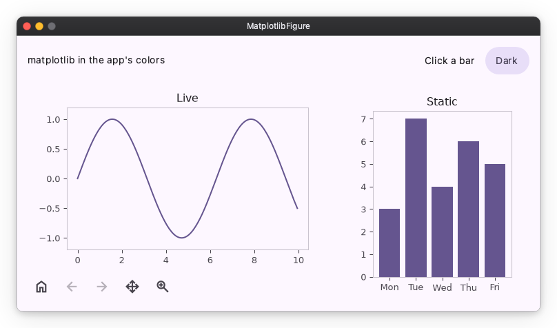

# A matplotlib figure

`MatplotlibFigure` is a widget that shows a matplotlib `Figure`, drawn at
the widget's size.

## 1. Install the extra

matplotlib is not a dependency of nuiitivet; the extra adds it.

```sh
pip install nuiitivet[matplotlib]
```

## 2. Show a figure

Make the figure as in any matplotlib program and hand it to the widget.

```python
from matplotlib.figure import Figure

import nuiitivet.material as nv

bars = Figure()
bars_ax = bars.subplots()
bars_ax.bar(["Mon", "Tue", "Wed", "Thu", "Fri"], [3, 7, 4, 6, 5])
bars_ax.set_title("Static")

nv.MatplotlibFigure(bars, width=260, height="wt")
```

The widget sizes the figure to itself on every layout. A `figsize` or `dpi`
you set is overwritten. A 10pt label is 10pt on screen, as in the rest of
the app, on any display.



The figure comes out in the app's colors and switches with the theme. A
color you set yourself stays. `themed=False` leaves every color as
matplotlib drew it.

## 3. Make it do more

Each of these is added on its own.

### Feed it from an Observable

`MatplotlibFigure.plot` is the constructor for a chart that changes, a
real-time chart for one. It takes the figure, the Observable and a function.

```python
import math

XS = [i / 20 for i in range(200)]
samples = nv.Observable([math.sin(x) for x in XS])

live = Figure()
live_ax = live.subplots()
(line,) = live_ax.plot(XS, samples.value)
live_ax.set_ylim(-1.2, 1.2)


def plot(figure: Figure, ys: list[float]) -> None:
    line.set_ydata(ys)  # same artists, new data


nv.MatplotlibFigure.plot(live, samples, plot, width="wt", height="wt")

samples.value = [math.sin(x + 0.5) for x in XS]  # redraws the chart
```

The function receives the figure and the new value, and runs on every
change of `samples`, the first draw included; the figure is drawn after it.
A resize draws the figure again without calling it.

`set_ydata` moves the data and keeps the line. When the number of series
changes from one value to the next, `figure.clear()` and plot again.

Every change draws the whole figure again, about 30 ms for a chart like this
one. Values that arrive within one frame are drawn once, with the latest.

### Handle events with `mpl_connect`

`mpl_connect` is matplotlib's way to register an event handler:
`figure.canvas.mpl_connect("pick_event", handler)` runs `handler` on every
pick. The widget hands the pointer and the keyboard to the figure as
matplotlib events, so a handler written for a matplotlib window runs
unchanged.

```python
from matplotlib.backend_bases import PickEvent

rects = list(bars_ax.bar(["Mon", "Tue", "Wed", "Thu", "Fri"], [3, 7, 4, 6, 5], picker=True))  # replaces step 2's bar call
picked = nv.Observable("Click a bar")


def on_pick(event: PickEvent) -> None:
    for rect in rects:
        rect.set_alpha(1.0 if rect is event.artist else 0.4)
    picked.value = f"bar {rects.index(event.artist)}"  # into the app's state
    bars.canvas.draw_idle()


bars.canvas.mpl_connect("pick_event", on_pick)

nv.Text(picked)  # follows the pick, anywhere in the app
```

`draw()` leaves the screen as it was; `draw_idle()` draws the figure on the
next frame. The wheel arrives as `scroll_event` and does not scroll a list
the figure sits in. Keys reach the figure once a click has focused it, and
the app's shortcuts see them too.

The other events, `motion_notify_event`, `button_press_event` and the rest,
are matplotlib's own; [Event handling and picking](https://matplotlib.org/stable/users/explain/figure/event_handling.html) lists them with their fields.

### Pan and zoom

A `MatplotlibController` is the pan, zoom and view history of one figure.
It puts nothing on screen. The app draws the buttons. It is matplotlib's
`NavigationToolbar2` with the buttons left out.

```python
import operator

controller = nv.MatplotlibController(live)  # beside the live figure above

nv.Column(
    [
        nv.MatplotlibFigure.plot(live, samples, plot, width="wt", height="wt"),  # the live widget above
        nv.Row(
            [
                nv.IconButton("home", on_click=controller.home),
                nv.IconButton("arrow_back", on_click=controller.back, disabled=controller.can_back.map(operator.not_)),
                nv.IconButton("arrow_forward", on_click=controller.forward, disabled=controller.can_forward.map(operator.not_)),
                nv.IconToggleButton("drag_pan", selected=controller.panning),
                nv.IconToggleButton("zoom_in", selected=controller.zooming),
                nv.Text(controller.message),  # the data coordinates under the pointer
            ]
        ),
    ]
)
```

With pan or zoom selected, a drag pans or draws the zoom rectangle, as matplotlib's
[Interactive navigation](https://matplotlib.org/stable/users/explain/figure/interactive.html#interactive-navigation) describes.
The wheel zooms around the pointer. Selecting pan deselects zoom, and the
reverse.

The keyboard shortcuts of matplotlib's toolbar are not connected, and the
pointer does not turn into matplotlib's hand or crosshair while pan or zoom
is selected.

The complete app is [`samples/charts/matplotlib_figure.py`](https://github.com/yuksblog/nuiitivet/blob/main/samples/charts/matplotlib_figure.py).

## Next Steps

- [Pixels or an image](pixels_or_image.md)
- [Charts overview](index.md)
