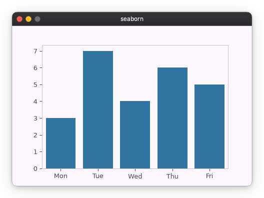
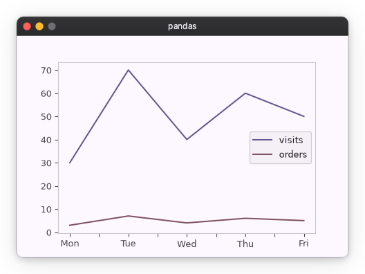
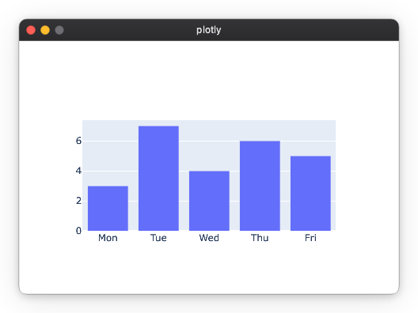

# A chart from another library

A chart library other than matplotlib hands you a matplotlib figure, a PNG,
or pixels. What it hands you picks the widget.

| The library hands you | Such as | Widget |
| --- | --- | --- |
| [A matplotlib figure](#a-matplotlib-figure) | seaborn, pandas | `MatplotlibFigure` |
| [A PNG](#a-png) | plotly | `Image` |
| [Pixels](#pixels) | Pillow, OpenCV, numpy | `RasterSurface` |

## A matplotlib figure

A library that draws with matplotlib takes the axes to draw into, as `ax`.
Make the figure, pass its axes, and show the figure with `MatplotlibFigure`.
The widget needs matplotlib installed: `pip install nuiitivet[matplotlib]`.

[A matplotlib figure](matplotlib.md) has the rest: a chart fed from a `State`, events, pan
and zoom.

### seaborn

seaborn takes the axes as `ax`.

```python
import seaborn as sns
from matplotlib.figure import Figure

import nuiitivet.material as nv

figure = Figure()
ax = figure.subplots()
sns.barplot(x=["Mon", "Tue", "Wed", "Thu", "Fri"], y=[3, 7, 4, 6, 5], ax=ax)  # into the axes it is given

nv.MatplotlibFigure(figure, width="wt", height="wt")
```



The text and the axes come out in the app's colors. The bars keep their
color: seaborn set it, and a color that is set stays.

A seaborn function with no `ax` parameter, `catplot` for one, makes its own
figure and returns a grid. Pass `grid.figure` to `MatplotlibFigure`.

The complete app is [`samples/charts/seaborn_chart.py`](https://github.com/yuksblog/nuiitivet/blob/main/samples/charts/seaborn_chart.py).

### pandas

`DataFrame.plot` takes the axes as `ax`.

```python
import pandas as pd
from matplotlib.figure import Figure

import nuiitivet.material as nv

frame = pd.DataFrame(
    {"visits": [30, 70, 40, 60, 50], "orders": [3, 7, 4, 6, 5]},
    index=["Mon", "Tue", "Wed", "Thu", "Fri"],
)

figure = Figure()
ax = figure.subplots()
frame.plot(ax=ax)  # into the axes it is given

nv.MatplotlibFigure(figure, width="wt", height="wt")
```



The lines, the text and the axes come out in the app's colors.

The complete app is [`samples/charts/pandas_chart.py`](https://github.com/yuksblog/nuiitivet/blob/main/samples/charts/pandas_chart.py).

## A PNG

A library that writes a PNG hands you its bytes, and [`Image`](../design-system/common_widgets.md#image) shows them. The
colors are the library's and do not switch with the theme. Hover and zoom do
nothing: the PNG is a still picture.

### plotly

`to_image` writes a plotly chart as PNG bytes. It needs kaleido:
`pip install kaleido`. Writing takes seconds, so write once and keep the
bytes.

```python
import functools

import plotly.graph_objects as go

import nuiitivet.material as nv


@functools.cache  # once, and the bytes are kept
def chart_png() -> bytes:
    chart = go.Figure(go.Bar(x=["Mon", "Tue", "Wed", "Thu", "Fri"], y=[3, 7, 4, 6, 5]))
    return chart.to_image(format="png", width=480, height=320, scale=2)  # 960x640 pixels, for a 2x display


nv.Image(chart_png(), width=480, height=320)
```



`Image` also takes a `State` of the bytes, for a chart that changes.

The complete app is [`samples/charts/plotly_chart.py`](https://github.com/yuksblog/nuiitivet/blob/main/samples/charts/plotly_chart.py).

## Pixels

A library that hands you pixels, a Pillow image or a numpy array, draws the
chart at a size you give it. `RasterSurface` asks a function of yours for the
chart at the widget's size, and the function returns the library's pixels.
[Common Widgets](../design-system/common_widgets.md#rastersurface) has the function and where it runs.

## Next Steps

- [Charts overview](index.md)
