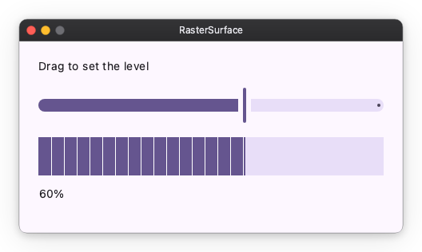

# Pixels or an image

Only matplotlib is shown as a figure. Any other library draws its chart into
RGBA pixels or a PNG first, and a widget shows that. Pixels drawn at the
widget's size stay crisp on any display. An image is scaled into the widget,
and its text blurs on a 2x display.

## Pixels

`RasterSurface.draw` takes an Observable and a function. The function
receives the value and the surface's size in device pixels, and returns the
RGBA bytes.

```python
import nuiitivet.material as nv

_FILL = bytes((101, 85, 143, 255))  # RGBA, alpha not premultiplied
_REST = bytes((232, 222, 248, 255))
_TICK = bytes((255, 255, 255, 255))


def draw_meter(level: float, width_px: int, height_px: int) -> bytes:
    filled = int(round(width_px * max(0.0, min(1.0, level))))
    row = bytearray(_FILL * filled + _REST * (width_px - filled))
    # A one-pixel tick every 16 device pixels of the filled part.
    for x in range(16, filled, 16):
        row[x * 4 : x * 4 + 4] = _TICK
    return bytes(row) * height_px


level = nv.Observable(0.6)

nv.RasterSurface.draw(level, draw_meter, width="wt", height=48)
```



A 200x100 widget on a 2x display asks `draw_meter(level, 400, 200)`. A
buffer of another length shows nothing, and the log says why. A library
that draws into a Pillow image hands the surface
`image.resize((width_px, height_px)).convert("RGBA").tobytes()`.

While the window is being resized, the last pixels are stretched for a
frame. The crisp ones follow.

The complete app is
[`samples/charts/raster_surface.py`](https://github.com/yuksblog/nuiitivet/blob/main/samples/charts/raster_surface.py).

## An image

`Image` shows a PNG or JPEG scaled into its rect. plotly's `write_image`, a
Pillow `save` and a file on disk all hand you one.

```python
from pathlib import Path

nv.Image(Path("chart.png").read_bytes(), width=260, height=200)
```

On a 2x display its text blurs. Its colors stay the library's.

## Next Steps

- [Charts overview](index.md)
