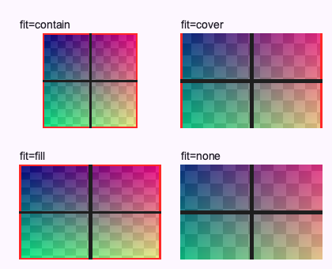
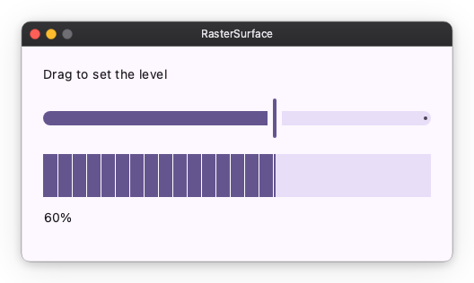

# Common Widgets

Common widgets are the widgets that are not Material components. They show
a picture, pixels or a chart, and take no Material style. Write each one as
`nv.<Name>`, like a Material widget: `nv.Image`. Layout widgets such as
`Column` are in [Layout](../layout/index.md).

| You have | Widget |
| --- | --- |
| A PNG or a JPEG, as bytes | [`Image`](#image) |
| Pixels with a size of their own, such as camera frames | [`Image`](#show-frames-from-a-camera), with a `Raster` |
| A large photo to open without a pause | [`Image`](#open-a-large-photo-without-a-pause), with a `Raster` |
| Pixels you draw at the widget's size | [`RasterSurface`](#rastersurface) |
| A matplotlib figure | [`MatplotlibFigure`](#matplotlibfigure) |

## Image

`Image` shows a picture scaled to the widget's size: a PNG or JPEG as
bytes, or pixels you decoded as an `nv.Raster`. `fit` picks how:
`"contain"`, the default, `"cover"`, `"fill"` or `"none"`. Without `width`
and `height` the widget takes the picture's size. [API Reference](../../api/widgets.md#nuiitivet.widgets.Image)

```python
from pathlib import Path

import nuiitivet.material as nv

nv.Image(Path("photo.png").read_bytes(), width=260, height=200)
```



A photo shrunk to a thumbnail stays smooth, with no moiré. A small picture
enlarged turns soft, not blocky.

### Show frames from a camera

A camera library hands you each frame on its own thread. Wrap the frame in
`nv.Raster.rgba(pixels, width, height)` and write it to the `State` the
`Image` shows. [API Reference](../../api/widgets.md#nuiitivet.widgets.Raster)

```python
import numpy as np

frame: nv.State[nv.Raster | None] = nv.State(None)


def on_camera_frame(rgba: np.ndarray) -> None:  # on the camera's thread
    height, width = rgba.shape[:2]
    frame.value = nv.Raster.rgba(rgba, width, height)


nv.Image(frame, fit="cover", width="wt", height="wt")
```

The write to `frame.value` is safe on the camera's thread. The `Image` is
empty until the first frame arrives.

A camera frame much larger than the widget makes the window stutter. At
4000x3000 each redraw of the window takes about 12 ms longer. Shrink the
frame on the camera's thread to about the size it shows at, with
`cv2.resize`.

An OpenCV frame also shows with red and blue swapped. Convert it there too:
`cv2.cvtColor(bgr, cv2.COLOR_BGR2RGBA)`.

The complete app is [`samples/design-system/material_widgets/image_camera.py`](https://github.com/yuksblog/nuiitivet/blob/main/samples/design-system/material_widgets/image_camera.py).

### Open a large photo without a pause

A 12-megapixel JPEG passed as bytes freezes the window for about 0.2 s when
it first appears. Reading the bytes on a thread does not help. Decode the
photo with Pillow on a thread into an `nv.Raster`, and show that.

```python
import asyncio
from pathlib import Path

from PIL import Image as PILImage
from PIL import ImageOps


def load(path: Path) -> nv.Raster:  # on a thread
    picture = ImageOps.exif_transpose(PILImage.open(path)).convert("RGBA")
    return nv.Raster.rgba(picture.tobytes(), picture.width, picture.height)


photo: nv.State[nv.Raster | None] = nv.State(None)


async def open_photo() -> None:
    path = await nv.FileDialog.open_file(title="Open a photo", file_types=["jpg", "jpeg", "png"])
    if path is not None:
        photo.value = await asyncio.to_thread(load, path)


nv.Button("Open photo…", on_click=open_photo)
nv.Image(photo, width=260, height=200)
```

`ImageOps.exif_transpose` turns a phone photo upright. Without it the photo
shows on its side, where the same bytes in `Image` show upright.

The complete app is
[`samples/design-system/material_widgets/image_open_photo.py`](https://github.com/yuksblog/nuiitivet/blob/main/samples/design-system/material_widgets/image_open_photo.py).

## RasterSurface

`RasterSurface` shows pixels you draw. You give it a `State` and a function.
The function takes the `State`'s value and the widget's size in device
pixels, and returns the RGBA pixels for that size. It runs again when either
changes. [API Reference](../../api/widgets.md#nuiitivet.widgets.RasterSurface)

Pick the call by how long the drawing takes:

| The drawing | Write |
| --- | --- |
| Takes a few milliseconds | [`draw`](#draw-in-the-frame) |
| Takes longer, inside OpenCV, numpy or I/O | [`draw_in_thread`](#draw-on-a-thread) |
| Takes longer, in pure Python or in a browser | [`draw` with a worker function](#draw-in-a-worker-function) |

### Draw in the frame

`RasterSurface.draw(state, function)` makes the widget. The window draws
nothing else until the function returns.

```python
import nuiitivet.material as nv

_FILL = bytes((101, 85, 143, 255))  # RGBA, alpha not premultiplied
_REST = bytes((232, 222, 248, 255))
_TICK = bytes((255, 255, 255, 255))


def draw_meter(level: float, width_px: int, height_px: int) -> bytes:
    filled = int(round(width_px * max(0.0, min(1.0, level))))
    row = bytearray(_FILL * filled + _REST * (width_px - filled))
    # A one-pixel tick every 16 device pixels of the filled part.
    for x in range(16, filled, 16):
        row[x * 4 : x * 4 + 4] = _TICK
    return bytes(row) * height_px


level = nv.State(0.6)

nv.RasterSurface.draw(level, draw_meter, width="wt", height=48)
```



On a 2x display a 200x100 widget calls `draw_meter(0.6, 400, 200)`.

For a library that draws into a Pillow image, return
`image.resize((width_px, height_px)).convert("RGBA").tobytes()`.

The complete app is [`samples/charts/raster_surface.py`](https://github.com/yuksblog/nuiitivet/blob/main/samples/charts/raster_surface.py).

### Draw on a thread

A drawing that takes longer than a frame holds the window still while it
runs: a slider beside it stops following the pointer. `draw_in_thread` takes
the same arguments and calls the function on a thread.

```python
import numpy as np


def draw_ripples(wavelength: float, width_px: int, height_px: int) -> np.ndarray:
    pixels = np.empty((height_px, width_px, 4), dtype=np.uint8)
    ...  # tens of milliseconds of numpy fill it
    return pixels


wavelength = nv.State(0.02)

nv.RasterSurface.draw_in_thread(wavelength, draw_ripples, width="wt", height="wt")  # on a thread
```

The slider follows the pointer while the picture catches up. During a fast
drag the picture skips values and lands on the newest. The surface is empty
until the first call returns. A PNG from `App.render_to_png` shows it empty.

!!! warning "Read only the arguments"
    The function reads no widget and no other `State`. Put what it needs
    into the `State` you pass. [`combine`](../state-management/operators.md) makes one `State` of several.

A drawing in pure Python still makes the slider stutter. Mark it as a
[worker function](#draw-in-a-worker-function). In a browser the surface stays empty, and the log says why.

The complete app is [`samples/charts/raster_surface_thread.py`](https://github.com/yuksblog/nuiitivet/blob/main/samples/charts/raster_surface_thread.py).

### Draw in a worker function

Mark the drawing `@nv.worker(process=True)` and pass it to `draw`. It runs
in a child process on the desktop and on a Web Worker in a browser, and the
window keeps moving while it draws. [Worker and Server Functions](../web/worker_and_server_functions.md) has the
rules for such a function.

The function sits at the top level of a module, with every parameter and the
return annotated.

```python
# jobs.py
import nuiitivet.material as nv


@nv.worker(process=True)  # pure Python on a core of its own
def draw_plasma(phase: float, width_px: int, height_px: int) -> bytes:
    ...  # a pixel at a time, in pure Python
```

The app imports it and passes it to `draw`.

```python
# app.py
import nuiitivet.material as nv
from jobs import draw_plasma

phase = nv.State(0.0)

nv.RasterSurface.draw(phase, draw_plasma, width="wt", height=160)
```

During a fast drag the picture skips values and lands on the newest. The
surface is empty until the first call returns. The `State`'s value and the
returned pixels must be of a type a worker function carries: a number, a
string, `bytes`, a dataclass of these. Return `bytes`, not a numpy array.

The complete app is [`samples/charts/raster_surface_worker/`](https://github.com/yuksblog/nuiitivet/tree/main/samples/charts/raster_surface_worker).

## MatplotlibFigure

`MatplotlibFigure` shows a matplotlib `Figure` in the app's colors. The
figure's `mpl_connect` handlers run on clicks and keys. [A matplotlib figure](../charts/matplotlib.md)
is its guide.
