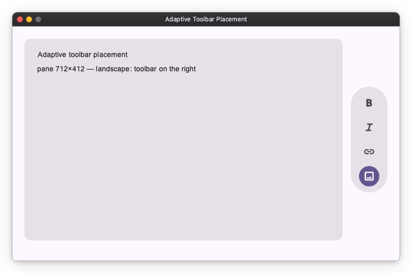
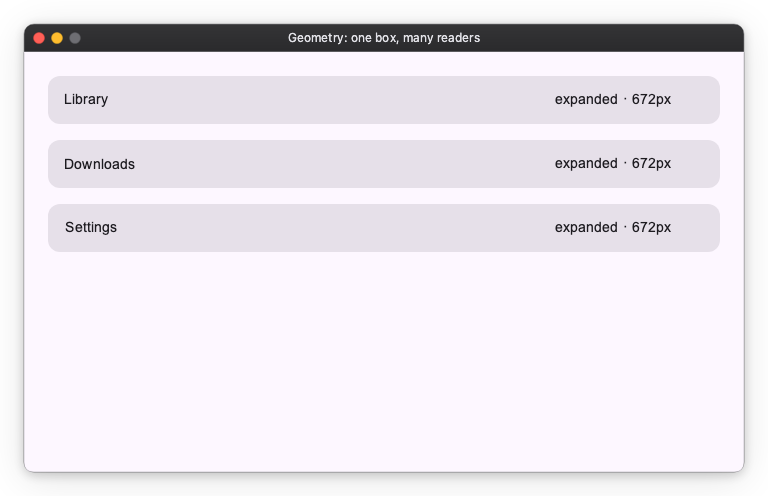

# Adaptive Layout

Some layouts need to change shape based on **how much space they have** — a
toolbar that moves depending on a pane's orientation, a panel that switches
arrangement once it gets narrow.

A widget cannot read its own size in `build()` — the parent decides that size
afterwards. So the size comes to you instead, as a `Size`: a `(width, height)`
pair. Whose size the widget reacts to picks the tool.

| The widget reacts to | Use |
| --- | --- |
| Its own size | `on_size_changed` |
| An ancestor's size, any number of levels up | `Geometry` |

## A widget's own size: `on_size_changed`

Attach `on_size_changed` to the widget whose size you want to know. The
callback is called with that widget's size whenever it changes.

```python
Column([...], width="wt").modifier(
    on_size_changed(lambda size: print(size.width))
)
```

Assign the size to a `State` in the callback and the widgets bound to it
update as usual. Those `State`s live in a plain `__init__`.

> **Mind the initial value.** The callback also runs once when the widget is
> first shown, not only when the size later changes — so whatever `State`
> you assign in it is overwritten right at startup. Give that `State` the
> value the starting size will produce. If the two differ, the UI shows the
> initial value for one frame and then switches.

### Example: Adaptive toolbar placement

A content pane places its toolbar by its own shape: a `VerticalFloatingToolbar`
on the right when the pane is landscape, a `HorizontalFloatingToolbar` on the
bottom when it is portrait.

A `Grid` holds all three widgets at once — card, right toolbar, bottom toolbar —
and each toolbar sits in a `Collapsible` that folds it away along its own axis.
The toolbar tracks are `"auto"`, so a collapsed toolbar takes its track with it
and the card reclaims the space. The callback only has to flip one flag.

```python
import nuiitivet.material as nv


class AdaptiveToolbarPanel(nv.ComposableWidget):
    def __init__(self) -> None:
        super().__init__(width="wt", height="wt")
        self._landscape = nv.State(True)      # this app's initial shape
        self._portrait = self._landscape.map(lambda landscape: not landscape)

    def _on_size(self, size: nv.Size) -> None:
        self._landscape.value = size.width >= size.height

    def build(self) -> nv.Widget:
        card = nv.Card(..., width="wt", height="wt")
        right_toolbar = nv.Collapsible(
            nv.VerticalFloatingToolbar(_actions(), style=nv.ToolbarStyle.standard()),
            opened=self._landscape, axis="horizontal",
        )
        bottom_toolbar = nv.Collapsible(
            nv.HorizontalFloatingToolbar(_actions(), style=nv.ToolbarStyle.standard()),
            opened=self._portrait, axis="vertical",
        )
        return nv.Grid(
            children=[
                nv.GridItem(card, row=0, column=0),
                nv.GridItem(right_toolbar, row=0, column=1, alignment="center"),
                nv.GridItem(bottom_toolbar, row=1, column=0, alignment="center"),
            ],
            rows=["wt", "auto"], columns=["wt", "auto"],
            row_gap=16, column_gap=16,
            width="wt", height="wt",
        ).modifier(nv.on_size_changed(self._on_size))
```

Keeping every widget in place, rather than swapping between two prebuilt
arrangements, means there is only ever **one** card: reflowing reshapes it
instead of replacing it, so a scroll position or a half-typed field inside it
survives. The toolbars animate in and out as a bonus.



> **Do not change the widget's own size from its callback** — assigning its
> `width`, for example. The new size calls the callback again, which changes the
> size again, and so on.

## An ancestor's size: `Geometry`

Sometimes the widget that needs the size is not the one that has it — a control
nested several levels down that has to react to the size of a pane above it.
Threading the value through every widget in between is not practical. Wrap the
pane in `Geometry` instead, and any widget below it reads the pane's size with
`nv.Geometry.proxy(self).size`. The call works in `__init__`, before the widget
is in the tree.

The `size` is a `State[Size]`. Bind it: map it into a `Text`, or into the
`opened` of a `Collapsible` as the toolbar example does. A `.value` read in
`build()` is the size at that moment, and the widget never updates.

### Example: One box, many readers

Three cards each hold a badge, and every badge shows the width of the pane
around the cards.

```python
import nuiitivet.material as nv

_WIDE = 600


class SizeClassBadge(nv.ComposableWidget):
    """A leaf, nested arbitrarily deep, that reads the pane it lives in."""

    def __init__(self) -> None:
        super().__init__()
        size = nv.Geometry.proxy(self).size      # the nearest Geometry above
        self._label = size.map(lambda s: f"{'expanded' if s.width >= _WIDE else 'compact'} · {s.width}px")

    def build(self) -> nv.Widget:
        return nv.Text(self._label, width=150)


class _Section(nv.ComposableWidget):
    """An intermediate widget: it holds a badge but knows nothing about size."""

    def __init__(self, title: str) -> None:
        super().__init__(width="wt")
        self._title = title

    def build(self) -> nv.Widget:
        return nv.Card(
            nv.Row([nv.Text(self._title), nv.Spacer(width="wt"), SizeClassBadge()],
                   gap=12, padding=16, width="wt", cross_alignment="center"),
            width="wt",
        )


# One Geometry around the pane: every badge below it reads this size.
nv.Geometry(
    nv.Column([_Section("Library"), _Section("Downloads"), _Section("Settings")],
              gap=16, width="wt", height="wt"),
    width="wt",
    height="wt",
)
```

`_Section` passes nothing down — it does not know that a badge somewhere inside
it cares about the pane's width. Move the badge elsewhere and it reads whatever
pane it lands in. The whole sample is `samples/layout/adaptive/scoped_size.py`.



The size starts as `Size(0, 0)`. Each badge reads `compact · 0px` when the
window opens, and the pane's width a frame or two later. Write the `map` so
that `Size(0, 0)` gives what the app should start with. After a resize the
badges follow one frame later.

### Keep in mind

- **The nearest `Geometry` above wins.** A widget with no `Geometry` above it
  reads the window's size.
- **Size the `Geometry` to measure a pane.** `width="wt"` and `height="wt"`
  make it take what its parent offers. With no size it wraps its child and
  measures the child.
- **In an event handler, `.value` is the size at that moment.**
- **The size is read-only.** A value the user also changes, such as a
  `NavigationRail`'s `expanded` that its menu button toggles, needs a `State`
  of its own. Put `on_size_changed` on the widget that owns that `State` and
  assign it there.
