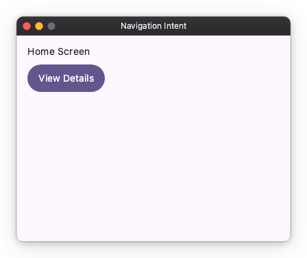

# Intent-Based Navigation

In larger applications, hardcoding widget creation inside your navigation logic can lead to tight coupling between different parts of your app. Nuiitivet provides an Intent-based navigation system to solve this problem.

## What is an Intent?

An Intent is simply a data class that represents a request to navigate to a specific screen. It can carry any data needed by that screen.

```python
from dataclasses import dataclass

@dataclass
class DetailsIntent:
    item_id: int
```

## Configuring Navigator.intents()

To use Intents, you create a Navigator with the `Navigator.intents(...)` factory and pass it to `App(Window(...))`. You provide a mapping of Intent types to route builder functions.



```python
import nuiitivet.material as nv

from dataclasses import dataclass


@dataclass
class HomeIntent:
    pass


@dataclass
class DetailsIntent:
    item_id: int

class HomeScreen(nv.ComposableWidget):
    def build(self):
        return nv.Column(
            padding=16,
            gap=12,
            children=[
                nv.Text("Home Screen"),
                nv.Button("View Details", on_click=lambda: nv.Navigator.of(self).push(DetailsIntent(item_id=42)), style=nv.ButtonStyle.filled()),
            ],
        )

class DetailsScreen(nv.ComposableWidget):
    def __init__(self, intent: DetailsIntent):
        super().__init__()
        self.intent = intent

    def build(self):
        return nv.Container(
            width="wt",
            height="wt",
            child=nv.Column(
                padding=16,
                gap=12,
                children=[
                    nv.Text(f"Details for item {self.intent.item_id}"),
                    nv.Button("Back", on_click=lambda: nv.Navigator.of(self).pop(), style=nv.ButtonStyle.filled()),
                ],
            ),
        ).modifier(nv.background("#F5F7FF"))

def build_root() -> nv.Widget:
    return nv.Navigator.intents(
        initial=HomeIntent(),
        routes={
            HomeIntent: lambda _: HomeScreen(),
            DetailsIntent: lambda intent: DetailsScreen(intent),
        },
    )

app = nv.App(
    nv.Window(
        content=build_root,
        title="Navigation Intent",
        width=400,
        height=300,
    ),
)
```

## Navigating with Intents

Once configured, you can navigate by pushing an Intent object to the `Navigator`. The `Navigator` will automatically resolve the Intent to the correct route using the mapping you provided.

```python
import nuiitivet.material as nv

def go_to_details():
    # Push an Intent instead of a Widget
    nv.Navigator.of(self).push(DetailsIntent(item_id=42))

nv.Button(
    "View Details",
    on_click=go_to_details,
 style=nv.ButtonStyle.filled())
```

## Giving a Screen Its Own Transition

A factory can return a `(widget, transition)` pair instead of a widget. That screen then moves with its own transition.

```python
import nuiitivet.material as nv

nv.Navigator.intents(
    initial=HomeIntent(),
    routes={
        HomeIntent: lambda _: HomeScreen(),
        DetailsIntent: lambda intent: (DetailsScreen(intent), nv.Transitions.empty()),
    },
)
```

`push(intent, transition=...)` raises `TypeError`. The transition belongs to the factory, so a hot reload that replays the intent restores it too.

## Navigating from a ViewModel

Intent-based navigation is highly recommended, especially when navigating from a ViewModel or controller. It allows your business logic to request a screen transition without needing to know how that screen is built or what widgets it uses. This separation of concerns makes your code more modular, testable, and easier to maintain.

Here is an example of how a ViewModel can trigger navigation using `Navigator` and Intents:

```python
import nuiitivet.material as nv

class ItemViewModel:
    # The navigator is passed in, so the ViewModel never touches a widget.
    def __init__(self, item_id: int, navigator: nv.NavigatorProtocol):
        self.item_id = item_id
        self._navigator = navigator

    def on_item_selected(self):
        self._navigator.push(DetailsIntent(item_id=self.item_id))


class HomeScreen(nv.ComposableWidget):
    def __init__(self):
        super().__init__()
        self.view_model = ItemViewModel(item_id=42, navigator=nv.Navigator.proxy(self))

    def build(self):
        return nv.Button("View Details", on_click=self.view_model.on_item_selected, style=nv.ButtonStyle.filled())
```

`HomeScreen` makes `nv.Navigator.proxy(self)` in its `__init__` and passes it to the
ViewModel's constructor.
[Giving a ViewModel the navigator](../state-management/patterns_and_recipes.md#giving-a-viewmodel-the-navigator-the-overlay-the-window-or-the-app)
covers why it is not `nv.Navigator.of(self)`, and what `push()` does once the screen
has been popped.

Because the ViewModel only depends on `NavigatorProtocol` and `DetailsIntent`, you can test the navigation decision logic in isolation.

## Testing a ViewModel

A fake needs only `push()`, `pop()`, and `can_pop()` — no widget tree, no `App`.

```python
class FakeNavigator:
    def __init__(self):
        self.pushed = []

    def push(self, screen, transition=None):
        self.pushed.append(screen)

    def pop(self):
        if self.pushed:
            self.pushed.pop()

    def can_pop(self):
        return bool(self.pushed)


def test_selecting_an_item_navigates_to_details():
    navigator = FakeNavigator()

    ItemViewModel(item_id=42, navigator=navigator).on_item_selected()

    assert navigator.pushed == [DetailsIntent(item_id=42)]
```

For the overlay side of the same boundary, see
[Dialogs](../overlay/dialogs.md#architecting-dialogs-in-mvvm).
