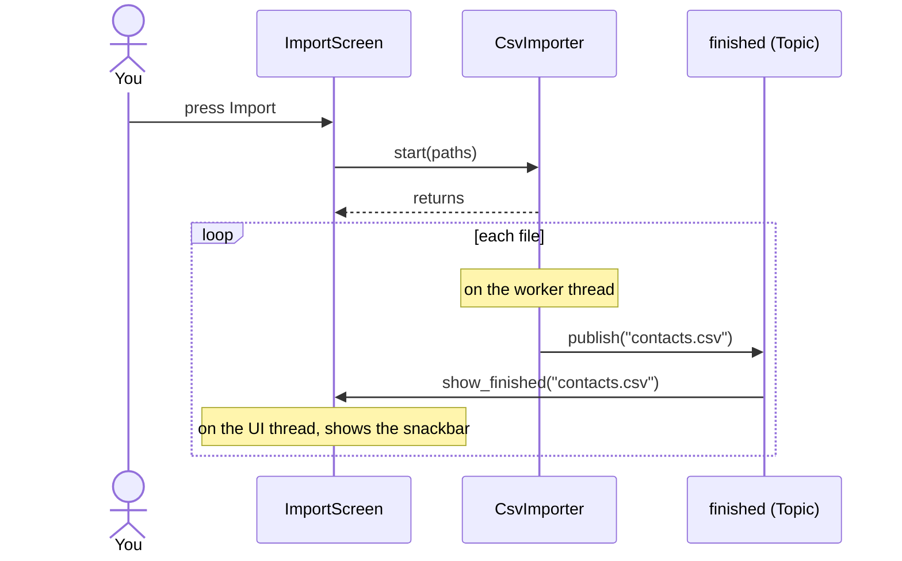
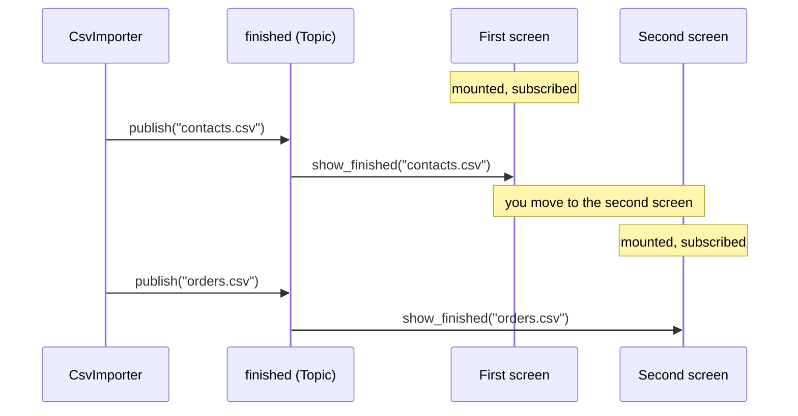

# Events with Topic

A `State` is what the screen shows: a title, a list, a progress bar. You bind
a widget to it and write nothing more.

A dialog or a snackbar is shown by a call instead, such as
`nv.Overlay.of(self).snackbar("Saved")`. You make the call in an event
handler, like a button's `on_click`.

Now a worker thread imports several CSV files, and you want a snackbar each
time one is done. A `State` does not fit. Subscribing to it runs your method
when its value changes, not each time a file is done.

A `Topic` is for this. You subscribe a method, and it is called each time you
publish. Here, the import publishes when a file is done, and the subscribed
method shows the snackbar.

## Show a snackbar when a file is done

The diagram follows one press of Import to the snackbars:



### 1. Publish when a file is done

Declare the `Topic` on the class that runs the import. Call `publish()` each
time a file is done:

```python
import threading
import time

import nuiitivet.material as nv


class CsvImporter:
    finished = nv.Topic[str]()

    def start(self, paths: list[str]) -> None:
        threading.Thread(target=self._run, args=(paths,), daemon=True).start()

    def _run(self, paths: list[str]) -> None:
        for path in paths:
            time.sleep(0.5)  # stand-in for importing one file
            self.finished.publish(path)  # on the worker thread
```

The type in the brackets is what the subscribed method receives. Each
`CsvImporter` has its own `finished`.

### 2. Show the snackbar

Subscribe a method of the screen in `on_mount`. Hand the result to `bind()`,
and the method is not called after the screen unmounts:

```python
class ImportScreen(nv.ComposableWidget):
    def __init__(self, importer: CsvImporter) -> None:
        super().__init__()
        self._importer = importer

    def on_mount(self) -> None:
        super().on_mount()
        self.bind(self._importer.finished.subscribe(self.show_finished))

    def show_finished(self, path: str) -> None:
        nv.Overlay.of(self).snackbar(f"Imported {path}")

    def _import(self) -> None:
        self._importer.start(["contacts.csv", "orders.csv", "products.csv"])

    def build(self) -> nv.Widget:
        return nv.Column(
            padding=24,
            children=[nv.Button("Import", on_click=self._import, style=nv.ButtonStyle.filled())],
        )
```

Press Import, and a snackbar appears for each file, in the order the files
finish. `publish()` runs on the worker thread. `show_finished` runs on the UI
thread.

The whole screen is `samples/state-management/topic.py`.

## Keep in mind

### A publish reaches the screens subscribed at that moment

Start the import on one screen and move to another. The files that finish
after the move reach the second screen only:



### Subscribe a method, not a lambda

Pass `subscribe()` a method or a module-level function. A lambda, or a
function defined inside another, is never called unless you keep what
`subscribe()` returned. Nothing reports it.

## When a State is the right tool

- Something the screen keeps showing, such as the number of files imported
  so far.
- Progress within one file. Publishing once per row of a 400,000-row file
  freezes the window for over a second. Put the row count in a `State`, and
  the progress bar [shows the newest value and skips the rest](background_work.md#skipped-values-are-the-point).

---

## Next Steps

- [Patterns and Recipes](patterns_and_recipes.md)
- [State Management Overview](index.md)
