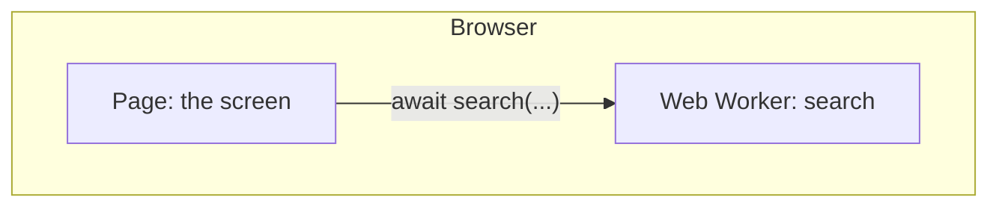
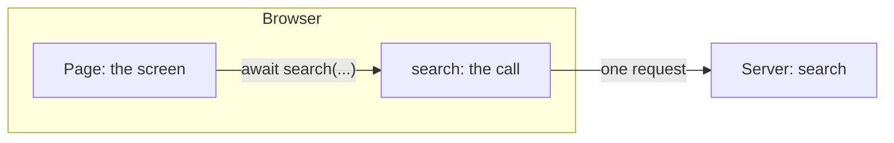

# Worker and Server Functions

An app runs in a browser from the source it runs on the desktop, and the
browser has one thread. `threading.Thread(...).start()`,
`asyncio.to_thread(...)` and `switch_map` with a plain function raise
`RuntimeError: can't start new thread`, and the handler dies there.

A worker function is the API for that work. On the desktop it runs on a
thread the runtime owns; in the browser it runs on a Web Worker, a second
Python the page starts beside the app's. The same function marked
`@nv.server` runs on a server instead; on the desktop it runs on a thread
all the same. The screen's code is the same on both targets and under both
marks, and so is the function's.

## Worker Function



### Mark the function and await it

```python
# jobs.py
import nuiitivet.material as nv

WORDS = [f"word{n}" for n in range(50_000)]


@nv.worker
def search(query: str) -> list[str]:
    return [word for word in WORDS if query in word]
```

```python
# app.py
from jobs import search


class SearchScreen(nv.ComposableWidget):
    query = nv.Observable("word1")
    status = nv.Observable("")

    async def search(self) -> None:
        self.status.value = f"{len(await search(self.query.value))} matches"
```

The function is a plain `def` at the top level of a module in the app's
directory, with every parameter and the return annotated. The screen awaits
it like any coroutine: the line after the `await` runs on the UI thread, with
the result, and the screen answers clicks while it waits.

In the browser the page runs one worker, which starts while the page loads;
a call made before it is up waits for it, about two seconds. Calls run one
at a time, in the order they were made: a call made while another runs
waits for it. On the desktop each call gets a thread of its own.

### Pass arguments and get the result

Arguments and the result are copied, and the type annotation decides how.
The function never sees the caller's objects, on the desktop either: a list
appended to inside the function stays as it was in the caller.

| Annotation | Carries |
| --- | --- |
| `None`, `bool`, `int`, `float`, `str`, `bytes` | The value; an `int` passed for a `float` arrives as a `float` |
| `datetime`, `date` | The value |
| An `Enum` subclass | The member |
| A dataclass of these | A dataclass of the same class |
| `list[T]`, `tuple[T, ...]`, `tuple[A, B]`, `dict[str, T]`, `Optional[T]` | The container, of these |

A value of another type, including a `bool` where an `int` is declared, is
refused with the argument named. An annotation outside the table, `Any`,
`object`, `set`, a plain `list`, is refused when the module imports.

### Report progress

A parameter annotated `nv.WriteOnlyObservable[T]` is written by the function
and read by the screen:

```python
@nv.worker
def search(query: str, progress: nv.WriteOnlyObservable[float]) -> list[str]:
    matches: list[str] = []
    for index, word in enumerate(WORDS):
        if query in word:
            matches.append(word)
        if index % 500 == 0:
            progress.value = index / len(WORDS)
    return matches
```

The caller passes an `nv.Observable[T]` and binds it as usual:

```python
class SearchScreen(nv.ComposableWidget):
    progress = nv.Observable(0.0)

    def build(self) -> nv.Widget:
        return nv.LinearProgressIndicator(value=self.progress)

    async def search(self) -> None:
        matches = await search(self.query.value, self.progress)
```

Each write lands on the caller's observable on the UI thread. A tight loop
can write as often as it likes: the screen sees the latest value per frame.
The function cannot read the observable back, and a type checker says so.

### Cancel

A parameter annotated `nv.CancelToken`, with `nv.CancelToken()` as its
default, is set when the caller gives up. The function checks
`cancel.cancelled` and returns:

```python
@nv.worker
def search(
    query: str,
    progress: nv.WriteOnlyObservable[float],
    cancel: nv.CancelToken = nv.CancelToken(),
) -> list[str]:
    for index, word in enumerate(WORDS):
        if cancel.cancelled:
            break
        ...
```

The caller gives up by cancelling the task that awaits the call:

```python
    async def search(self) -> None:
        self._task = asyncio.ensure_future(search(self.query.value, self.progress))
        try:
            matches = await self._task
        except asyncio.CancelledError:
            self.status.value = "cancelled"

    def cancel(self) -> None:
        if self._task is not None:
            self._task.cancel()
```

The caller never passes the token; the default is the one that gets set. A
function with no `CancelToken` parameter runs to the end whatever the caller
does.

In the browser a running worker function is not told to stop: the page ends
the worker it runs on and starts another. The next call waits for that
start, about two seconds.

### Handle an error

A built-in exception raised in the function, a `ValueError`, a `KeyError`,
reaches the caller as itself. Any other class reaches it as
`nv.RemoteError`, whose text is the class name and the message:

```python
        except ValueError as error:
            self.status.value = str(error)
        except nv.RemoteError as error:
            self.status.value = str(error)  # "Rejected: not for you"
```

A `ConnectionError` says the function never answered: the worker stopped,
or the server could not be reached.

### Cap the calls that run at once

```python
@nv.worker(parallel=3)  # up to three calls at once
def search(query: str, progress: nv.WriteOnlyObservable[float]) -> list[str]:
    ...
```

The number is the function's ceiling: three calls of `search` run at once
and the fourth waits for one of them to return. On the desktop each runs on
a thread from a pool; in the browser, on a Web Worker, so the page starts
up to three. Without a number a thread is started per call and the page
runs one call at a time.

The pool is everyone's. Every numbered function shares one pool, as large
as the largest number among them and, in the browser, never larger than the
machine's cores. A function that fills the pool makes another wait, within
its own ceiling.

### Run calls in a process

```python
@nv.worker(process=True)  # a child process instead of a thread
def search(query: str, progress: nv.WriteOnlyObservable[float]) -> list[str]:
    ...
```

On the desktop the calls run in a child process, one at a time; with
`parallel=N` as well, in up to N child processes. Reach for it when the work
is pure Python that should use another core, when a loop that never checks
its token must still be stoppable, or when native code may crash and must
not take the window with it. The browser ignores the flag: there every call
already runs in a Web Worker.

A Python starts when a call needs it. The first call waits for the first
one, about 0.3 seconds on the desktop and about two in the browser; the
second concurrent call waits for the second. `warm=True` starts them with
the app instead:

```python
@nv.worker(parallel=3, process=True, warm=True)  # the three start with the app
def search(query: str, progress: nv.WriteOnlyObservable[float]) -> list[str]:
    ...
```

The warmed Pythons belong to the pool, so every function uses them. Each one
holds memory for as long as the app runs: tens of megabytes on the desktop,
60 to 100 in the browser.

Cancelling a call ends the Python running it, on both targets; the function's
`CancelToken` is never set, so a function marked `process` needs none. The
pool starts another Python when a call needs it. On a thread, cancelling
sets the token as it always does.

A child process imports the function's module by name, and your entry
script the way `multiprocessing` does, so `app.run()` stays under
`if __name__ == "__main__":`. An app frozen with PyInstaller calls
`multiprocessing.freeze_support()` first under that line. Under
`python -m nuiitivet.dev run`, a saved edit reaches the pool at its next
call: an idle Python is replaced at once, a busy one after its call.

## Server Function

A server function does the same work on a server instead of in the browser.



### Mark the function and await it

```python
# jobs.py
import nuiitivet.material as nv

WORDS = [f"word{n}" for n in range(50_000)]


@nv.server
def search(query: str) -> list[str]:
    return [word for word in WORDS if query in word]
```

The screen imports and awaits it as it does a worker function, and the rest
is written the same way: the arguments and the result, progress, cancel,
and the errors. A function moves between the two marks without a change to
its body or its callers.

## Choose between the two

A worker function runs in the browser, on the user's machine. A server
function runs on a server, one request per call. What the table lists
follows from that:

| | `@nv.worker` | `@nv.server` |
| --- | --- | --- |
| Start-up | A second Python boots with the page, in parallel; a call made before it is up waits, about two seconds | The server process is already running |
| A call | About a millisecond, no network | One round trip to the server |
| Cancel | The worker is ended and another starts; the next call waits for it, about two seconds | The function stops where it checks the token |
| Computing resources | The user's machine, within what a browser tab may hold | The server's |
| Libraries | What Pyodide runs: pure Python, and the packages Pyodide ships. Each one is downloaded with the page | Anything installed on the server, imported in a module kept there |
| Deployment | The site alone, on any file server | A Python process beside the site |
| Security | The function's code and data are in the browser, where anyone can read them | The same, unless the module is kept on the server |

Mark the work `@nv.worker` unless a row above says otherwise.

## Keep a module on the server

Your function's module goes to the browser with the rest of the app. Two
kinds of module should not: one that imports a package the browser's Python
does not have, `psycopg2` say, which stops the app from starting in the
browser; and one that holds a key you do not want anyone to read. Put
`nv.server_only()` at the top of such a module and it stays on the server.
For a package, the call goes in `__init__.py` and covers every module in
it:

```python
# backend/__init__.py
import nuiitivet.material as nv

nv.server_only()  # nothing under here reaches the browser
```

```text
myapp/
├── app.py          # the screens; python -m nuiitivet.web run app.py
├── jobs.py         # @nv.worker and @nv.server functions the browser may see
└── backend/
    ├── __init__.py # nv.server_only()
    └── search.py   # @nv.server functions that import the server's libraries
```

## Full samples

`samples/web/worker_functions/` and `samples/web/server_functions/` are the
same app: a search for the words within one edit of the query, with
progress, a Cancel button, and a button to click while it runs. The first
marks `search` in `jobs.py` as a worker function; the second marks it as a
server function. Search for `word1`, cancel a
search, clear the field to see the `ValueError`, and look for `secret` to
see the `RemoteError`.

## Next Steps

- [Building and Deploying](building_and_deploying.md)
- [Web overview](index.md)
